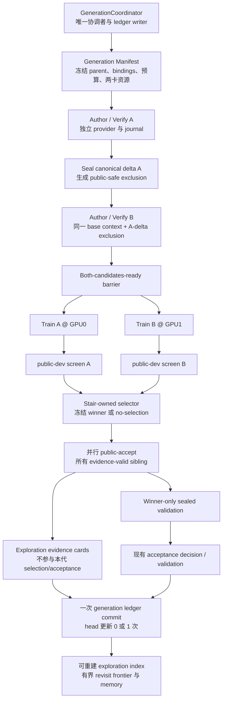

# 双卡 Generation 与探索价值系统升级计划

> 文档状态：P0–P6-A2 已完成工程实现与技术验收；P6-A 为 G2 资源 GO；P6-A2
> 机器结果 `12/15`、逐件人工保守结果 `11/15`、等价漏放 0，author-only 门为 GO；
> 用户已批准按 `P6-B → P6-C → P6-D` 顺序实施，当前进入 P6-B。任一阶段只有在严格
> GO、提交/同步和独立审计闭合后，下一阶段的条件式授权才生效。
> 初编日期：2026-08-12；按当前系统复核更新：2026-08-20。
> 适用仓库：`true_RL_Agent`；P0 历史审计基线 `e8b1e9e`，P5 发布基线 `86e5f48`，
> P6-A 运行提交 `4b2aefb`，P6-A2 plan/修正提交 `b5dff4d` / `bb226275`。
> 当前门禁：P6-A2 已达到 `>=10/15` 且等价漏放为 0，并完成 15 例逐件人工复核；
> 后续 generation 默认 provider 合同已经冻结。用户的顺序授权不允许跨过失败门、改动
> 冻结科学语义，或把一个阶段的 ledger/Genesis 拼接到下一阶段。

## 1. 结论摘要

本项目最合适的双卡升级不是把现有 `round` 复制两份并发执行，也不是引入通用 Graph/DAG、HPO 或分布式训练框架，而是增加一个固定宽度为 2 的 `GenerationCoordinator`：

1. 每个 generation 开始时冻结同一 current-best、base public context、训练初始化、评测绑定和成本上限；
2. 严格按 `A author/verify → 封存 A 的单机制语义 exclusion → B author/verify` 串行产生两个候选；该 exclusion 由现有 verifier 对“A 相对共同 anchor 的唯一变化组件”投影，忽略组件/函数改名并归一化数值参数；B 不得看到 A 的源码、rationale、provider response 或结果；每条 sibling trial 仍只允许一个可归因机制变化；
3. 两条 trial 分别绑定宿主物理 `cuda:0`、`cuda:1` 并行训练，并用同一 `public_dev` cohort 并行初筛；子进程内 CUDA ordinal 可由可信 resource binding 映射，不能与宿主物理身份混为一谈；
4. 由 Stair 插件拥有的确定性 selector 仅根据 `public_dev` 先排除明显越过 parent guard 硬回退上限的候选，再按 objective 排序冻结唯一 provisional winner；paired noise 只作为证据标签，只有完全并列或没有 guard-eligible 候选时才 no-selection；
5. 对所有具有完整有效 screen evidence 的 sibling 并行运行 `public_accept`，为 winner 和 loser 都留下较强公开证据；只有已冻结的 winner 继续运行 `sealed_validation` 并进入正式接受；
6. 整个 generation 只产生一次科学 ledger 提交，current-best 最多推进一次；
7. 每条具有 canonical candidate evidence 的闭合 trial 从 ledger 派生 context-scoped 探索证据卡；高价值 loser 进入有界重访前沿，公开负向证据只抑制 verifier 可证明等价的单组件语义，证据不足保持 unknown；`not_started` 与基础设施 partial 不生成科学卡；
8. ledger 仍是唯一科学权威，探索索引、重访前沿、可视化和 prompt memory 都可删除重建，不建立第二套可写实验数据库；
9. 正式 generation 会话允许在**同一 immutable session identity 内**按预承诺规则续行：lifecycle segments、logical-job attempts 和累计预算形成不可分叉的 hash chain。它不授权跨不同 15-generation 实验搬运证据，也不包含“失败后自动再开一场正式实验”的策略。

该方案的主要收益是将两个完整训练和两份公开评测的墙钟重叠，从而更快探索两个机制方向，同时不丢掉“效果不错但不是本代第一名”的证据。Authoring 改为串行会增加少量关键路径时间，但它让 B 在不接触 A 私有内容的前提下明确避开 A 已占用的单机制语义等价类，双方向成立不再依赖低 temperature 下的随机多样性，也不会被简单改名或换权重绕过。方案不会降低总训练工作量：每个 generation 的训练 allocated-active GPU-hours 约为单候选的 2 倍。基准评测上限为 23 seed-units（`2×public_dev + 2×public_accept + 1×sealed`）；仍明显低于两个候选都做完整 sealed 评测的 30 seed-units。成本控制来自固定宽度、固定预算、winner-only sealed、禁止同代 fallback，以及有界而非无限扩张的经验投影。

## 2. 当前真实基线与实施前置条件

### 2.1 已核实的代码边界

- 当前 live loop 每次只 author 一个候选并调用一次 `run_candidate_round()`；`run_candidate_round()` 仍同时完成候选验证、job materialization、训练、完整评测、决策、单候选 record 构造和 ledger append。
- acceptance replay 仍按 ledger 顺序逐条推进 current-best。因此不能并行调用两个现有 round；先提交的 sibling 会改变后一个的 parent 语义。
- 当前单候选科学记录已经是 `true_rl_agent.ledger_record.v7`。v7 在 v6 的机制 delta 绑定之上增加了 round authoring anchor 绑定，但 record 原子单位仍是单候选 round；ledger writer 已复用共享 `fs_contract` 做进程锁下的原子替换。
- 当前 runner 仍使用阻塞式 `subprocess.run(..., capture_output=True)`，不足以可靠拥有两个长时间 Isaac 子进程的独立进程组、取消和恢复。
- Train/Eval spec 和 summary 已绑定并校验 `execution_device`。新正式 Genesis 还会冻结 backend-owned Isaac/RSL-RL execution-environment manifest，train/eval 子进程在 simulator 启动前重算并由 runner 精确核验。该 manifest 刻意不包含 GPU、driver 或机器资源，因此它是双 lane 共享的软件执行身份，不是 per-lane GPU resource plan 的替代品。
- 当前 `RoundAuthoringJournal`、authoring evidence v4 和 continuation 已能持久化 attempt 预算、首个真实 prompt/parent anchor 与中断恢复；串行 A/B authoring 仍应各复用一套独立 journal，以隔离 lane identity、预算和 continuation，而不是共享可变状态。
- 当前 `OpenAICompatibleCandidateProvider` 在实例内维护递增 counter 和输出命名空间。A/B 即使串行调用，也必须使用 lane-local provider 实例、输出目录、journal 和预算账户，避免恢复或审计时混淆两条 lane。
- Stair 底层 `execute_stair_evaluation()` 已支持显式 split 子集；正式 round 入口仍一次固定执行 `public_dev + public_accept + sealed_validation` 三个 split。
- `TaskPlugin` 已是任务语义边界：`src/true_rl_agent/tasks/base.py:136-181`。双选 selector 应作为可选 task-owned adapter，公共层不得读取 Stair cell、失败类型或 sealed 内容。
- 当前新候选严格限制为一个 canonical mechanism delta：`src/true_rl_agent/candidates/authoring_policy.py:15`。双卡方案不放宽该约束，而是让 A、B 各自提出一个不同的单机制 trial。当前 v1 delta 主要表达组件身份，不能可靠区分新增、删除、修改或重命名；在用于 sibling 去重和探索索引前，必须由 verifier 单源派生带 operation、before/after identity 与 source hash 的下一版 delta，投影层不得自行猜测。
- 当前 experiment memory 有 14 KiB 硬上限：`src/true_rl_agent/agent_core/experiment_memory.py:24`，已经保存候选组件、公开 objective/guard delta、decision reason 和部分失败门，但没有“高价值未选 sibling 的重访资格”这一稳定语义。升级应复用这一投影链并按 generation 压缩，不能新增平行经验库，也不能让 prompt 历史按 lane 数线性膨胀。

### 2.2 已完成、不得在本计划中重复建设的基线能力

当前主线已经包含 eval-v6 稳定到顶主成功语义、sealed 可重算证据、候选/机制身份单源化、prompt 容量约束、authoring anchor/continuation、ledger v7、backend execution-environment identity、live invocation 生命周期证据和旧 ledger 能力分派。本计划将这些视为不可退化的基础，不再创建并行的语义、hash 或 evidence schema。候选 ID 的 80 字符可移植路径合同、共享 `fs_contract`、provider 32,768 output-token 默认上限与 512 KiB response envelope、Session Genesis v3、authoring evidence v4 和 live summary v6 同样属于已完成基线，只能复用或版本化扩展，不能在 generation 层各造一份近似合同。

Stair 还已具备一条 task-owned session-end final-confirmation 链：计划在 Genesis 前 create-once，并绑定独立 private cohort；15 个单候选 round 闭合后，只允许在同一 7-seed cohort 上按 `Genesis → final current-best` 顺序执行一次配对诊断。reservation/result 为 single-use，完整 35-cell summaries 与 paired delta 可重算，但 `acceptance_authority=false`、不写 ledger/prompt/history/memory，也不提供新的 pass/fail 决策。正式 Stair 入口进一步要求从空 ledger 开始、恰好一个 live invocation 闭合全部 15 个 round。2026-08-15 的 P0 审计确认 `e8b1e9e` 正式 live 已闭合 15/15 round、唯一 invocation completed，服务器尚未运行终局配对诊断；服务器入口仍有把公开 `artifact://` URI 当本地 checkpoint 路径的确定性缺口，本地工作树中的用户修复及回归已通过但未同步。双卡计划必须扩展并复用这条权威链，不能另建一个竞争的 terminal-audit 真相源。

2026-08-15 P0 基线：

- HEAD 与 origin 为 `e8b1e9e`；
- `git diff --check` 通过；
- 干净提交 `e8b1e9e` 的可复现完整测试基线为 `Ran 1150 tests; OK (skipped=20)`；P0 开始前工作树另含用户的 final-confirmation 修复及 3 个测试，形成 `1153/20` 的入场基线；P0 verifier 根修及数值结构边界纠偏后，当前未提交集成候选为 `1156/20`。三者必须分栏记录，未提交工作树结果不得冒充 commit 基线；
- 工作树中已有用户的 output/follow-up 产物，本计划的实施不得批量 stage、移动或删除这些内容。

### 2.3 活动正式实验与硬前置门

服务器上的轮次、GPU 和磁盘状态是会变化的运行事实，不复制为本计划中的固定快照。P0 必须重新读取最新 follow-up、ledger、live invocation、runner summaries 和服务器进程；本计划不依据旧 PID 或旧阶段描述判断当前状态。现有 width=1 正式会话及其 single-invocation 合同保持原样，本计划只为未来 generation session 定义新版本能力。

实施前必须满足：

1. 当前单候选正式实验自然闭合，或由用户明确停止并判定其只保留为何种证据；
2. ledger、lifecycle、partial round、GPU 进程和正式结果完成审计；
3. 形成当前单候选训练墙钟、评测墙钟、API 用量、磁盘增长、GPU/RAM 峰值的实际基线；
4. 明确开发基准 commit，并再次确认本地、origin、服务器版本关系；
5. 不在正在运行、已中断或已经 final-confirmation 预承诺的正式目录/ledger 上试验 generation 协议；width=2 必须使用新的 output、plan、Genesis 和 ledger record kind。

P0 已确认前四项的可持久证据并写入 [`P0_BASELINE_AND_PROTOCOL_FREEZE_ZH.md`](P0/P0_BASELINE_AND_PROTOCOL_FREEZE_ZH.md)。当前正式 live 已自然闭合且 GPU 空闲；终局 final-confirmation 尚未执行，原正式目录只读保留。历史产物没有持久化 GPU/RAM 峰值，因此该项被诚实记录为测量缺口，留给 P1 receipt 与 P6 pilot 产生，不以口头估计填充。

## 3. 目标、成功标准与非目标

### 3.1 目标

| 目标 | 可验收结果 |
|---|---|
| 更快探索 | 同一 generation 内两个不同机制训练高度重叠；screen-tier 候选吞吐接近单卡的 2 倍 |
| 成本可控 | 每 generation 最多 2 次正式训练、2 次 public-dev、2 次 public-accept 和 1 次 winner sealed；attempt、input/output units、金额、env/control steps、allocated-active GPU-hours 和磁盘上限全部写入 Genesis |
| 评价可信 | selector 只使用 public-dev 的 objective、parent-relative guard 硬上限并在 public-accept 产生前冻结；它只分配后续资源，正式接受仍只消费 winner 的 public-accept、sealed 和所有 required gates |
| 单一真相 | ledger 是唯一科学权威；journal、receipt、探索索引、UI 都可验证或重建，不得自行推进 head |
| 可恢复 | 同一 generation session 内，已闭合 receipt 可验证复用，logical-job infra retry 和 lifecycle continuation 都必须进入不可分叉 hash chain；Genesis、session contract、final plan、ledger epoch、output root 与累计预算保持不变 |
| 兼容 | 当前 width=1/Push 的 round-v7 不退化；历史 v2/v4/v5/v6 ledger 继续回放，v3 继续 fail closed |
| 记忆有效 | 高价值 loser 可被后代重访，完整负证据能减少相同错误；unknown 不被伪装成低价值，且 prompt 不暴露 sealed/raw/private 数据 |

### 3.2 第一版明确不做

- 不引入 LangGraph、Ray、Temporal、Optuna、Hydra、Submitit、MLflow/W&B 作为主执行或科学记录系统；
- 不使用 DDP 把两张卡投入同一个 policy 的梯度同步；
- 不使用 PBT、checkpoint 合并、训练中机制交换或动态权重复制；
- 不启用 ASHA/Hyperband 或基于训练 reward 曲线的早停；
- 不让 LLM 决定拓扑、GPU、seed、预算、selector、evaluation 或 retry；
- 不共享同一个 provider 实例；A、B 使用 lane-local provider/output/journal 严格串行 author/verify。A 完成后，现有 verifier 以 A 与共同 anchor 投影唯一变化组件的任务中立语义签名；B 的 provider prompt 只接收净化后的 exclusion payload/hash。私有 authoring evidence ref 只留在 coordinator/journal 绑定链中。B 不得看到 A 的 rationale、源码、provider response、路径、训练或评价结果，也不得按 A 的内容动态改变预冻结 lane intent；
- 不在 public-accept 或 sealed 上挑 winner；
- winner 正式失败后不回头正式评测 loser；
- 不维护两个 current-best、Pareto head 或自动合并两个候选；
- 不建立可写 graph database，也不把运行调度图和科学证据图混成一套系统；如需图形展示，只从 ledger-derived exploration index 临时生成；
- 不引入全局 0–100 “机制分”、UCB/MCTS 或自动策略树；当前最多 30 个 trial、parent 持续变化且每个候选通常只有一个训练实例，这些条件不支持把 context-specific 观察伪装成稳定全局价值；
- 第一版在 selector 冻结后并行完成有效 sibling 的 public-accept，再仅对 winner 做 sealed；不让 loser 的 public-accept 反向改变本代选择或正式接受。
- 不设计跨不同完整 15-generation session 的自动重试、择优恢复或证据拼接；本版 continuation 只服务当前获批的同一个 session，链无法合法继续时保持 incomplete 并停止。

## 4. 对成熟项目和技术的取舍

| 技术 | 借鉴内容 | 当前决定 |
|---|---|---|
| Python `Popen` / POSIX process group | 精确启动、轮询、超时、TERM→grace→KILL、wait/reap | 直接采用；保持零新增 production dependency |
| Ray Tune | per-trial 资源声明、固定并发上限、barrier、trial 状态 | 只借鉴模型；不引入 Ray runtime。Ray 的资源声明主要用于调度，且会使用 `CUDA_VISIBLE_DEVICES`，与当前物理 device 合同存在额外转换面 |
| Temporal | 确定性 orchestration、外部副作用 receipt、幂等 key、可配置 retry | 只借鉴原则，并在本项目强制有限上限；不部署服务、数据库和第二套 event history |
| Optuna | 并行 study、Journal/RDB storage、pruner | 不进入机制主线；会形成第二套 study/storage 权威，且当前 width=2 太小 |
| Nevergrad | ask/tell 黑盒数值优化 | 不进入机制主线；候选是受验证的程序机制，不是普通参数向量 |
| ASHA / Hyperband | 多 fidelity 资源分配和早停 | 暂不采用；需先证明中间指标可靠预测 eval-v6 正式能力，且当前只有两个 trial |
| Hydra / Submitit | 配置 multirun、Slurm 提交和重排队 | 当前单机双卡不采用；Genesis/job spec 已是配置真相，且当前环境不是 Slurm |
| MLflow | parent/child run 展示和指标检索 | 未来可选的 ledger 后置只读投影；不得参与 selection、acceptance、replay 或 prompt |
| W&B Artifacts | artifact lineage DAG 与可视化 | 当前不采用；会引入外部状态、存储和 GC 成本，不能替代 ledger |
| PyTorch DDP | 单个模型的多卡同步训练 | 不作为当前目标；它可能缩短单 policy 训练，但不能扩大机制探索，并会改变 training binding |
| PBT | population exploit/explore | 明确排除；会破坏共同初始化、单机制归因和清晰 parent lineage |
| MAP-Elites / Quality-Diversity | 不只保留单一赢家，而是保存质量较高且方向不同的 stepping stones | 借鉴“质量与多样性并重”和“好 loser 可重访”；不维护 policy/checkpoint archive，不引入行为网格，也不把 trial value 当 acceptance |
| Contextual bandit / UCB | 按证据和不确定性平衡探索与利用 | 只借鉴 unknown 不能当 negative、探索必须保留新方向；不直接采用 UCB，因为 arm、parent 和 reward 语义都在变化，样本量也远不足以校准 bandit regret |
| 选择/评测分离与 adaptive holdout | 先选定候选再用未参与选择的证据确认，限制重复查询隐藏 cohort | selector 在 public-accept 前冻结，sealed 每代最多查询 winner 一次，并保留不反馈的终局 cohort；双 public-accept 只增加公开经验，不增加 sealed 选择机会 |

参考依据：

- [Python subprocess 官方文档](https://docs.python.org/3/library/subprocess.html)
- [Ray Tune 资源与并发](https://docs.ray.io/en/latest/tune/tutorials/tune-resources.html)
- [Ray Placement Groups](https://docs.ray.io/en/latest/ray-core/scheduling/placement-group.html)
- [Temporal 官方文档](https://docs.temporal.io/)
- [Temporal 架构与 event-sourcing 原则](https://github.com/temporalio/temporal/blob/main/docs/architecture/README.md)
- [Temporal Retry Policy](https://docs.temporal.io/encyclopedia/retry-policies)
- [Optuna 并行化](https://optuna.readthedocs.io/en/stable/tutorial/10_key_features/004_distributed.html)
- [Nevergrad 官方入门](https://facebookresearch.github.io/nevergrad/getting_started.html)
- [Hyperband 论文](https://www.jmlr.org/beta/papers/v18/16-558.html)
- [ASHA 论文](https://arxiv.org/abs/1810.05934)
- [Hydra Submitit Launcher](https://hydra.cc/docs/1.3/plugins/submitit_launcher/)
- [MLflow Tracking](https://mlflow.org/docs/latest/ml/tracking/)
- [W&B Artifact Lineage](https://docs.wandb.ai/models/artifacts/explore-and-traverse-an-artifact-graph)
- [PyTorch DistributedDataParallel](https://docs.pytorch.org/docs/stable/generated/torch.nn.parallel.DistributedDataParallel.html)
- [PBT 论文](https://arxiv.org/abs/1711.09846)
- [CUDA 环境变量和设备可见性](https://docs.nvidia.com/cuda/cuda-programming-guide/05-appendices/environment-variables.html)
- [MAP-Elites 原论文](https://arxiv.org/abs/1504.04909)
- [Quality-Diversity Algorithms Can Provably Be Helpful for Optimization](https://arxiv.org/abs/2401.10539)
- [Quality-Diversity with Limited Resources（ICML 2024）](https://proceedings.mlr.press/v235/wang24cd.html)
- [Uncertain Quality-Diversity](https://arxiv.org/abs/2302.00463)
- [Multi-Objective MAP-Elites](https://arxiv.org/abs/2202.03057)
- [Introduction to Multi-Armed Bandits](https://arxiv.org/abs/1904.07272)
- [Improving Model Selection by Employing the Test Data（选择诱导乐观偏差）](https://proceedings.mlr.press/v97/westphal19a.html)
- [The advantages of multiple classes for reducing overfitting from test set reuse](https://proceedings.mlr.press/v97/feldman19a.html)
- [How Many Random Seeds? Statistical Power Analysis in Deep RL](https://arxiv.org/abs/1806.08295)

## 5. 目标架构与权威边界

### 5.1 固定拓扑

外层仍是 generation loop，authoring lane 内仍是现有 bounded repair loop。这里的“图”只是文档中用于说明固定的 fan-out、barrier、fan-in、确认和提交，不要求引入图框架。production 只需要显式 coordinator、typed receipt 和状态机；LLM 不能动态改拓扑。

### 5.2 单一真相分工

| 对象 | 权威范围 | 禁止事项 |
|---|---|---|
| Session Genesis | 既有 task/session/eval/backend identity；新版本只绑定 create-once generation-session contract hash/ref | 原地扩写 v3、复制合同字段或由 provider 覆盖 |
| Generation-session contract | width、writer kind、A-first/B-second authoring、selector/eval/provider/cost/retry/resource/continuation/final-plan 等会话级合同 | 每代重写、看到结果后调整或成为第二份 Genesis |
| Generation manifest | 引用 session contract，并冻结本 generation 的 parent/context/lane/idempotency 输入 | 重复抄写会话合同或作为 accepted 科学结果 |
| Trial receipt | 已完成外部副作用的 hash-bound 证据 | 自行写 ledger 或更新 current-best |
| Generation journal | pending/running/completed/failed 和 receipt ref | 保存第二份指标、decision 或 prompt truth |
| Lifecycle continuation chain | 同一 session 的 invocation segment 顺序、退出/恢复依据、ledger 高度与累计成本 head | 形成第二套科学 ledger、跨 session 搬运 receipt、分叉或重置预算 |
| Ledger | 唯一科学历史与 head transition | 被 exploration index/UI/MLflow 回写 |
| TaskPlugin | screen/selector/confirmation 的任务语义 | 把 Stair 字段放入公共 coordinator |
| Exploration index / revisit frontier / memory | 从已验证 ledger 派生的查询、价值卡和 prompt 投影 | 成为可独立编辑的经验数据库，或反向影响本代 acceptance |

当前 Session Genesis v3 并不拥有 generation width、selector、provider/cost policy 或 generation continuation 字段，因此不能原地假设这些字段已经由 v3 冻结。为避免 create-once 对象形成 hash 引用环，构造顺序固定为：①先创建独立 continuation-policy artifact，冻结允许的退出/恢复原因、segment 上限、logical-job retry 上限、累计预算和 exclusive lease 规则；②创建 pre-Genesis final-confirmation Plan，它只引用该 policy hash，不引用尚未产生的 generation-session contract/Genesis；③创建 task-neutral generation-session contract，引用 policy hash、Plan hash/ref、既有 backend execution-environment hash及 authoring/provider contracts；④由下一版 Session Genesis 绑定 generation-session contract hash/ref；⑤终局 Reservation 才绑定 Plan、Genesis、contract和实际 terminal heads。旧 v2/v3 仍按 width=1 只读。每代 Generation manifest 只引用 `session_genesis_hash + generation_session_contract_hash` 及本代冻结输入，不逐字段复制 transport、reasoning、output cap 或 plan commitment。A/B 共享同一个 backend 软件执行身份，但分别绑定 GPU0/GPU1 resource assignment；不得把共享 manifest 复制成两份可漂移的软件真相，也不得把 per-lane GPU identity 塞进该 task-neutral backend manifest。

### 5.3 统计和选择边界

- A、B 使用同一冻结 parent、训练初始化、训练 seed schedule 和 public-dev cohort；
- selector 是“资源分配排序”，不是“接受”，不得声明 3-seed public-dev 已统计证明能力，也不得复制 public-accept 的 headroom、动态 guard 或 sealed 门；
- selector 的固定规则、输入 schema 和 hash 进入 Genesis，并在任何 public-accept 结果产生前写出不可变 selection receipt；先用同一 public-dev cohort 相对当前 parent 的 guard 硬回退上限剔除明显不安全项，再始终按 generalization objective 排序。`1.5×paired_SE` 仅记录 `inside/outside estimated noise band`，不再决定是否放弃整代；objective 完全相同时可用 public-dev guard 作次序，只有 objective 与 guard 都完全相同，或两者均不具 guard 资格时才 `inconclusive_no_selection`；
- current parent 的 public-dev guard reference 必须来自已验证、同 evaluation domain 的既有 receipt/ledger 投影；A/B 可在不同 `execution_device/resource_binding_hash` 上运行，这两项必须显式记录并声明为允许比较差异，不能静默省略；
- selection 冻结后，所有具有完整、无基础设施污染的 public-dev receipt 的 sibling 都可运行 public-accept。loser 的结果只用于探索证据，不得重选 winner，也不得构造 accepted decision；
- winner 的正式决策仍只与冻结 current-best 比较，不把 sibling 对比混入现有 acceptance rule；只有 winner 的 public-accept 与 sealed 被 formal assembler 消费；
- sealed 在 selector 完成后才产生，且只为 winner 产生，仍是 fail-closed generalization gate；
- winner 正式失败后本 generation 结束；loser 即使 public evidence 很好，也只能进入未来重访前沿，不能在同代 fallback；
- public_accept cohort 在多代间仍会重复查询，因此其分数是“循环内公开证据”，不是独立泛化证明；prompt 只接收有界 aggregate/value card，不接收逐 seed 明细。winner-only sealed 和 session 末不反馈 cohort 是防止适应性过拟合的必要边界；
- 若未来需要对两个候选都正式下结论，必须另立多重比较/独立确认协议，不能悄悄扩展本计划。

### 5.4 探索价值、重访和避错边界

本计划不采用一个可随意加权的全局“机制分数”。单个候选通常只有一个训练实例，且每代 parent、已有组件和失败分布都会变化；同一机制在旧 parent 上的高分不能直接当作在新 head 上的真实价值。第一版使用由 ledger 事实确定性派生的 `ExplorationEvidenceCard`：

| 字段 | 含义 | 权威边界 |
|---|---|---|
| `context_binding` | task、parent/source、mechanism delta、training/eval contract 与证据来源 hash | 必须逐字绑定原 ledger/receipt，禁止跨 context 冒充可比 |
| `trial_status` | `not_started / candidate_failed / verified_not_run / screened_only / qualified_not_selected / formal_rejected / accepted` | 直接引用 generation schema 的唯一 closed enum，回答“本次实际发生了什么”；`not_started` 无 candidate、不得建卡，`verified_not_run` 只表示 sibling authoring 未齐备而未启动训练，不创建第二套映射状态 |
| `public_evidence_summary` | dev/accept 完整性、candidate 与共同 parent 的 objective/guard、delta、公开 gates/reason 和跨 split 方向 | 从公开 receipt 有界重算；保留价值依据，不含逐 seed、raw 或 sealed 指标 |
| `evidence_tier` | `verified / trained / public_dev / public_complete / formal` | task-neutral 的完成度；accepted 仍是 formal，不能被 lineage 状态覆盖 |
| `observed_effect` | `strong_positive / positive / mixed / neutral / negative / unknown` | 只由 task-owned projector 根据公开评测和 gates 派生；LLM 不可填写，accepted 也保留原公开方向 |
| `novelty_class` | `exact_new / explicit_revisit / exact_repeat` | 只由 verifier identity/hash 与 manifest-bound `inspired_by_trial_id` 派生，不用名字、embedding 或 LLM 猜家族 |
| `failure_scope` | `none / authoring_or_implementation / paired_authoring / scientific_public / formal_private / infrastructure` | 对 closed scientific trial 说明“什么失败了”；infra/partial journal 不形成科学 card |
| `lineage_status` | `independent / inspired / incorporated` | 只说明谱系关系和是否已进入 accepted lineage，不改变 evidence/effect |
| `revisit_disposition` | `priority / eligible / cooldown / suppress_equivalent / incorporated / not_evaluable` | 只决定未来 authoring 优先级，不参与 selection、acceptance 或 head replay |

派生规则必须简单、保守并可解释：

1. 未选中但具有完整 public-dev 与 public-accept、硬证据门通过，且相对共同 parent 呈一致正向或落入预注册“有意义但未胜出”区间的 sibling，标为高或中等重访价值；具体 materiality/mixed 阈值由 Stair task-owned policy 在 P0 基线后、任何 pilot 前冻结，不能看见 pilot 结果再调整。它不是 formal accepted，也不能继承旧 checkpoint。
2. 被接受的 trial 仍保留 `formal` evidence 和原公开 effect，同时将 `trial_status=accepted`、`lineage_status=incorporated`、`revisit_disposition=incorporated`；后代从 current head 的源码看到它，不再作为待重访 loser 重复提出。
3. 完整公开评测明确回退后，verifier 判定为同一种单机制语义实现的后续候选可 `suppress_equivalent`：两侧都相对各自 authoring anchor 提取唯一变化组件，比较组件种类、变化后是否存在、输入依赖、函数/clip 结构以及参数归一化签名，不比较 parent、source、组件名或函数名。归一化覆盖外层 `weight/clip/value` 等已声明参数，以及 callable 中的普通算术、缩放和阈值幅值；tensor 下标/slice，以及 reduction/shape 调用的维度/轴配置仍是结构身份。该判定可跨 parent 阻止 R1→R8 式改名/改权重重复，但 `[:,2]` 与 `[:,0]`、`sum(dim=1)` 与 `sum(dim=2)` 及其他结构不同的同输入变体仍可探索。
4. 已闭合的 provider/static 或 candidate-owned runtime failure 使用唯一 `candidate_failed` trial status，`observed_effect=unknown`、`revisit_disposition=not_evaluable`。provider 未产出 canonical candidate 时只保留 authoring failure 事实，不能凭空生成机制卡；已经封存 source/delta 的实现级重复继续由现有 verifier/history gate 负责，P5 不再复制第二套 exact-source blocker。基础设施失败、partial 或未闭合 journal 不生成 EvidenceCard，只在 operational lifecycle 中显示未完成。sealed/formal gate 失败只公开既有安全 reason code，不把 raw sealed 指标写入卡片；该 trial 在本 session 进入 cooldown，但隐藏证据不参与价值排序。
5. A authoring 失败时 A 以 `candidate_failed` 闭合，B 为 `not_started` 且不生成 EvidenceCard；若 A 已验证而 B 在自身 authoring budget 内失败，A 以 `verified_not_run` 闭合，`evidence_tier=verified`、`observed_effect=unknown`，B 以 `candidate_failed` 闭合。本 generation 的训练数为零、head 不变。不得把 A 伪装成 screened loser，也不得为“利用已生成的 A”静默降为 width=1。
6. 第一版只自动判断 verifier 可证明的“单组件 identical/parameter-only 等价”，不建立“机制家族”权威身份，也不做家族聚合或降权。不同 source/delta 若只是改名或数值参数变化，并不自动成为新证据；只有函数/clip/输入结构确实不同，或 manifest 明确指定某次重访时，才生成新实现证据或通过 `inspired_by_trial_id` 建立启发链。组件名字、rationale、embedding 或 LLM 判断都不能生成相似性事实。
7. 每个 generation 最多一条 lane 由 `RevisitFrontier` 指定为重访方向，且自动重访只服务公开证据充分的 `priority/high` 卡；`eligible/medium` 只作为提示。另一条 lane 始终保留给新的、针对当前失败的探索；没有合格 priority 项时两条都探索新方向。
8. 重访必须相对当时 current head 重新 author、重新封存单机制 delta、重新训练和评测；不得直接合并 sibling source、复用 loser checkpoint 或把旧分数搬到新 parent。current head 未变化时，也不得原样重跑同一 source/delta，只能提出有可验证结构差异的新实现。
9. 完整 exploration index 可由全部闭合 ledger 重建；`RevisitFrontier` 为审计和 prompt 保留 priority/eligible 项，但自动 lane 只从 priority 中选择，并按“等价机制服务次数少 → 相对 current head 的接受推进距离小 → task-owned 公开增益排序键高 → 更新近”确定顺序。同一 verifier-equivalence class 最多服务2次、任一等价卡取得 public evidence 即消费整类，超过1次 head transition 后过期；没有 public evidence 的失败重访也消耗一次服务机会。完整EvidenceCard、prompt和lane intent分别受12 KiB、6 KiB与generation-owned 2 KiB合同约束：完整证据不为适配提示而删除，prompt只投影最多2张正向卡、2张 recent verifier-equivalent avoidance和2条非阻断负向变体advisory，无法表达的卡整张省略并确定性记账；lane只携带有界preview及summary hash/省略信息。所有降级必须有限且每步严格前进。容量外每张frontier卡仍须有稳定queue position/deferred reason，不能只剩backlog数；最终experiment memory继续服从现有14 KiB总预算，压力不足时减少提示而不放宽上限。
10. exploration index 被关闭、删除或重建失败时，固定候选的 selection、acceptance 和 current-best replay 必须保持完全不变；最坏只能退化为没有历史启发，而不能改变科学结论。

## 6. 分阶段实施计划

下列工作量为单名熟悉项目工程师的有效工程人日区间，不包含当前 15-round 自然运行时间、GPU 排队或等待用户审批时间。串行 sibling authoring 减少了并发与冲突协调面；logical-job retry、prompt minimum-core 和正式同-session continuation 增加了可靠性工作。各阶段相加为 23–32 人日；考虑协议审计、兼容修正和真实 pilot 反馈后建议预留 25–36 人日。

| 阶段 | 目标 | 预计工作量 | 是否使用 GPU/API |
|---|---|---:|---|
| P0 基线闭合与协议冻结 | 结束并审计当前单卡正式实验，冻结可比较基线 | 1–2 人日 | 不新增；只读现有运行与产物 |
| P1 Runner、prompt 可靠性与资源治理 | 让一个 job 可被可靠拥有、有限重试、取消和回收；让合法 prompt 确定性降级到 minimum core | 3–4 人日 | 本地 fake；服务器仅非 GPU 进程树 smoke |
| P2 无副作用 Trial Executor | 将执行 trial 与 ledger/head mutation 分离，补最小幂等 receipt，保持 width=1 完全等价 | 4–5 人日 | 不需正式 GPU/API |
| P3 分阶段评测与成本收敛 | 建立双 public evidence、winner-only sealed 和等价 formal 聚合 | 4–5 人日 | 少量固定 checkpoint eval 验证 |
| P4 Width=2 Generation 与新 ledger | 实现共同 parent、串行 A→B author、ready barrier、两条执行 lane、单 selector、单 commit | 5–7 人日 | 先 fake runner，不用正式 API/GPU |
| P5 同-session continuation、探索索引与有界重访 | 完成正式 continuation chain、工程幂等验证、价值卡、重访前沿和 prompt 投影 | 5–7 人日 | 不需正式 GPU/API |
| P6 双卡 pilot 与分级放量 | 证明资源、成本、科学记录和故障收口在真实服务器成立 | 1–2 人日工程 + 受控算力 | 每一级都需用户单独批准 |

### P0：基线闭合与协议冻结

> 实施状态：2026-08-15 完成本地与服务器只读基线，2026-08-16 完成 verifier 根因纠偏与回归验收；当时“用户批准后才进入P1”的门已满足，当前P1–P5也已完成本地验收。执行清单见 [`P0_IMPLEMENTATION_PLAN_ZH.md`](P0/P0_IMPLEMENTATION_PLAN_ZH.md)，权威结果见 [`P0_BASELINE_AND_PROTOCOL_FREEZE_ZH.md`](P0/P0_BASELINE_AND_PROTOCOL_FREEZE_ZH.md)。

**目标**

在不触碰当前正式会话的前提下，获得后续所有效率比较所需的可信单卡基线，并清楚区分已经解决的问题、follow-up 观察和本计划新增范围。

**主要工作**

- 先实时确认当前正式会话是否已经启动/闭合；如已启动则等待其闭合或按用户指令停止，再审计 round-v7 ledger、live invocation、每轮 train/eval summary、prompt payload、final-confirmation 资格和资源成本；
- 记录单轮训练/评测/authoring 墙钟分布、GPU/RAM/磁盘峰值、API usage、接受/拒绝/基础设施失败分类；冻结 provider 计费单位、cache 计价、每次 request/response 上限和价格快照；
- 分别固化干净 `e8b1e9e` 的 `1150/20` commit 基线，以及“该 commit + 用户 final-confirmation 修复”的 `1153/20` P0 入场工作树基线；后续 P0 根修完成后再记录新的集成候选测试数和相关文件 hash，禁止用一个数字覆盖三种身份；
- 使用现有公开历史做只读回放，提出 Stair-owned value policy 草案：明确 `strong_positive / positive / mixed / neutral / negative / unknown` 的公开观测方向、`high / medium / low / unknown` 价值标签、可比 context 和证据门；verifier-equivalent 单组件语义负责科学排重，trial-specific exact implementation 只保留审计用途。不因历史上恰好出现的 winner 反向拟合复杂权重，也不猜测机制家族；
- 审计现有 verifier 的 `historical_mechanism_repeat` 与计划中的 verifier-equivalent single-component suppression 边界，冻结一个 verifier-owned repeat disposition；frontier 只引用该事实，不能再实现第二套“重复机制”分析器；
- 记录当前 provider temperature、reasoning mode 和已观察到的跨 session exact/near-exact mechanism repeat，作为“必须结构化排重”的证据；不以温度 sweep 决定正确性。generation 合同必须在 temperature 为 0、provider 返回相同候选、改名、改权重或出现 alpha-equivalent 实现时，仍由“各自相对自身 anchor 的单组件语义比较”与 verifier fail-closed 保证两个候选不同；
- 只把真实仍存在且有证据的 follow-up 纳入计划。

**严格验收**

- 目标进程树、tmux、GPU PID 与 lifecycle 状态一致；partial round 不计入 ledger；
- 全部闭合 ledger 可 replay，current-best 与正式结果一致；
- 本地全量测试仍通过，跳过数不得无理由增加；
- 生成一份不可变基线报告，后续性能阈值只引用该报告，不引用口头估计；
- provider 的计量字段、单次 input 上限 `I`、Genesis 冻结的单次 output 上限 `O`、512 KiB response envelope、transport policy、reasoning mode、reasoning effort、cache/普通计价和人民币或美元金额上限必须形成可审计草案；当前 provider/CLI 默认 `deepseek-v4-flash`、`reasoning_effort=max`、`O=32,768`，但计划以变量绑定而不把默认值冒充永久协议。这些数值未由用户批准时，P6 provider pilot 不得启动；
- value policy 只能引用公开、任务自有且已有 runner evidence 的字段；不得引用 sealed raw、provider rationale 或人工事后标签。其版本/hash须在 P6 前与 selector、成本合同一起获批冻结；
- repeat disposition 的 canonical identity、适用 context 和阻断范围必须有 golden/tamper 用例；同一输入不得在 authoring verifier 与 frontier projector 中得到相反结论；
- 冻结 A-first/B-second authoring 角色、B 可见的唯一 exclusion schema、provider temperature/reasoning policy 和 paired-ready 观测指标；exclusion 的 blocking 真相必须直接复用现有 verifier 的单组件等价原语，不能在 coordinator/frontier 再写一套判重。temperature 只能在新 generation-session contract 中预先更改，不能根据本 session 的碰撞或效果临时调参；
- P0阶段未经用户确认不得进入P1；该历史门已满足。当前门是未经用户验收不得进入P6。

### P1：Runner、Prompt 可靠性与双卡资源治理

**目标**

先把当前单 job 执行边界和 prompt 构建做可靠，再谈两个 job 并发；不在 coordinator 外层用两个线程包住现有阻塞 round，也不让一个可重试的基础设施故障或合法最大形状 prompt 直接毁掉整个正式 session。

**主要工作**

- 以小型 runner-owned process handle 替代长任务的 `subprocess.run` 所有权；
- 每 job 使用独立 process group、日志文件、timeout、有限 grace、强制回收和 wait/reap；
- 将当前笼统的 `RunnerExecutionError` 收敛为 closed typed ownership：只有预注册的 transient/infra failure 可重试；candidate-owned failure、科学 gate fail、binding/hash/contract/tamper mismatch 和确定性 invalid summary 一律不可重试；
- 为每个 logical job 建立 create-once `AttemptReservation → AttemptResult` 链。reservation 绑定 session/Genesis/contract、generation/lane、invocation segment、job spec/input/environment/device hash、attempt index 和预算预留；唯一一次同参数 infra retry 必须引用前一次 result hash，输入、device 和科学 job identity 不得变化，且失败 attempt 的成本不可删除或漏记。hard crash 若留下 reservation 而没有 result，只能由 P5 的 recovery inspector 在确认旧进程死亡后发布一次 `status=abandoned_unclean` result，引用 recovery receipt并按最坏预留成本结算，之后才可在剩余 reserve 内建立后继 attempt；
- 增加可信 GPU resource assignment/lease，绑定宿主物理 GPU identity/UUID、子进程内 ordinal、renderer 物理 ordinal 和实际 summary；P6-A 实证路径中，runner 仅对子进程注入计划 GPU 的完整 UUID，两条 child 内均使用逻辑 `cuda:0`；
- 显式关闭 Isaac renderer MGPU/auto-enable，并以 PID→GPU UUID 外部采样验证隔离；`multi_gpu=false` 单项不是充分证明；
- 把 prompt 容量合同改为“对所有 contract-valid、已受字段长度/数量约束的输入，确定性降级后必能产出文档化 `minimum_core`”。Stair task-owned projector 决定其最小语义内容：任务 objective/success、current-best source/ref/hash、candidate/authoring contract、latest closed outcome（bootstrap 时使用显式 `no_closed_outcome` sentinel）、lane intent、预算引用，以及 B 所需的 A-delta exclusion；公共层只负责 typed byte cap、稳定 omission receipt/hash 和最终验证，不理解 Stair 字段；
- 在 invocation journal 建立前执行最坏形状 prompt preflight。合法输入运行中不得以 byte overflow 抛出；非法、未受界或 tampered 输入仍 fail closed。若连 `minimum_core` 都无法容纳，必须在正式 invocation 开始前拒绝启动，而不是吞掉必要语义或运行到中途失败；
- 不新增 Ray/Temporal 等 production dependency。

**严格验收**

- 原 train/eval argv、summary、错误分类和 execution-device 校验不变；
- timeout、SIGINT、SIGTERM、启动失败、summary 缺失均不掩盖原错误，不遗留子孙进程；
- 首次 attempt 的 typed infra failure 在同一 session、同一 logical job、同一输入和足够预留预算下最多重试一次并成功闭合；candidate/scientific/binding/tamper failure 不产生 retry reservation；attempt 跳号、第二次 retry、缺前驱、未通过合法 lifecycle predecessor 的跨 segment 冒用、跨 session复用、device 或 job hash 漂移、reservation 后无 result 直接重试、遗漏失败成本均 fail closed；
- 两个 session 不能取得同一 GPU lease；异常退出后 lease 可安全恢复；
- 15 generations/30 trials 的 contract-valid 最大 prompt 形状必须稳定产出同一 `projection_level=minimum_core` 或更丰富层级，canonical bytes/hash 可重复，必要字段零缺失；测试同时覆盖 bootstrap sentinel、accepted-head、current-best source 合同最大字节形状、B exclusion 和 cap+1/tamper。非法长度和 tamper fixture 仍明确拒绝。Push/Neutral task 使用自身 task-owned minimum core，不引入 Stair 语义；
- Python 3.10 合同和服务器 Python 环境均通过相关测试；
- Windows 本地单测、Linux 非 GPU process-group 测试和全量回归均通过；
- P1 可单独回滚，不改变 ledger schema、任务语义或 prompt。

### P2：无副作用 Trial Executor 与 width=1 等价

**目标**

把候选准备、训练、评测、record 构造与 ledger append 分开；旧 `run_candidate_round()` 继续作为 width=1 wrapper。

**主要工作**

- 提取无 ledger/head 副作用的 trial 执行阶段；
- 定义 immutable train/eval receipt、稳定 idempotency key 和最小恢复加载器，并复用 P1 的 logical-job attempt chain；已闭合 receipt 可验证复用，半成品不得冒充完成；lane authoring 直接复用现有 `RoundAuthoringJournal`、durable attempt reservation、continuation、terminal-result 与 source-repository 恢复能力，只增加 lane/generation binding；
- 为 `authoring_evidence.json`、`attempt_result.json` 和 budget artifact 建立同一 task-neutral typed-size contract/实现原语，但每种 artifact 使用独立、公式化上限：budget 使用固定小 cap；attempt result 由冻结的 source/diagnostic/continuation 上限推导；authoring evidence 由 `max_attempts × 单 attempt 上限 + 固定区段` 推导。P0 的真实 15-round sizing 只用于校准 headroom，不是唯一依据；对应 Ref、producer 写前校验、cap+1 bounded reader、resume loader 和 verifier 必须引用同一个 type-specific cap；
- 将 verifier 已知的组件 diff 收敛为 task-neutral mechanism-delta 新版本，明确 `add/remove/modify/rename` 等 operation 及 before/after identity/hash；P2 只把它封存在 verifier-owned receipt，当前 round-v7 与历史记录继续按其既有 v1 能力投影，不改写旧 schema；
- 让旧 live loop、replay-only loop、Push 插件继续走同一源头的 width=1 wrapper；
- provider/static/candidate-runtime/infra failure 继续使用既有分类，不创建新含义相同的状态。
- lane/generation 归属优先由新 TrialReceipt 绑定现有 authoring evidence v4 ref/hash，保持 v4 字节合同不变；只有确实需要把新字段写入 evidence 本体时才版本化为 v5，禁止静默改变 v4。

**严格验收**

- 固定 fake 输入下，refactor 前后当前 round-v7 record 的 canonical public 内容、decision、gates、parent、round authoring anchor 和 current-best 结果一致；
- 每个 width=1 round 仍恰好 append 一次；shadow/fake 恢复测试中，append 前故障或 append 失败后的新进程可复用已验证 receipt，不重复训练，也不生成半条 ledger。当前 width=1 Stair 继续沿用既有 single-invocation 终局合同；future generation session 的跨进程 continuation 只能走 P5 的新版本链，不能通过放宽旧 schema 实现。CLI 在 journal 建立前的参数/preflight 失败不被误计为 invocation；
- receipt loader 必须绑定同一 session/Genesis/generation-session contract/ledger epoch/idempotency key；任何跨完整 session 搬运 receipt、预算或 lifecycle head 的尝试均拒绝；
- 当前 v7 与历史 v2/v4/v5/v6 golden replay 不变，v3 仍明确拒绝；
- Push 和所有非 Stair 插件默认 width=1，既有测试全部通过；
- mechanism operation 只能由 verifier-owned diff 生成；rename、add/remove、modify 和非法/unknown 输入均有 tamper 测试，history 层不能二次推断；
- 新 executor 不导入 Stair selector、sealed raw evidence 或 prompt memory。

### P3：分阶段评测、selector 边界与 eval 成本收敛

**目标**

建立真实的 `public-dev selection → 双 public-accept evidence → winner-only sealed confirmation`，既避免在 formal cohort 上挑 winner，也为好 loser 留下比 3-seed screen 更可信的公开证据。

**主要工作**

- 定义绑定完整 evaluation plan 的三个 phase receipt：`public_dev`、`public_accept` 与 `sealed_validation`；
- Stair 插件提供 task-owned screen projector、parent guard-reference projector、确定性 selector contract、公开证据 projector和 winner-only formal assembler；
- selector 在两份 public-dev receipt 闭合后先写不可变 selection receipt；随后对所有 evidence-valid sibling 并行运行 public-accept，结果不得回流重选；仅 selected winner 运行 sealed_validation；
- 保留 width=1 的完整评测路径；
- selector 的生产边界由严格的 `StairPublicDevScreenEvidence` 类型、`phase=public_dev` 验证和 task-owned projector保证；不使用脆弱的 import 名称子串扫描冒充权限证明；
- formal projection 只接受 task assembler 产生的 typed assembly，其中必须绑定 selection hash、selected trial和三份 create-once phase receipt；runner 必须重新读取并校验三个 receipt 的 checksum、job spec、plan、phase result和共同 trial contract。任意进程内 mapping 不得直接进入正式 `PublicEvalResult` 投影；
- generation 终局合同不得在 P3 复制一套较弱的 Plan/Reservation。保留当前 task-owned `StairFinalConfirmationPlan/Reservation/Result` 为唯一冻结语义源；待 P4/P5 的 generation session、continuation chain和 replay audit 真实存在后，再在同一模块中版本化扩展，复用既有 `single_use`、同 cohort 配对顺序、paired delta/mean/SE及 `acceptance_authority=false` 冻结块。独立 private cohort 在 session 闭合前不可执行或投影给 provider，result 永不参与 selection、acceptance 或 head transition；不得另建 `TerminalAuditContract` 或第二套终局统计/阈值；
- 对 follow-up 中“按 tread horizon 同质分组”的成本优化做独立等价实验，不与 selector 语义混改。

**严格验收**

- 对同一不可变 winner checkpoint，`public_dev + public_accept + sealed_validation` receipts 聚合后的 outcome counts、score samples、evaluation binding、sealed evidence hash、required gates 和最终 decision 与当前单体完整评测完全一致；phase receipt、wall-clock 和 execution-cost 字段预期不同，不得被错误纳入“字节/hash 全同”的要求；
- public-dev 或 loser public-accept receipt 都不能构造 accepted decision；selection receipt不能读取 public-accept；合法的微小 objective 差也必须冻结 winner并把噪声关系作为标签保存，不能因未越过 `1.5×SE` 浪费整代；sealed 在 selector 完成前不存在且只绑定 winner；
- 3/5/7 seeds 都只提供冻结协议内的有界证据：3-seed 只筛选，loser 的5-seed只支持探索卡，winner的5+7及全部 gates才支持本代正式 decision；任何一层都不描述为机制的普遍因果证明；
- public-dev/public-accept/sealed cohort 数量、namespace 和互斥关系保持当前协议；
- final-confirmation cohort 与三种迭代 split 全部不相交；pre-Genesis Plan 冻结 cohort hash、Genesis 与 final checkpoint 的同 cohort配对顺序、terminal binding schema、完整 eval-v6 35-cell summary、paired seed delta/mean/SE 和 `decision_rule=none_diagnostic_report_only`。闭合后的 single-use Reservation 冻结实际最终 continuation-chain head，并证明所有 segment 构成唯一、不分叉、预算连续的同一 session；Result 绑定 Reservation。全链必须保留 `acceptance_authority=false`，不得升级成 pass/fail/inconclusive 门、不得只评 final，也不得因结果不理想更换 cohort 或重跑；
- 7 seeds 只支持该冻结 cohort 上 Genesis-vs-final 的有界配对诊断，不被描述为跨环境总体证明。缺 seed、绑定/hash、source/environment/device 或 single-use reservation 不闭合时直接视为 final confirmation 不完整，而不是生成一个科学 pass/fail；
- 基准双选评测预算固定为 `2×3 + 2×5 + 7 = 23 seed-units`，而不是两个完整 sealed eval 的 30。若某 lane 没有完整有效的 public-dev evidence，则跳过其 public-accept 并保留较低 evidence tier，不能为了“凑满证据”运行无效 job；
- seed-units 只便于比较 split 数量；每 generation 的 23 seed-units 对应 6,440 episodes。Genesis 还必须绑定由 evaluation profile 推导的 episode、vector-env calls、simulated control steps、runner timeout 和 allocated-active GPU-hours 上限，实际成本报告不能只报 seed-units；
- tread horizon 分组只有在结果/hash 等价且重复实测墙钟至少下降 5% 时才启用；否则保留现状并关闭该优化；
- 不因成本优化修改 episode outcome、20-step stable success 或 acceptance threshold。

### P4：固定 Width=2 Generation、一次提交与兼容回放

> 实施状态（2026-08-17）：固定 scientific generation、generation-v1 ledger、Session Genesis v4 capability、串行 A→B authoring、双 lane 执行编排、一次 selection/commit、兼容 replay 与 Stair parent public-dev bootstrap 已完成本地实现和 CPU/fake 验收。generation lifecycle continuation、正式 live summary/audit/final-confirmation 适配以及 session-wide provider 金额治理继续由 P5/P6 的会话层实现；P4 只冻结其合同 hash/ref 和固定拓扑上限，不在尚无生产 generation 入口时另造一套未被消费的 governor/journal。

**目标**

把外层原子单位从单候选 round 提升为 generation，但保持固定拓扑、唯一 current-best 和唯一 ledger writer。

**主要工作**

- 版本化扩展现有 Session Genesis，使下一版具备 generation capability：在 Genesis 创建前先 create-once generation-session contract，再由 Genesis 绑定其 hash/ref；同时新增 generation manifest、A/B lane、both-candidates-ready barrier 和 coordinator。旧 Session Genesis v2/v3 保持 width=1 兼容。session contract 是 width/writer/A-first-B-second authoring/selector/eval/provider/cost/retry/resource/continuation/final-plan 的唯一会话级真相；每代 manifest 只引用该 contract 并绑定共同 `base_public_context_hash` 与本代 lane assignment，不独立重述合同字段值，也不能把硬件身份塞回软件 execution-environment manifest；
- A/B authoring 分别拥有独立 provider 实例、counter、输出目录、journal、lease 和 lane budget，但严格串行执行。generation 开始前同时冻结 A/B lane intent 与顺序；A 先基于 `base_public_context_hash` author/verify，verifier 以 A 与共同 anchor 封存唯一变化组件的 canonical delta 及任务中立语义 exclusion/ref/hash 后，B 才能开始；
- B 的 authoring anchor 仍是同一冻结 parent/base context。coordinator/journal 私下绑定 `A_authoring_evidence_ref` 以证明 exclusion 来源；投影给 B provider 的 prompt 只增加净化后的 `single_component_semantic_exclusion` payload/hash（canonical delta、组件种类、公开输入依赖和不泄露源码的语义签名），不包含 evidence ref、绝对/相对路径、A 源码、rationale、provider response、candidate ID、训练或评价事实。这里的 `canonical_mechanism_delta` 会包含被改组件的名字，它只是帮助 provider 定位排除对象的公开 locator，不是等价判定权威；真正 blocking 的 verifier 比较必须忽略改名并使用归一化组件语义。B 如仅改名、改权重或提出同一/参数等价机制，现有 verifier 的同一比较原语必须 blocking；同输入但 tensor 下标/slice、reduction/shape 的维度或轴、函数/clip 结构不同只作 advisory，不得误杀。普通算术、缩放和阈值字面量仍按参数归一化，不能借 `.mul(...)` 或 `clamp(...)` 改写逃过 exclusion。公共 `compare_single_component_deltas` 只有在两侧都能投影恰好一个 delta 时才允许返回等价或 distinct；任一侧 parse/结构/基数不可用必须抛 `SingleComponentDeltaComparisonUnavailable`，B 将其作为本 lane 可修复的 authoring invalid 消耗既有 attempt，绝不能把 unavailable 当 distinct 后启动训练。repair 只能消费 B 自己既有的最多 5 次 attempt，不能新增“第三条 rewrite lane”或额外预算；
- A 开始前，cost governor 原子预留 A+B 的最坏 provider input/output/金额预算；随后 A、B 串行消费各自余额，闭合后按权威 usage 结算未使用额度。A 未闭合时 B 不启动；A/B 任一未得到有效 candidate evidence 时 both-candidates-ready barrier 不开放，本 generation 不 materialize 或启动任何 train job，也不降为 effective-width=1；
- 两卡并行训练和 public-dev screen，Stair selector 对 guard-eligible sibling 始终排序并立即封存唯一 provisional winner；只有完全并列或没有 guard-eligible 候选才 no-selection。有效 sibling 随后并行 public-accept，只有冻结 winner进入 sealed 与 formal decision；formal fail 后 generation 结束，不 fallback loser；
- 增加独立的 current `generation_ledger_record.v1` record kind，在新 schema 中正式绑定 P2 receipt 的 operation-aware delta；Genesis 固定本 session 只写 round-v7 或 generation-v1，不允许混写。旧 width=1/Push 继续写现有 current round-v7，旧记录不重写；
- acceptance replay、source catalog 和 memory 只通过 generation-v1 的唯一 validated head-transition/public projection 读取 winner，不能同时复制 nested winner 与顶层 round-style winner 两份事实；generation nested trials 必须使用 schema-aware public allowlist，不能沿用只剥顶层 private path 的 generic projection；
- 为 generation 增加新版本、schema/capability-aware 的 invocation-segment start/exit receipt、live summary、eval-run audit 和 final-confirmation gate：新字段使用 `unit_kind=generation`、`invocation_segment_id`、`continuation_index`、`previous_exit_or_recovery_receipt_hash`、`generations_at_start/end`、累计 cost-chain head、generation record kind/count、Genesis hash 与 ledger epoch，禁止把 generation 数塞入旧 `rounds_requested/resumed_from_round_count/rounds_executed` 字段；其余审计按 15 个 generation、每代最多 2 个 trained/public-complete trial、最多 1 个 sealed/formal winner复算，不能沿用当前 round-v7 的 `trained == full_eval == sealed` 计数关系。当前 width=1 invocation v1、live summary v6 和 final gate 保持严格原样，不得为了 generation 放宽；
- commit 时在同一锁内重新 replay，校验 generation ID 唯一且 frozen parent 仍是 current head。

**严格验收**

- A/B 的 parent program、`base_public_context_hash`、training initialization、seed schedule 和 evaluation binding 完全相同；每条 prompt 还带各自在 generation 开始前预冻结的 lane-specific intent。从 A 运行后动态流向 B 的唯一 provider-visible 信息是净化后的单组件语义 exclusion payload/hash。lane-local provider 状态、路径和 budget 互不共享；B 不得收到 A 的 evidence ref、rationale、源码、provider response 或 train/eval 结果；
- A 首次 provider 请求前，generation cost governor 必须原子预留两条 lane 的最坏 input/output/金额额度；A/B 依次消费自己的最多 5 attempts，B exclusion repair 也只能消费 B 的既有余额，总额仍受同一 generation/session 硬门约束；
- A-first/B-second 是 manifest 冻结语义，不要求调换输入顺序等价。A、B authoring receipts 齐备后，训练、public-dev 和 public-accept 的完成顺序不得改变 selection 或 generation canonical record；
- 一个 generation 的科学计划最多两条 trial、最多两份 public-accept evidence、最多一个 sealed/formal confirmation、恰好零或一次 head transition；execution retry 不能制造第三个 trial、第二次 scientific selection 或第二个 sealed 查询；
- sibling 排重使用 verifier-owned、各自相对共同 anchor 的单组件语义比较，而非 source hash、组件名或 canonical ID 字面值；B 在自身 bounded authoring loop 内必须生成与 A 结构不同且有效的 delta，耗尽后 generation 以 paired-authoring-incomplete 闭合，不得训练等价 lane或追加第三个方向；
- A provider/static failure 时 B 不启动；A 已 verified 而 B provider/static failure 时，A 记为 `verified_not_run(reason=paired_authoring_incomplete)`、B 记为 `candidate_failed`，generation 零训练、零 selection、零 head transition。A/B 都 verified 后的 candidate-owned runtime failure 才按 lane-local科学状态闭合；infra/shared-binding/ledger/selector 错误暂停整个 generation；
- generation schema 只定义并复用一套 closed `trial_status`：`not_started / candidate_failed / verified_not_run / screened_only / qualified_not_selected / formal_rejected / accepted`；`not_started` 只用于 A 未闭合时的未执行 B lane且不生成 EvidenceCard，infra/partial 只存在于 operational journal，不进入 scientific ledger 或 EvidenceCard；
- generation record 必须保存构造 evidence card 所需的公开事实与 refs，但不复制派生的 value band/frontier 状态；这些只能由版本化 projector 重算；
- selection receipt 必须在任何 public-accept receipt 之前封存；receipt 应保存 objective paired delta/SE/noise-band 标签、parent guard reference、每条 trial 的 guard regression/eligibility以及跨卡 device/resource 差异。篡改或调换 loser public-accept 不能改变 winner、sealed subject、formal decision或 head；`no-selection` 必须产生零 sealed query 和零 head transition；
- round-v7 与 generation-v1 writer capability 独立校验；切换全局 `current schema` 不得导致旧 width=1/Push writer 突然失效；
- `15 generations` 明确等于最多 30 次训练；同时绑定 `max_generations`、`max_trials`、`max_train_jobs` 和总成本，禁止继续用含糊的 `15 rounds` 预算。
- forced exact collision、alpha-equivalent delta、A 失败、B repair exhaustion、A receipt 已闭合而 B 未闭合、两者齐备后再启动训练等路径必须有 golden/fault-injection 测试；恢复不得重 author A、跳过 B 或偷偷降宽度。

### P5：同-session Continuation、故障收口、探索索引和有界重访

**目标**

让同一个获批的 generation session 在进程退出或可重试基础设施故障后能够确定性续行，同时不掩盖失败、不重置预算、不重复副作用；并让高价值 loser 真正能启发后代。ledger 仍是唯一科学真相，lifecycle chain 只是运行证据，探索价值不参与接受。

**主要工作**

- generation journal 只记录运行状态和 receipt ref，所有外部副作用使用稳定 idempotency key；
- 为同一 session 建立 append-only lifecycle segment chain。每个 `segment.start` 绑定 session/Genesis/generation-session contract/final plan/ledger epoch/output root、continuation index、previous exit/recovery receipt hash、闭合 generation 高度、当前 lifecycle/cost chain head 和 exclusive lease identity；`segment.exit` 绑定退出类型、最后闭合 ledger 高度、未闭合 logical job refs、累计成本和下一步是否满足预承诺 continuation 条件；旧 segment 永不回写；
- 正常受控 pause/异常退出必须先写 create-once exit receipt、终止精确 process groups并释放 lease。hard crash 若没有 exit，下一 segment 只能在重新取得 exclusive lease、用 process-incarnation token 确认旧进程实例及其专属 process group 全部死亡并审计 ledger/attempt receipts 后，创建一次 `UncleanTerminationReceipt` 引用旧 start hash；不能只凭可复用 PID 判断。它还必须列出所有未闭合 attempt reservation，并驱动每条 attempt 生成一次 `abandoned_unclean` result、按最坏预留成本结算。不得伪造旧 exit 或删除旧目录；
- continuation 是合同驱动而非看结果选择：满足冻结原因、链完整、预算足够和 parent/receipt hash 一致时，下一 segment 必须从最后一条已闭合 generation 与未完成节点继续；不得重 author、重训或重评已闭合节点。链 gap、fork、并发 reopen、旧进程仍存活、budget reset、contract/code/environment 漂移或跨 session receipt 复用均 fail closed；
- P1 logical-job attempt chain 与 lifecycle segment chain 分层：attempt chain 记录同一科学 job 的物理尝试和全部成本；segment chain 记录谁在何时继续同一 session。两者都不得保存或复制 decision/metrics，generation ledger 只引用已验证的 chain head；
- 建立 `ledger → replay validation → ExplorationEvidenceCard → RevisitFrontier` 的确定性 projector；projector schema/version/hash 在 Genesis 冻结；
- evidence card 直接引用 P2 verifier receipt 的 canonical delta 与单组件语义 equivalence；task-owned ledger projector 再依据 P3 公开 outcome 派生 priority/eligible/suppress-equivalent。frontier 只消费这些唯一投影，不从 runtime salience、组件名字、LLM rationale 或另一套规则猜机制身份、重复关系和价值；历史 identical/parameter-only repeat、本代 A/B 等价 exclusion 与 P5 负向排除都由同一 verifier 原语判断；同输入但结构不同的历史变体只保留 advisory。每次 authoring evidence 还必须记录 `history_sources_with_anchor / history_sources_without_anchor` 与 candidate anchor 是否可用；legacy full-source fallback 只服务历史兼容，不能给 sibling exclusion 或新 generation 记录提供“已证明 distinct”的权威结论；
- 为重访生成稳定 `inspired_by_trial_id` 关系；旧 card 永不改写，新 parent 上的重访产生新 trial 与新 card；
- 将现有 experiment memory 按 generation 投影，保留近期 generation、accepted lineage、最多4张与当前 head 有关的 frontier/avoidance 卡；另外只投影少量同输入负向变体 advisory，明确 `blocking=false`，不能生成机制家族身份；仍服从既有14 KiB总预算；
- 下一代 A/B lane intent 在 A authoring 开始前同时冻结：至少一条 novel lane，最多一条 priority revisit lane；LLM 只负责在给定 intent 下提出新单机制实现。B 的 A-delta exclusion 只排除本代重复，不能改变已冻结的 novel/revisit 角色；
- raw sealed、seed、checkpoint path、provider transcript 和私有 receipt 不进入 prompt。

**严格验收**

- 在 shadow/fake 模式下于 A 后、B 后、train 后、两个 screen 后、confirmation 后、append 前和 append 后分别注入受控退出与 hard crash；下一 segment 只补缺失节点，不重复 author、训练、评测或 commit。A→B authoring 顺序不可互换；只有 ready barrier 后的 A/B train/eval completion order 互换不得改变 receipt aggregation hash；
- 正式 generation 终局资格由“唯一 immutable session identity + 完整合法 continuation chain”决定，不再要求物理进程恰好启动一次。当前 width=1 round-session 的 single-invocation gate保持原样；generation-vNext final gate必须验证每个 segment、exit/recovery receipt、exclusive lease 顺序、ledger高度、logical-job attempt chain和累计预算连续，且 session 从空 generation ledger 开始并闭合恰好15代；
- 本计划不定义跨不同完整 15-generation session 的 retry。当前 session 链无法合法继续、预算不足或证据无法闭合时，该 session 保持 `incomplete`，不得运行终局 confirmation，也不得自动创建下一套 output/Genesis/plan。以后是否另开正式实验由本计划外的用户决策处理；
- 篡改 receipt、manifest、parent 或 contract hash 时 fail closed，不能复用；
- 受控 pause 后 continuation index 必须严格+1；start 无 exit且无合法 recovery receipt、exit 无前驱、未闭合 reservation 未被保守结算、删除失败 attempt、替换已闭合 receipt、从较早 ledger 高度分叉、跨 segment 重置 retry/provider/GPU/eval预算、两个进程同时持有 active lease均须被测试拒绝；本地 hash chain 的威胁模型是“保留正式产物下检测遗漏/篡改”，不得夸称能防止拥有文件系统写权限者删除整段历史；
- 删除 exploration index/cache 后可从 ledger 重建相同 projection hash，派生 current head 必须等于 acceptance replay head；
- qualified loser 不会被标成正式 rejected；未闭合/infra journal 不生成科学 card，closed static/candidate failure 的 effect 为 unknown，均不会被伪装成负向机制证据；
- synthetic/golden generation 覆盖：好 loser 进入 priority/eligible frontier；both-good/no-selection 两者不丢；accepted 保留 formal evidence并标记 lineage incorporated；dev/accept方向冲突为 mixed；一次完整负结果只 suppress verifier-equivalent 单组件语义；结构不同或不可证明等价的实现不得被自动聚合；缺少本代 parent public-dev guard reference 时不得异常或产生正向/高价值判断，但 public-accept guard 已独立证明失败时可保留 negative；
- 已有负向证据的 verifier-equivalent 单组件机制（包括跨 parent 改名或只改数值参数）的再次训练为0；结构不同的同输入变体不计作重复，但可形成非阻断 advisory。所有符合 high 规则的 loser 必须100%生成 high card。每个 generation 开始时，只有兼容 priority/high 项可分配给唯一 revisit lane；medium/eligible只进入提示。同一 verifier-equivalence class 失败服务最多2次、任一等价卡取得 public evidence 即消费整类，超过1次 head transition 后过期；更强的新卡不能被更弱的旧卡长期饿死。其余项保留稳定队列位置或逐卡生成可重算的 ineligible/deferred reason，不能静默丢失；
- PID 复用、旧 leader 消失但子进程组仍活、真实进程已死亡三种情况必须区分。Windows/mock 只验证状态机；P6-D 前必须在 Linux 真实创建专属 process group，验证 boot-id/procfs incarnation、killpg 存活与 terminate/reap 后死亡，留下日志后才算 continuation runtime 门通过；
- prompt 压力测试覆盖 15 generations/30 trials，experiment memory 保持 14 KiB 硬上限和现有 headroom；合法12 KiB内大卡、32字段内full/minimal均超6 KiB、超过prompt字段显示合同、合法大task summary四种形状必须有限返回，完整索引证据保留，prompt/lane以omission计数或hash显式说明省略；不得忙等或使必需 current-head evidence 消失；
- 禁用 exploration projector 后，在给定相同 candidate receipts 的条件下，selector、acceptance、sealed gate 和 current-best replay 逐字不变；
- 不增加可由模型写入的 experience/graph 数据库。
- P6-D 前必须通过不使用正式 GPU/API 的 continuation fault-injection gate，证明同一 session 内不重复副作用、不分叉、不漏记失败成本；失败时不得用另一场真实 15-generation 实验来替代该验收。

### P6：双卡 Pilot、分级放量和正式 rollout

**目标**

先证明真实双卡运行的资源、墙钟、成本、清理和权威记录，再验证一代科学流程，最后才考虑多代实验。

本节数值是初始 go/no-go 标准。P0 可以依据不可变单卡基线报告提出一次书面修订，经过用户批准后必须在任何双卡 pilot 前 hash-bind 并冻结；开始 P6-A 后，不得根据 pilot 或正式结果回溯放宽阈值。

#### P6-A：资源 shadow pilot

> 实施状态（2026-08-19）：发布提交 `4b2aefb` 的正式输出完成 13 cases / 18 jobs，report v2 `go=true`；本地全量 `1270 tests / 21 skipped`、服务器 Linux 聚焦 `31/31`、三路独立重算均通过。权威报告见 [`P6A_ACCEPTANCE_REPORT_ZH.md`](P6-A/P6A_ACCEPTANCE_REPORT_ZH.md)。该 GO 只代表 G2 资源门，不自动授权后续阶段。

- 使用固定、预验证的 program fixture；P6-A 资源实验采用 tracked 官方 Stair reference complete-reward program，避免为非科学资源测量额外制造 candidate authorization/历史 output 依赖；正式 generation 的候选边界不变；
- 不调用 provider，不使用 sealed，不写 primary ledger，不影响 current-best；
- resource plan/lease 保持宿主物理 `cuda:0/cuda:1 + GPU UUID`；runner 只对子进程建立单 UUID 的 CUDA compute 可见性，两条 child 内都使用逻辑 `cuda:0`，Kit renderer 仍绑定宿主/Vulkan 物理 ordinal；
- 用短而足以暴露 Isaac/CPU/IO 争用的任务，依次完成 GPU0 单 lane、GPU1 单 lane和双 lane 配对基线；每种模式至少 3 个有效重复，warm-up 不计入统计；
- 预注册 active interval、full-job wall-clock、allocated-active GPU-hours 和 overlap 的采样边界；`overlap_ratio = simultaneous_active_time / min(active_time_A, active_time_B)`；
- 必须经用户单独批准后才能执行。

验收：

- 两个物理 GPU 各有一个目标训练 PID；宿主 physical device、GPU UUID、child logical device、renderer ordinal 与 resource receipt/plan 一致，两条 lane 的软件 execution-environment manifest hash 与同一个版本化 Session Genesis binding 一致；
- 用同一短 fixture 验证 GPU0/GPU1 的初始状态、预算、设备和产物绑定合同一致；浮点非确定性不得被误报为机制效果；
- 配对运行的有效重叠率中位数至少 90%；
- 每条 lane 相对同物理 GPU 单 lane 基线的 active-time slowdown 中位数不超过 1.15，任一有效重复不超过 1.25；
- 配对训练 allocated-active GPU-hours 相对两条 matched single-lane 基线之和不超过 1.15；折算为一个单候选基线时不超过约 2.30 倍，后者是前者乘 2 的代数冗余展示门，不是独立证据；
- 无 OOM、无异常 swap 增长、无跨卡误占、无孤儿进程；
- 中断其中一条 lane 不杀死另一条，resource-shadow coordinator 能按合同收口；
- 磁盘和日志增长符合预估，pilot 后目标进程和 GPU lease 全部清空。

实测结果：overlap median `0.9999694815`；lane-a/lane-b slowdown median
`1.0294992890 / 1.0341294103`，任一 repeat 最大 `1.0524981051`；
paired/matched-single allocated-active GPU-hours ratio `1.0349108098`，paired/one-single 为
`2.0698216196`。无 cross-device、unknown PID、OOM、orphan、sampler error 或 swap
增长；fault 两 lane 在 signal 前各有 3 个 post-active exact PID+UUID 样本，随后只
终止 lane-a，lane-b 完整完成，最终 compute PID、active lease holder、managed
process 和 tmux 均清空。

资源解释边界：measured process-resident 窗口的 `nvidia-smi utilization.gpu` 均值为
single/paired `24.05% / 23.27%`，workload-active 窗口为 `25.91% / 24.97%`。
该字段是 kernel busy-time，不是 SM occupancy，不能推导尚有 75% 可叠加算力。同序号
single 顺序墙钟相对 `max(同次 paired 两 lane full_job_wall)` 的训练 shadow 吞吐提升
中位数为 `1.92365×`，但不含
authoring、eval、selector、sealed 或 generation barrier，也不外推到正式 2,000-iteration
训练。

可选的同卡双 lane contention follow-up 不属于 G2 或 P6-B 的必需门，也不得自动启动。
如果用户另行批准，它只使用与双卡 shadow 相同的 source commit、execution environment、
reference fixture 和同期 matched controls，在同一物理 GPU 的一个 case-level
lease 内执行 `1 warm-up + 3 measured`，不调用 provider/eval/ledger/fault；使用独立
create-once 诊断合同，同时报告两条 lane active-hours 之和与物理 GPU active-union hours。
不得放宽现有双 UUID resource plan、GpuLeaseManager 或 fixed width=2 科学合同；结果只能
回答资源 contention，不能直接授权 width=4。单卡可同时放下两份显存也不等于两个 CUDA/
Isaac context 不竞争。

#### P6-A2：author-only paired-ready 探针

- 该探针只能在 P4 的生产 `single_component_semantic_exclusion` 路径、verifier blocking 比较和 fake/golden 验收全部通过后执行；不得用一次性 prompt 拼接脚本替代生产路径；
- 复用本次正式 session 已保存的 15 份真实首轮 prompt/base context。每份以该轮已封存候选相对其 own anchor 的单组件语义作为 A exclusion；正式请求固定为 `deepseek-v4-flash + thinking enabled + reasoning_effort=max + temperature omitted + max_tokens=32,768`。15 个 case 各发出恰好一次 B 请求、零重试；预算上限为 15 次，不使用 GPU、sealed、primary ledger 或 current-best；
- 用户于 2026-08-20 明确批准本探针并豁免金额门；工程硬边界仍为固定 15 个输入、每输入恰好一次请求、无重试/替换、单次 request `≤300,000` UTF-8 bytes、`max_tokens=32,768` 与 512 KiB response envelope。usage 只作审计事实，不作停机或样本选择依据。该探针不做 temperature/reasoning sweep，也不把 15 个相关历史样本冒充精确碰撞概率；
- 100% 的改名、改权重、alpha-equivalent 或其他 identical/parameter-only 返回都必须被 verifier blocking；tensor 下标、axis、符号、函数/clip/输入结构真正不同的返回才计为 `valid_structurally_distinct`。任何不能投影恰好一个单组件 delta 的返回计为 authoring invalid，不得以 distinct 计数；
- 第一版工程 go/no-go 门为至少 `10/15` 个首响应得到 `valid_structurally_distinct` 且等价漏放为 0。低于该门则返回 P4 改善 exclusion 表达/authoring contract，禁止消耗 P6-B 的训练预算；探针结果只能决定是否进入 pilot，不能在同一 generation session 内临时调 temperature 或放宽 verifier。
- 正式运行已闭合：15 份有闭合 authoring receipt 的 provider execution、零 retry/替换；机器
  结果为 12 valid、2 provider failed、1 authoring invalid、0 equivalent leak。逐件人工复核
  将 R14 因 `projected_gravity` upright 符号错误降级，最终保守结果为 11 valid、2 provider
  failed、2 authoring invalid、0 leak，仍为 GO。首次运行的 R01 receipt 投影异常以直接子
  提交和 create-once correction receipt 零网络恢复，原请求/响应/evidence 未覆盖、未重发；
  冻结阈值与 15 个请求合同未移动。正式报告见
  `PLAN/2-GPUS/P6-A2/P6A2_ACCEPTANCE_REPORT_ZH.md`。

#### P6-B：一个受控 generation scientific pilot

- fresh pilot Genesis，显式声明 `session_mode=development_generation_pilot` 与 `max_generations=1`；它可以产生可回放的开发期 generation ledger 与 head transition，但不具备 15-generation final-confirmation 资格，也不能并入后续正式 ledger；
- 启动任何正式 train/eval job 前，必须把 P6-A 已验证的“宿主物理 UUID → child 单 UUID 可见性 → 进程内逻辑 `cuda:0` → task-owned renderer 物理 ordinal”策略接入正式 Stair train/eval 入口，并用 job/summary、Kit 日志和外部 PID→UUID 采样证明；P6-A shadow 入口的成功不能冒充正式入口已经接线，也不得通过放宽 cross-device 门绕过；
- 接线的唯一数据模型使用可选、task-neutral `GpuProcessBinding`：显式区分 `host_execution_device`、`process_execution_device` 和 `resource_binding_hash`，物理 UUID/physical hash 仍只由可信 `GpuDeviceIdentity/GpuLeaseManager` 拥有。P6-B 两 lane 的 host 分别为 `cuda:0/cuda:1`，child 均为 `cuda:0`；attempt scope 只交叉绑定同一 resource hash，不能成为“实际执行”的替代真相。旧 Push 与 legacy width=1 的无-binding JobSpec 保持原 argv/env/summary 行为；P6-B 自身的 reference Genesis、baseline 或 parent public-dev 即使是单 lane，也不得借该兼容边界绕过 binding；
- generation resource contract/schema 必须改为以 `binding.host_execution_device + resource_binding_hash` 判断两 lane 的物理资源不同，不能再用两条 child 都相同的 `process_execution_device` 判 distinct。binding 必须不丢失地贯穿 `_materialize_program_jobs → bind_eval_spec_to_checkpoint → materialize_eval_phase → TrialReceiptJournal`；reference 私有 eval artifact 经 `_reference_eval_artifact_payload → _reference_eval_spec_from_private_artifact → run_genesis_parent_public_dev` 重载后必须字节等价，phase 只能继承同一 binding，不能重建第二份；
- `SubprocessRunner` 必须按 binding 的 host device 在任何 spawn 前取得 lease，并只对子进程设置 `CUDA_VISIBLE_DEVICES=<full GPU UUID>`、删除 `NVIDIA_VISIBLE_DEVICES`；mapping 必须显式沿 operation/job execution 传递，禁止 thread-local 或修改父环境。train、public-dev、public-accept、sealed phase 的实际 summary/receipt 必须重新验证并携带 binding，不能从 spec/scope 回抄；
- Stair task-owned adapter/entrypoint 负责 logical `cuda:0`、renderer physical ordinal、MGPU/auto-enable 关闭和环境/summary 复核；common runner 不理解 Isaac renderer 或 Stair 字段。candidate train/eval、Genesis reference/baseline 和 first-generation parent public-dev 均不得绕过同一绑定；缺 binding 的 generation CUDA job 在 spawn 前 fail closed；
- 当前 session-end final-confirmation 在父进程内直接创建 AppLauncher，不经过 `SubprocessRunner`。P6-B development pilot 不调用它，因此不借此扩面阻塞 P6-B；但正式 15-generation 终局前必须改为独立、runner-owned、受 lease/UUID 绑定的 child，并留下同级 resource receipt；届时可声称 generation-vNext scientific eval 与 session-end final-confirmation 已接入，不得把仍保留运行兼容的 legacy width=1 路径也包含在该声明内；
- 最多 2 次完整训练，共不超过 `393,216,000` env-steps；
- 最多 10 次 provider authoring attempts（每 lane 延续现有上限 5）；
- provider 每次 response 上限使用 Genesis 冻结的 `O`；本 generation 的 request `≤10I`、response `≤10O`（当前 `O=32,768` 时为 `327,680`）、total `≤10(I+O)` units，金额 `≤C_generation`。usage 缺失或超过剩余额度时不得继续请求；
- 上一条 `2 train / 23 seed-units` 只是 generation 迭代部分。fresh session 还固定包含
  `1` 个 reference qualification train、`15` seed-units reference eval 和 `3` seed-units
  parent-public-dev bootstrap；因此成功 session 总量为 `3 train jobs / 589,824,000`
  train env-steps、`41 eval seed-units / 11,480 episodes`。初始 pilot 另预留 `1` 个
  同参数 train retry 和 `7` seed-units eval-phase retry，物理 hard cap 为
  `4 train jobs / 786,432,000` train env-steps、`48 eval seed-units / 13,440 episodes`；
  allocated-active GPU-hours 与磁盘 reserve 在任何 job 前按同一 create-once 成本合同冻结。
  未使用 reserve 不得挪作第三个科学 trial或第二次 sealed 查询；
- 只产生一条 generation ledger；
- winner confirmation 失败时保持旧 head，不回捞 loser；
- provider 数字是该 session 的硬上限；train/eval 的总 execution 硬上限等于成功路径加上述独立 retry reserve。基础设施故障只有在剩余 reserve 足以覆盖完整同参数 job 时才允许一次重试，否则本 pilot 以 infra-incomplete 暂停；
- 必须在 P6-A2 报告闭合后，由用户明确批准“启动 P6-B”；此前对 P6-A2 的授权不能替代
  P6-B 授权。

验收：

- generation 总墙钟不超过当前单候选完整 round matched baseline 的 1.35 倍；
- 沿用 P6-A 的采样口径：每条 lane slowdown 不超过 1.25，训练 allocated-active GPU-hours 不超过一个单候选 matched baseline 的 2.30 倍，训练有效重叠率不低于 90%；
- selector 输入、selection、两份公开证据、winner confirmation、decision、ledger 和 exploration cards 可独立重算；
- 资源绑定聚焦验收只保留三组根边界：A/B host 为 `cuda:0/cuda:1` 且 UUID 不同、两 child 均为 `cuda:0`，父环境不变且 lease 从 spawn 前持有到 retry/reap 结束；host/hash/manager identity、child env 或 summary 任一漂移都在 phase receipt 前失败，TrainJobResult/checkpoint metadata 和三类 phase result 的 binding 只能来自已验证 summary；checkpoint 绑定、phase 物化和 reference eval artifact reload 后 binding 不漂移。不得为此引入通用资源调度器、常驻 sampler 或动态拓扑测试矩阵；
- A/B 串行 authoring 的 paired-ready barrier 可重算；两条 prompt 各含预冻结 lane-specific intent，从 A 完成后动态加入 B 的唯一 provider-visible 信息是单组件语义 exclusion。forced-collision、改名和参数等价 fixture 均不得训练重复 delta；tensor 下标/axis 差异必须保持 structurally distinct；compound/unavailable delta 必须 repair 或闭合为 authoring failure，不能训练。报告 A/B authoring 墙钟、B repair/耗尽率和 paired-ready rate，但不以单代样本调整 temperature 或合同；
- formal 结果可能接受也可能拒绝；“接受”不是系统正确性的强制条件，证据和决策有说服力才是；
- 若本代产生符合预注册 high/medium 规则的 loser，必须进入 frontier/index；只有 high/priority 可自动占用后续 revisit lane，medium 作为提示保留。infra/partial trial 必须保持 operational-only、无 EvidenceCard；本验收不要求“必须出现好 loser”，但必须用 golden fixture 同时证明两条路径；
- user 审核 pilot 报告前不进入多 generation。

#### P6-C：3-generation 有界验证

- 仅在一个 generation pilot 通过并经用户批准后，以新的 development Genesis/ledger 执行；显式冻结 `max_generations=3`，不继承或拼接 P6-B ledger，也不声称具有正式终局资格；
- generation 迭代部分上限为 6 个 train jobs、69 eval seed-units（19,320 episodes）、
  30 次 provider attempts，训练预算 `1,179,648,000` env-steps；fresh session 加上同样的
  reference qualification 与 parent bootstrap 后，成功 session 总量为
  `7 train jobs / 1,376,256,000` train env-steps、`87 eval seed-units / 24,360 episodes`。
  另由 P6-B 实测后、P6-C 启动前冻结本 session 的数值化 `R_train_jobs`、
  `R_eval_seed_units`、retry allocated-active GPU-hours/磁盘 reserve 和相应物理 hard cap；
- provider request `≤30I`、response `≤30O`（当前为 `983,040`）、total `≤30(I+O)` units，并在启动前填写该阶段的明确金额上限；
- 所有失败/partial/retry execution 都消耗成功路径加 reserve 的同一累计 hard cap，continuation segment 不得重置；reserve 耗尽时 session 保持 incomplete，可能少于 3 个闭合 generation；
- selector、screen/confirmation 协议、成本合同和所有阈值在三代期间冻结；看到任一 confirmation 后如需修改，必须结束本 session、重新审计并创建新 Genesis；
- 每 generation 结束都做自动 replay、资源和成本检查，任一硬门失败立即暂停；
- 重点判断双选是否实际增加不同机制的有效探索、selector 是否长期偏向表面分数、frontier 是否准确保留好 loser 并避免 verifier-equivalent negative 重复，不能只看 accepted 数量；
- `high_card_recall`（符合预注册 high 条件的 loser 被正确建卡比例）必须为100%；只要 generation 开始时存在兼容 priority/high item，`revisit_lane_service` 必须为1，完整负向 verifier-equivalent repeat 必须为0；medium/eligible 未自动服务不计失败；
- 报告 priority/eligible 各自到达数、已服务数、服务失败次数、过期数、当前 backlog/deferred、`revisit_yield`、equivalent-repeat rate、同输入负向 advisory 命中率、public-dev/public-accept一致率、prompt bytes和额外eval成本。三代样本太小，不设置虚假统计显著性门槛，也不在本 session 内根据结果改 value/frontier 规则；若 priority backlog 持续增长或强卡被弱旧卡饿死，阻止 P6-D 并重新审阅策略。
- 报告 A/B authoring 总墙钟、B exclusion repair rate、paired-ready rate、同 delta/等价 delta 阻断数和零训练 authoring-incomplete 数；这些只用于判断串行方案是否真的提供有效 width=2，不在本 session 内修改 temperature、attempt cap 或 exclusion 规则。
- 若至少两个具有完整双公开证据的 generation 出现“public-dev 选中的 winner 在 public-accept 上按冻结 materiality 规则明显落后 loser”，或 winner 公开门失败而 loser 公开门通过，则阻止 P6-D，先审查 selector；该事后审查不得回头改写已闭合 generation 的 winner 或 acceptance。

#### P6-D：正式 15-generation 实验

- 只在 3-generation 报告通过独立审计并经用户再次明确批准后启动；
- 新 Genesis 明确 generation 迭代部分 `15 generations ≤ 30 train jobs ≤ 5,898,240,000`
  train env-steps、`≤345 eval seed-units = 96,600 episodes`；fresh reference qualification、
  parent bootstrap 和终局 `2×7` seed confirmation 全部计入后，成功 session 总量为
  `31 train jobs / 6,094,848,000` train env-steps、`377 eval seed-units / 105,560 episodes`。
  Provider 上限仍为 `≤150 attempts`、request `≤150I`、response `≤150O`（当前
  `O=32,768` 时为 `4,915,200`）、total `≤150(I+O)` units。另依据 P6-C 的真实故障/
  成本证据冻结数值化 `R_train_jobs`、`R_eval_seed_units`、retry allocated-active
  GPU-hours、control steps 与磁盘 reserve。物理 execution hard cap = 成功 session
  总量 + retry reserve；报告必须把 reference qualification、parent bootstrap、generation、
  final confirmation 和 retry/partial 分栏，不能与旧“15 个单候选 round”作不加说明的比较；
- 所有 failed/partial/retry execution 都计入同一累计 physical cap；任何 continuation segment 都不得重置 attempts、provider units、train/eval steps、allocated-active GPU-hours或磁盘账。`15 generations` 是目标科学闭合数，不是以超预算补齐的配额；reserve 耗尽或链无法验证时 session 保持 incomplete；
- 首版正式 Stair generation session 从空 generation ledger 开始，并只允许 P5 generation-session contract 预承诺的有界 lifecycle segments。每次 continuation 必须保持同一 output root、Genesis、session contract、final plan、ledger epoch、代码/环境身份与累计预算，并从最后闭合 ledger/receipt 精确续行；并发 segment、链分叉、选择性丢弃失败 segment或跨 session 搬运证据一律失去终局资格。当前 width=1 single-invocation 合同不变；generation-vNext 不通过修改旧 final gate获得该能力；
- 整个 session 冻结 selector、screen/confirmation、acceptance、evidence-card/frontier projection 和成本合同；每代 winner 的既有 formal decision（accepted 或 rejected）可以按冻结投影进入下一代上下文，但不得据此调规则或阈值；这与终局 final-confirmation 的 diagnostic-only result 是两条不同边界；
- Genesis 前 create-once 现有 Stair final-confirmation Plan，冻结一个与迭代 split 不相交的 7-seed cohort及 terminal binding schema；仅在第 15 代闭合、generation replay/audit 和完整 continuation-chain 资格都通过后，create-once Reservation 绑定实际 terminal heads，再按 `Genesis checkpoint → final current-best checkpoint` 在同 cohort 上各执行一次。满 15 代科学路径的终局成本为 `2×7=14 seed-units = 3,920 episodes`，session 科学 eval **上限**为 `345+14=359 seed-units = 100,520 episodes`；若有零训练 generation，实际量相应减少。若终局 job 出现 typed infra failure，只能使用预留的同参数 eval retry reserve，single-use scientific result 仍只能形成一次。Result 只报告完整 canonical summaries、paired deltas/mean/SE，不产生 acceptance/pass/fail，不改变 current-best，也不能反馈给同一 session 继续优化；
- 终局报告单独统计 high/medium loser 数、被重访数、重访后公开改善/接受数、verifier-equivalent avoidance、trial-specific exact implementation审计和frontier prompt成本；这些只用于本 session 的诊断总结，不得回写本 session 的历史价值。是否启动另一场完整实验不属于本计划。
- 若三代中持续出现无有效 sibling、selector 与 formal confirmation 系统性背离、墙钟收益不足或 prompt/memory 退化，则回到 width=1 或修正 selector，不直接扩大运行规模。

## 7. 全阶段通用验收流程

每个阶段都必须依次通过以下流程，禁止以“后面再补测试”进入下一阶段：

1. **范围审查**：列出本阶段修改、明确未修改的 task/eval/acceptance/ledger 边界，检查是否新增第二真相源；
2. **静态审查**：`git diff --check`、依赖方向、任务特定语义归属、schema/hash 单源检查；
3. **定向测试**：覆盖正常、边界、tamper、失败和恢复路径；
4. **全量回归**：干净 commit 基线不得低于 `1150/20`；P5 基于其发布前集成树实跑为 `1256 tests / 21 skipped`；P6-A 最终运行提交 `4b2aefb` 实跑为 `1270 tests / 21 skipped`。这些数字均绑定各自代码树，不互相冒充。每阶段还必须记录其实际 candidate baseline、base commit 与受影响文件 hash；新增 skip 必须有书面理由；
5. **legacy 回放**：当前 v7 与历史 v2/v4/v5/v6 golden ledger、现有 live artifacts、Push width=1 全部不退化；
6. **独立审计**：至少分为 authority/evaluation、runner/resource、prompt/memory 三个视角；
7. **阶段报告**：给出证据、失败项、成本变化和可回滚点；
8. **用户门控**：涉及服务器写入、GPU pilot 或正式实验时，必须等待用户明确批准。

阻断项必须在当前阶段按“修改 → 定向验证 → 全量回归 → 再审计”闭环；非阻断改进只记录观察和证据，不在实现中顺手叠加。

## 8. 成本、容量与运行硬门

### 8.1 单 generation 成本合同

Provider 成本不能只用 attempts 表示。P6 的 create-once session 成本合同必须把以下值填写为明确数字：

- `I`：单次 provider request 的最大计费 input units；在请求前用该 provider/model 的权威 tokenizer 或兼容计量器预检。P0 的 `300,000` 只是一项宽松 reserve 草案；P1 预检实现后必须用 15 轮实测分布和最大合法 prompt 形状重新校准，再由用户批准 P6 的冻结值；
- `O`：Genesis 冻结的单次最大 response units；当前 provider/CLI 默认为 `32,768`，将来若改变必须形成新的 provider/cost binding；
- cache-hit、cache-miss、普通 input 和 output usage 必须保留并结算；
- 用户已明确表示本轮实验不以金额为阻断门，因此 P6-B–P6-D 合同记录
  `money_governor=waived_by_user_20260820`，但 request/response/total units、attempt、
  train/eval、steps、allocated-active GPU-hours 和磁盘硬门均不豁免。

任一单位数值缺失、usage 无法归一化或剩余单位额度不足时均 fail closed。A 首次请求前先按本代 `10(I + O)` 原子预留 A+B 总额度，再由两条 lane 串行消费；每次响应闭合后以权威 usage 结算。15-generation session 的公式上限为 request `150I`、response `150O`、total `150(I + O)` units；当前 `O=32,768` 时 response 上限为 `4,915,200`。B 的 exclusion repair 只能消耗 B 既有 5-attempt 配额，不增加总次数。金额豁免不允许变成单位额度或科学作业数量豁免。

| 项目 | Width=1 当前上限 | Width=2 第一版上限 |
|---|---:|---:|
| 候选机制 | 1 | 2 个 sibling，各 1 个 delta |
| Provider attempts | 5 | 10，按 lane 独立计账 |
| Provider request units | 既有记录、未作 session 硬门 | `≤10I / generation` |
| Provider response units | `≤5O`（当前 163,840） | `≤10O / generation`（当前 327,680） |
| Provider 金额 | 既有 usage 记录 | `≤C_generation`，并计入 `C_session` |
| 科学 Train jobs | 1 | 2 |
| 科学 Train env-steps | 196,608,000 | 393,216,000 |
| 科学 Eval seed-units | 15 | 最多 23（`2×3 + 2×5 + 7`），即 6,440 episodes |
| 物理 retry reserve | 当前无 job retry | Genesis 冻结 `R_train_jobs / R_eval_seed_units / retry allocated-active GPU-hours / disk`；不得用于新增科学 trial或 sealed 查询 |
| Eval control/GPU 成本 | profile/runner 记录 | profile 推导硬上限 + 实际 vector-env calls/control steps/allocated-active GPU-hours |
| Public evidence | 1 个候选 | 最多 2 个 sibling，各自 public-dev + public-accept |
| 每代 sealed/formal decision | 1 | 仅 winner 追加 sealed 并形成 decision；不同于 session-end final-confirmation |
| Head transition | 0 或 1 | 0 或 1 |

表中的 train/eval 数字是成功科学路径预算，不是物理 execution hard cap，也不是可以忽略失败执行的“免费额度”。P6 前必须把 retry reserve 填成明确数值并由用户批准；总 physical cap = 科学路径 + reserve。每次 train、screen、confirmation 的启动都先预留完整最坏成本；失败、partial 和 retry 都按实际消耗计入 train env-steps、vector-env calls、simulated control steps、allocated-active GPU-hours、provider units 和磁盘。本文未特别限定时的 GPU-hours 均指独占物理设备的 capacity-time，即 `sum(active_seconds) / 3600`，不是 utilization 加权 compute-hours。若 partial job 无法可信测得实际消耗，则保守地把该次预留的最坏成本视为已经消费。每个 logical job 最多一次同参数 infra retry，且同时受 session-wide reserve 限制；continuation segment 不得重置余额。reserve 不足时 session 保持 incomplete，绝不允许靠超预算“跑满 15 代”。

fresh generation session 的成功总量必须在上述单代迭代表之外另计 reference/终局成本：

| 阶段 | Reference qualification | Parent bootstrap | Generation 迭代 | Final confirmation | 成功 session 总量 |
|---|---:|---:|---:|---:|---:|
| P6-B | 1 train + 15 seed | 3 seed | 2 train + 23 seed | 禁用 | 3 train + 41 seed |
| P6-C | 1 train + 15 seed | 3 seed | 6 train + 69 seed | 禁用 | 7 train + 87 seed |
| P6-D | 1 train + 15 seed | 3 seed | 30 train + 345 seed | 14 seed | 31 train + 377 seed |

### 8.2 启动前资源门

- shadow/单代 pilot 的磁盘剩余空间必须大于 `max(30 GiB, 3 × 预计单 generation 峰值)`；多代正式会话必须覆盖“预计完整剩余会话最坏增长 + 20% 误差余量 + 10 GiB 系统保留”；不得自动删除用户产物来满足门槛；
- 两张目标 GPU 必须无未知计算 PID，物理 identity 与 resource plan 一致；coordinator 父环境不得预先 remap，只有 runner-owned child spawn 可按冻结 UUID 建立单卡可见性；
- P6-A 实测双 lane 最大 `MemAvailable` 下降为 `12,049,000 KiB`、swap 增长为 0；按冻结的 `1.2×峰值下降 + 10 GiB` 公式，后续数据驱动 RAM 门为 `24,944,560 KiB`（约 `23.79 GiB`），实施取不低于 `25 GiB MemAvailable`。swap 阻断门保持 `<=64 MiB`；CPU busy 约 `12.69%`、输出峰值约 `514.3 MiB`，当前 30 GiB 磁盘启动门不下调；
- secret 只通过既有 provider env 边界读取，不进入 manifest、journal、argv 日志或 receipt；
- 任何 preflight 失败都在启动前停止，不允许静默降设备、降 seed 或改预算。

### 8.3 自动暂停条件

- 任一 shared binding、selector、ledger replay 或 sealed isolation 失败；
- 两条 lane 的 parent、初始化、seed schedule 或 evaluation binding 不一致；
- GPU OOM、持续资源过载、磁盘跌破安全余量或出现未知目标外进程；
- 已闭合 receipt 无法重算、hash 漂移、重复 generation ID 或 parent CAS 失败；
- contract-valid prompt 未能按冻结阶梯降级到 `minimum_core`、minimum-core hash/必要字段漂移、memory 超过硬预算，或 raw/private/sealed 数据进入 public projection；
- evidence card 脱离 parent/protocol 比较、infra/partial 生成科学 card、frontier 影响 selector/acceptance，或 verifier-equivalent suppressed trial 被再次送入训练；
- 实际 job/provider 次数、request/response/total units、金额、train/eval steps、allocated-active GPU-hours 或磁盘增长超过 Genesis 成本合同。

## 9. 故障分类和处理规则

| 故障类型 | 处理 | 是否写科学 ledger |
|---|---|---|
| A provider/static failure | A=`candidate_failed`，B=`not_started`；本代不训练、不降宽度 | 闭合一条零训练 generation；仅在 A 已有 sealed source/delta 时形成具体实现失败卡 |
| B provider/static failure | A=`verified_not_run`，B=`candidate_failed`；本代不训练、不降宽度 | 闭合一条零训练 generation；仅在 B 已有 sealed source/delta 时形成具体实现失败卡 |
| Candidate-owned runtime failure | 关闭对应 lane，不把它伪装成基础设施错误 | generation 闭合时记录 candidate failure |
| Typed transient infra failure | 同一 logical job 最多一次同参数 retry；必须引用前驱 attempt result 且从累计 reserve 预留。若尚未消费唯一 retry、链完整且后来恢复了足额预留，可在同一合法 session chain 继续；一旦 retry 已用尽或 session reserve 不足，该 session 保持 incomplete，新 segment不得得到第三次尝试 | 不作科学 reject，不推进 head；失败 attempt 永久计成本 |
| Binding/hash/contract/tamper/invalid summary | 不重试；写安全失败证据并暂停，不能改输入后冒充同一 job | 不提交半条 generation |
| Shared invariant/binding/selector/ledger 错误 | 取消整个 generation，保留 journal 等待修复 | 不提交半条 generation |
| Winner formal gate fail | generation 正常结束，保留 current-best | 写 formal rejection；不得 fallback loser |
| 用户受控暂停 | 精确停止两个 process group，reap 后写 create-once segment exit并释放 GPU lease；经用户批准后只能沿同一 session chain继续 | 只保留已闭合 ledger；partial trial 不进入科学历史，chain 未闭合前不运行终局 confirmation |
| Hard crash / 无 exit | 新 segment 取得 exclusive lease、确认旧进程已死并发布一次 recovery receipt 后，才能沿同一 session继续；链无法证明则保持 incomplete | 不补造科学事实，不删除旧 start/attempt |

scientific ledger 只记录 closed trial 的唯一状态；infra/partial 只在 operational journal 中记录且不生成 value card。value projector 必须保持证据范围：provider/static/runtime failure 不能生成相似机制的 negative，qualified loser 的公开正向证据也不能伪装成 formal accept。

## 10. 交付物与审批门

| 审批门 | 提交给用户的材料 | 用户批准后允许的下一步 |
|---|---|---|
| G0 计划审阅 | 本计划、当前边界、技术取舍 | 开始本地 P0/P1 实现工作 |
| G1 实现验收 | P1–P5 diff、全量测试、legacy replay、三类独立审计 | 服务器非 GPU smoke 与 P6-A shadow pilot |
| G2 资源验收 | P6-A 双卡资源/进程/墙钟/磁盘报告 | 经单独批准后运行 P6-A2 author-only 探针 |
| G2.5 authoring 验收 | P6-A2 正式结果、15 例人工复核、provider 合同 | 用户明确批准 P6-B 后，才允许一个受控 generation scientific pilot |
| G3 单代验收 | 完整 generation ledger、exploration cards、cost、decision、重试与故障收口报告 | 3-generation 有界验证 |
| G4 三代验收 | 三代效率、成本、selector、frontier 重访与失败分析 | 15-generation 正式实验 |
| G5 终局验收 | 15 代、完整 continuation chain、预承诺 Genesis-vs-final 配对 cohort、总成本和最终 head 证据 | 仅形成本 session 的诊断结论；是否进行另一场完整实验不在本计划范围内 |

任一审批门未明确通过，后续 GPU/API 实验均保持禁止状态。

## 11. 计划完成判据

本计划只有在以下条件同时满足时才算完成：

1. 双卡固定 generation 能稳定运行并安全退出，无资源残留；同一正式 session 的 lifecycle/attempt hash chain 可在受控退出或 hard crash 后精确续行，不重复副作用、不分叉、不重置预算；旧 width=1 single-invocation 合同不被放宽；
2. 两个 sibling 的共同 parent、单机制归因和训练/评测绑定可独立验证；
3. 分阶段评测将迭代期单代评测上限控制在 23 seed-units：两者都有公开证据，只有 winner 查询 sealed；selection 在 public-accept 前冻结，多代结论另由一次不反馈的终局 cohort 审计；
4. generation 只提交一次 ledger、head 最多推进一次，旧 ledger 与旧任务不退化；
5. exploration evidence cards、revisit frontier 和 experiment memory 可从 ledger 重建、受字节预算约束、无第二真相源；好 loser 能被重访，unknown 不被误判为坏机制，已有完整负向证据的 verifier-equivalent 单组件语义不再重复训练；
6. 相比当前单候选基线，双卡在可接受的总计算增长下显著提高墙钟内的候选探索吞吐；
7. 经过 1-generation 和 3-generation 两级真实证据确认后，再由用户决定是否值得运行 15 generations；15 代结束后必须用预承诺、同 cohort 的 Genesis-vs-final 配对诊断区分“循环内优化”与“未参与迭代的泛化证据”，但不把该诊断变成新的 acceptance 门；
8. 如果收益不足，系统可以无数据迁移地回退到 width=1，而不是被通用图框架或外部数据库锁定。
9. 本计划只证明一个获批 15-generation session 内的工程可达性与科学闭合；不实现跨不同完整 session 的自动重试、挑选或证据拼接。
