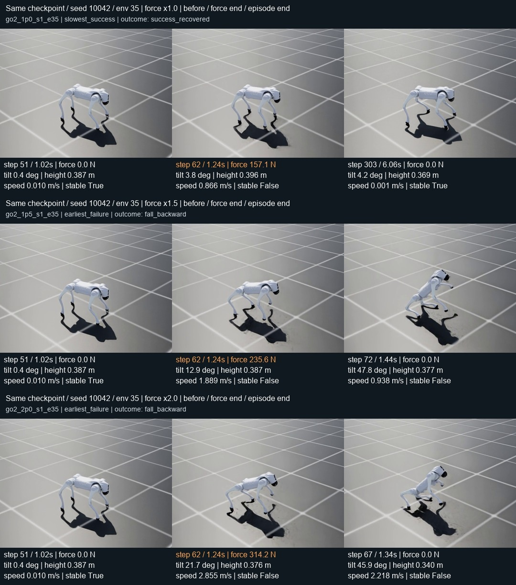

# G：Go2 外力强度扫描与成功判定复核

2026-09-22。按[事前计划](FORCE_STRENGTH_PLAN_ZH.md)，固定已有 Go2 D checkpoint，不训练、不修改成功标准，仅把 F 的实际外力乘以 1.5 或 2。两个新增档各 3×64 个公开 dev episode，均首次执行成功。**2× 外力已使总体成功率从 100% 降为 79.17%，高强度层降为 29.17%。** 这是固定策略的公开开发诊断，不是新 reference 资格。

## 数值结果

| 外力倍率 | 总体成功 | low | medium | high | repeated | 三 seed 成功数 |
|---|---:|---:|---:|---:|---:|---|
| 1×，复用 F | 192/192，100% | 48/48 | 48/48 | 48/48 | 48/48 | 64、64、64 |
| 1.5× | 185/192，96.35% | 48/48 | 48/48 | 41/48 | 48/48 | 61、62、62 |
| 2× | 152/192，79.17% | 48/48 | 45/48 | 14/48 | 45/48 | 47、54、51 |

每次持续 0.22 秒，即 44 个物理子步。Go2 high 的力幅值分别约 129–162、193–243、258–323 N；不同环境按各自实际总质量归一化，不能把牛顿范围差误解为随机改变强度档。方向、躯干刚体质心施力位置、两次扰动时刻、原恢复与失败阈值均不变。

- 1.5× 的 7 次失败：后跌 1、侧跌 4、高度塌落 1、未恢复 1，均在 high。
- 2× 的 40 次失败：前跌 3、后跌 3、侧跌 3、高度塌落 22、越界 9。越界单独报告，不能称这 40 次全部被推倒。
- 新增统计总共 384 episode；1×没有为统计另跑，录像重放也不重复计入分母。网格到此停止，没有第三个强度、作用点搜索、换 seed 或调门。

## 独立数值审计

[audit.json](force_strength_01/audit.json)由不导入产品 runtime 或诊断评分器的 NumPy 脚本重算，目标和本地均 PASS。覆盖原 1× 和新增两档共 576 条记录：实际质量、种子生成的方向、每物理步外力、积分冲量、脉冲外清零、连续首 episode、单位四元数、全程失败及每次推后驻留、末态稳定。所有分类与已记录结果一致；2×有一个 episode 在第二推前已失败，保留原分母。

关键数值检查：

| 成功样本的实际表现 | 1× | 1.5× | 2× |
|---|---:|---:|---:|
| 末尾连续稳定最短时长 | 0.76 s | 1.42 s | 1.24 s |
| 全程最低根高度 | 0.25281 m | 0.22513 m | 0.19466 m |
| 全程最大绝对 roll/pitch | 0.4065 rad | 0.5248 rad | 0.6932 rad |

原成功规则要求每次力结束后，在固定窗口内完成 16 步连续稳定（0.32 秒），并且末态稳定；并未新增“末尾长时间稳定”的门。上表说明当前成功集没有仅末帧偶然稳定的现象。2×的22条高度塌落终帧为0.16181–0.17966 m，确实低于0.18 m；9条越界终帧为1.20038–1.20769 m，确实超过1.2 m。成功样本2×最大位移1.19126 m，虽接近边界，仍未跨过原门。

## 原生录像复核

预声明的8个案例全部完成：原1×恢复最慢的成功；新增每档恢复最慢成功、最大倾角的另一个成功和最早物理失败；G1原F的一次侧跌作对照。每次使用原seed全部64环境，只显示所选机器人，并在termination/reset前采帧。

首批录像被完整解码检查拒绝：诊断请求960×720，实际RGB输出1280×720，303个control图像错误编码为404帧。原数值NPZ不受影响，首例有/无渲染原始数组逐项完全相同；该批视频不作视觉证据。保留问题记录与原件，诊断入口改用后端实际1280×720画幅，并在编码前核对RGB形状、编码后完整解码核对帧数。修正后的录像按另冻执行声明重新运行，不改统计样本或其科学条件。

第二批的4个seed1案例与原轨迹完全一致；另4个seed2/3案例因直接跳过前序运行，初始状态和轨迹不同，未冒充原结果的回放。只修正诊断重放流程：保留完整前序seed仿真，再录指定seed。四个重录与原统计轨迹全部一致。上述两处均为本次诊断录像入口的问题，没有修改指标、重新筛选统计样本或隐去失败尝试。

最终[录像对照](force_strength_01/video_comparison.json)为PASS：8段、1741帧，均为1280×720、50fps，含真正的失败末帧；8次指定seed重放的全部512条episode分类、恢复时刻，以及首episode有效根状态/每物理步力数组均与对应原统计运行逐位一致。512条是重复验证，不增加统计分母。有效录像目录明确列在[准入清单](force_strength_01/records/video_admission.json)；原7段编码错误视频和4段不匹配重放均有拒绝说明。

实际图像审阅采用原生关键帧和每0.16秒时序帧表，完整MP4另存。已看到：

- 同一seed10042/env35在1×下受推后重新直立；1.5×、2×时前躯明显抬起、向后倾斜，终止前倾角分别47.8°、45.9°，越过原0.8rad（约45.8°）失败门。这里的“后跌”指越过该门，不要求录像继续到完全躺地。
- 2×的两个临界成功双推样本确实有连续的失稳与恢复过程：env48第二推后最大倾角约39.7°，随后重新支撑；env49第二推后倾斜约37.1°、短暂下蹲，末尾恢复直立。没有把仍然倾倒、躯干贴地拖行或突然重置站起当作成功。
- 独立审阅者也检查了1.5×的两个成功案例：一次下蹲后重新撑起、一次第二推后侧倾再落脚纠正，末段持续站立；G1对照在最后两关键帧从约42.1°侧倾到46.7°，与原侧跌门一致。
- 原生画面支持数值判定；不能用少量图像证明足端完全无滑动或证明所有连续物理子步都没有未采样事件。

图从上到下为1×、1.5×、2×；各行依次为施力前、施力结束、各自episode结束，最后一列的物理时刻不同，已标注。

- [2×：大幅后仰后恢复成功](force_strength_01/videos_v2/go2_2p0_s1_e48/video/seed_01_env_48.mp4)
- [2×：同一个env35后倾失败](force_strength_01/videos_v2/go2_2p0_s1_e35/video/seed_01_env_35.mp4)
- [G1：原F侧跌对照](force_strength_01/videos_v3/g1_1p0_s3_e41/video/seed_03_env_41.mp4)

## 执行与保护

两端评分专项6项通过，诊断入口编译与Ruff致命错误检查通过；没有因PLAN内诊断改动重复全项目长测。目标原件两批357+91文件逐文件SHA/大小验证通过。[最终资源回执](force_strength_01/records/execution_closure_final.json)确认21个统计/录像作业全部退出、GPU compute为空；其中2个是新增统计，19个是录像尝试（最终8个案例、11次因技术问题被替代的尝试）。统计作业未重试。

本地/目标373个产品源码文件保持不变；Go2 D的37文件/12checkpoint、G1的49文件/13checkpoint、完整15rounds的1271文件/71checkpoint，其hash/大小/mtime保持不变。0训练、0holdout、0provider，原正式资格不动。

## 判断边界

数值与视觉证据支持：原外力范围对该 Go2 checkpoint 太容易，增强外力能够形成成功到失败的过渡；本轮未发现导致持续满分的成功判别错误，无需通过更苛刻的成功指标制造失败。当前标准允许恢复中的短暂倾斜、挪步和小范围位移，不要求回到原位置，也未把足端滑移或躯干接触单独设为接受门。

复现依赖既定批次顺序，不能只设置同一个seed就宣称同轨迹。[跨倍率施力前对照](force_strength_01/pre_force_comparison.json)显示第一seed的全部施力前根状态逐位相同；第二、三seed有小幅历史依赖（最大位置差约0.775mm），故不把三seed整批描述为跨倍率初态逐位相同。第一seed的成功数本身也从64降为61、47，且同一env35图像对照来自这一干净的前置状态。该限制不改变对实际轨迹分类的复算结果，不以此追加样本或调整阈值。

该 checkpoint 不是在新外力任务下重新训练所得；公开 dev 已参与难度研究，不能冒充独立验收集。若后续选定新的正式外力任务，必须先冻结范围、训练/评测定义和新独立验收样本；充分训练后是否又饱和仍未知。本轮不重训、不消费 accept/sealed、不签发新资格，P6整体状态不据此改为GO。
