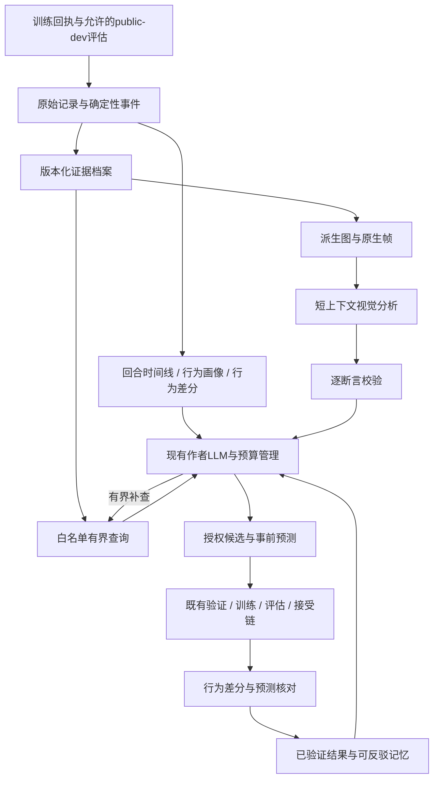

# 反馈系统升级计划：可核查的行为反馈与有界改进闭环

版本：v1.2.7（P2审计修订与验收版）
日期：2026-09-24
状态：Phase 0七项遗留已收敛；Phase 1当前generation主线已验收。完整Phase 2已实现，首轮7组真实评估与4组短训练对照通过；P2审计修订补齐接触历史、运动方向与启动锚点分散采样，新增4组真实评估与4组短训练对照通过。Phase 3及以后尚未实施；历史范围见[P2首轮验收](./P2/ACCEPTANCE_ZH.md)，当前v2边界与证据见[审计修订验收](./P2/audit_response/ACCEPTANCE_ZH.md)。
项目：`D:\humanoid_agent\true_RL_Agent`。  
修订记录：2026-09-23 v1.2.1，依据[第三次审计](D:/humanoid_agent/true_RL_Agent/PLAN/feedback_sys/PLAN_AUDIT_3_V1.2_2026-09-23_ZH.md)做小侵入修改：3-live 真实小探针、Phase 1 分档、Phase 3 默认工作集与重复生成、Phase 4 启动条件、Phase 5 裁决规则、两任务首个问题的对齐与登记。

2026-09-23 v1.2.3：依据[P0审计处理](D:/humanoid_agent/true_RL_Agent/PLAN/feedback_sys/P0/AUDIT_RESPONSE_ZH.md)，补齐formal c6的23条已训练父子边/22个候选权重、最新Push的10条父子边，以及历史作者输入和输出。首个采集包含真实parent–candidate对；已有P3 reference与Gen8-A新v3回放先提供描述差分。移除strict-token资格、双人盲评硬前置和四层预算矩阵。具体资源与下一阶段入口见[P0范围卡](D:/humanoid_agent/true_RL_Agent/PLAN/feedback_sys/P0/RESOURCE_SCOPE_AND_MIN_LOOP_CARD_ZH.md)；[实施前v1.2.1](D:/humanoid_agent/true_RL_Agent/PLAN/feedback_sys/archive/FEEDBACK_SYSTEM_UPGRADE_PLAN_ZH.v1.2.1.md)保留。

2026-09-23 v1.2.4：P0七项遗留清理完成；[P1验收](./P1/ACCEPTANCE_ZH.md)完成generation绑定phase回执重建、缺测与零值区分、任务投影隔离和逐lane记忆保真，265项当前CPU测试通过。借鉴本地Codex的记录/视图分离，保留既有journal及任务所有权。旧width-one路径的ledger信任层与其保证范围已明确记录，未扩建旧格式认证协议。另核实formal原parent的v1→v3祖先准入尚需在P2启动前处理，见[P2范围卡](./P0/RESOURCE_SCOPE_AND_MIN_LOOP_CARD_ZH.md)。

2026-09-23 v1.2.5：依据[P1独立审计处置](./P1/AUDIT_RESPONSE_ZH.md)，长期记忆改存逐lane奖励执行短状态，generation去掉顶层重复，详细计数留在原回执与runtime反馈。保留未知语义，增加固定14 KiB下的真实历史保留门槛；修订后267项相关CPU测试通过。P2范围卡补充历史摘要语义、旧数据派生视图与新采集的区别、原路径回放和新增信息的容量评估。Stair已有别名由同一状态导出且受历史合同消费，本次保留，不另建兼容框架。实际回放与量化结果以[P1验收](./P1/ACCEPTANCE_ZH.md)为准。

## 1. 总目标与本版决策

2026-09-24 v1.2.6：完成[P2实施卡](./P2/IMPLEMENTATION_PLAN_ZH.md)规定的数值证据主线。任务拥有字段、身体/时间语义与复算；共享层只负责有界存储和固定训练采样，回执封存与附件按需读取分开。训练覆盖同时贯通正常与候选失败回执的作者公开投影。原始时序不自动加入prompt，14 KiB长期记忆预算、训练与接受权威保持。先前两项P1小修见[P1小修记录](./P2/P1_CLEANUP_ZH.md)；字段、资源、来源差分和实际验收见[P2报告](./P2/ACCEPTANCE_ZH.md)。

2026-09-24 v1.2.7：依据[P2逐项审计处置](./P2/audit_response/AUDIT_RESPONSE_ZH.md)补齐实际接触判据历史和Push方向操作数，明确旧profile缺失与传感器槽时间未知。训练使用启动锚点加分散采样，仍最多24×16。固定seed训练绑定、任务终局分类和本次已验证回执读取收敛；保留历史域与独立时序复算。新增8组真实对照通过，576506个Stair有效控制帧的历史禁触判据零不一致，补回37个瞬时力无法表达的禁触终止帧；数值与资源见[修订验收](./P2/audit_response/ACCEPTANCE_ZH.md)。原始数组不入prompt，未增加长期记忆预算或生产PLAN依赖。

**让作者LLM知道策略具体做了什么、哪些解释仍不确定、哪些修改在授权范围内，以及改完后预期行为是否真的发生；证据增加时，成本、上下文和记忆仍有界。**

本版保留Phase 0–11，但调整推进顺序：先在单一已支持任务上完成“现有事实→必要时序→行为描述→作者离线判断”的最小闭环，得到价值信号，再投入检索、记忆和多模态的完整工程。Phase 9仍负责最终配置选型，不能用早期试验替代。

三项决定：

- **高层行为成为正式交付。** 默认反馈是回合时间线、分组行为画像、candidate与parent的行为差分；原始轨迹留在外部按需核查。
- **预测核对进入闭环。** 作者在实验前登记可测预测，实验后由固定规则比较证据；行为改善、任务成功、候选接受、物理因果四种结论分别报告。
- **计划冻结目标与硬边界，阶段启动时冻结具体方案。** 文件格式、类名、模型、词表阈值、相机、样本量和统计实现不在今天全部写死，也不能在看过本阶段验收结果后降低标准。

两份审计原文保留不改；逐条判断和未采纳理由见 [审计处理记录](D:/humanoid_agent/true_RL_Agent/PLAN/feedback_sys/AUDIT_RESPONSE_AND_PLAN_REVISION_2026-09-23_ZH.md)。[v1.1原稿](D:/humanoid_agent/true_RL_Agent/PLAN/feedback_sys/archive/FEEDBACK_SYSTEM_UPGRADE_PLAN_ZH.v1.1.md)已归档；[既有研究记录](D:/humanoid_agent/true_RL_Agent/PLAN/feedback_sys/RESEARCH_AND_ENGINEERING_REVIEW_ZH.md)保留方法与源码依据，实施顺序和预算以本版及其阶段登记为准。

## 2. 当前基础与真正缺口

本节最初调查快照的HEAD为`5cef484d`；P1实施与审计修订的检出HEAD为`fe96455d`，均有未提交变更。实施基线同时记录实际源码内容、配置和协议hash，不能只以HEAD代表工作区。

| 范围 | 已有基础 | 本次补什么 |
|---|---|---|
| Stair | 逐步host历史包含较丰富的状态；transition含逐支撑体信息；当前正式套卷已持久化逐回合facts；公开反馈主要为计数和比率 | 持久化必要时序、保留方向与身体身份、事件起止与并发关系、行为画像和差分 |
| Push | episode记录已有扰动时刻、恢复步、censored latency及极值；奖励路径可读关节状态 | 先投影已有事实，再保存逐步稳定条件与dwell重置原因；逐脚动作描述需另验证支持体映射和观测能力 |
| 上下文 | 已有确定性裁剪优先级、minimum-core和容量回执 | 校准token、记录缓存与位置、减少重复、全局预算分配，再按诊断相关性选择证据 |
| 作者与记忆 | 已有source_request、authoring journal、机制卡、session内派生索引 | 有界证据查询、可核查预测及裁决、反证关联，避免查询挤掉最终候选答复 |
| 媒体 | 已有task-owned原生录制及pre-reset状态 | 有限缓冲、实际覆盖、派生图、同源索引、真正的图像传输与独立视觉工作集 |

特别说明：Push物理overlay当前关闭接触传感器；补逐脚接触不是免费日志扩展。Stair脚部参考点、base位置与合力，也不能直接证明脚尖撞某个立面。模型当前收到纯文本，是本地请求实现的事实；不能由旧模型别名推断远端模型永远不支持视觉。

已有实验支持补过程证据：Stair reference的slip在成功回合也常见，方向、身体与时间窗口比全局ever计数更值得补；Gen8-A的新v3回放提供另一策略的分布。最新Go2 Push force attempt_08有10个已训练候选、2次接受，应进入开发素材池；旧velocity D池192/192不代表它饱和。作者A已经引用部分标量、分层统计和负历史，新增价值须超过重述这些事实；同时核查解释与奖励符号/实际贡献是否一致。历史搜索是相关样本，不能按checkpoint个数计算独立实验数。

## 3. 目标架构：四个合同

图中的查询只访问允许的public-dev证据；训练摘要通过既有训练回执投影。媒体补查经视觉分析与断言校验返回作者，不把全部图像塞入代码上下文。

### 3.1 观察合同：四层表达，明确来源

| 层 | 产物与产生者 | 用途与边界 |
|---|---|---|
| L0 原始记录 | recorder生成的数值、原生媒体、identity、时间、覆盖与缺失状态 | 外部留存、重算和回查；内部路径与私有seed不进入作者输入 |
| L1 确定性事件 | task/robot projector从合法字段与版本化规则派生 | 接触边沿、恢复条件变化等；规则事件不等于物理根因 |
| L2 行为表达 | task-owned确定性投影生成时间线、画像、差分 | 作者默认工作集；每条描述回指L0/L1，不增加新的真值来源 |
| L3 模型笔记 | VLM/作者产生visual_observation、解释假说及待验证规则建议 | 保留可见性与引用；不能覆盖测量、自动修改词表或控制验收 |

L1与L2都是确定性派生层；增加L2不是增加一份实验真值。MotionSegment保留producer与证据类型，同名视觉描述不能覆盖规则事件。

L2包含三个逻辑对象，不要求实现成三个新服务：

- **EpisodeTranscript**：一回合发生了什么，按时间和身体部位组织，允许并行动作和unknown。
- **BehaviorProfile**：同一比较域内的行为分布、分母、覆盖、成功与失败组对照；有限代表样本不代替总体统计。
- **BehaviorDiff**：在可比条件下candidate与parent的变化，保留原始值、配对覆盖、缺失及不确定性。不同策略轨迹不能按相同step强行对齐；需要时按外部扰动或任务事件对齐并保留对齐误差。

描述只承诺观测足以支持的粒度：低净空加减速可叫“疑似阻滞”，不能自动叫toe collision；支撑刚体参考点不冒充足底中心或脚尖；base所在层不等于实际接触面；无离地不证明ankle/hip策略。词表外可见事实允许保留，不能因不在规则表中被当作不存在。

### 3.2 动作合同：可表达不等于获授权，也不等于有效

当前仍遵守实际candidate authority：奖励程序按现有单机制/组件规则修改，source_request读源码，新增evidence_request只读取证。runner-owned组件继续冻结，不因反馈升级解冻curriculum、DR、PPO、初始化或任务成功标准。

行为描述附“可操作性映射”：相关观测/授权输入、当前可表达的干预类别，以及`diagnostic_only / requires_new_observation / outside_current_authority / unknown`。映射绑定实际input schema/hash、时间窗口、参考系和派生定义；同名字段不自动等价，离线未来窗口不能变成reward-time可用输入。它表示可尝试范围，不能声称“这个奖励一定能解决”。诊断可以覆盖奖励空间之外的问题，为未来授权扩展保留同一证据接口；本次不实现新动作空间。

### 3.3 记忆合同：经验保存为带适用域的预测与结果

复用ledger和派生索引，默认session内记忆。结果卡、行为差分、假说和反证相互引用；自然语言rationale本身不升级为事实。

可裁决预测至少明确：指标及版本、适用范围、比较对象、期望方向、最小有意义变化或容差、覆盖要求、判断不确定性的规则、登记时点。条件或样本不足时必须允许`inconclusive / not_tested`；只有冻结规则满足时才给`supports_prediction / contradicts_prediction`。预测命中不是候选接受，也不证明根因。

任务层拥有指标语义、比较适用性和不确定性规则；共享核对层只执行已登记的类型检查、比较和状态更新，不写死Stair/Push含义。纠正与反证追加保存，旧结论保留来源及失效关系。

跨session不是首版默认能力。实验可从空历史或相同冻结公共证据包开始；若导入历史，必须保存来源session、适用协议与身份、允许时间和只读边界，不能改写session genesis伪装成本session经历。

### 3.4 决策合同：预测先于结果，查询不消耗完答复机会

闭环为“读画像与差分→检索相关正反证→登记可检验预测→生成授权候选→固定训练评估→核对预测→追加记忆”。探索性候选允许证据不足，不强迫作者虚构根因。

补查与候选答复共同受轮次/费用上限约束。必须为查询后的最终答复保留额度；不能在最后一次可用尝试上接受一个无法继续完成的查询。若需要额外continuation槽，应在实验前登记到两臂相同总费用/尝试边界，不能给处理组隐性加预算。

## 4. 不随Phase改变的硬边界

1. **身份与权限**：每个事实、帧、查询和对照绑定session/task/robot/protocol/source/checkpoint/episode；public-dev白名单输出，accept/sealed原始细节不开放。
2. **可用性**：未采集、丢失、截断、被预算省略、不支持和实测零分开；事件时间与证据首次可用时间分开，迟到证据不提前进入历史回放。
3. **可追溯性**：引用可解析，关键数值和分母可重算；索引可由原件重建。数值与媒体分别记录完整性，CORE不因未启用媒体而无法完成。
4. **任务与授权不漂移**：描述词表、视觉解释和预测核对不改变success、termination、reward ABI、训练预算或接受gate。非任务所有者不定义身体角色及物理阈值。
5. **预算与恢复**：逻辑操作最多提交一次，所有实际调用/重试/未知费用入账；恢复不重置额度、不重复晋升。外部API无幂等承诺时不能声称exactly-once。
6. **比较与数据隔离**：对照域可比；共享原件与独立派生状态分开。不同arm/session/case不能读取彼此新生成的诊断、笔记、结果或自适应缓存。
7. **结论分级**：接线正确、采集可信、诊断有用、预测得到支持、搜索收益成立分别验收。没有新增证据不能靠流畅叙述通过。

全局硬错误零容忍。必测分支不得skip；未训练、作者失败、infra故障、未选中和真实退步分别记录。

## 5. 阶段推进与调整规则

每个Phase启动前形成简短的“阶段验收卡”：范围/非目标、依赖、源码与协议版本、待解决问题、交付、量化指标及门槛、案例与隔离方式、资源上限、停止条件。卡片必须在该阶段用于判定通过的数据或结果揭示之前冻结。模型别名可能漂移，记录可获得的实际版本/fingerprint与日期。

开发中可依据接口现实调整实现；若改变观察定义、规则、输入、指标或样本集合，升版本并重验受影响能力。看过保留验收结果后修改方案，应使用未参与调整的新确认数据；不得只降低门槛后重跑旧集宣布通过。

计量、去重和必要核心保留等低成本修正可随Phase 1前置，不等待完整Context Broker；仍须通过相同payload与授权回归。稳定前缀调整作为有界探针，不能省略执行所需合同。

状态为`NOT_STARTED / PASS / FAIL / INCONCLUSIVE / DEFERRED`，并注明能力profile。单任务最小闭环通过，不等于两任务、多形态、视觉或跨session全部通过。

| Phase | 目标与工作量边界 | 前置与出口 |
|---|---|---|
| 0 | 小：现状、资源、协议与数据来源基线 | 无；给出有限可行范围 |
| 1 | 小至中：复用既有投影与journal，补必要契约回归 | 0；证据可安全进入作者 |
| 2 | 中：必要时序持久化，先单任务再扩范围 | 1；最小profile可供3验证 |
| 3 | 中：行为表达与首轮价值验证 | 2的对应profile；早期继续/收窄/停止决策 |
| 4 | 中：有界证据查询 | 3的价值门与本Phase启动条件；不另起开放服务 |
| 5 | 中：预测记忆、核对与全局上下文预算 | 3、4；可回读和可反驳 |
| 6 | 中：可靠媒体与派生图，资源有界 | 2；事件选帧依赖3，查询接入依赖4 |
| 7 | 中：短上下文视觉补充与断言核对 | 3、6；生产路径另需4、5 |
| 8 | 中：作者真实状态机接入 | 4、5；启用视觉另需6、7 |
| 9 | 有界评测：选择最终生产配置 | 3–5、8；V比较另需6、7 |
| 10 | 有界计算：真实闭环pilot | 9；确认运行与预算可行 |
| 11 | 有界计算：搜索收益研究与发布 | 10；探索性或确认性事前定性 |

早期最小路径为0→1→2-min→3-min，直接使用现有公开投影做离线作者对照；不等待4/5/8，也不绕过1的安全边界。通过后完成对应Phase的其余承诺，再扩展服务和多模态。若时序文本没有增量，先定位问题；只有预先登记的视觉信息缺口才值得追加小型视觉探针，不直接建设完整平台。

3-min 通过后、建设 Phase 4/5 之前，允许一次有界的真实小探针，记 `3-live`：1 个 T session×2 代×2 lanes＝最多 4 个候选机会，不做A/T效应比较。作者使用 T 反馈，并在既有 rationale 中按 §3.3 的字段写出事前预测；裁决按冻结规则手工或脚本执行，沿用现有 journal、授权与训练/评估链。它只回答三个问题：作者是否引用画像与可用差分、预测是否可裁决、下一代改变的是行为还是只有分数。结果用于确定 Phase 4/5 的范围，不进入 Phase 10/11 的效应样本，也不构成 CORE 通过；费用在 §7 总账内事前登记。若另做成对A/T，则为8机会，须在启动前从总额度重新分配，不仍记为4。

## 6. Phase目标与严格验收

### Phase 0：建立真实基线与可行范围

**目标与交付：**知道已有证据、缺失字段、实际作者成本和可用实验余量；交付范围/资源/数据地图及首个最小闭环验收卡。

**严格验收：**

- 区分“已采集未保存、已保存未投影、从未采集”；记录源码、协议、robot binding、观测与授权ABI。旧修复通过回归确认，不重新假定为bug。
- 至少覆盖初代、长历史、source followup、repair、minimum-core的实际输入与usage，分别标明历史实发、重建与强制分支。记录bytes/token、段落位置与cache；用校准集拟合、另列输入检验误差，估计只适用于所测模型与工作负载，实际usage用于费用结算。移除单独的strict-token资格门；发送前仍为输出和输入估算误差留余量。
- 登记作者A的实际输出：引用了哪些已提供证据、哪些过程机制仍是假说、文字与候选实现是否一致。历史rationale、输入和结局逐项绑定，未训练产物保留状态。
- 评估媒体与provider可行性：实际模型/端点、image block、usage、原生录制覆盖、相机可辨性、内存与回放条件。尚未实测只能标待验证，不能影响CORE先行；VISION启用前必须完成真实传输和费用探针。
- 用hash、训练attempt、seed/初始化、祖先和session核对案例依赖；checkpoint副本和同次训练中间版本不算独立谱系。数据不足明确缩小结论范围，不为凑数擅自启动训练。
- 以GPUh和模型费用登记项目与阶段预算；runner完整耗时、调用、usage、失败与重试留在既有回执，采集器启动时再定具体内存/磁盘上限。正式收益域必须有合格基线且有改进余量，不能临时换成功定义或挑有利子集。

**可延后：**完整词表、最终VLM/相机、确认性样本量在对应Phase启动时锁定；当前只做可行性约束。

### Phase 1：证据进入作者前的可信边界

**目标与交付：**复用现有phase-summary、public projection、parent-dev与journal，保证新增反馈在live/replay/最终payload里含义一致。

**严格验收：**

- 正确身份、receipt绑定、分母、缺失语义在live、重放、记忆和最终provider请求一致，投影幂等；与其他trial混用、仅篡改public_summary、私有路径/accept/sealed canary被拒绝或明确不可用。
- 缺runtime、无term、零执行、有效零、预算遗漏不混淆。accepted、rejected、未训练、未选择、首次reference和混合sibling结果都有闭合回执。
- 新增逐代证据同时核对真实历史的保留量，不以“未超预算”代替信息可用性。当前14 KiB/16轮下，formal c6第13/16代前至少保留11/13代、Push attempt_08第6代前保留5代，身份、当前/最近接受记录与遗漏计数保持；后续扩充工作集先登记容量取舍。
- task-owned语义可经一个最小非Stair/Push adapter验证，共享层无任务公式。已有实现通过就保留，只在反例证明的所有权层修复。
- 本次依照用户要求按完整档实施，未只交付原3-min所需离线档；live/replay/memory、最小adapter与最终请求均已验收。当前generation消费回到绑定phase回执；旧width-one提交时验证execution receipt，重放仍信任已提交ledger公开结果，不宣称对该旧格式任意诊断字段做独立回执认证。

**可延后：**完整新schema生态；不因计划重做已经正确的消费链。

### Phase 2：保存足以重算行为的证据

**目标与交付：**先保住一个任务的必要时序，再按声明profile扩展；交付可回读数值档案、覆盖目录和训练阶段摘要所需样本。`2-min`只要求Stair评估时序，不为补齐历史训练采样而重训；训练采样属于后续训练profile/完整CORE，评估回放不能冒充训练阶段证据。

**严格验收：**

- 首个Stair问题明确为“终局禁触前出现了哪些可测事件，成功组是否也出现”。沿用P0的失败cell、进度分布与共现画像，新增带符号姿态、身体映射、支撑状态、起止时间和pre-reset边界。progress_fraction最大值分箱不代表碰撞层，ever旗标不代表先后。首批用真实parent–candidate两个策略在同版v3下重评；按问题覆盖扩到2–4个策略，22个兼容候选作为可选池，不全量重放作硬前置。P3 reference↔Gen8-A已有同协议描述差分，但二者不是历史父子且执行源码不同，不能直接当同版干预效果。
- 对照优先同cell，在seed内配对或跨seed分层汇总；失败时已有同cell成功样本就使用。过程窗口由task-owned事件对齐，如articulation-root跨越同一级立面，记录对齐误差。未到达锚点的失败保留终止前窗口和完整分母。跨cell同阶段仅作明确标记的辅助类比，地形/动力学差异不能因level名称相同而消失。
- 首版复用现有接触传感器，可保存任务binding明确映射的15个body合力范数来定位受力身体；它不识别接触对象/面，也不改变base-only forbidden定义。字段和dtype按所问问题确定，先量出真实数组/缓冲/落盘开销；float16等优化须保持事件判定精度，不为估算中的“减半”先丢关键向量。
- 接触证据必须保存实际判据使用的操作数：Stair区分瞬时力与传感器历史缓冲，槽顺序、lazy更新及时间戳缺失如实声明，不能推定等距物理子步。Push保留世界系平面速度/位移方向，同时保留实际范数阈值操作数。新profile单独版本化，旧档案缺项不补零；只有开启public-dev数值采集才新增复制/搬运。
- Push基础profile覆盖真实扰动、逐步稳定条件、dwell重置/删失与恢复时序。多条件同时失守保留集合和时间精度，不强选单一原因。逐脚profile须先具备有效接触/位置及task binding，再承诺迈步描述；关节窗口按需要采集，不直接承诺ankle/hip分类。Push 首个问题登记为“not_recovered 回合里 dwell 被哪些子条件、在扰动后多久打断，success_recovered 组是否同样出现”，先分“窗口内未完成dwell”和“已恢复但终局再失稳”；velocity按event、force按末pulse结束后的sequence分别对齐。只依赖逐步子条件与已有事件时刻，不依赖脚部传感器。
- 登记每个ever/max/dwell/持续时间统计的输入覆盖；从持久证据重算一致。终止/pre-reset/reset边界不串episode，填充点和丢帧不作真实持续证据。
- 真实simulator案例覆盖每个声明支持的协议/形态及短回合/失败/成功；capture on/off不改变任务与主统计，在事前定义容差内可比。新增传感器也受此门约束。
- 缓冲、磁盘与热路径开销满足冻结上限；数值/媒体分别发布complete。损坏、半写入与重复提交可检测；训练采样覆盖早/中/晚、term版本、贡献及未采样状态，仍经训练回执公开投影。
- 训练样本使用有界启动锚点与三个阶段内的分散取点，精确索引留在档案，作者只接收受预算约束的覆盖事实。短训练只能证明接线、时钟、算术与采集不干扰训练；稀疏样本不能声称全程均值、精确首次激活或失败瞬间。全程周期聚合按P3实际需求决定，不为本阶段新增聚合平台。

**可延后：**所有任务同时完成、全关节高频全量落盘、MCAP/数据库迁移。min通过不代表完整跨任务采集通过。

### Phase 3：高层行为表达与最小闭环价值门

**目标与交付：**交付有限任务词表、EpisodeTranscript、BehaviorProfile、BehaviorDiff、可操作性映射；尽早验证这些信息是否帮助作者提出更有根据的修改。

**严格验收：**

- 每个正式词条说明可观测定义、身体角色、时窗、单位、缺失与适用域，能从Phase 2字段独立重算；镜像/索引重排、并行动作、回合边界和正常罕见行为保持语义正确。
- P2的PLAN离线事件原型只供验收参考；正式词条进入任务src，不导入PLAN。支撑接触描述明确使用瞬时力还是历史判据，缺少每槽时间戳不得生成子步事件顺序；世界平面运动方向本身不能证明迈步或碰撞因果。
- 旧全局指标与新逐部位事件分别版本化，保持原success/primary语义。Stair旧slip/clearance先对支撑体做any再累计streak，不能用新增逐脚持续时间冒充重现；阈值与地形查询来自实际协议/地形，不固定套用0.018 m或平整台阶模型。
- 先以现有可观测事件描述摆动/触地、停滞、倾斜、扰动响应、恢复保持；碰撞位置、步态类别或恢复策略在证据不够时降为候选/unsupported。描述同时标“当前可表达/越权/缺观测”，不自动给出已证实修复方法。
- 成功/失败画像有完整分母和覆盖；差分使用正确parent及可比域，删失与不同轨迹长度不被忽略。可测几何只声明实际参考点，推断事件不冒充测量。
- 阶段验收卡固定 T 的默认工作集：按 stratum 的画像与成功/失败对照、相对 parent 的差分、有限代表性 transcript 的确定性选择规则；同时列出为腾出预算而删除或压缩的现有段。A 与 T 在相同 token 上限下比较，T 不得靠超出预算取得增量。
- 在冻结的12–24个开发案例上比较A（现有反馈）与T（行为表达），登记policy/parent/cell与共同来源；案例数不是独立谱系数。两臂使用同一数据可用时点、作者、源码权限和预算，每案例每臂至少两次新生成。历史A输出供基线分析，不能与今天新T组成匹配实验，更不能把v3新证据塞进v2历史决策时点。机器核对引用/数值/奖励符号，1名人工依据原始只读时间轴按固定rubric盲化打乱评阅语义、支持/反证引用、授权机制和可证伪性；保留不确定项，报告单人评阅局限，无需双人作为工程前置。
- 早期继续门：无全局硬错误，输出事实支持率至少95%；在至少两个事前登记的不同过程类别上，T减少A的关键误判或补足影响修改判断的必要证据，授权合规和可检验性不退化；若走成本收益路线，须质量不退化且总费用至少降低20%。未达门先收窄/修正，不进入完整服务建设。该小样本门只判断继续投入价值，不证明泛化或搜索收益。

**可延后：**覆盖全部动作词、学习式异常检测、自动扩词表、交互式平台；简单只读时间轴导出即可支持核查。

### Phase 4：按问题回查的有界证据接口

**目标与交付：**在既有源码查询、权限和journal边界内，增加独立typed evidence请求；让作者按“回合结果→事件目录→局部窗口”回查。启动条件：3-min 或 3-live 记录到“证据存在于 L0/L1、因预算未进入默认工作集、且盲评或裁决认为影响修改判断”的案例比例超过阶段卡登记值；未超过时先改进默认选择与去重，不建查询接口。

**严格验收：**

- 只读已允许的public-dev档案，限定查询范围、返回量、分页和调用数；无任意路径读取、重训、改seed或追加评测能力。
- scope绑定session、协议、允许checkpoint及决策时点；同时检查事件时间和证据首次可用时间。同名episode、迟到证据、未来后代、sibling和旧缓存均不能越界。
- 三层view与原件身份、数值、顺序和分母一致；缺对照返回missing。相同输入/版本/预算排序可重放，截断与遗漏可见。
- 查询/缓存/重试与原有journal共同计量；媒体view留给Phase 6/7，训练原始日志不伪装成public-dev开放。

**可延后：**向量搜索、独立服务进程、无限schema查询；首版目录和确定性索引足够。

### Phase 5：预测记忆与上下文预算

**目标与交付：**扩展已有结果卡，连上行为差分和预测核对；从“局部字节上限”走向“必需核心＋可变证据池”，不丢正反证。

**严格验收：**

- 预测必须在对应结果可见前登记，核对规则归任务所有，共享层执行比较；覆盖支持、反驳、缺样本、无可比parent、规则版本变化、未训练和删失。parent画像按head在同一cohort用同版recorder计算后复用。任务层事先规定配对单位、最小有意义变化和不确定性规则；不把跨seed离散度统一当所有指标的容差下限。奖励项激活、目标行为变化、任务结果变化分项核对，证据缺失保留unknown，三者关系作为解释线索而非强制根因分类。formal历史36份rationale可作带输入/结局的回顾fixtures；缺明确事前指标和阈值时不能补写后计算预测命中率。
- 原始测量、确定性事件/行为表达、模型笔记分类型写入；三轮压缩/重建后关键数值、来源和unknown不变，假说不能升级成事实。支持与反证均可回读，更新幂等并检查ledger head。
- 工作集强制保留当前parent与最近待解释trial的最小行为证据、身份和授权边界；旧经验不能将当前问题挤出。完整排除集合保持有效，不能随prompt截断而缩小。
- 默认session内；如启用历史导入，来源与兼容性门全部通过，否则使用空历史或相同冻结基底。实验arm/session的派生索引和笔记隔离。
- 至少30个冻结检索问题覆盖精确事实、跨代、反证更新、时间、缺证据、权限六类；可回答项recall@5至少90%，错身份为0，缺证据不补造。100/500/1000条历史压力下仍遵守固定预算和排除集合。
- 身份/授权/输出合同/核心ABI不能为了省token移出必需核心；冗余解释、例子和可选源码才可按需读取。prefix稳定、去重、缓存和证据位置以实测回执评估，缓存不算上下文缩短，也不保证固定费用降幅。

**可延后：**图数据库、跨session自动学习、智能重排序模型；先做预算表和遗漏回执。

### Phase 6：可辨认、可计量的媒体证据

**目标与交付：**交付有界原生采集、测量数据派生图和同源索引；先解决内存、覆盖、相机分辨能力及provider成本。

**严格验收：**

- `_frames`等媒体缓冲不随完整rollout无限增长，编码/上传/磁盘/失败均有上限；camera/ROI能看清宣称判断的尺度，无法看清则不生成相应视觉结论。
- 媒体明确分为native_frame、derived_plot、frame_grid，记录来源hash、control-step、渲染/布局版本。派生图可以呈现其源测量支持的距离或接触变量，但不能增加未测量事实；示意图不冒充观测。
- 录制池在运行前冻结，选帧只从实际媒体中进行。诊断重放始终有新的run身份；只有验证身份、条件和逐步容差后才能标“对齐的重放证据”，不能变成原episode原生帧。缺录制或不一致明确缺失。
- 比较事件锚点与覆盖采样；派生图和网格作为候选表达方式，不能预设必然优于原生帧。网格每格可读、时间明确，原始子帧数、分辨率和实际费用分别计量，不用“16帧拼成1张”绕开预算。
- 在真实provider请求中验证image block、接收与usage；同一轮基础分析、补查、ROI、重复发送及重试累计受图像/像素/token/费用上限约束。首版沿用最多4个episode、单请求与整轮实际发送各不超过24图像输入作为上限建议；启用补查必须预留额度，最终值在本Phase探针前冻结。

**可延后：**全高清全回合录制、所有相机、专用可视化平台；派生图与原生图可分profile验收，二者不互相冒充交付完成。

### Phase 7：视觉核对、补充与未知行为

**目标与交付：**视觉分析器结合必要L1/L2和媒体，核对并补充规则词表之外的可见行为；输出经校验后进入作者短报告。

**严格验收：**

- 视觉工作集与代码/长历史隔离，文本、媒体与输出都有上限；基础分析一次逻辑调用，额外补查由Phase 8统一管理。
- 每条visual_observation/hypothesis有身体、时间、来源、可见性与不确定性；引用/身份/时间/数值一致性可机械检查，机械检查通过不等于视觉语义被证明正确。
- 错帧、错误部位、遮挡、低帧率、损坏媒体和数字冲突有明确处理；不猜测未测接触力、摩擦、扭矩或因果。允许提出词表外描述，不能只重复输入事件表获得增益资格。
- 原始池独立标注同时覆盖规则内与规则外事实、成功和异常过程；短/长干扰工作集比较质量与遗漏。文本、派生图、原生帧的适用增量留待Phase 9冻结对照判断。
- 新规则建议仅存为待验证说明，不执行模型生成判据，不在线改词表或gate；未来需要时另走任务规则变更与独立回归。

**可延后：**训练失败VLM、自动规则编译、开放视觉agent、多轮caption→diagnosis链。

### Phase 8：有界查询与作者闭环

**目标与交付：**让作者实际使用画像、记忆和媒体补查，并将候选、事前预测、调用预算和恢复纳入现有状态机。

**严格验收：**

- 最多一次证据补查往返、每次最多两个view；给出要区分的问题。source查询、证据查询、candidate答复与修复预算关系明确，最后一次可用答复额度不会被查询耗尽；无法继续时返回可执行的降级路径。
- 数值经task投影回作者，媒体经独立分析和断言校验回作者。基础＋补查最多两次逻辑视觉分析、合计最多三次实际视觉调用只是上限，不突破整轮媒体和费用额度。
- 候选仍遵守授权和固定选择规则；预测sidecar不执行、不替代gate。允许探索性不确定预测，但不将它记作已支持机制。
- 发送前、远端成功未落盘、收到未晋升、已晋升未返回四类恢复切点不重复提交、不丢费用；未知调用保守占额，失败日志保留，缓存须完整输入和版本匹配。
- 只读历史回放不得隐式发新调用；ledger head冲突须重新校验scope与parent，不能静默改绑。调用与修复过程保持原source/parent anchor。
- 至少三代scripted链覆盖G2使用G1、G3处理反证，以及拒绝、缺证据、静态修复、预算耗尽和降级；最终payload、ledger、候选和证据闭合。实际跨代效果仍由Phase 10/11检验。

**可延后：**开放自主取证、额外训练请求、多agent规划；不另起平行journal。

### Phase 9：诊断与修改建议的配置选型

**目标与交付：**选择唯一进入真实搜索的配置；同时区分“找到证据、读懂证据、提出可执行预测”三个环节。

**严格验收：**

- 使用与开发阶段隔离的冻结选择集，按训练祖先/谱系而非视频帧拆分。原建议48案例、两任务均覆盖可作为目标规模，实际数量及独立性在启动前登记；数据不足只能作有限工程判断。机器核对可重算事实，1名人工按固定rubric在隐藏配置名、打乱顺序后评阅语义并保留不确定项，明确单人评阅局限；额外评阅用于解决争议，不作为默认依赖。
- 至少比较A与T；检索R、视觉V启用时比较匹配的T、T+R、T+V、T+R+V。派生图/原生图的小型开发探针先决定生产V输入；若没有单独消融，不能把视觉包增益归因到某种媒体。补查开关在选择集揭示前固定。
- 全局硬错误为0，逐案例宏平均事实支持率至少95%、可观测关键事实召回及主要阶段/部位定位至少90%；空泛、选择器漏选、本可判断却拒答计漏检。时间区间按身体/动作一对一匹配并报边界误差；可评集合来自原始池，不能按已选帧缩分母。具体容差和tIoU等在解封前按观测精度冻结。
- 修改建议另评支持/反证引用、授权合规、可证伪性、机制与观察的关联；不能用确定性投影标签的阅读正确率替代这一层。真实预测命中率需要事前预测及后续实验，离线新建议没有结果时只评可检验性，不伪造命中率。
- 在开发探针中对比实际检索与同scope/as-of/预算/reader的oracle原始证据；oracle不提供答案且缺证据时仍为空。长上下文探针中的关键质量下降不超过5个百分点。所有arm/case可写状态隔离，标注与评测反思不得回流。
- 只有通过绝对质量门的配置可选；相对匹配底座，关键错误案例率降低至少20%，或同等质量总费用降低至少20%，且最终方案相对A有增量。基线零错不算相对降错；组合交互可整体入选，不宣称各模块独立有效。先比错误，再比费用，再比复杂度，规则事前固定。
- 同等质量要求主错误率不升高且全部绝对质量门通过，不能靠少说必需事实、增加拒答或减少可评案例省钱；费用包括前处理、查询、修复和失败尝试。
- planned单位以case×config×重复序号对账；失败终态保留，重试不新增质量样本。运行、修复、媒体、费用和延迟分别报告；选择集成绩是工程选型成绩，独立效力需独立确认。

**可延后：**大型基准、多个模型全面排名。无增益的可选模块关闭；无方案优于A则不进入昂贵正式研究。

### Phase 10：真实闭环pilot

**目标与交付：**验证冻结方案在真实候选生成、训练、评估、预测核对和恢复中运行，测量正式研究的费用与失败模式。

**严格验收：**

- 默认上限仍为两臂×两对session×两代×两lanes＝16个候选机会；另最多两次infra重试、每臂一次，候选训练启动最多18次。必要评估、reference与capture另计实际GPUh和费用，不混入这18次候选训练。预算在首个调用前冻结，pilot不并入后续效应样本。
- 起始parent、初始化、训练/评估协议、候选机会、作者费用及尝试边界匹配；各session独立运行，派生记忆隔离。运行顺序事前交错/随机；provider可复现性按实际能力记录。
- 每个机会从证据、预测时间戳、prompt、candidate、训练、评估、接受到记忆可追溯。作者失败、无候选、方法错误仍占机会；infra只能按冻结代码和证据分类，重试不换源码、seed和初始状态。
- 报告有证据/被检索/被引用/被后续测量的覆盖，以及预测支持、反驳、不确定、未测试的全部分母；不能只报容易命中的预测。行为预测命中与任务增益分别展示。
- 无硬门违规，成本在上限内，CORE与启用的媒体profile确有真实覆盖；未自然触发的路径标未覆盖。两对pilot只支持运行与成本结论，不支持显著收益声明。

**可延后：**长期跨session记忆效力与跨机器人泛化。

### Phase 11：固定资源搜索收益研究与发布

**目标与交付：**回答升级是否在声明任务与资源下更容易找到合格的好策略；诚实区分探索结果与确认性证据。

**严格验收：**

- 本轮默认设计为有界探索性比较：上限8对独立search sessions，每session三代×两lanes，共96候选机会；infra重试池最多8次、每臂4次、每槽1次，候选训练启动最多104次。必要评估、reference与capture另计实际GPUh和费用。若要确认性研究，须在首个正式模型调用/生成/训练前证明设计可行、冻结效应阈值/统计方法/样本与预算；不在结果出来后升级研究性质。
- 主效用保持“固定资源结束时，满足既有必要gates的current-best相对同cohort初始parent的public-dev收益”，包括真实负值；以两臂session差值比较。不改成只统计已训练/幸存候选的平均分来绕过稀疏接受。连续候选质量、作者完成率、行为预测支持率等作预注册次要指标，保留未训练/失败分母。
- 不把1条历史session的1/11当稳定独立接受概率，也不把小pilot当可靠分布估计。对零膨胀、稀疏提升和退化等合理情景检查精度/功效；n=8、δ=0.01和t区间不是保证。δ由实际价值与协议量纲事前确定，不能为通过而降低。
- 确认性收益PASS需要预注册设计成立、独立配对结果对实际效应阈值给出足够支持、无必要guard或预算违规；使用t/配对bootstrap时说明假设并按完整pair重采样，一致不等于分布无关保证。探索性完成只能记研究完成和区间/不确定性，收益门仍为INCONCLUSIVE，不能宣布系统收益已证实。
- 方法侧失败按当时current-best进入意向处理，未晋升不换幸运seed；纯infra不足完整计划对数则结论不充分。不得中途追加样本直到显著，亦不按效果提前停止。硬身份/泄漏错误判FAIL。
- 不改主任务为事后有利cell，不用sealed选反馈方案。若预先选择更有余量的合法比较域，先完成资格验证并明确为新研究范围；dev重复使用的结论限于该池，独立泛化由事前隔离的最终评估另证。
- 发布声明逐项列出代码/schema、支持profile、诊断与真实结果、费用、盲点与回退；另一任务/形态/协议或长期记忆未验证则不宣称覆盖。

**可延后：**超出现有预算的确认性研究单独立项；不能以更容易显著的替代指标冒充原目标完成。

## 7. 统一资源、验收数字与发布范围

项目硬预算为GPUh与模型费用，逐阶段从剩余额度分配。候选机会与重试限制属于实验设计；实际训练/评估、reference资格、回放、provider子调用、usage及失败均进入既有journal。采集器内存/磁盘和单轮上下文限制由对应实现控制，无需再维护一套四层多维预算矩阵。复用回执登记来源，不重复当独立样本。

输入必须满足“必需核心＋必要源码＋当前行为＋相关记忆＋查询/媒体＋输出预留＋余量≤实际模型上限”。CORE优先做计量、去重、稳定前缀和遗漏回执，随后才增加检索复杂度。媒体张数、帧格数、像素和实际计费不能互相替代。

v1.1的24/48案例、312/216报告、600/300调用及固定帧数是原方案的预算草案，不作为本版全部实验的既定配额。Phase 0登记项目总上限；早期A/T、3-live 真实小探针、媒体/上下文开发探针、Phase 9选择矩阵在各自开始前逐项分配，费用累计。可继续使用旧规模，但必须先证明报告数和所有子调用容纳得下；阶段不能借“可调整”扩大总预算。Phase 10/11默认候选机会和重试上限保留，变更只能在相应研究开始前重新登记。

**不允许延后的内容**是身份、权限、真实缺失、可重算、有限预算和选择/确认隔离。**允许阶段内确定的内容**是存储格式、词表实现、采样器、VLM、媒体布局、阈值及统计实现；决定必须先于相应验收结果。

发布能力按profile分开：最小行为反馈、完整CORE、派生图、原生视觉、检索R、主动补查。某个profile未通过如实保留未完成；最小闭环通过不能代替整个计划完成。Phase 0–10中声明启用能力通过可交付工程系统；Phase 11单独决定是否允许宣称搜索收益。

## 8. 源码所有权与实施锚点

以下是边界地图，不是逐文件施工流程。到对应Phase再依据当前源码确定最小改动。

| 所有权 | 当前入口 | 原则 |
|---|---|---|
| 共享投影与重放 | `evaluation/phased_adapter.py`、`agent_core/generation_record.py` | shared生命周期，task统计语义 |
| Stair原始与时序 | `tasks/stair_climbing/isaaclab_runtime_env.py`、`evaluation_runtime.py`、`transition_decoder.py`、`episode_evidence.py` | 复用已采字段，补持久化与方向/部位，不改终局 |
| 行为画像与作者投影 | `tasks/stair_climbing/ordered_summary.py`及两任务`prompt_adapter.py` | 分母、可比域、描述与差分task-owned |
| Push观测 | `tasks/push_recovery/runtime.py`、`force_runtime.py`、`runtime_adapter.py`、robot binding | root事实优先；新增接触/位置需独立能力与开销门 |
| 记忆与预测 | `agent_core/exploration.py`、`experiment_memory.py`、`memory/context_builder.py` | 原ledger派生，任务定义裁决，共享执行与记账 |
| 查询与作者预算 | `agent_core/source_request_service.py`、`agent_core/authoring_loop.py`、`prompting/authoring_frame.py`、`prompting/payload.py` | 保留合同、统一预算、答复预留 |
| 媒体与provider | `runner/native_video.py`、`agent_core/openai_compatible_provider.py` | 缓冲有界、媒体溯源、真实传输与usage |

v1.2.2已交付P0离线取证/计量/验收脚本、309项既有CPU回归和8次真实provider计量，详见P0目录。未修改生产源码、任务协议或接受规则，未启动训练/新simulator评估；单图运输通过不等于VISION诊断通过。后续能力及搜索收益仍按各自Phase验收。原审计逐条判断与未采纳原因见本页开头链接。
