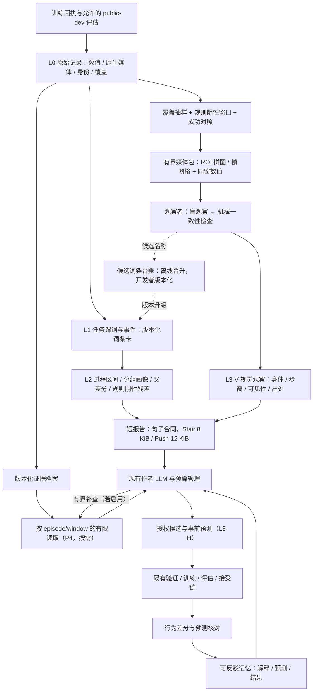

# 反馈系统升级计划：可核查的行为反馈与有界改进闭环

版本：v1.4.28（Phase 3-NEW 以仿真时序为骨架，保存变化与后续结果；多视角补形态，自由文字经语义核对后投递；作者 A/T 价值实验不再作为建设前置）

2026-10-01 评阅接口补记：两任务报告工程修复之后，执行一次已登记的旧 focus-07 DeepSeek 开发检查。30 个证据 ID 全部有效，但原对象形状要求与模型返回的字符串不一致，原检查失败且不回改。当前在唯一解析入口接受精确 ID 字符串，程序还原原 catalog 地址；旧对象/局部路径保持严格，未知 ID 和宽泛报告定位仍拒绝。8项定向检查及原答后验解析通过，不等于语义通过。实际新增费率计量US$0.073839，当前账本累计US$1.120625436（Codex费用另计且未知）。详见[接口开发记录](./P3NEW/results/n5_confirmation_execution_r4/anchor_only_focus07_dev_r1/RESULT_ZH.md)。未来正式评阅的全80事实屏障和本人原答/原目录报告投递已工程闭合，真实旧40包三轴材料接线完成；尚未封存真实80份事实或取得独立语义PASS。旧正式轮保持INCONCLUSIVE，未新增采集、训练或作者调用，阶段仍IN_PROGRESS。

2026-10-01 最新执行状态：两任务非盲工程审读已定位并从任务报告源头修复过程保真缺口：Stair补同段roll/pitch、成功组相容性及残差定义；Push补恢复路径和残差定义，并压缩重复措辞以容纳父代差分。当前开发报告为Stair 7757/8192 B、Push 11643/12288 B；登记容量压力最大分别7809/8192 B、12250/12288 B，必需过程/反例/残差不丢，超限时明确省略可选视觉。四类生产HTTP离线投递收尾见[工程记录](./P3NEW/results/n5_confirmation_execution_r4/ENGINEERING_CLOSEOUT_ZH.md)。本次修复没有新采集、训练或模型调用；当前模板已在R4上开发，旧冻结输出/答案不回写。原正式R4和限额修订均INCONCLUSIVE：固定80事实槽11完整、1引用失败、68未发，0 seal/0 report。上述工程核验不替代独立N.5，未产生正式支持率/召回率，全部最低阈值保持。Phase 3-NEW仍IN_PROGRESS，3-live/P4未启动。

2026-10-01 v1.4.24：R3 两任务原生采集和固定 CPU 复算已完成。Stair 原六句经 root 非盲模块检查为 4 supported、1 contradicted、1 insufficient：一条把左后腿当右后腿，一条以遮挡视角支持远侧前腿细节；这不是独立 N.5 评分。依据既定修正纪律，[R3 整轮转为开发资料](./P3NEW/results/n5_confirmation_execution_r3/cohort_disposition.json)，保留 INCONCLUSIVE，正式 facts/report 调用均为 0。源头补齐 Stair 的任务侧具名身体图像定位，复用已有同帧投影与白名单字段，每图四个 calf link 原点，不改变原图、提示、共享六点上限或数值派生；投影不认证可见性、接触或连续运动。旧原答不改写，修正先在开发资料验收，再冻结未使用 cohort；阶段整体仍 IN_PROGRESS，不新增作者或训练调用。
日期：2026-09-30
状态：Phase 0–2 已验收。Phase 3 工程与 48 项作者终态已交付，[模型专家评阅](./P3/human_review_20260924/REVIEW_REPORT_ZH.md)的价值门结果为未通过，作为历史结果保留、不改写。Phase 3-R 于 2026-09-29 收尾：R.0 完成（运行前提第二轮 8/8，天花板探针 32/32），R.1/R.2 工程交付并经独立重算，原“数值开发门通过”声明因裁决撤回，R.3 未执行，R.4 取消；详见[P3-R 验收记录](./P3R/ACCEPTANCE_ZH.md)、[审计](./P3R/Audit_P3R_2026-09-29_ZH.md)与[收尾状态](./P3R/audit_response_20260929/closeout_status.json)。**当前主线为 Phase 3-NEW，状态 IN_PROGRESS**；Phase 4 及以后未启动。

2026-10-01 执行补记：Stair 定位输入修正完成两次事前登记的 fresh SOL 开发观察，原五句经 root 非盲逐图检查全部 supported；旧 R3 六句不改判。修正后的[开发离线投递](./P3NEW/results/stair_body_identity_dev_r1/offline_delivery/README_ZH.md)已闭合：短报告 7,181/8,192 B、最终作者 user payload 71,154/262,144 B，仅一条视觉观察进入短报告，完整五条留在外部证据；两条旧未支持文字未混入，非视觉内容不变，Push 输出与原件逐字节相同。这些请求未新增发送作者。固定旧 media-04 的一次独立 CLI 执行已结束；[终态离线补核](./P3NEW/results/cli_clean_media_dev_r1/final_access_reaudit.json)确认 12 张原始 1920×1080 图像按序实际读取、GPT-6.1-SOL/high、无已观察压缩，原答 129 处引用及结构通过。原自动回执因只识别直接看图调用而未通过，保持原件，补核识别实际固定 code-mode 包装；没有重跑模型或正式评分。生产 DeepSeek 作者与观察者容量另列，当前包无爆窗证据，历史仍按已有条数与字节限收敛；不以评委窗口代替生产证明。详见 [Stair 开发验收](./P3NEW/results/stair_body_identity_dev_r1/README_ZH.md)、[R3 闭合记录](./P3NEW/results/n5_confirmation_execution_r3/README_ZH.md)及 [生产作者容量](./P3NEW/results/production_author_capacity.md)。开发回归已闭合，下一步冻结最终源码并做两任务 CPU preflight；正式 facts/report 仍为 0，R4 尚未采集，阶段不提前通过。
项目：`D:\humanoid_agent\true_RL_Agent`。

2026-10-01 采集执行边界补记：开发阶段优先复用已归档、同轨同步的原始数值与原图。修改诊断派生、身体标注、观察提示或报告，不等于策略运动变化，不应每次都重采整套资料。先在旧资料上完成开发与回归，明确记录其已参与开发；系统稳定后再冻结一次未用 cohort 完成独立验收。策略/场景变化或缺失必要量测、视角时，才补采所需数据。R3 旧结论与分母不回改；R4 尚未启动，验收阈值和最终未用资料要求不变。

## 修订记录

2026-10-01 v1.4.26：将评阅运行故障与诊断语义缺陷分开处理。原R4在任何report揭示前因DeepSeek输出截断停止；本次仅允许机器登记中一个已知截断槽的新请求，及未发DeepSeek槽统一65,536 cap，后续再失败不继续扩大或抽取答案。原5份完整答不重跑、旧失败及全部费用保留、40单位/80份facts先封存后report/原阈值与分母全部不变。原预注册R4仍INCONCLUSIVE。为避免与故障无关的重新仿真，本阶段工程出口允许引用这次已明确登记的同源工程语义验收，须披露后登记运行参数与混合输出额度，不称新独立cohort或无偏离预注册通过。任何生产语义、提示、表示、选择或评分修订仍按原纪律处理，不适用本例外。DeepSeek调用上限仅本轮从16增至17，总US$15不增加，逐请求重算足额预留；SOL沿原输入及argv，32k指令/预留不冒称硬cap。

2026-10-01 v1.4.25：按用户再次确认，语义验收继续主用 GPT-6.1-SOL，DeepSeek 保留固定小部分真实可行性调用；生产模型容量仍单独按 DeepSeek 验证。下一轮正式评阅使用事前冻结的独立 CLI 会话：完整原文及图像顺序保留，每份临时 home 无旧记忆/会话/其他评者答案，记录实际模型、原图访问和用量。完整轨迹评阅使用 512000 窗口，旧默认窗口不再作为可发送保证；不扩大生产作者输入。修正后的 Stair 开发验收与新 CLI 运行检查分开登记，旧 R3 不改判。见[R4 实施卡草案](./P3NEW/N5_RUN_CARD_R4_ZH.md)。当前尚未完成新来源与运行放行，正式双评仍未启动。

2026-09-30 v1.4.23：按用户明确要求减少后续DeepSeek API调用。当前两包开发检查在任何新答产生前改为Stair一次DeepSeek、Push一次全新GPT-6.1-SOL；输入与规则保持，模型变更单列。未来N.5仍40单位各两份独立原答，A路全GPT-6.1-SOL，B路8单位DeepSeek/32单位独立GPT-6.1-SOL；DeepSeek固定覆盖全部4媒体及每任务首个episode/focus，facts/report同角色。全体门槛与分母不变，32单位的同家族相关误差明确报告，不宣称全部双家族。角色表与新来源须在运行前冻结，旧轮不改判。详见[更新评阅合同](./P3NEW/REVIEW_PROTOCOL_ZH.md)。新版40包真实重建和28包独立算术/来源核验已完成，仅工程通过；整阶段仍IN_PROGRESS。

2026-09-30 v1.4.22：继续修正 N.5 的评阅输入边界，生产诊断、独立观察与短报告架构不扩张。`reference_blocks.v2` 将编号与完整原值相邻呈现，旧40包编码/48原图无损核验通过；相同材料最大文字实测209157代理token，较v1增加，不称上下文节省。过程输入审查发现省略直接列被误读为缺观测，以及终局容器携带额外诊断标签。新 `related_v2` 保留完整原始相关曲线，恢复Stair足速/参考点净空直接列，明确其它可重建量的公式与操作数；供应原始导出器已有的中立区间/极值/驻留浏览索引，排除生产诊断和一致性PASS，不给预写必要事实。原始/related/媒体投递统一任务终局投影，原始归档与旧回答保持。新视图正在真实旧资料上离线核验，不能以旧容量、单测或算术一致性冒称语义通过；正式确认仍须新冻结资料。详见[过程输入审查](./P3NEW/results/reference_anchor_probe_r1/PROCESS_INPUT_AUDIT_ZH.md)及[算术辅助边界](./P3NEW/results/reference_anchor_probe_r1/DIRECT_ARITHMETIC_FACTS_BOUNDARY_ZH.md)。

模块边界补充：生产诊断由任务数值过程模块、独立多模态观察与语义核对组成；主作者只接收有界报告和必要原始结果/精确测量/来源，不接收全量轨迹、评委原答或几千张原图。N.5的全量大包属于独立验收上下文，不能混称主作者输入。当前独立观察已实际运行，短报告投递经开发调用与离线装配验证，但整个服务的正式循环自动调度与资格不能提前宣称完成；P3-NEW仍按既定开发级范围验收，不新增常驻多代理平台。

2026-09-30 v1.4.21：R2采集和离线交付完成，Stair三条、Push六条原始视觉描述均获root非盲模块支持，但首个正式DeepSeek facts存在19个真实引用路径错误，原轮保持INCONCLUSIVE，后续调用停止。当前从[证据定位职责](./P3NEW/REFERENCE_CONTRACT_REVISION_ZH.md)修正：程序由实际材料生成结构块编号与完整地址，模型选编号并给可选块内pointer；报告沿用既有文字目录，facts到report绑定原目录，不重新编号解释旧答。原始曲线、原图、语义阈值和必要事实分母不变，生产不依赖PLAN。新契约先做真实40包离线保真/容量及必要开发验证，改变后的正式确认仍需未使用cohort；不重试旧包刷正式通过。Push来源链、全池/残差、代表/成功对照已有独立补证；未核的focus形式对象和完整双家语义资格继续如实保留，不提前进入3-live/P4，不增加作者调用。

v1.4.21实际补记：40包离线工程与文字容量已通过，一次登记旧包开发调用仍因4处真实引用错误而未通过；编号本身有效，但元数据/原值块及局部层级仍有混淆，不重试、不回判。下一步检查证据编号与原值相邻呈现，暂不启动新的正式采集。12focus已供应形式操作数的独立补证已完成（Push19670、Stair38974比较对象零差异），其几何/来源/未核物理边界如实保留；这些程序票不替完整语义资格。

2026-09-30 v1.4.20：固定两个旧 Stair 包、同盲文字与原图的一次性 SOL/high 开发对照已完成，3 条粗粒度机身/地形关系均获 root 非盲支持；这不认证必要过程覆盖，不改原 DeepSeek 六句分母，也不证明模型优劣的因果关系。下一轮按[第二轮执行合同](./P3NEW/N5_RUN_CARD_R2_ZH.md)固定两任务均用 fresh SOL/high 观察，正式双评仍为 DeepSeek 与另一独立 SOL。第一轮 N.5 保持 INCONCLUSIVE。新轮准备中发现旧 Stair diagnostic 入口硬绑定同一 namespace，仅换输出路径仍是重复测量；需在任务拥有的诊断入口显式登记 cohort 并派生新 runner seeds，默认 v1 和正式/封存评估原义保留。新轨迹来自同 checkpoint、同地形 suite 的新 reset 随机流，不宣称新地形泛化。来源、任务定义、优先级修正统一冻结后启动；未通过独立语义资格前不进入 3-live/P4，作者八槽不扩充。

2026-09-30 v1.4.19：完成同批工程闭合中的两项源头修正。数值导出绑定私有 source index，评阅打包入口显式验证各 task/run/numeric source 对应的任务定义；9 项定向测试及 72 份真实材料请求核对通过，旧冻结资料不回写。默认视觉位置改由任务层提供回合优先级：数值代表案例、已知失败、其余；公用层只排序，保留冲突优先、逐句语义准入和原始分母。114 项服务器 CPU 测试及真实生产离线装配通过，Stair 6956/8192 B、Push 11063/12288 B，均显示已支持的失败回合形态，数值及非视觉内容不变。Push 两包 SOL 原始 6 句的 root 非盲模块复核为 5 supported/1 insufficient；原 Stair DeepSeek 仍为 2/6，不能用过滤后准确率替代。已单独登记两个原 Stair 包、同文字/原图/提示的各一次 fresh SOL 载体开发对照，检验粒度问题，不改原答、不反复调提示或重试。**原轮 N.5 仍 INCONCLUSIVE；无新增作者、正式评委或训练调用**。本轮结果、限制与对照更新统一见[执行记录](./P3NEW/results/n5_confirmation_execution_r1/README_ZH.md)，当前阶段不提前通过。

2026-09-30 v1.4.18：首轮新 N.5 原始采集已经完成，Stair 864 回合/4,900 张 PNG、Push 192 回合/4,696 张 PNG，执行与绑定检查通过。Push 媒体选择器将生产成功标签 `success_recovered` 误按空标签处理，错误排除了成功回合，原观察者准备失败；已将终局分组收回 Push 任务层并用真实 classifier 输出修正回归测试。原封存源码、选择与失败保留，**原轮 INCONCLUSIVE，修复后同批只作工程诊断**；正式双评尚未发出，不回填 PASS、不重试同池冒充新确认。Stair 两次原观察已收到，root 非盲模块审查为 2/6 supported、4/6 insufficient，主要是整体姿态被扩写成所有肢体的细节；该结果不是独立评分，六条原句仍全部保留。继续完成当前资料的来源、投影与模块检查，再按既有纪律冻结未使用 cohort；不恢复作者实验、不降低语义阈值。事实与代码证据见[本轮执行记录](./P3NEW/results/n5_confirmation_execution_r1/README_ZH.md)。此前“N.5尚未采集”均为对应旧修订时点的状态，不能当作当前状态。

2026-09-30 v1.4.17：在新确认资料产生前拆开采集准备与评阅验收。旧长包实际评阅失败保留，不再用同例重试作为采集前置；采集前冻结所有影响证据、描述和判分的规则，采集后按实际完整材料核容量与执行，未评完仍不能通过。固定一单位一阶段一请求，不新增共享定义分包、跨请求摘要或自动评阅平台。N.4累计8次到顶，后续最终请求只做来源明确的生产序列化核验，不能称为新增真实作者接收。最新r4生产源码400文件及两任务服务器静态预检通过，仍不等于运行/语义资格；资源不足时不启动。详见[职责与执行顺序](./P3NEW/REVIEW_RESPONSIBILITY_REVISION_ZH.md)。所有语义阈值与新资料修正纪律保持，P3-NEW仍IN_PROGRESS。

2026-09-30 v1.4.16：针对评阅长期停留在默认上下文与重复标量核对的瓶颈，补上实际解释文本目录、精确引用检查和独立任务合同原件；它们只证明覆盖留痕和来源，不给模型代判语义。核实本机SOL默认窗口272000之外还有872000的可配置上限，允许在新确认前固定CLI独立临时上下文，仅为该次评阅设置512000窗口并验证实际执行；不改用户全局配置，不继承开发历史，不删全程原量或降低任何阈值。两任务最新源码的服务器静态预检已完成，实际采集仍待资源与最终冻结；P3-NEW保持IN_PROGRESS，N5未通过。具体依据及执行证据见[实施收敛记录](./P3NEW/EXECUTION_CONVERGENCE_ZH.md)。

v1.4.16 执行补记：两次旧全量报告执行均未完成；第二次返回47条判断、37/41项目录已评，四组共享定义与匹配接口缺口保留，不追加同例尝试。已补齐原档案绑定的奖励输入 ABI，并将评委单包条款从同一主协议直接抽取，数值/媒体共用，整轮管理职责留给运行者；36个数值包及12张旧原图的双家族请求离线核验通过。原始轨迹、全部应评文字、必要事实和共享定义不删，旧回答不改判；这是[输入职责修复](./P3NEW/results/review_packet_scope_r1/RESULT_ZH.md)，不是语义门通过。

N.4 已按累计上限完成8次作者烟测：最后两次均实际送达，Stair候选静态通过，Push因一次改变7个机制被拒绝，均无训练、无重试；本次约US$0.04248、8次累计US$0.24309，非盲读法仍发现范围与术语问题，详见[最后两槽记录](./P3NEW/results/native_author_current_r1/RESULT_ZH.md)。随后仅澄清Push“数值通道缺测”与“图像不可见”的区别，默认报告11344/12288字节、38项相关检查通过，公用层不变。这36字节修正未再发作者，旧实际请求不改写；此前r3预检只代表其冻结源码，新N.5前仍须冻结最终源码及协议。N.5尚未采集、未通过。

2026-09-23 v1.2.1，依据[第三次审计](D:/humanoid_agent/true_RL_Agent/PLAN/feedback_sys/PLAN_AUDIT_3_V1.2_2026-09-23_ZH.md)做小侵入修改：3-live 真实小探针、Phase 1 分档、Phase 3 默认工作集与重复生成、Phase 4 启动条件、Phase 5 裁决规则、两任务首个问题的对齐与登记。

2026-09-23 v1.2.3：依据[P0审计处理](D:/humanoid_agent/true_RL_Agent/PLAN/feedback_sys/P0/AUDIT_RESPONSE_ZH.md)，补齐formal c6的23条已训练父子边/22个候选权重、最新Push的10条父子边，以及历史作者输入和输出。首个采集包含真实parent–candidate对；已有P3 reference与Gen8-A新v3回放先提供描述差分。移除strict-token资格、双人盲评硬前置和四层预算矩阵。具体资源与下一阶段入口见[P0范围卡](D:/humanoid_agent/true_RL_Agent/PLAN/feedback_sys/P0/RESOURCE_SCOPE_AND_MIN_LOOP_CARD_ZH.md)；[实施前v1.2.1](D:/humanoid_agent/true_RL_Agent/PLAN/feedback_sys/archive/FEEDBACK_SYSTEM_UPGRADE_PLAN_ZH.v1.2.1.md)保留。

2026-09-23 v1.2.4：P0七项遗留清理完成；[P1验收](./P1/ACCEPTANCE_ZH.md)完成generation绑定phase回执重建、缺测与零值区分、任务投影隔离和逐lane记忆保真，265项当前CPU测试通过。借鉴本地Codex的记录/视图分离，保留既有journal及任务所有权。旧width-one路径的ledger信任层与其保证范围已明确记录，未扩建旧格式认证协议。另核实formal原parent的v1→v3祖先准入尚需在P2启动前处理，见[P2范围卡](./P0/RESOURCE_SCOPE_AND_MIN_LOOP_CARD_ZH.md)。

2026-09-23 v1.2.5：依据[P1独立审计处置](./P1/AUDIT_RESPONSE_ZH.md)，长期记忆改存逐lane奖励执行短状态，generation去掉顶层重复，详细计数留在原回执与runtime反馈。保留未知语义，增加固定14 KiB下的真实历史保留门槛；修订后267项相关CPU测试通过。P2范围卡补充历史摘要语义、旧数据派生视图与新采集的区别、原路径回放和新增信息的容量评估。Stair已有别名由同一状态导出且受历史合同消费，本次保留，不另建兼容框架。实际回放与量化结果以[P1验收](./P1/ACCEPTANCE_ZH.md)为准。

2026-09-24 v1.2.6：完成[P2实施卡](./P2/IMPLEMENTATION_PLAN_ZH.md)规定的数值证据主线。任务拥有字段、身体/时间语义与复算；共享层只负责有界存储和固定训练采样，回执封存与附件按需读取分开。训练覆盖同时贯通正常与候选失败回执的作者公开投影。原始时序不自动加入prompt，14 KiB长期记忆预算、训练与接受权威保持。先前两项P1小修见[P1小修记录](./P2/P1_CLEANUP_ZH.md)；字段、资源、来源差分和实际验收见[P2报告](./P2/ACCEPTANCE_ZH.md)。

2026-09-24 v1.2.7：依据[P2逐项审计处置](./P2/audit_response/AUDIT_RESPONSE_ZH.md)补齐实际接触判据历史和Push方向操作数，明确旧profile缺失与传感器槽时间未知。训练使用启动锚点加分散采样，仍最多24×16。固定seed训练绑定、任务终局分类和本次已验证回执读取收敛；保留历史域与独立时序复算。新增8组真实对照通过，576506个Stair有效控制帧的历史禁触判据零不一致，补回37个瞬时力无法表达的禁触终止帧；数值与资源见[修订验收](./P2/audit_response/ACCEPTANCE_ZH.md)。原始数组不入prompt，未增加长期记忆预算或生产PLAN依赖。

2026-09-24 v1.2.8：依据[P3实际实施卡](./P3/IMPLEMENTATION_PLAN_ZH.md)落地 Stair / Push 任务内行为表达、合法父差分及作者可操作性说明，保留原有接受标准。11组原始档案共5,472回合的终局复算通过；新生产重放发现的初轮入口、成功反证压缩和 evaluator 身份字段问题在源头收敛。作者实验固定12个焦点问题、2份观察包/2个策略簇、每臂2次新生成，工程验收与人工价值门分开。当前进展和边界见[P3开发记录](./P3/DEVELOPMENT_LOG_ZH.md)。

2026-09-24 v1.2.9（当时交付快照）：P3已完成48项新作者终态与53项匿名材料，92个账本槽及所有中断纳入计量；两次服务恢复和一次输出计量偏差完整保留，未提高总预算。24项Stair已存样本算术可核，Push未保存逐样本raw，保留缺失；数值/引用定位不代替事实支持率。按用户选择交付空评分表，质量收益门仍待人工，Phase 4未启动。见[P3验收](./P3/ACCEPTANCE_ZH.md)与[匿名评阅入口](./P3/results/author_final_bundle/author_blind_review/reviewer/INDEX_ZH.md)。

2026-09-25 v1.3.0：依据当前源码、P3工程审计、模型专家评阅及随机复核，在 P3/P4 之间插入 P3-R。保留已正确的数值证据与任务所有权，修正代理语义、过程组织、默认选择/裁剪、repair核心和CPU/GPU计算边界；未知通过组合描述、覆盖抽样与条件视觉探针处理。先验过程描述，再以新资料做一次同底座 A/T 质量确认；旧分数不回写为通过，评阅类型如实登记、不冒称人类裁决。阶段详细范围与退出条件单源维护于[P3-R计划](./P3R/PHASE_PLAN_ZH.md)。本次只修改计划，不代表修正已实现或新实验已启动。

2026-09-29 v1.3.1：复核 P3 作者账本与请求回执后，在 P3-R 内新增并前置 P3-R.0：先固定两臂共用的作者运行状态（P3 的 92 个账本槽中 34 次输出计量达到 32,768 上限，首次尝试失败 A 13/24、T 18/24，8 个最终输入因最小修复帧失去全部反馈），再用 4 个案例的手工整理证据做天花板探针，按预先登记的判定表决定 R.1–R.3 的扩展范围；R.3 的 24 个确认回合可分两批冻结；3-live 提前执行列为需用户明确批准的可选项。阈值、A/T 同预算、数据隔离与 §4 硬边界不变。详见[P3-R计划](./P3R/PHASE_PLAN_ZH.md) v1.1。本次只修改计划。

2026-09-29 v1.4.0：依据[P3-R 审计](./P3R/Audit_P3R_2026-09-29_ZH.md)、[审计收尾](./P3R/audit_response_20260929/AUDIT_RESPONSE_ZH.md)与用户的[语义与多模态设计建议](./P3R/audit_response_20260929/SEMANTIC_MULTIMODAL_HANDOFF_ZH.md)做方向调整：有证据支撑的过程反馈按能力建设，验收对象改为**描述保真、必要过程覆盖、未知与冲突表达、实际送达**四项；作者 A/T 价值实验不再作为建设前置，P3-R.4 取消，历史价值门结果保留不改。在 3-R 与 4 之间新增 **Phase 3-NEW**，新增描述合同、未知合同与观察者合同（§3.2–§3.4）及两条硬边界（§4.8–§4.9）；Phase 4–11 按此重排：P6 收敛为生产媒体，P7 改为观察者生产化与残差闭环，P9 改为双臂配置冻结（删除相对 A 的降错门），3-live 由可选项改为 P3-NEW 通过后的默认下一步（仍需启动卡批准与预算登记），真实收益仍只由 3-live、P10、P11 回答。本次只修改计划，未改代码、未启动实验；v1.3.1 全文归档于[archive](./archive/FEEDBACK_SYSTEM_UPGRADE_PLAN_ZH.v1.3.1.md)。

2026-09-29 v1.4.1：P3-NEW 开始实施，见[实际实施卡](./P3NEW/IMPLEMENTATION_PLAN_ZH.md)。在验收资料揭示前澄清采样口径：数值窗口目录/核对覆盖与实际媒体送达覆盖分别计量；每份报告的媒体上限不能靠分批调用重置。残差最小选取量约束数值窗口检查，不冒称全部被视觉观察；媒体未送达逐项记缺口。描述性词条不作 S2 区分性谓词；若仅展示其不具区分力的事实，须显式保留描述性标记、两侧分子分母和非区分说明，见[开发期边界修订](./P3NEW/DEVELOPMENT_DECISIONS_ZH.md)。对照不足优先记不可判。原独立语义、视觉支持与投递门槛保持，不恢复作者价值 A/T。

2026-09-29 v1.4.2：按用户明确授权，N.5 正式双评改为 DeepSeek API 加全新 GPT6-SOL 子 agent（不可用时预先登记 Astra），不再等待另一家 API。子 agent 不继承开发上下文，仅读匿名白名单材料；双方独立封存后统一核对，禁止定向重评或刷通过。模型载体、可核实模型身份及不可获得的 fingerprint/usage 如实登记，不伪造 API 回执。视觉允许 DeepSeek 评阅者与观察者同家族，但必须另有 GPT 家族评阅者，相关误差限制明确保留；取消两位视觉评委均须与观察者异家族的旧要求。事实支持、召回、定位、越权与修正阈值不变。详见[正式双评协议](./P3NEW/REVIEW_PROTOCOL_ZH.md)。

## 1. 总目标与本版决策

2026-09-30 v1.4.15 修订：旧材料核实了 Stair 源头只保存最大回退、丢掉再次回退和重返原位置的问题，见[粒度审计](./P3NEW/results/stair_process_granularity_audit_r1/ANALYSIS_ZH.md)。现任务内保留完整进度片段及局部 signed 姿态/原事件引用，短报告描述最大两段并保留终点未返回段，成功反例同样保留变化与结果；不把重返 x 当恢复平衡，不把小波动数当尝试次数。原864回合全部旧测量及终局相等，独立12回合49段一致；新数值报告6515B，最长四字节视觉句及合成父差分8177/8192B，见[实现与验收](./P3NEW/results/stair_progress_process_development_r1/README_ZH.md)。同组对照和残差合并表达，数值分母不删，生产不依赖PLAN。新职责的一次SOL执行原答45KB、未观察到压缩，但定位和共享条款覆盖追踪仍有缺口，不能凭complete=true放行，见[结果](./P3NEW/results/semantic_execution_scope_r2/RESULT_ZH.md)。旧facts/评分不重判；后续必要性按过程而非逐列字段，并避免同一事实重复加权。P3-NEW仍IN_PROGRESS，N5仍NOT_RELEASED，尚未采集新确认资料或新增作者API实验。

2026-09-30 v1.4.14 修订：同证据 r12 独立 SOL 观察的三条端点形态均获主代理开发支持，实际生产投影为 11308/12288 字节、数值过程及全部非视觉段不变，见[r12复核](./P3NEW/results/model_carrier_probe_r12/R12_REVIEW_ZH.md)。最长旧 Stair 的一次完整评阅却发生上下文压缩，原答 complete=false、1.59 MB；不追加重试，不算容量或语义通过。依据[验收职责修订](./P3NEW/REVIEW_RESPONSIBILITY_REVISION_ZH.md)，把形式化派生对象的全量独立程序核验，与双模型对解释、关系、必要过程和全部视觉文字的评阅分开；数值一致性要求100%，模型语义支持仍≥95%、必要过程召回/定位仍≥90%，两个分母分别报告，不把程序通过算模型票。此为新确认前的方法变更，成绩不与旧逐标量双评直接比较、不回判旧结果。原始曲线、全部派生对象和locator保留；两任务独立复算覆盖及最终材料仍在实施，未核部分不能称完整。观察者增加与评委一致的桌面载体证据合同，缺失fingerprint/usage如实登记；正式载体须事前按任务冻结。P3-NEW仍IN_PROGRESS，N.5仍NOT_RELEASED，没有新确认资料、训练或新作者价值实验。

2026-09-30 v1.4.13 修订：完整Push r2密采与原图验收通过，192回合数值/终局未变，1870张逐步双视角原图完整。r11唯一实际调用的坐标算术大体正确，但原答JSON缺括号、没有形成有用形态新增，并把缺脚坐标误写成无法看脚位置，结论不通过；同源失败投递保留缺口和全部数值，详见[r11复核](./P3NEW/results/body_grounding_observer_r11/R11_REVIEW_ZH.md)。另从任务源头修复Push默认报告只详述首个未恢复窗、遗漏后续恢复及再失稳的问题：现在全部恢复单位有简述、最多一窗详述；34项针对检查通过，含父差分及最长Unicode视觉材料时11893/12288字节，见[过程骨架验收](./P3NEW/results/push_sequence_projection_r1/README_ZH.md)。现有几何输入不等于模型已理解身体；在实现额外图像标记前，先登记[r12单次独立模型载体检查](./P3NEW/R12_REGISTRATION_ZH.md)，相同证据、不同模型和载体、不看旧答、不重试，不作普遍优劣或N.5结论。旧provider累计23调用/US$0.402907032计量上界；桌面费用未知。正式容量用真实旧开发facts原答重新试算，但工具辅助查看不冒称完整数组已逐token进入子代理上下文。N.5保持NOT_RELEASED，原门槛与确认集未动。

2026-09-30 v1.4.12 源头修订：r10的局部姿态与左右部位错误说明，观察者需要明确的部位身份和几何操作数。已实现v4原生快照的具名link位姿、同一RGB render product实际camera_params、公用坐标投影，以及Push任务拥有的资产绑定H-K-A夹角与六点定位；不移植人体姿态阈值，不把投影等同可见性，不从q或root高度直接推出整体下蹲。观察工作集最多五条测量事实、每图六点，精确原量与完整标定留档，作者8/12KiB边界不变。详见[实现和验收边界](./P3NEW/BODY_GROUNDING_NEXT_ZH.md)。133项相关单测及9个离线发送场景通过；401文件冻结的旧Push稀疏工程采集已完成，192回合的12个数值字段/终局一致，32原图机械通过、主代理12图部位定位开发验收通过；真实离线输入为5事实/72点/12原图。见[工程实测](./P3NEW/results/body_grounding_capture_r1/REVIEW_ZH.md)。下一单元是[事前登记r11](./P3NEW/R11_REGISTRATION_ZH.md)的一次旧Push观察检查，先补完整v4密采，不降低完整媒体门。此后尚无新增模型调用，N.5仍NOT_RELEASED。N.5的180k是保守预检目标，其真实上下文开销仍需核实，见[容量复核](./P3NEW/N5_CONTEXT_RECHECK_ZH.md)；不靠删掉事实或降低门槛闭合。

2026-09-30 v1.4.11 修订：依据r9瓶颈、PoseScript/PoseFix/MotionScript的几何事实组合、FActScore/SAFE的逐事实核对及REFLECT的分层证据思想，收敛描述职责，详见[研究与实现决定](./P3NEW/SEMANTIC_GROUNDING_REVISION_ZH.md)。任务层从已有同轨量生成少量可复算姿态短事实；Push补入原档案已有root roll/pitch，Stair明确前向仰角与root向上轴倾角，缺定义不补。共享S0定义去重而精确值保留，不把关节坐标或根部高度翻译成整体蹲姿。自由视觉句须经绑定原件的逐条语义核对才进入作者，supported须覆盖text与uncertainty全部命题；未知、驳回和未核各自保留，数值consistent不能代替整句评阅。程序保证合同和投递，评者本身仍需独立审计；正式N.5过滤前分母与精度/必要过程召回门槛不变。固定两个旧回合各一次r10开发检查另行[事前登记](./P3NEW/R10_REGISTRATION_ZH.md)，总预留US$0.10、不自动重试，不据此提前宣布阶段通过。

2026-09-30 v1.4.11 实测补记：固定r10两次唯一真实回复均机械PASS；主代理结合24原图复核，Stair3/3观察支持、Push1/3支持，膝部变化及手身份/起点仍有错误，原始描述质量不通过。review实际投递边界通过，数值与非视觉报告保持，Stair7772/8192B、Push10970/12288B；结果与局限见[r10全体复核](./P3NEW/results/diagnostic_module_probe_r10/R10_REVIEW_ZH.md)。不重复调用，不用筛选后正确率改写原始质量。阶段累计22次，登记费率下usage计量上界US$0.385198632，N.5/P4未启动。

v1.4.10 开发验收结果补记：固定三例r9已完成且不通过。明显翻倒得到描述，但Stair一个前部抬高时刻仍被写成平直，Push局部变化仍被整理成无充分证据的整体蹲起；3次原答只有1次机械PASS，不能替代语义判断。接下来优先在任务/机器人层提供少量有明确定义的姿态变化事实，模型补可见形态、环境关系及未知部分，由实际看图的核对者检查自由文字，不继续靠增加提示词或重复请求刷通过。已修复合法长视觉句/父差分的整句容量处理及无效输出的明确缺口投递；均不使错误描述变真。新确认未开始，P3-NEW保持IN_PROGRESS。详见[r9验收记录](./P3NEW/results/diagnostic_module_review_r1/R9_REVIEW_ZH.md)。

2026-09-30 v1.4.10 修订：按用户授权，诊断模块先由当前主代理结合原图、同轨状态与实际送达报告独立于作者/训练做开发验收；这是非盲开发评阅，不替代 N.5 独立双评。明确最小“任务数值过程→有界形态描述→核对→短报告”模块边界，主作者只接收必要主信息和出处；未知过程可用组合事实描述，不自动新增任务谓词，不搭建多代理辩论平台。r8 开发复核发现 Push 把不同步的小幅肢体变化切成反复蹲起，机械有效不能认证文字；源头提示允许相似/不确定、要求部位粒度与跨视角合并。新提示用固定三个旧开发回合（Stair成功/失败各一、Push失败一）按现有任务选择器各6时刻×双视角进行一次性 r9 检查，high/32768、每回合仅一次、总新增预留US$0.15，历史调用累计，不重试刷通过、不做新训练。Stair新检查累计24图、Push12图；旧开发历史超额单独保留，不冒称正式报告预算。新确认尚未采集；旧source_n5_preflight_r1与r8冻结源均不覆写，正式入口必须绑定最终新源码。详见[模块边界](./P3NEW/DIAGNOSTIC_MODULE_BOUNDARY_ZH.md)与[开发验收](./P3NEW/results/diagnostic_module_review_r1/REVIEW_ZH.md)。

2026-09-30 v1.4.9 修订：基础数值采样与原生媒体选帧分别管理。N.5在预录的两env×三seed六回合中，按原始结局和冻结哈希各取一个成功、失败回合；缺类时该任务观察者记INCONCLUSIVE，不依据自动报告好坏补选。每回合最多六个实际时刻，保留首/中/末，另取任务自有事件前/中/后；每时刻双视角，累计最多24原图。Stair使用已确认姿态/运动过程和明确回退操作数；Push使用真实执行扰动及其实际响应/恢复窗，不能以计划扰动或全回合恢复代替。0.5秒偏移按实际控制dt换算，边界缺帧留缺失，余位只按时间覆盖补齐。数值目录与媒体目录不强求重合；这些是有限观察策略，不宣称已识别所有未知过程或已实现生产自动调用。原始密采、N.5事实优先双评、过滤前分母及既有阈值不变。

2026-09-30 v1.4.8 修订：原生 v3 开发两任务均已真实返回并通过机械合同，但自由文字仍有错误：Stair 前向轴在99/196步实际向上，原答却写 nose-down；Push 比较缺少基线引用且稀疏点被写成持续过程。旧答与机械结果不改。补有资产依据、绑定该 run 的身体轴定义和方向量；无定义时保持缺失，任务/机器人语义不进公用层。通用合同要求比较引用两端、稀疏点不得写成全时段持续，默认视觉句在明确冲突后优先过程关系，量化命题 consistent 不提升自由文本可信度。下一轮旧开发仅两次一次性请求（各任务一次、Stair8图/Push16图），观察者开启 high thinking/32768，新增预留 US$0.10；Stair 历史原生32图加本次8图累计40图，Push16加16累计32图，不伪称符合原开发单轮24图；所有旧失败/错误保留。此为输入定义和推理配置修正后的开发检查，不是受控消融、重试刷分或正式确认，正式每报告24图限制不变。N.5 视觉支持的事实范围明确为观察者实际收到的完整原图工作集，并附完整数值轨迹；密采未显示图留档、不替观察者补证，不宣称已完整评阅全部密采录像。原始完整过程的数值验收、过滤前观察分母和阈值不变。

2026-09-30 v1.4.7 修订：旧开发原生观察暴露了输出合同的重复职责：模型同时填写引用、步窗、可见性与数值标签，出现时间字段矛盾和否定命题缺少极性。观察者 v3 收敛为身体、图像引用、形态文字、空间可见性、状态/变化关系及可选 `{id, asserted}` 数值命题；公用层从引用推导时间范围、引用步和间隔，任务层按同源测量核对命题真假。空间遮挡与时间采样覆盖分开；所引步之间的间隔不冒称整个输入未显示。保留所有原始输出及无效项分母，不给整句自然语言盖数值真值章。旧 v2 原生 Stair 开发配额已用满24图；为检查合同的实质修订，在新输出揭示前明确另登记一次8图 v3 开发调用，累计32图，不冒称仍满足原开发配额。该一次开发例外不用于 N5/生产，正式每报告24图上限不变。历史失败不重判，新确认尚未开始；阈值、任务所有权、媒体工作集和正式双评边界不变。开发同源双视角已完成，两任务有限双环境采集数值非干扰检查通过；工程与像素可辨性、语义验收分别记录。

2026-09-29 v1.4.6 修订：原始媒体采集覆盖与实际模型工作集明确分开。正式卡可预登记同一次 rollout 的两个 env × 三个 seed，共六个原始媒体回合；每份报告实际观察仍累计最多四回合、24 图、96 子帧，不按调用重置。两个 env 的有限原生采集接口须先完成工程验证，任务分别拥有各自终点 T；不把另一轮同 seed 重放的画面挂到本轮数值档案。原始终局决定成功/失败覆盖，缺类如实 INCONCLUSIVE，禁止事后换 env 冒充预选。

2026-09-29 v1.4.5 修订：在新确认资料采集和揭示前，纠正同池两批/储备的隔离假设。五束组级问题及完整过程工件会暴露整池过程；看过这些再换回合 ID 不能称为未揭示储备。N.5 改为一次性 24 回合全体独立评阅，仍先封存原始事实清单、再揭示报告；任何据确认资料修改规则、选择、压缩、模板、提示或判分主规则，均使整包转开发，另冻真正未用的 cohort。原有支持、召回、定位和越权阈值不变，不新增批次管理平台，不把相同 namespace 的重复测量当新资料。

2026-09-29 v1.4.4 修订：用户明确要求“无需考虑训练采集用时等预算，追求更好的效果”。后续采集不再受此前 2 GPUh 总额、1 GPUh 确认采集额及其开发分配约束，运行超时按合理完成时间和挂死处理设置，不能为了挤入预算截掉关键过程。保留实际资源、失败与重试记录。原始媒体按需要密采、完整保留首回合与末段，模型输入仍按问题选择有来源的少量图；上下文、记忆及每份报告媒体容量是质量边界，不等同于原始采集预算。具体实现、实际通过与未完成项见 P3NEW 开发记录；本次决定不改变语义验收阈值、数据隔离或任务权限，也不代表新增训练已经启动。

2026-09-29 v1.4.3 修订：依据用户关于画面质量、多视角和仿真额外信息的指示，明确“测量时间线 → 过程关系 → 互补视觉 → 带来源的报告”主线，见[仿真证据设计](./P3NEW/SIMULATION_EVIDENCE_DESIGN_ZH.md)。删除把旧 4×3 拼图可辨性当作普遍前提的表述；最终发送尺寸和遮挡必须实查。N.3 允许在原预算内用最多两个同状态互补机位，任务拥有取景与测量语义；不是多视角已实现声明。能直接测量的事实不再交给视觉重复猜，视觉、测量与因果假设保持不同来源。新确认尚未揭示，历史回执和评分、阈值、任务权限及预算不变。

**让作者LLM知道策略具体做了什么、哪些解释仍不确定、哪些修改在授权范围内，以及改完后预期行为是否真的发生；证据增加时，成本、上下文和记忆仍有界。**

本版保留 Phase 0–11 的编号，在 3-R 与 4 之间新增 Phase 3-NEW。早期方向“现有事实→必要时序→行为描述→作者离线判断”已经走完：P3 与 P3-R 的作者实验没有证明过程反馈改善作者输出，也没有证明它无用，而是定位了失败的层：投递形式（索引编码表、密集数字、修复帧丢反馈）、运行状态（推理预算耗尽）和观测缺口（决定性失败形态只在录像里可见）。本版据此不再用更多作者对照回答“加入过程反馈有没有用”，而是把“有证据支撑的过程反馈”当作要建设的能力，验收它是否正确、完整、诚实、送达；训练收益留给真实闭环回答。

四项决定：

- **高层行为成为正式交付。** 默认反馈是回合时间线、分组行为画像、candidate 与 parent 的行为差分，以及经核对的视觉形态补充；原始轨迹与媒体留在外部按需核查。
- **过程反馈按能力建设，作者价值实验不再是建设前置。** 建设是否值得的判断由用户依据 R.0-b 天花板证据作出并记录于本版；§4.7 的“诊断有用”一级登记为**用户决定接受**，不是验收通过。P3 的正式价值门历史结果仍为未通过；今后若要对外声称收益，用 3-live、P10、P11 的真实闭环回答，不再安排离线 A/T 对照。
- **预测核对进入闭环。** 作者在实验前登记可测预测，实验后由固定规则比较证据；行为改善、任务成功、候选接受、物理因果四种结论分别报告。
- **计划冻结目标与硬边界，阶段启动时冻结具体方案。** 文件格式、类名、模型、词表阈值、相机、样本量和统计实现不在今天全部写死，也不能在看过本阶段验收结果后降低标准。

本版依据（均为已存在记录，不是本次新实验）：

- P3 正式价值门（model_review）：事实支持率 A 92.7% / T 84.1%，关键硬错误 15 / 39；独立重算方向稳健（12 个案例中 11 个 T 更低，案例级精确符号置换 p≈0.001），但 12 题来自两个观察包/两个策略簇，且与推理预算耗尽（92 个账本槽中 34 次输出计量 ≥32,000 token：A 14/41、T 20/51，含 1 个按上限预留的中断槽）、修复帧丢反馈（8 个最终输入）和索引编码行为块混杂，不能推到“过程反馈本身有害”。
- P3-R.0-a：high / 65,536 下 8/8 完成；两臂共用设置固定。
- P3-R.0-b（4 案例 × A/T0/Tc-num/Tc-vis × 2 次，[结果](./P3R/R0B_RESULTS_ZH.md)）：A 与 T0 均 0 个案例达标；Tc-num 原判 2 个案例，[裁决](./P3R/audit_response_20260929/AUDIT_RESPONSE_ZH.md)确认 001 的代码矛盾后降为 1；Tc-vis 原判 3 个案例，022 存分歧则为 2。两种局部重算都落在预登记的“只有 Tc-vis 有效”一行。原评阅的每项硬错误：A 0.62、T0 1.12、Tc-num 2.00（Stair 3.25）、Tc-vis 0.62；行动相关性 2 的生成：Tc-num 3/8、Tc-vis 7/8。密集数字增加作者错误，几句经核对的短形态句同时提高准确性与行动相关性，这是本版描述合同（§3.2）的直接依据。
- 有界视觉探针（4 张 Stair 拼图，Codex 模型观察，[记录](./P3R/audit_response_20260929/visual_probe_model_review.json)，非盲）：躯干翻转、几乎不动等原则上可由根部/足端数值复现的形态（本轮未做数值核对）、躯干低伏（当前无根部相对台阶面的高度量，只能记仅视觉）以及腿屈伸轮廓等仅视觉可见的形态均可辨；接触、力、终止原因不可判；远侧腿遮挡、稀疏采样、终止帧缺失是固定限制。它也暴露了观察者读到结局字段的污染事故，本版把盲观察协议写入合同（§3.4）。
- R.1/R.2 工程：Stair `observed_motion.v2` / `public.v3`（[记录](./P3R/STAIR_MOTION_V2_ZH.md)）、Push `push_process_v2`（[记录](./P3R/PUSH_R1_R2_IMPLEMENTATION_ZH.md)）从原始数组独立重算通过；修复帧保留证据核心（[记录](./P3R/PROMPT_EVIDENCE_RETENTION_ZH.md)）；Stair CPU 派生不再占住 GPU；独立诊断 cohort 入口就绪（[记录](./P3R/DIAGNOSTIC_COHORT_BOUNDARY_ZH.md)）。选例审查另发现“时长中位实例不代表最常见过程”（[记录](./P3R/STAIR_PROJECTION_V2_ZH.md)）。
- 作者常见误读类别（P3 与 R.0-b 共同观察到）：回合当 cell、子组比例推广总体、终止同帧当终止前、整回合列与末段窗口列混用、score 当成功率、中断总数当每回合阈值、张量轴误读、奖励上界当逐状态主导、代码改变了声称不变的部分。它们大多是句子层面缺少范围、分母与时窗，见 §3.2。

两份早期审计原文保留不改；逐条判断和未采纳理由见[审计处理记录](D:/humanoid_agent/true_RL_Agent/PLAN/feedback_sys/AUDIT_RESPONSE_AND_PLAN_REVISION_2026-09-23_ZH.md)。[v1.1原稿](D:/humanoid_agent/true_RL_Agent/PLAN/feedback_sys/archive/FEEDBACK_SYSTEM_UPGRADE_PLAN_ZH.v1.1.md)与 v1.3.1 已归档；[既有研究记录](D:/humanoid_agent/true_RL_Agent/PLAN/feedback_sys/RESEARCH_AND_ENGINEERING_REVIEW_ZH.md)保留方法与源码依据，实施顺序和预算以本版及其阶段登记为准。

## 2. 当前基础与真正缺口

本节最初调查快照的HEAD为`5cef484d`；P1实施与审计修订的检出HEAD为`fe96455d`；P3-R 工作区基于 `e5c2b901` 且含大量未提交交付。实施基线同时记录实际源码内容、配置和协议hash，不能只以HEAD代表工作区。

| 范围 | 已有基础（2026-09-29） | 本版补什么 |
|---|---|---|
| Stair 数值过程 | `observed_motion.v2`：带符号 roll/pitch、`up_z=1−2(qx²+qy²)` 与首次负值步、最大回退、同一支撑体“无瞬时承载且低运动”区间、可重叠的 low_progress/tilt 区间；`public.v3` 8,073 B 保留 8 层完整分母与 5 个受保护的同 cell/run 对照；864 回合、3,312 段独立重算一致 | 词条卡与句子合同；规则阴性残差；按最常见条件组合选例；视觉形态补充；仍不可测的接触对象/面明确留缺口 |
| Push 数值过程 | `push_process_v2`：本次注入锚点、首帧/峰值/末帧、窗口净位移、五项稳定条件的违反区间、全条件稳定区间、latch 后再失稳；12 KiB 默认视图保留四强度分母与相容成功对比；192 回合、1,811 条件区间复算一致 | 词条卡与句子合同；残差与覆盖抽样；逐脚观测仍缺，迈步/落脚/踝髋策略保持 `requires_new_observation` |
| 投递 | 初稿、源码续答、静态修复、推理耗尽修复均保留任务反馈与焦点（P3 的 8 个丢反馈末帧重建通过）；完整请求按序列化字节计量；共同提示已写明“多个过程观察不是改多个机制的授权” | 报告骨架与裁剪优先级；“档案有／派生有／报告有／最后请求有”四层账；作者读法烟测 |
| 运行状态 | 两臂共用 high / 65,536 / 40k 输入；R.0-b 34/34 请求投递审计通过 | 不变；观察者调用另计 |
| 媒体 | 原生录制存在，但 `NativeVideoRecorder` 把全部 RGB 帧驻留内存（旧样本302帧约796 MiB）；历史单帧传输探针通过，只证明该输入可送达与粗识别。开发复查发现旧4×3拼图均衡/缩放和部分机位遮挡会影响姿态辨读，不能作为通用画质证明。两个入口支持按env索引录制，现有录制仍为单机位；相机参数已可配置 | 最终输入画质与有界互补机位验证；观察者组件（开发级）；完整媒体生产化和有界缓冲留 P6 |
| 未知过程 | 计划有“组合描述、未知出口、独立抽样”的原则，但没有实现规则阴性残差、覆盖抽样与候选词条台账 | 全部作为 P3-NEW 交付 |
| 作者与记忆 | 已有 source_request、authoring journal、机制卡、session 内派生索引；过程预测类别审查显示 32 份提案中 14 份含过程预测（其中 5 份带范围/量化限制）、13 份无、5 份歧义 | 预测字段进入 rationale（3-live）；记忆保存解释/依据/干预/结果（P5） |
| 独立确认资料 | Stair `public_dev_diagnostic_v1` namespace（base seed 170100）已实现并测试；Push 的 `eval_base_seed=1500000000` 已进入生产 cohort/计划绑定并有合成 CPU 检查；真实合格 G1 来源的新卡 preflight、采集与最终身份核对仍待完成；旧采集卡已作废且未执行；旧 P2/P3/R.0 资料全部为开发集 | 在 P3-NEW 重新冻结后采集并同步录制媒体；采集质量优先，实际耗时留账 |

特别说明：Push物理overlay当前关闭接触传感器；补逐脚接触不是免费日志扩展。Stair脚部参考点、base位置与合力，也不能直接证明脚尖撞某个立面。作者当前收到纯文本；观察者可以是任何经真实传输验证的视觉模型，不由旧模型别名推断远端能力。历史搜索是相关样本，不能按checkpoint个数计算独立实验数。

## 3. 目标架构：七个合同

图中的读取只访问允许的 public-dev 证据；训练摘要通过既有训练回执投影。观察者把画面变成带出处的文字，再经数值一致性检查进入短报告；作者默认不直接收图。候选名称只进台账，不在线进入词表。

### 3.1 观察合同：五层表达，明确来源

| 层 | 产物与产生者 | 用途与边界 |
|---|---|---|
| L0 原始记录 | recorder 生成的数值、原生媒体、identity、时间、覆盖与缺失状态 | 外部留存、重算和回查；内部路径与私有 seed 不进入作者输入 |
| L1 任务谓词与事件 | task/robot projector 从合法字段与版本化规则派生：条件开始/确认/结束、接触边沿、扰动锚点、终止 | 每条谓词有词条卡（§3.2）；规则事件不等于物理根因 |
| L2 过程与分组表达 | task-owned 确定性投影生成过程区间及其重叠、分组画像与同条件对照、合法父差分、规则阴性残差 | 作者默认工作集；每句回指 L0/L1，不增加新的真值来源 |
| L3-V 视觉观察 | 观察者（经真实传输验证的视觉模型）对已绑定窗口的画面所写、经一致性检查的观察，含身体、步窗、证据类别、可见性、不确定性 | 进入报告的“视觉形态补充”一节；不能覆盖测量、不改词表、不控制验收；与数值冲突时并列保留 |
| L3-H 假说与预测 | 作者产生的解释、干预意图、事前预测；待验证的规则建议 | 与事实分开；预测按 §3.6 裁决；规则建议只存台账 |

L1 与 L2 都是确定性派生层；增加 L2 不是增加一份实验真值。MotionSegment 保留 producer 与证据类型，同名视觉描述不能覆盖规则事件。

L2 包含四个逻辑对象，不要求实现成四个新服务：

- **EpisodeTranscript**：一回合发生了什么，按时间和身体部位组织，允许并行动作、反复、持续到终止、只见后半段和 unknown。
- **BehaviorProfile**：同一比较域内的行为分布、分母、覆盖、成功与失败组对照；有限代表样本不代替总体统计。
- **BehaviorDiff**：在可比条件下 candidate 与 parent 的变化，保留原始值、配对覆盖、缺失及不确定性。不同策略轨迹不能按相同 step 强行对齐；需要时按外部扰动或任务事件对齐并保留对齐误差。
- **UnexplainedResidual（规则阴性残差）**：每个比较域中现有词表无法与匹配成功区分开的失败回合及其数量、抽样与观察状态（§3.3）。它是报告的固定一行，不是可省略的附录。

描述只承诺观测足以支持的粒度：低净空与减速先分别报告，“阻滞”需作为待核假说，不能自动叫 toe collision；支撑刚体参考点不冒充足底中心或脚尖；base 所在层不等于实际接触面；无离地不证明 ankle/hip 策略。词表外可见事实允许保留，不能因不在规则表中被当作不存在。

### 3.2 描述合同：粒度、句子与词条卡

**粒度原则。** 一句话取三个条件同时成立的最粗一级：能按冻结规则回核到 L0/L1；带有范围（单位是回合、分组还是 cohort，分母是什么，时窗是什么）；改变作者对“该碰哪个机制”的判断。更细的数字留在完整档案，更粗的机制断言不属于报告。“高层”是把有关联的事实组织成读得懂的过程，不是更多术语：“完成驻留后平移速度再次越界，终局未稳定”是可核的高层过程；“策略不懂恢复”没有定位信息。

**六种句型。** 以已复核的 Stair `r1.e64` 与视觉探针 `slot64_r1` 为例（均为开发资料，只作说明；句型编号用 S 以免与 P8 的“代”混淆）：

| 句型 | 例子 | 来源层 | 必填槽 |
|---|---|---|---|
| S0 测量句 | root `up_z` 于第 418 步首次小于 0（回合 r1.e64） | L0/L1 | 主体、谓词、时窗、回合范围 |
| S1 过程句 | r1.e64：369–426 步低进展；385–426 步持续倾斜（394 步确认）；414–426 步无瞬时脚部支撑；426 步禁触终止。更早已出现倾斜，不是全程首次 | L2 | 主体、谓词、时窗（开始/确认/结束、终止标记）、回合范围 |
| S2 组句 | c1_frontier L5 / run 1 / 禁触组：9 个失败中 7 个出现确认倾斜；同 cell/run 的 2 个成功也都出现（2/2） | L2 | 谓词、范围（组 n/N 或 cohort N）、对照对象与匹配级别、规则版本 |
| S3 形态句 | 画面（重放 run `slot64_r1`，第 405–425 步，终止帧未显示；与数值回合 r1.e64 仅端点一致，逐步对齐未验证）：躯干向侧/后翻转，多只脚高于躯干；标“重放观察”，不与 418 步拼接。远侧腿遮挡，不判定接触 | L3-V | 身体、步窗、媒体身份与对齐状态、证据类别、可见性 |
| S4 差分句（示意数字） | candidate 对 parent（同规则版本 `stair.observed_motion.v2`，配对 cell/run 5/5，缺配对 2 组）：确认倾斜失败占比 7/9 → 4/9 | L2 | 两侧范围与分母、规则版本、配对覆盖、缺失 |
| S5 残差/缺口句（示意数字） | frontier L5 / 禁触组：9 个失败中 3 个规则阴性、0 个对照缺失；观察者抽样 2/3，未抽样 1。缺口：看不到脚与台阶的相对运动，无法区分摆动停止与遮挡 | L2 / L3-V | 范围与分母、抽样数、缺哪种观测、当前能说到哪里；不要求时窗 |

“俯仰惩罚导致翻倒”属于 L3-H，作者可以写，报告不写。只有与数值同一 run 同步录制的媒体才允许在 S3 中写“与 up_z<0（步 n）一致”，且这一标记只能由 §3.4 的机械检查给出；cohort 句是 S2 的范围取值，不是另一种句型；第 (7) 节可操作性映射是 §3.5 定义的结构化块，不走句子 lint。

**句子合同。** 报告中的每一句由确定性模板渲染，槽位固定：主体（身体或部位）；谓词（词条 id 与版本）；时窗（开始/确认/结束，或“整回合”；终止步单独标记；before_terminal 计数要求确认步严格小于终止步，全回合极值含终止步；终止截止不等于状态自然结束）；范围（回合 id，或组 n/N，或 cohort N）；对照对象与匹配级别（仅 S2/S4：同 cell/run、同 cell 他 run、同 stratum、缺）；规则版本（S2/S4 必填，不同版本计数不可比）；来源层；必要时的“不等于”。渲染不新增 LLM 叙事调用。机械 lint 按句型检查必填槽：S0–S3 必有时窗，S4 必有两侧范围与规则版本，S5 必有分母与缺口类型；分母与全量汇总一致；默认报告不含索引编码表，数字只出现在带范围的句子里；骨架的七节各自必须出现，或以 S5 句写明“本节缺／被省略”及原因，缺节且无说明计 lint 失败；描述性词条（见词条卡状态）可进入 S1 时间线与分母行；若用于 S2，必须显式标为描述性及非区分比较，同句给两侧范围与 n/N 并写明“不具区分力”，不得作为区分性谓词。成功侧高出现率在词条卡与反例中明确记录。已观察到与可预期的作者误读逐类对应到规则：

| 误读类别 | 句子合同规则 |
|---|---|
| 回合数说成 cell 数；子组比例推广到总体（已观察到） | 范围槽必填；组句必须写分母，cohort 句与组句不混写 |
| 终止同帧当作终止前；整回合列与末段窗口列混用（已观察到） | 时窗槽区分开始/确认/结束；“曾发生”与“全程如此”分句；整回合量与窗口量在句中标明时窗 |
| score 当成功率；中断总数当每回合阈值（已观察到） | 指标只用词条卡登记的名称并附单位；派生率写清分子与分母 |
| 密集数字表引发的读错（已观察到） | 默认报告不含索引表；细碎数值留档案，报告只留会改变判断的转折、反证与范围 |
| 张量轴误读；奖励上界当逐状态主导；代码改变了声称不变的部分（已观察到） | 属作者代码层：由既有静态核验与“保留声明”算术检查兜底，不进报告 |
| 冲突行被当作改多个机制的许可；“仅视觉”被当作测量；S4 差分被读成因果（可预期，读法烟测专门登记） | 冲突行与“仅视觉”句带固定前缀；S4 只陈述变化与配对覆盖；共同提示已写明观察不是多机制授权 |

**词条卡。** 每个正式词条一张卡：id 与版本；可测定义（操作数、阈值、持续条件、坐标/参考点、单位）；身体角色；时窗语义；适用 profile 与缺字段降级；它针对的失败形态；“不等于”清单（例如 `loaded_point_motion` 不等于接触面滑动，无载低运动不等于控制器冻结，low_progress 不等于全身静止，up_z<0 表示机体 z 轴翻到世界 z 负方向而不是“背部触地”）；开发池上的区分力（失败组出现率对同 cell/run 成功组出现率，各带 n）；至少一个困难反例；一条模板句；状态（正式 / 正式-描述性（开发池无区分力，如 `loaded_point_motion` 的 9/9 对 2/2） / 候选 / 仅视觉 / 已退役）。不能给出可测定义的名称不是正式词条。

**报告骨架。** 默认短工作集固定顺序：(1) 任务结果与分母；(2) 主要失败过程：S1 与 S2 各一，含一个主要过程的时间关系；(3) 相容成功反例；(4) 视觉形态补充（S3，若有）；(5) 未覆盖、冲突与规则阴性残差（S5）；(6) 合法父差分（S4）；(7) 可操作性映射。Stair 8 KiB、Push 12 KiB 的视图上限与 56 KiB task sections、14 KiB 长期记忆保持为起始约束，各节句数上限在阶段卡冻结；预算不足不一律处理成扩窗。裁剪优先删重复例子与细碎数值，保住会改变判断的转折、反证、范围与残差行；修复请求保留同一证据核心；不能靠删反证让报告显得更确定。

**三重实例检查。** 群体计数正确、实例区间忠实、实例代表常见过程是三件事。代表回合按“主要失败组内最常见的条件组合，再取组合内时长中位、编号最小”选出：条件组合在阶段卡冻结的“终止前已确认”正式词条子集上定义（Stair 首版为 tilt、low_progress、同体无载低运动、up_z<0 四项），相对多数即为“最常见”，平票按组合字典序取并在句中声明“平票”；代表句必须带 `pattern_n/group_n`，当它不大于 1/2 时必须写“非多数组合”，且该节不得使用“主要失败过程”措辞。不按时长中位直接选，不手工指定戏剧性回合，不引入聚类或新类别。

**词表增长约束。** 新增词条必须先通过区分力门槛并附反例；默认报告的句数不随词表增长，新词条只能替换或省略；不为每个失败故事补专用标签。Tc-num 的教训是数字越多硬错越多，报告长度有硬上限。

### 3.3 未知合同：组合、残差、开放观察与晋升

不以是否命中已有标签决定有没有内容可说，按三种情况处理：

| 情况 | 系统应做什么 | 不做什么 |
|---|---|---|
| 量已有、组合未见 | 直接以 S1 句表达时间片段与组合（重叠、先后、反复、持续到终止），每个子句定位到量或帧；不必先有行为名 | 不硬命名成某种步态或策略 |
| 数值难表达、画面可见 | 作为 L3-V 观察保存：有时窗、身体、可见性；允许“可见一侧腿比另一侧更伸展”这样的新描述，作为可撤回的描述性名称 | 无关节量或遮挡时不升级为精确关节策略；不自动进入判定规则 |
| 两者都不足 | 写缺口句：缺哪种观测、当前能说到哪里，例如“看不到脚与台阶的相对运动，无法区分摆动停止与遮挡” | 不把整段压成 unknown，不写“没有异常” |

**规则阴性残差。** 判据由任务登记，每个失败回合落到三种状态之一：规则阳性、规则阴性、对照缺失不可判。比较域：Stair 为（失败原因，cell，run），Push 为（强度组，实际执行事件数，恢复窗口）。Stair：失败回合在终止前没有任何正式词条被确认，或其“终止前已确认词条集合＋各词条相对终止的确认时长分箱”这一签名在同域成功对照中出现比例不低于冻结阈值，记规则阴性；同域成功数少于阶段卡冻结的最小值（建议 3），或必要字段/窗口无效时，优先记“对照缺失不可判”，不先套无词条阴性判据；与规则阴性同等进入数值窗口补充目录和有界媒体选择池，分别记录实际覆盖。Push：not_recovered 按定义至少违反一项条件，因此只用第二条判据：窗口的“违反条件集合＋首次违反相对锚点的时间分箱”签名在同域 success_recovered 窗口中出现比例不低于阈值时记规则阴性。在两组都接近 100% 出现的词条（如旧 `window_slip_any`）按定义不提供区分，这正是该判据要暴露的情况。残差行固定格式“该域 N 个失败中 k 个规则阴性、u 个对照缺失不可判”，携带词表版本；旧报告及其残差行不重算、不覆盖，新版本词表只作用于新派生，历史域按新版重算时另存为带版本的新派生并保留旧行。历史依据：旧词表能在这些回合上触发 tilt/low_progress，却既不能把后翻、腹部下沉、冻结跨立三种形态彼此区分，也不能把它们与同 cell/run 的成功区分（核心组 tilt 7/9 对 2/2、low_progress 9/9 对 2/2）；三种形态只在评阅录像里可辨。它们在 v1 与当前词表下的规则阴性状态由 N.2 按冻结判据回溯确定。R.1 把翻滚（up_z<0）和无载低运动变成可测词条，就是晋升路径的先例。

**覆盖抽样。** 抽样器输出窗口列表（回合、起始步、结束步、来源＝规则无关基线 / 规则阴性或对照缺失补充 / 成功对照），由两部分组成：规则无关基线为固定 seed 的分层抽样，每（层 × 结果）至少 1 个回合，每回合 m 个等距锚点各扩展 w 步；规则阴性与对照缺失回合按确定性哈希序补入，每任务封顶 c 个回合（c ≥ 4）；这是数值窗口目录与实际数值检查的覆盖，不能等同于视觉观察覆盖。媒体采用独立预登记覆盖层：从实际同步录制回合按原始结局与冻结哈希序选择每份报告最多四个，保留成功与失败，复用任务的窗口定义；不要求与结果产生后才确定的数值目录成员相同。分别登记两层重合、缺类、没有媒体、未发出或被裁剪的窗口，媒体不替代必需数值专项检查。数值目录不受图像上限裁掉必需残差窗口，媒体层严格服从 §3.4 的上限，不能通过分批调用重置同一报告的上限。m、w、c 与媒体选择顺序在阶段卡冻结。覆盖率按两个维度报告：回合覆盖＝抽样回合数／域内回合数（按层 × 结果列出），时间覆盖＝窗口并集步数／回合总步数（按回合列出中位与最小值）。它不是能发现所有新行为的检测器。lint 维护中英禁用短语表（“没有异常”“行为正常”“no anomaly”等）；残差行必须出现，0 失败的域写“0 个失败中 0 个规则阴性”而不是“正常”；残差或对照缺失数大于 0 且未抽样数大于 0 时必须至少有一条 S5 缺口句。

**候选词条与晋升。** 观察者提出的名称进入候选台账：来源回合与窗口、观察者版本、原始名称、开发者归并后的规范名（归并记录保留）、出现次数。P3-NEW 只登记，不评“是否影响诊断”。晋升条件在 P7 执行：某个规范名跨至少两个 run/采集反复出现并影响诊断，且开发者能从 L0 字段给出稳定可测定义，才按顺序晋升：开发池验证区分力与成功组误报 → 困难反例 → 第二名上下文独立的评阅者按同一可见证据核对区分力与反例 → 版本升级 → 进入任务代码。旧记录不静默改名。永远测不到的东西（接触面、脚尖勾住）留在“仅视觉可见”，报告明确它是观察不是测量。模型不在线扩充正式词表，不建专用 OOD 网络、自动本体扩展、在线学规则或异常分数平台。

### 3.4 观察者合同：媒体如何进入报告

**分工。** 数值负责精确量、全回合覆盖和分组统计；画面负责难用现有通道表达的形态、空间关系以及发现遗漏。两者对齐到同一 episode、身体和时间窗后共同展示，不先把所有画面压成“翻倒/卡住”一个词。

**输入。** 任务先从同源仿真时序建立可测过程，再从全程资料选少数窗口：事件锚点、覆盖抽样与规则阴性窗口，保留变化前、中、后，同时保留成功或规则阴性对照，按时间去重，被去重或裁掉的帧与窗口记录为省略范围。媒体使用带步标签的原生帧，或经过实际尺寸可辨性检查的等比帧网格；ROI 不裁掉身体与必要环境参照，不做直方图均衡或非等比拉伸。旧探针与旧 4×3 拼图不构成后续媒体可辨性保证。每个媒体窗口与同窗数值量绑定同一 episode、checkpoint、run 与步范围引用。**盲观察协议按白名单 schema 序列化观察者输入**：回合别名（与档案 id 的映射不随包发送）、相机/布局/ROI 版本、显示步标签、身体名、同窗 S0 量（只有数值与单位，不含终止、成功、失败、原因、分数、来源类别字段）、可见性元数据；窗口末只标“显示结束步”，不标“终止前”；不含结局标签、分数、作者答案与评阅结论。机械审计＝schema 校验＋对实际发送字节做禁用 token 扫描（结局枚举、primary reason 字符串、score / success / fail / terminated / forbidden / timeout / recovered 及对应中文词表），任一命中即该批观察降为开发资料。先写观察，再做核对。

**仿真与互补视角。** 能从已采集记录计算的姿态、运动、接触判据及事件时间由任务代码计算；视觉补足可见形态、遮挡与未知名称，不让模型从像素重复猜测这些数值，也不把读取 S0 当作图像所见。必要时每个选中状态最多两个互补机位，保存逐图 view_id、相机参数和控制步；两视角必须来自同 run 同一步、不推进物理且 reset 前的同一状态，不把另一次重放拼成同步多视角。任务决定机位与所需测量，公用媒体层只维护身份、传输、计量和保真。额外字段按实际问题最小补采；仿真可读取不等于档案已记录，诊断权限不扩大策略观测或奖励 ABI。所有视角共享原图数/帧格/像素/费用上限，不能以机位重置预算。取景与布局在开发样例验证后、确认采集前冻结；主体被严重遮挡或实际发送尺寸不可辨的窗口不作可观察证据，保留缺口。过程的测量、画面、候选解释分开引用，时间顺序不写成已证实因果。

**输出。** 每回合至多 k 条观察（k 与字数上限在阶段卡冻结）。模型填写身体、逐图引用、形态文字、空间可见性、状态/变化关系和不确定性，可选声明数值命题及真假极性，另列“看不到什么”。归档和报告同时携带公用层由引用派生的步窗/时间覆盖，以及任务核对后的数值一致/冲突/仅视觉状态。空间可见性由观察者填写并由标注者复核；ROI 裁剪丢失身体的窗记不可见。

实际请求审计扫描序列化 JSON 的全部文本层，先解码 JSON 转义；图像 data URL 中的 base64 数据不当作自然语言扫描，另保存原始图像字节哈希与尺寸，并核对真实传输中的图像字节相等。这样既不会因随机编码字符误报，也不能绕过文本字段、标签或实际请求的检查。新增测量命题定义同属被扫描的白名单文本，不能携带结局名称。

**机械一致性检查。** 身体必须存在，逐条引用必须指向实际输入图。模型不再重复填写步窗；公用层从引用推导首末步、所引步集合及引用间隔，并区分单点、连续控制步与稀疏引用。空间可见性单列 visible/partial/occluded，不用它代替时间覆盖。变化关系需要同一视角至少两个不同控制步；多幅同刻图不能支持变化。白名单媒体元数据可携带任务登记的测量命题 `{id, body, definition}`，只定义量、参考系、阈值与显示步聚合，不含行为类别或结局；观察者可显式选择 `numeric_claim={id, asserted: true/false}`，分别表达命题成立或不成立；代码不靠自然句关键词猜含义。任务核对实际真值与所声明极性，缺测保持不可核，不当作 false。映射表每条含 L0/L1 字段、坐标系、阈值、聚合方式与步容差；表可以为空或部分，无映射的观察一律标“仅视觉”，不算冲突。Stair 首版核对显示帧的机体竖轴世界 z 分量是否曾小于0，以及显示首末 root x 净位移；Push 首版核对显示帧内相对环境原点的最低 root 高度和显示首末平面净位移。均从同一 run 的 L0 按实际显示步重算，不用包含未显示帧的整窗极值替代。俯仰正负暂不自动翻译成前/后倾：Euler pitch 与机体朝向、翻转状态有关，待完整约定后登记。净位移小只表示首末接近，不证明持续静止、控制器冻结或全身不动；`up_z<0` 不证明完成翻滚或身体触地。S3 分别保留视觉原话、可见性与“所声明量化命题成立／冲突／不可核”；命题成立不等于整句形态被数值证实。冲突并列保留，不按“哪个模型更自信”融合；仅形态的标“仅视觉”。检查时间、坐标系、遮挡和信号定义比增加一轮模型投票更有用。

**重放与派生图。** 重放始终是新 run；只有身份、条件和逐步容差验证后才能标“对齐的重放证据”，否则是“另一次重放观察”，不能与原数值逐步拼成一条事实，其一致性检查只能对该重放自身的数值采集进行。验收用的媒体必须与数值同一 run 同步录制。派生曲线是已有测量的可视化，可给观察者对齐时间，但由它产生的不是视觉观察。拼图/网格渲染器版本化，并用合成帧自检步标签到帧索引的映射；观察者首次调用前用已知拼图做读回探针，确认远端缩放/重编码后步标签与形态仍可辨。

**接收者。** 作者默认收文字；观察者不必是作者模型，但必须是能出具真实传输与用量回执的 API 调用（桌面助手的看图只算开发资料）；开发调用与验收调用使用同一模型 fingerprint，漂移则重做 N.3 检查。作者直接收图记为独立 profile `V-direct`，需要传输、用量与读回一致性探针，不是主线。

**预算与禁止。** 三重计量的每轮上限：一轮（为一份报告生成的全部观察者调用，含重试）最多 4 个回合、24 图像输入、96 原始子帧，另登记像素总量与费用；P6 沿用同一三重上限。一次验收或一次生产 run 的观察者调用总数在阶段卡冻结；失败与重试计入。观察者不猜力、接触面、摩擦、扭矩、训练因果或终止原因；不改测量；不改词表；不控制验收。

### 3.5 动作合同：可表达不等于获授权，也不等于有效

当前仍遵守实际candidate authority：奖励程序按现有单机制/组件规则修改，source_request读源码，新增evidence_request只读取证。runner-owned组件继续冻结，不因反馈升级解冻curriculum、DR、PPO、初始化或任务成功标准。

行为描述附“可操作性映射”：相关观测/授权输入、当前可表达的干预类别，以及`diagnostic_only / requires_new_observation / outside_current_authority / unknown`。映射绑定实际input schema/hash、时间窗口、参考系和派生定义；同名字段不自动等价，离线未来窗口不能变成reward-time可用输入。它表示可尝试范围，不能声称“这个奖励一定能解决”。诊断可以覆盖奖励空间之外的问题，为未来授权扩展保留同一证据接口；本次不实现新动作空间。共同提示已写明：多个过程观察不构成修改多个机制的授权。

### 3.6 记忆合同：经验保存为带适用域的预测与结果

复用ledger和派生索引，默认session内记忆。结果卡、行为差分、假说和反证相互引用；自然语言rationale本身不升级为事实。记忆优先保存“曾提出的解释、依据、干预和后续结果是否支持”，不反复复制整份轨迹或上一轮长推理；视觉观察与作者假说分型写入，冲突记录保留双方与范围。

可裁决预测至少明确：指标及版本、适用范围、比较对象、期望方向、最小有意义变化或容差、覆盖要求、判断不确定性的规则、登记时点。条件或样本不足时必须允许`inconclusive / not_tested`；只有冻结规则满足时才给`supports_prediction / contradicts_prediction`。预测命中不是候选接受，也不证明根因。

任务层拥有指标语义、比较适用性和不确定性规则；共享核对层只执行已登记的类型检查、比较和状态更新，不写死Stair/Push含义。纠正与反证追加保存，旧结论保留来源及失效关系。

跨session不是首版默认能力。实验可从空历史或相同冻结公共证据包开始；若导入历史，必须保存来源session、适用协议与身份、允许时间和只读边界，不能改写session genesis伪装成本session经历。

### 3.7 决策合同：预测先于结果，查询不消耗完答复机会

闭环为“读画像、差分与视觉补充→检索相关正反证→登记可检验预测→生成授权候选→固定训练评估→核对预测→追加记忆”。探索性候选允许证据不足，不强迫作者虚构根因。

补查与候选答复共同受轮次/费用上限约束。必须为查询后的最终答复保留额度；不能在最后一次可用尝试上接受一个无法继续完成的查询。若需要额外continuation槽，应在实验前登记到两臂相同总费用/尝试边界，不能给处理组隐性加预算。

## 4. 不随Phase改变的硬边界

1. **身份与权限**：每个事实、帧、查询和对照绑定session/task/robot/protocol/source/checkpoint/episode；public-dev白名单输出，accept/sealed原始细节不开放。
2. **可用性**：未采集、丢失、截断、被预算省略、不支持和实测零分开；事件时间与证据首次可用时间分开，迟到证据不提前进入历史回放。
3. **可追溯性**：引用可解析，关键数值和分母可重算；索引可由原件重建。数值与媒体分别记录完整性，CORE不因未启用媒体而无法完成。
4. **任务与授权不漂移**：描述词表、视觉解释和预测核对不改变success、termination、reward ABI、训练预算或接受gate。非任务所有者不定义身体角色及物理阈值。
5. **预算与恢复**：逻辑操作最多提交一次，所有实际调用/重试/未知费用入账；恢复不重置额度、不重复晋升。外部API无幂等承诺时不能声称exactly-once。
6. **比较与数据隔离**：对照域可比；共享原件与独立派生状态分开。不同arm/session/case不能读取彼此新生成的诊断、笔记、结果或自适应缓存。
7. **结论分级**：接线正确、采集可信、诊断有用、预测得到支持、搜索收益成立分别验收。没有新增证据不能靠流畅叙述通过。本版“诊断有用”一级由用户决定接受并登记为决定，不登记为验收通过。
8. **观察不改测量与词表**：视觉观察、模型笔记与候选名称不改变测量值、正式词表、成功判定与接受逻辑；正式词条只由开发者在版本化的任务代码中增删，并附区分力与反例证据；观察者输入不含结局与评分。
9. **分歧不投票**：影响门的判定先用算术与定义解决；仍不一致者保留分歧并按保守方向计入，不用多数票或同一模型多次投票制造真值，也不对每句话重复评八遍。

全局硬错误零容忍。必测分支不得skip；未训练、作者失败、infra故障、未选中和真实退步分别记录。

## 5. 阶段推进与调整规则

每个Phase启动前形成简短的“阶段验收卡”：范围/非目标、依赖、源码与协议版本、待解决问题、交付、量化指标及门槛、案例与隔离方式、资源上限、停止条件。卡片必须在该阶段用于判定通过的数据或结果揭示之前冻结。模型别名可能漂移，记录可获得的实际版本/fingerprint与日期。

开发中可依据接口现实调整实现；若改变观察定义、规则、输入、指标或样本集合，升版本并重验受影响能力。看过保留验收结果后修改方案，应使用未参与调整的新确认数据；不得只降低门槛后重跑旧集宣布通过。

计量、去重和必要核心保留等低成本修正可随Phase 1前置，不等待完整Context Broker；仍须通过相同payload与授权回归。稳定前缀调整作为有界探针，不能省略执行所需合同。

状态为`NOT_STARTED / PASS / FAIL / INCONCLUSIVE / DEFERRED / CLOSED`，并注明能力profile。单任务最小闭环通过，不等于两任务、多形态、视觉或跨session全部通过。

| Phase | 目标与工作量边界 | 前置与出口 |
|---|---|---|
| 0 | 小：现状、资源、协议与数据来源基线 | 无；给出有限可行范围。PASS |
| 1 | 小至中：复用既有投影与journal，补必要契约回归 | 0；证据可安全进入作者。PASS |
| 2 | 中：必要时序持久化，先单任务再扩范围 | 1；最小profile可供3验证。PASS |
| 3 | 中：行为表达与首轮价值验证 | 2；工程交付，价值门 FAIL 保留为历史 |
| 3-R | 中：R.0 完成、R.1/R.2 交付、无条件工程修正交付；R.3 设计移交 3-NEW，R.4 取消 | CLOSED（2026-09-29）；数值有效声明撤回、022 分歧保留；两种局部重算一致落在预登记的“只有 Tc-vis 有效”一行，本版将该行作为用户决策采用 |
| 3-NEW | 中，分五单元：描述合同与词表收敛、未知残差与覆盖抽样、有界观察者、投递保真与作者读法、独立语义验收 | 3-R 收尾；工程、语义、观察者、投递分别验收；通过后默认进入 3-live |
| 4 | 中：按 episode/window 的有限读取 | 3-NEW 通过且查询需求成立；默认 DEFERRED |
| 5 | 中：预测记忆、观察分型写入、全局上下文预算 | 3-NEW；3-live 结果用于定范围 |
| 6 | 中：生产媒体：有界缓冲、覆盖、拼图/网格/ROI 生产化、对齐证据、计费 | 2、3-NEW 观察者的开发工具定义；P7 前置 |
| 7 | 中：观察者生产化与残差闭环；V-direct 可选 | 3-NEW、6 |
| 8 | 中：作者真实状态机接入 | 5；启用查询需4，启用视觉另需6、7 |
| 9 | 小：配置冻结与预算可行性 | 3-NEW、5、8 及已启用能力的保真门 |
| 10 | 有界计算：真实闭环pilot | 9；确认运行与预算可行 |
| 11 | 有界计算：搜索收益研究与发布 | 10；探索性或确认性事前定性 |

依赖按事前声明的能力profile执行。P4因无需求而DEFERRED时，后续可沿既有有界默认输入路径验收所选能力，不为满足编号补建查询；查询专属条款标未启用，不能记作已通过或宣称完整查询能力。非可选的身份、权限、预算、当前证据与回执闭合仍必须验收。

推进路径改为 **P3 → P3-R（已收尾）→ P3-NEW → 3-live → P5 / P8（P4 按需求，P6 / P7 按观察者 profile）→ P9 → P10 → P11**。P3-NEW 不等待 4/5/8，也不绕过 1 的公开边界；其观察者是开发级组件，不代表 VISION 已通过。无保真增量先定位并停止无依据扩建，不直接建设完整平台。

**3-live** 是 P3-NEW 通过后的默认下一步而不是可选项，但启动前仍须用户在启动卡批准并登记预算：1 个 T session × 2 代 × 2 lanes ＝ 最多 4 个候选机会，不做 A/T 效应比较。作者使用自动生成的过程报告（观察者通过时含视觉补充，由开发级观察者离线运行，其媒体与调用计入 3-live 预算），并在既有 rationale 中按 §3.6 的字段写出事前预测；裁决按冻结规则手工或脚本执行，沿用现有 journal、授权与训练/评估链。它只回答三个问题：作者是否引用过程句与视觉句、预测是否可裁决、下一代改变的是行为还是只有分数。结果用于确定 Phase 4/5/8 的范围，不进入 Phase 10/11 的效应样本，不构成 CORE 通过，不回写任何门；费用在 §7 总账内事前登记。若另做成对 A/T，则为 8 机会，须在启动前从总额度重新分配。

## 6. Phase目标与严格验收

### Phase 0：建立真实基线与可行范围

**目标与交付：**知道已有证据、缺失字段、实际作者成本和可用实验余量；交付范围/资源/数据地图及首个最小闭环验收卡。

**严格验收：**

- 区分“已采集未保存、已保存未投影、从未采集”；记录源码、协议、robot binding、观测与授权ABI。旧修复通过回归确认，不重新假定为bug。
- 至少覆盖初代、长历史、source followup、repair、minimum-core的实际输入与usage，分别标明历史实发、重建与强制分支。记录bytes/token、段落位置与cache；用校准集拟合、另列输入检验误差，估计只适用于所测模型与工作负载，实际usage用于费用结算。移除单独的strict-token资格门；发送前仍为输出和输入估算误差留余量。
- 登记作者A的实际输出：引用了哪些已提供证据、哪些过程机制仍是假说、文字与候选实现是否一致。历史rationale、输入和结局逐项绑定，未训练产物保留状态。
- 评估媒体与provider可行性：实际模型/端点、image block、usage、原生录制覆盖、相机可辨性、内存与回放条件。尚未实测只能标待验证，不能影响CORE先行；VISION启用前必须完成真实传输和费用探针。
- 用hash、训练attempt、seed/初始化、祖先和session核对案例依赖；checkpoint副本和同次训练中间版本不算独立谱系。数据不足明确缩小结论范围，不为凑数擅自启动训练。
- 以GPUh和模型费用登记项目与阶段预算；runner完整耗时、调用、usage、失败与重试留在既有回执，采集器启动时再定具体内存/磁盘上限。正式收益域必须有合格基线且有改进余量，不能临时换成功定义或挑有利子集。

**可延后：**完整词表、最终VLM/相机、确认性样本量在对应Phase启动时锁定；当前只做可行性约束。

### Phase 1：证据进入作者前的可信边界

**目标与交付：**复用现有phase-summary、public projection、parent-dev与journal，保证新增反馈在live/replay/最终payload里含义一致。

**严格验收：**

- 正确身份、receipt绑定、分母、缺失语义在live、重放、记忆和最终provider请求一致，投影幂等；与其他trial混用、仅篡改public_summary、私有路径/accept/sealed canary被拒绝或明确不可用。
- 缺runtime、无term、零执行、有效零、预算遗漏不混淆。accepted、rejected、未训练、未选择、首次reference和混合sibling结果都有闭合回执。
- 新增逐代证据同时核对真实历史的保留量，不以“未超预算”代替信息可用性。当前14 KiB/16轮下，formal c6第13/16代前至少保留11/13代、Push attempt_08第6代前保留5代，身份、当前/最近接受记录与遗漏计数保持；后续扩充工作集先登记容量取舍。
- task-owned语义可经一个最小非Stair/Push adapter验证，共享层无任务公式。已有实现通过就保留，只在反例证明的所有权层修复。
- 本次依照用户要求按完整档实施，未只交付原3-min所需离线档；live/replay/memory、最小adapter与最终请求均已验收。当前generation消费回到绑定phase回执；旧width-one提交时验证execution receipt，重放仍信任已提交ledger公开结果，不宣称对该旧格式任意诊断字段做独立回执认证。

**可延后：**完整新schema生态；不因计划重做已经正确的消费链。

### Phase 2：保存足以重算行为的证据

**目标与交付：**先保住一个任务的必要时序，再按声明profile扩展；交付可回读数值档案、覆盖目录和训练阶段摘要所需样本。`2-min`只要求Stair评估时序，不为补齐历史训练采样而重训；训练采样属于后续训练profile/完整CORE，评估回放不能冒充训练阶段证据。

**严格验收：**

- 首个Stair问题明确为“终局禁触前出现了哪些可测事件，成功组是否也出现”。沿用P0的失败cell、进度分布与共现画像，新增带符号姿态、身体映射、支撑状态、起止时间和pre-reset边界。progress_fraction最大值分箱不代表碰撞层，ever旗标不代表先后。首批用真实parent–candidate两个策略在同版v3下重评；按问题覆盖扩到2–4个策略，22个兼容候选作为可选池，不全量重放作硬前置。P3 reference↔Gen8-A已有同协议描述差分，但二者不是历史父子且执行源码不同，不能直接当同版干预效果。
- 对照优先同cell，在seed内配对或跨seed分层汇总；失败时已有同cell成功样本就使用。过程窗口由task-owned事件对齐，如articulation-root跨越同一级立面，记录对齐误差。未到达锚点的失败保留终止前窗口和完整分母。跨cell同阶段仅作明确标记的辅助类比，地形/动力学差异不能因level名称相同而消失。
- 首版复用现有接触传感器，可保存任务binding明确映射的15个body合力范数来定位受力身体；它不识别接触对象/面，也不改变base-only forbidden定义。字段和dtype按所问问题确定，先量出真实数组/缓冲/落盘开销；float16等优化须保持事件判定精度，不为估算中的“减半”先丢关键向量。
- 接触证据必须保存实际判据使用的操作数：Stair区分瞬时力与传感器历史缓冲，槽顺序、lazy更新及时间戳缺失如实声明，不能推定等距物理子步。Push保留世界系平面速度/位移方向，同时保留实际范数阈值操作数。新profile单独版本化，旧档案缺项不补零；只有开启public-dev数值采集才新增复制/搬运。
- Push基础profile覆盖真实扰动、逐步稳定条件、dwell重置/删失与恢复时序。多条件同时失守保留集合和时间精度，不强选单一原因。逐脚profile须先具备有效接触/位置及task binding，再承诺迈步描述；关节窗口按需要采集，不直接承诺ankle/hip分类。Push 首个问题登记为“not_recovered 回合里 dwell 被哪些子条件、在扰动后多久打断，success_recovered 组是否同样出现”，先分“窗口内未完成dwell”和“已恢复但终局再失稳”；velocity按event、force按末pulse结束后的sequence分别对齐。只依赖逐步子条件与已有事件时刻，不依赖脚部传感器。
- 登记每个ever/max/dwell/持续时间统计的输入覆盖；从持久证据重算一致。终止/pre-reset/reset边界不串episode，填充点和丢帧不作真实持续证据。
- 真实simulator案例覆盖每个声明支持的协议/形态及短回合/失败/成功；capture on/off不改变任务与主统计，在事前定义容差内可比。新增传感器也受此门约束。
- 缓冲、磁盘与热路径开销满足冻结上限；数值/媒体分别发布complete。损坏、半写入与重复提交可检测；训练采样覆盖早/中/晚、term版本、贡献及未采样状态，仍经训练回执公开投影。
- 训练样本使用有界启动锚点与三个阶段内的分散取点，精确索引留在档案，作者只接收受预算约束的覆盖事实。短训练只能证明接线、时钟、算术与采集不干扰训练；稀疏样本不能声称全程均值、精确首次激活或失败瞬间。全程周期聚合按P3实际需求决定，不为本阶段新增聚合平台。

**可延后：**所有任务同时完成、全关节高频全量落盘、MCAP/数据库迁移。min通过不代表完整跨任务采集通过。

### Phase 3：高层行为表达与最小闭环价值门

**当前结果：**本节保留原P3目标与验收合同作为历史合同；工程和实验材料已交付，价值评阅未过门且部分标签经复议。本版起不再重跑本节的 A/T 价值门，后续验收按 Phase 3-NEW；本节验收要求不写成已完成事实。

**目标与交付：**交付有限任务词表、EpisodeTranscript、BehaviorProfile、BehaviorDiff、可操作性映射；尽早验证这些信息是否帮助作者提出更有根据的修改。

**严格验收：**

- 每个正式词条说明可观测定义、身体角色、时窗、单位、缺失与适用域，能从Phase 2字段独立重算；镜像/索引重排、并行动作、回合边界和正常罕见行为保持语义正确。
- P2的PLAN离线事件原型只供验收参考；正式词条进入任务src，不导入PLAN。支撑接触描述明确使用瞬时力还是历史判据，缺少每槽时间戳不得生成子步事件顺序；世界平面运动方向本身不能证明迈步或碰撞因果。
- 旧全局指标与新逐部位事件分别版本化，保持原success/primary语义。Stair旧slip/clearance先对支撑体做any再累计streak，不能用新增逐脚持续时间冒充重现；阈值与地形查询来自实际协议/地形，不固定套用0.018 m或平整台阶模型。
- 先以现有可观测事件描述摆动/触地、停滞、倾斜、扰动响应、恢复保持；碰撞位置、步态类别或恢复策略在证据不够时降为候选/unsupported。描述同时标“当前可表达/越权/缺观测”，不自动给出已证实修复方法。
- 成功/失败画像有完整分母和覆盖；差分使用正确parent及可比域，删失与不同轨迹长度不被忽略。可测几何只声明实际参考点，推断事件不冒充测量。
- 阶段验收卡固定 T 的默认工作集：按 stratum 的画像与成功/失败对照、相对 parent 的差分、有限代表性 transcript 的确定性选择规则；同时列出为腾出预算而删除或压缩的现有段。A 与 T 在相同 token 上限下比较，T 不得靠超出预算取得增量。
- 在冻结的12–24个开发案例上比较A（现有反馈）与T（行为表达），登记policy/parent/cell与共同来源；案例数不是独立谱系数。两臂使用同一数据可用时点、作者、源码权限和预算，每案例每臂至少两次新生成。历史A输出供基线分析，不能与今天新T组成匹配实验，更不能把v3新证据塞进v2历史决策时点。机器核对引用/数值/奖励符号，1名人工依据原始只读时间轴按固定rubric盲化打乱评阅语义、支持/反证引用、授权机制和可证伪性；保留不确定项，报告单人评阅局限，无需双人作为工程前置。
- 早期继续门：无全局硬错误，输出事实支持率至少95%；在至少两个事前登记的不同过程类别上，T减少A的关键误判或补足影响修改判断的必要证据，授权合规和可检验性不退化；若走成本收益路线，须质量不退化且总费用至少降低20%。未达门先收窄/修正，不进入完整服务建设。该小样本门只判断继续投入价值，不证明泛化或搜索收益。

**可延后：**覆盖全部动作词、学习式异常检测、自动扩词表、交互式平台；简单只读时间轴导出即可支持核查。

### Phase 3-R：过程描述、证据保真与价值再验证（已收尾）

**状态：**CLOSED，2026-09-29。详细计划 [P3-R v1.1](./P3R/PHASE_PLAN_ZH.md) 保留为历史定义，不再修订；实际交付、撤回与未执行项以[验收记录](./P3R/ACCEPTANCE_ZH.md)、[审计](./P3R/Audit_P3R_2026-09-29_ZH.md)与[审计收尾](./P3R/audit_response_20260929/AUDIT_RESPONSE_ZH.md)为准。

**已交付并有证据的部分：**R.0-a 运行前提（第二轮 high / 65,536 独立 8/8，两轮费用 US$0.437974032）；R.0-b 天花板探针（32/32 终态、34/34 请求投递审计通过、US$0.993046416；R.0 累计 50 次调用、US$1.431020448）；修复帧证据保留；Stair CPU 派生与 GPU 租约边界；Stair `observed_motion.v2` / `public.v3` 与 Push `push_process_v2` 的过程派生、默认视图及原始数组独立重算；独立诊断 cohort 入口；中强度 Push 补录（约 0.0396 GPU 小时）。

**撤回与分歧：**原“数值开发门通过（Tc-num 两个案例）”声明撤回：001 的“驻留姿态带保持完整阻尼”与实现 `keep = 1 − 0.75·clamp(‖(roll,pitch)‖/0.4, 0, 1)` 矛盾（带内 roll=0.2 时 keep=0.625），行动相关性降为 1；022 的行动相关性 2/1 作为评阅分歧保留。全 32 项按类别复核另确认 005、007、008、011、013、025 六项“保留声明”存在代数矛盾；过程预测类别为 14 项有、13 项无、5 项歧义。原评分、评阅与结算不改写，局部复核不是全体新分数。

**取消与移交：**R.4 的 48 个作者 episode 新 A/T 确认取消（用户决定，见 §1）；可选 Stair 追加探针不执行；`confirmation_capture_r1.json` 与上传的工具包不再构成运行授权。R.3 的确认设计（24 回合、两任务各 12、两批冻结规则、两个分母、模态划分、精度/召回/定位阈值）整体移交 Phase 3-NEW 的 N.5，须在 P3-NEW 下重新冻结采集卡后执行。001/022 的裁决结论与分歧记录作为 P3-NEW 评阅规则的校准样例。

**出口行：**数值有效声明撤回、022 分歧保留，不发布新的无争议全体门结论；两种局部重算一致落在 R.0-b 预登记判定表的“只有 Tc-vis 有效”一行（登记视觉缺口；数值词条只补数值能支持的；视觉探针提前），本版将该行作为用户决策采用，扩展为 P3-NEW 的观察者单元，并在 P6/P7 评估有限视觉 profile。P3-R 不证明真实 RL 收益，也不自动续领其 US$30 / 4 GPU 小时的剩余额度。

### Phase 3-NEW：语义主线、未知过程与有界观察者

**位置与前提：**即用户在 2026-09-29 修订指示中所称的 P3NEW。P3-R 收尾之后、P4/P5 之前。以 R.1/R.2 的过程派生与默认视图为基础，继承 R.3 的确认设计；不做候选训练，不做作者 A/T 对照，不建查询、记忆、完整媒体平台。用户 2026-09-29 的[设计建议](./P3R/audit_response_20260929/SEMANTIC_MULTIMODAL_HANDOFF_ZH.md)是本阶段的输入；本节是阶段目标与验收的唯一定义，具体方案在启动卡冻结。

**目标：**让系统对两个任务都能**准确、有范围、有出处**地说明“这一段行为怎样发展到当前结果”，对现有词表说不清的部分**如实标出并交给观察者**，把画面里可辨认的形态**经数值核对后**作为文字送到作者，并证明作者实际收到的内容没有在选择、裁剪和修复中丢失。验收对象是描述保真、必要过程覆盖、未知与冲突表达、实际送达；不验收作者价值。

**交付：**(1) 两任务词条卡、句子模板、报告骨架与 lint；(2) 规则阴性残差、覆盖抽样、候选词条台账与晋升规程；(3) 开发级观察者：媒体包定义、盲观察协议、输出 schema、机械一致性检查；(4) 投递保真四层账与作者读法烟测记录；(5) 冻结新资料上的独立语义验收与观察者验收。生产规则、投影、观察者检查与测试进入正常源码目录，PLAN 只留启动卡、验收记录与索引。

**架构：**§3 的流程图即本阶段的实现范围，去掉 P4 读取、P5 记忆与训练闭环三条边。任务模块拥有身体映射、测量定义、过程规则、事件对齐、选例与选窗；公用层只负责证据引用、访问边界、容量、投递、观察者传输与计量、一致性检查框架。任务登记观察者可选择的量化命题，例如“显示帧中 root 竖轴世界 z 分量曾小于 0”；命题成立只确认这个量，不等于证明“发生翻滚”，详见 §3.4。

**工作单元：**

| 单元 | 交付 | 验收对象 |
|---|---|---|
| N.1 描述合同与词表收敛 | 词条卡、模板句、报告骨架、lint、按最常见组合选例、已知描述错误修正 | 群体计数、实例忠实、实例代表性、范围与时窗完整 |
| N.2 未知残差与覆盖抽样 | 规则阴性判据、残差行、确定性抽样器、缺口句、候选台账与晋升规程 | 残差正确、覆盖率可报、0 条自动扩词 |
| N.3 有界观察者（开发级） | 媒体包（可辨原帧/等比网格、必要时同状态双视角 + 同窗数值）、盲协议、输出 schema、一致性检查、冲突表达 | 输入无泄漏、图像真实发送、时间/视角身份准确、观察句被画面支持、越权 0 |
| N.4 投递保真与作者读法 | 四层账、裁剪优先级、修复帧回归、整请求计量、≤8 个 episode 的读法烟测 | 必要证据 0 丢失；误读类别记录 |
| N.5 独立语义验收 | 新冻结资料（两任务）、标注、两分母成绩、观察者成绩、分歧记录 | 精度 ≥95%、召回/定位 ≥90%、两任务分别通过 |

**N.1 必要范围：**为 Stair（loaded_point_motion、low_progress、带符号 tilt、up_z<0、最大回退、同体无载低运动、禁触终止）与 Push（五项稳定条件、dwell/latch、条件违反区间、全条件稳定区间、latch 后再失稳、首帧/峰值/末帧响应、窗口净位移、删失与未执行事件）的每个正式词条建卡；把 R.0-b 与裁决中确认的描述错误（中断总数与每回合阈值混用、回合当 cell、终止同帧、整回合列与末段窗口列混用）落到模板与 lint；报告骨架加入残差行与视觉节但不扩大字节上限：当前余量 Stair 119 B（8,073/8,192）、Push 带父差分 14 B（12,274/12,288），新节以删除重复例子与细碎数值为代价，删除项在启动卡列出，由验收 3 的容量压力回归覆盖；代表回合改按最常见条件组合选取。

v1.4.15 补充：上述数字是阶段起点快照。最小过程单位应保留起点、变化、结束或截尾，以及必要的局部姿态背景和出处。Stair 的进度回撤必须能说明是否重返原 x，Push 的恢复窗必须能说明驻留之后是否再次越界；完整派生保留全部重复段，短报告按任务规则挑主要段并明示覆盖。源头已丢失的关系不能靠模型补写；未命名过程可由已测关系与已核视觉形态组合描述，不自动升格为新正式行为类别或机制结论。

**N.2 必要范围：**每任务冻结规则阴性判据（三态、比较域、签名与时间分箱、最小对照数、阈值）；实现 §3.3 的抽样器（m、w、c 与哈希序在启动卡冻结），输出窗口列表与两维覆盖率；残差与覆盖率另有独立脚本从 L0 数组按冻结判据重算；三种未知情况的句型与禁用短语表；候选台账 schema（含规范名归并记录）与晋升规程文档。用旧 P3 录像已确认的三种 Stair 失败形态（后翻、腹部下沉、冻结跨立）做回溯检验：记录每种形态在 v1 与当前词表下分别是否规则阳性，不能分辨者列为残差并进入候选台账；这是规程演练，不是新实验。

**N.3 必要范围：**媒体包由任务自有选帧器生成，保留基础首/中/末及事件前/中/后；与N.2数值检查目录独立计数，不以数值选中冒称已看图。开发阶段使用有来源的旧重放录像和未增强原帧，其观察一律标“重放观察”；旧拼图仅保留历史记录，不直接继承画质资格。先检查最终发送图的全身、任务几何、遮挡和可辨尺度；必要时开发最多两个同状态互补机位，增加逐图视角标识和相机记录，并验证渲染不推进物理、帧缓存及步号没有错位。验收用媒体只来自 N.5 采集中同步录制的回合。观察者载体在新确认采集前按任务冻结：API用真实传输/用量回执核实，开发与验收使用同一fingerprint；桌面独立agent固定可观察模型/推理配置、指令及材料hash、读图记录与原答，不可得的服务端fingerprint/usage/费用明确缺失，仅声称同可观察配置。两种载体不冒称同HTTP或等强版本复现保障，不能看确认结果后换载体择优。调用总数与每轮三重上限在启动卡冻结；最终布局须用机器人图做读回核查，合成色块探针只证明传输接线；渲染器版本化并用合成帧自检步标签映射。输出 schema v3 只要求模型负责身体、逐图引用、文字、空间可见性、状态/变化关系与不确定性；步窗及引用采样覆盖由公用层派生，可选数值命题显式带真假极性；白名单输入 schema 与禁用 token 扫描实现为机械审计；任务登记谓词映射表（允许为空或部分，Stair/Push 首版映射见 §3.4）；一致性检查、冲突表达与“仅视觉”降级进入报告渲染。派生曲线可作对齐输入，不产生视觉观察。两任务分别登记媒体来源、相机与可辨尺度，分别验收；未实际采集的仿真字段保持缺失。

**N.4 必要范围：**两任务的诊断问题清单沿用[确认协议](./P3R/CONFIRMATION_PROTOCOL_ZH.md)的每焦点五束（分母与结局／常见与不常见过程／相容成功反例／有定位依据的主要过程关系／缺观测与采样范围），在采集卡封存时一并冻结 hash，N.5 的必要事实答案依同一清单建立；对每个必要事实记录“原始档案有／完整派生有／有界报告有／最后一次实际请求有”，最后一项以实际发送的序列化请求字节为准；初稿、源码续答、静态修复、推理耗尽修复的真实序列化请求回归；A（现有聚合反馈）作为 P10/P11 的对照臂保留，与 T 共用底座，任何提示或修复改动同时作用于两臂。作者读法烟测在 N.5 解封前完成：文本部分使用 R.0-b 的 4 个开发案例各 1 次；含视觉部分在完成 N.3 开发级同源对齐、实际传输和可辨性核查后，使用两任务各 1 个同源的旧开发策略重放包，每包 1 次（独立语义门仍由 N.5 评阅，不形成循环前置）。重放包必须使用自身数值、完整派生与真实观察者输出，不为套用旧案例拼接不同 run；这不是配对 A/T。总 episode 仍不超过 8，已完成文本4次与新增视觉2次累计计数（含修复的实际调用数和历史费用在启动卡合并登记），按既有机器核对统计硬错误类别（含 §3.2 表中“可预期”三类）与过程句/视觉句引用情况；**不作门**，只用于修模板并记录，解封后不再据烟测改模板。跨代送达与预测可反驳性由 3-live 与 P5 验收。

**N.5 必要范围：**在 P3-NEW 下重新冻结采集卡，用现有合格 checkpoint 经诊断 cohort 采集新公开包：Stair 走任务拥有的 public-dev diagnostic 入口并登记此前未用的诊断 cohort（旧 `v1` 已用于首轮，不能重跑冒充新资料）；Push 使用尚未采集过的 eval base seed（首轮 1500000000 已用），在新采集卡内重新登记并确认实际 runner seeds 与 cohort 绑定，作者恢复所需的 binding 边界在采集卡内解决。采集卡在启动前按任务域与冻结哈希序预选每任务两个 env，三个 seed 共六个原始媒体回合，启用经过验证的同 run 有限多 env 原生录制（逐步双视角、流式落盘，各 env 按真实终点 T 裁尾；磁盘与内存配置登记在卡内）。原始回合全部留档；观察者从预登记并实际同步录制的六个回合，按原始终局分成功/失败，各取 SHA256(`p3new-n5-observer-episode-v1|task|run|env`) 最小者，共两个；缺类记INCONCLUSIVE，不按报告阳性或观察者输出补选。每回合由任务媒体选择器在有效数值与实际双视角交集中保留首/中/末，再用三个时刻覆盖事件前/中/后，最多6时刻×2视角；不足处记录边界，剩余位置按最远时间覆盖补齐。媒体覆盖与 N.2 数值目录独立计数并报告重合，不要求两者成员相同；模型仍累计最多24图/96子帧，未发送回合单列；数值与媒体共享同一 run 身份；未同步录制的回合不进入观察者验收；两任务各至少含带媒体的失败与成功回合，无法录制的任务其观察者 profile 记 INCONCLUSIVE。采集耗时不设此前 GPUh 上限，实际耗时和失败留账；同 checkpoint 同 namespace 的重复采集是重复测量，不算新资料。24 个确认回合（两任务各 12）一次性整体独立评阅。采集前冻结按原始终局、任务域和哈希排序的选择算法及缺类处理；依原始结局才能确定的成员在报告揭示前封存，不假装预知运行结果，不按自动报告好坏选例。覆盖主要成功、失败、易混淆过程、规则阴性窗口与全程分散点。保留事实先行、报告后揭示的两阶段；一旦据确认资料修改规则、选择、压缩、模板、提示或判分主规则，整包转开发，本轮保留原失败/INCONCLUSIVE，必须另冻真正未使用的 cohort 再验。同池换回合 ID、同 checkpoint/namespace 重跑不构成新确认集；阈值不因重采改变。标注者先看完整原始曲线与可用媒体，再看报告，只标与诊断问题有关的事实；两个分母（完整回合派生、有界报告及最终请求）分别建立答案，必要事实清单由标注者按 N.4 冻结的五束清单从原始池建立并在看报告前封存，不能按选择器输出缩小分母，报告变短不提高覆盖；纯数值 profile 的召回只评数值可支持的事实，仅视觉可见与真正缺观测分别作为能力缺口报告，划分在看确认输出前固定；媒体子集同时评观察者输出。确认集的形式化派生对象（含类别、部位、布尔/null、完整事件集合与时间关系）由独立程序从原始操作数全量复算，责任清单与未核项在采集前冻结；不调用生产派生函数作真值，不只检查已报行。全部实际解释性文字、词条含义/限制、引用映射和关系，以及必要过程覆盖，由两名上下文独立的评阅者双评；跨家族覆盖按v1.4.23固定的8单位分配，其余32单位为同家族独立上下文；原始对象与locator不删，程序票不混入模型支持率。详见P3NEW/REVIEW_RESPONSIBILITY_REVISION_ZH.md。两路角色为：A路全新GPT-6.1-SOL；B路8个固定单位DeepSeek API、32个单位另开的全新GPT-6.1-SOL（独立子agent或事前冻结的CLI临时会话；具体分配遵循v1.4.23，不按结果换载体），协议见 P3NEW/REVIEW_PROTOCOL_ZH.md；不继承开发历史，只读冻结白名单材料，不得看到正式答案后更换载体择优。API 留真实回执，子 agent 留任务 id、模型配置、材料 hash、独立原答与工具访问记录，无法取得的 fingerprint/usage 明确缺失。视觉允许一位评阅者与观察者同家族，另一位必须异家族；报告相关误差限制，不宣称两名视觉评阅者均与观察者独立家族；解封前先用 001/022 与 R.0-b 开发样例校准，登记算术/定义裁决后的原始一致率，低于冻结下限（建议 90%）则先修评阅规则再解封；算术与定义能解决的先解决，仍不一致者保留分歧并计为不支持，验收记录区分“系统错误导致的不支持”与“评阅分歧导致的不支持”。

**本次工程验收的执行例外（v1.4.26）：**下列1–8项的语义、覆盖、投递和身份阈值不变；仅接纳上述机器登记SHA `c08ace063b3ae6a34300308cba856e82294bbe25fdfc0573865a192557f1bf34` 限定的评委输出运行修订。全部项目实际闭合后，阶段工程出口必须附“同cohort、执行参数后登记”标签；原预注册R4结论继续单列INCONCLUSIVE，不以修订结果覆盖。此例外不是通用自动重试规则，也不豁免任何后续语义修订的重新确认纪律。

**严格验收：**

1. **词表与句子。** 每个正式词条有完整词条卡，含开发池区分力统计、状态与至少一个困难反例；不能给出可测定义的名称不作为正式词条。默认报告 100% 句子通过按句型的必填槽 lint 与骨架七节 lint，不含索引编码表，描述性词条不作 S2 区分性谓词，非区分比较严格保留描述性标记、两侧 n/N 与限制说明；报告分母与全量汇总独立重算一致。
2. **三重实例检查。** 受保护对照组的群体计数独立重算一致；代表回合的每条区间逐条匹配完整档案；代表按最常见条件组合选出并声明 `pattern_n/group_n`，不声称“最常见”除非计数支持。
3. **容量与不变量。** Stair 8 KiB、Push 12 KiB、56 KiB task sections、14 KiB 长期记忆不变；容量压力回归下反证与残差行不丢；旧 `public.v1/v2`、`behavior.v1` 幂等；success、termination、reward ABI、acceptance 与训练逻辑不变；生产不依赖 PLAN。
4. **残差与覆盖。** 开发池与确认集的残差按域报告且分母完整，残差与覆盖率由独立脚本从 L0 数组按冻结判据重算并与生产输出逐域相等；确认集中规则阴性与对照缺失回合的专项数值窗口选取与检查数等于 min(k+u, c)，少于该值计失败；专项选择与规则无关基线独立，二者允许重叠，联合覆盖可大于该专项数，未联合选取者逐回合列出；媒体实际送达另按四回合上限计数，未观察者逐项保留，不将数值检查记为视觉覆盖；抽样确定性可重放；候选台账中 0 条自动进入规则；禁用短语表 0 命中，残差行 100% 出现。
5. **观察者（按任务分别判定）。** 白名单 schema 校验与实际发送字节的禁用 token 扫描 100% 通过；图像确实进入观察者工作集；API留真实用量且开发/确认fingerprint相同，桌面agent按N.3留配置/材料/实际读图记录并明确不可得遥测；媒体包每个窗口与同窗数值量绑定同一 episode/checkpoint/run/步范围引用，100% 机械核对；每条观察带身体、步窗、证据类别、可见性，步窗 100% 落在显示步内。在同 run 同步录制的媒体子集上，以观察者产出的**全部**观察句为分母（一致性过滤之前，不能靠过滤抬高），被独立标注者（看观察者实际收到的全部原图及完整数值轨迹；未显示密采图不补证）判定为画面支持的比例 ≥90%，越权推断按冻结谓词清单（接触/碰撞/受力/摩擦/扭矩/打滑/因果连接词/终止原因）判定为 0；标注者事先标出的显示帧内主要形态被观察者提及的比例作为报告项，不作门；一致性检查的冲突率与“仅视觉”比例如实报告；观察者输出进入报告后 L1/L2 数值差分为空；重放帧一律标“重放观察”，不计入一致率分母。任一任务媒体不可辨或未采集，该任务观察者 profile 记 INCONCLUSIVE，不影响另一任务。
6. **投递。** 冻结五束清单上的必要证据在四层账中 0 丢失，“最后一次实际请求有”以实际发送的序列化字节核对；四类真实序列化请求通过并计量整请求字节与余量；两臂共用底座。读法烟测在解封前完成、episode 数 ≤8，硬错误类别与引用情况记录在案，据此修改模板的改动列明；它不构成通过或失败。
7. **独立语义（继承 R.3 阈值）。** 冻结可评范围内 0 身份/来源/权限硬错误；形式化派生对象在冻结责任清单内100%独立复算一致，未核部分不得冒称完整；全部解释性主张的支持率按回合宏平均≥95%，关键过程事实召回与主要时段/部位定位均≥90%，程序核验和模型语义分别计分，不以大量正确算术项稀释语义错误；有界报告及最终请求按诊断问题单位宏平均事实支持率 ≥95%、必要事实覆盖 ≥90%；两组成绩分别报告，再按 Stair、Push 与困难类别展开，任一任务不达标则该任务 profile 不通过、整体不写 PASS。按身体、观察含义和时间区间匹配，边界容差在解封前冻结；重叠与重复不能折成错误的单次顺序；空泛、可判断却拒答、代表选择漏掉主要过程均计遗漏；没发生的行为被当事实输出计不支持；分歧项计不支持，同时报告校准一致率与正式分歧率，并区分系统错误与评阅分歧导致的不支持。
8. **修正纪律。** 若确认集揭示系统性语义错误（定义：同一错误类别在至少两个回合出现，或任一影响可操作性映射的事实被反转），即使均值达标也须修正，该集转开发集，在新冻结集上重验；不在原集刷 PASS；不降阈值；不以少数漂亮视频或完整派生高分掩盖实际请求的失败。

**严格出口：**

| 验收结果 | 决策 |
|---|---|
| 1–8 全部通过，两任务均通过 | P3-NEW PASS；默认进入 3-live；P5/P8 按 3-live 结果定范围；P4 按其启动条件评估需求，默认 DEFERRED |
| 语义或投递未通过 | 留在 N.1–N.4 修正，新冻结集重验；不进入 3-live、P4、P5 |
| 观察者未通过或 INCONCLUSIVE（按任务），其余通过 | 该任务纯文本 profile 记 PASS，视觉缺口如实登记，P6/P7 相应收窄；3-live 在该任务只用文本报告 |
| 仅一个任务通过 | 只记该任务 profile；整体不写 PASS；收窄目标须先修订范围 |
| 采集或预算不足 | 完成可独立完成的工程与材料，记 INCONCLUSIVE；不缩掉主验收算通过，也不得把单任务的部分成绩报为该任务 PASS |

**资源：**P3-NEW 模型费独立登记 US$15，不继承 P3-R 余额；API 调用卡按实际任务分配并记录真实 fingerprint/usage，失败与重试也计入。用户已取消训练和采集耗时上限，此处旧 2 GPUh、采集1h及补录/重试各0.5h配额全部作废；原始媒体按必要覆盖采集，实际资源仍留账。作者读法烟测累计不超过8个 episode，当前计划文本4个加原生视觉2个；已冻结的作者 US$4 子卡继续沿用，不能再把早期建议US$2误写成当前执行门。观察者每报告的模型媒体/上下文限制是证据质量与容量边界，与原始采集耗时分开。独立评阅按正式包实际字节与输入/输出预留登记费用；桌面 GPT6-SOL/Astra 费用无实验 provider 回执时单列未知，不算免费。当前阶段使用已有checkpoint评估，不以取消耗时上限自动增加训练或恢复作者 A/T实验。

**可延后：**超出现有采集的逐脚接触/关节扩展、两机位之外的相机体系、V-direct 主线、学习式检测器、自动扩词、完整 P6/P7 平台、P4 查询、P5 记忆、任何作者价值对照。

### Phase 4：按问题回查的有界证据接口

**目标与交付：**在既有源码查询、权限和journal边界内，增加独立typed evidence请求；让作者按“回合结果→事件目录→局部窗口”回查，形式为按 episode/window 的有限读取。当前启动条件：P3-NEW 通过，且 P3-NEW 的四层账或 3-live 记录到“证据存在于 L0/L1、因预算未进入已修正的默认工作集、且评阅或裁决认为影响修改判断”的案例比例超过事先登记值。需求口径与比例阈值须在对应结果出现前冻结；未超过时不建查询接口。缺采集、描述错误、规则阴性残差（属观察者与晋升路径）或作者已见仍误读不计为查询需求。

**严格验收：**

- 只读已允许的public-dev档案，限定查询范围、返回量、分页和调用数；无任意路径读取、重训、改seed或追加评测能力。
- scope绑定session、协议、允许checkpoint及决策时点；同时检查事件时间和证据首次可用时间。同名episode、迟到证据、未来后代、sibling和旧缓存均不能越界。
- 三层view与原件身份、数值、顺序和分母一致；缺对照返回missing。相同输入/版本/预算排序可重放，截断与遗漏可见。
- 查询/缓存/重试与原有journal共同计量；媒体view留给Phase 6/7，训练原始日志不伪装成public-dev开放。

**可延后：**向量搜索、独立服务进程、无限schema查询；首版目录和确定性索引足够。

### Phase 5：预测记忆与上下文预算

**目标与交付：**扩展已有结果卡，连上行为差分、视觉观察和预测核对；从“局部字节上限”走向“必需核心＋可变证据池”，不丢正反证。记忆内容以“曾提出的解释、依据、干预、后续结果是否支持”为主。

**严格验收：**

- 预测必须在对应结果可见前登记，核对规则归任务所有，共享层执行比较；覆盖支持、反驳、缺样本、无可比parent、规则版本变化、未训练和删失。parent画像按head在同一cohort用同版recorder计算后复用。任务层事先规定配对单位、最小有意义变化和不确定性规则；不把跨seed离散度统一当所有指标的容差下限。奖励项激活、目标行为变化、任务结果变化分项核对，证据缺失保留unknown，三者关系作为解释线索而非强制根因分类。formal历史36份rationale可作带输入/结局的回顾fixtures；缺明确事前指标和阈值时不能补写后计算预测命中率。
- 原始测量、确定性事件/行为表达、视觉观察、作者假说分类型写入；三轮压缩/重建后关键数值、来源和unknown不变，假说不能升级成事实，视觉观察不能升级成测量；候选词条名称在记忆中保持“候选/仅视觉”类型，不得被作为正式词条引用；冲突记录保留双方与范围。支持与反证均可回读，更新幂等并检查ledger head。
- 工作集强制保留当前parent与最近待解释trial的最小行为证据、身份和授权边界；旧经验不能将当前问题挤出。完整排除集合保持有效，不能随prompt截断而缩小。
- 默认session内；如启用历史导入，来源与兼容性门全部通过，否则使用空历史或相同冻结基底。实验arm/session的派生索引和笔记隔离。
- 至少30个冻结检索问题覆盖精确事实、跨代、反证更新、时间、缺证据、权限六类；可回答项recall@5至少90%，错身份为0，缺证据不补造。100/500/1000条历史压力下仍遵守固定预算和排除集合。
- 身份/授权/输出合同/核心ABI不能为了省token移出必需核心；冗余解释、例子和可选源码才可按需读取。prefix稳定、去重、缓存和证据位置以实测回执评估，缓存不算上下文缩短，也不保证固定费用降幅。

**可延后：**图数据库、跨session自动学习、智能重排序模型；先做预算表和遗漏回执。

### Phase 6：生产媒体：有界采集、派生与计费

**目标与交付：**把 P3-NEW 观察者所依赖的媒体包做成生产能力：有界原生采集（修正 `NativeVideoRecorder` 全帧驻留）、实际覆盖与来源、带步标签的 ROI 拼图/帧网格/派生图的版本化生成、重放对齐证据、媒体计费；先解决内存、覆盖、相机分辨能力及 provider 成本。

**严格验收：**

- `_frames`等媒体缓冲不随完整rollout无限增长，编码/上传/磁盘/失败均有上限并实测 RSS；camera/ROI能看清宣称判断的尺度，并登记“该尺度可判/不可判的形态清单”，观察者提示据此限定；无法看清则不生成相应视觉结论。
- 媒体明确分为native_frame、derived_plot、frame_grid，记录来源hash、control-step、渲染/布局/ROI版本。拼图与网格的定义与 P3-NEW N.3 的开发工具一致（同输入同 hash），不改变其输出定义；渲染器版本化并用合成帧自检步标签到帧索引的映射。派生图可以呈现其源测量支持的距离或接触变量，但不能增加未测量事实；示意图不冒充观测。
- 录制池在运行前冻结，选帧只从实际媒体中进行，选帧确定性或冻结随机性并留回执。诊断重放始终有新的run身份；只有验证身份、条件和逐步容差后才能标“对齐的重放证据”，不能变成原episode原生帧。缺录制或不一致明确缺失。
- 比较事件锚点与覆盖采样；派生图和网格作为候选表达方式，不能预设必然优于原生帧。网格每格可读、时间明确，原始子帧数、分辨率和实际费用分别计量，不用“16帧拼成1张”绕开预算。
- 在真实provider请求中验证image block、接收与usage；同一轮基础分析、补查、ROI、重复发送及重试累计受图像/像素/token/费用上限约束。沿用 §3.4 的三重上限：每轮最多4个episode、24图像输入、96原始子帧，像素总量与费用另计；启用补查必须预留额度，最终值在本Phase探针前冻结。

**可延后：**全高清全回合录制、所有相机、专用可视化平台；派生图与原生图可分profile验收，二者不互相冒充交付完成。

### Phase 7：观察者生产化与残差闭环

**目标与交付：**观察者按生产 run 运行于规则阴性残差与覆盖抽样窗口，观察句经一致性检查进入短报告；候选词条台账与离线晋升规程完整运行一轮；决定 `V-direct`（作者直接收图）是否作为可选 profile。

**严格验收：**

- 视觉工作集与代码/长历史隔离，文本、媒体与输出都有上限；基础分析一次逻辑调用，额外补查由Phase 8统一管理；盲观察协议在生产路径上由机械检查保证。
- 每条visual_observation有身体、时间、来源、可见性、证据类别与不确定性；引用/身份/时间/数值一致性可机械检查，机械检查通过不等于视觉语义被证明正确。
- 错帧、错误部位、遮挡、低帧率、损坏媒体和数字冲突有明确处理；不猜测未测接触力、摩擦、扭矩或因果；冲突并列保留，不按置信度融合。
- 在与开发隔离的冻结集上，观察句被独立标注者判定为画面支持的比例 ≥90%，越权推断 0，按任务分别判定；该冻结集须与 P3-NEW 的确认集不同，只有观察者版本（模型 fingerprint、提示、布局、映射表）与 P3-NEW 完全相同时才允许复用并注明；残差覆盖率按回合与时间报告；允许提出词表外描述，不能只重复输入事件表获得增益资格。
- 至少一次完整晋升演练：候选名称 → 可测定义 → 开发池区分力与成功组误报 → 困难反例 → 版本升级进入任务代码，或明确“不可测，留视觉”；旧记录不改名。新规则建议仅存台账，不执行模型生成判据，不在线改词表或gate。
- `V-direct` 若启用：传输、用量与读回一致性探针通过，且相对纯文本报告不增加事实硬错误，媒体预算与文本预算同账；否则关闭并记录原因。

**可延后：**训练失败VLM、自动规则编译、开放视觉agent、多轮caption→diagnosis链、多相机。

### Phase 8：有界查询与作者闭环

**目标与交付：**让作者实际使用画像、视觉补充、记忆和（若启用的）媒体补查，并将候选、事前预测、调用预算和恢复纳入现有状态机。

**严格验收：**

- 启用证据查询时，最多一次补查往返、每次最多两个view；给出要区分的问题。source查询、证据查询、candidate答复与修复预算关系明确，最后一次可用答复额度不会被查询耗尽；无法继续时返回可执行的降级路径。未启用时验证现有默认输入路径，不虚构一次查询作为验收。
- 数值经task投影回作者，媒体经观察者与断言校验回作者。基础＋补查最多两次逻辑视觉分析、合计最多三次实际视觉调用只是上限，不突破整轮媒体和费用额度。
- 候选仍遵守授权和固定选择规则；预测sidecar不执行、不替代gate。允许探索性不确定预测，但不将它记作已支持机制。
- 发送前、远端成功未落盘、收到未晋升、已晋升未返回四类恢复切点不重复提交、不丢费用；未知调用保守占额，失败日志保留，缓存须完整输入和版本匹配。
- 只读历史回放不得隐式发新调用；ledger head冲突须重新校验scope与parent，不能静默改绑。调用与修复过程保持原source/parent anchor；修复帧保留证据核心。
- 至少三代scripted链覆盖G2使用G1、G3处理反证，以及拒绝、缺证据、静态修复、预算耗尽和降级；最终payload、ledger、候选和证据闭合。实际跨代效果仍由Phase 10/11检验。

**可延后：**开放自主取证、额外训练请求、多agent规划；不另起平行journal。

### Phase 9：配置冻结与预算可行性

**目标与交付：**同时冻结进入 P10/P11 的两臂：A ＝ 当前基线反馈（与 T 共用同一底座、运行设置、共有修复与授权规则，仅无过程报告与视觉节），T ＝ 从已通过各自保真门的 profile 中选出的唯一生产配置（纯文本过程报告，或加观察者文字 V-obs；`V-direct` 仅在其 profile 通过时可选）；两臂的模型 fingerprint、词表版本、观察者版本、媒体布局版本与全部预算写入同一冻结文件，P10/P11 不得更改任一臂；核实费用与 GPU 可行。依据用户 2026-09-29 的建议（不再以离线作者 A/T 对照判建设价值），删除 v1.3.1 P9 的大规模离线作者矩阵与“相对 A 关键错误案例率降低 20%”相对门；作者层面的收益由 P10/P11 的真实闭环回答。

**严格验收：**

- 候选 profile 必须已通过 P3-NEW 或 P7 的绝对保真门（事实支持 ≥95%、关键过程召回与定位 ≥90%、观察句被画面支持 ≥90%、越权 0）；未通过者不可选，不能用流畅叙述或少数案例替代。
- 若两个以上 profile 均通过，按事前固定的“先保真错误率、再费用、再复杂度”选择；费用包括前处理、观察者、修复和失败尝试；不能靠少说必需事实、增加拒答或减少可评案例省钱。
- 若多个 profile 均通过而需比较保真错误率，只使用各自验收记录中的冻结集成绩，不另建选择集、不新增作者调用；所有 profile 的可写状态隔离，验收标注不得回流。
- 补查与媒体开关在选择前固定；配置冻结文件登记两臂的模型与 fingerprint、词表版本、观察者版本、媒体布局版本、全部预算；P10 不得更改。
- 无 profile 通过绝对门则不进入 P10，回到对应 Phase 修正；本阶段成绩是工程选型成绩，不是效力证明。

**可延后：**大型基准、多个模型全面排名；无保真增量的可选模块关闭。

### Phase 10：真实闭环pilot

**目标与交付：**验证冻结方案在真实候选生成、训练、评估、预测核对和恢复中运行，测量正式研究的费用与失败模式；首次记录价值侧观察。

**严格验收：**

- 默认上限仍为两臂×两对session×两代×两lanes＝16个候选机会；另最多两次infra重试、每臂一次，候选训练启动最多18次。必要评估、reference与capture另计实际GPUh和费用，不混入这18次候选训练。预算在首个调用前冻结，pilot不并入后续效应样本。
- 起始parent、初始化、训练/评估协议、候选机会、作者费用及尝试边界匹配；各session独立运行，派生记忆隔离。运行顺序事前交错/随机；provider可复现性按实际能力记录。
- 每个机会从证据、预测时间戳、prompt、candidate、训练、评估、接受到记忆可追溯。作者失败、无候选、方法错误仍占机会；infra只能按冻结代码和证据分类，重试不换源码、seed和初始状态。
- 报告有证据/被检索/被引用/被后续测量的覆盖，以及预测支持、反驳、不确定、未测试的全部分母；不能只报容易命中的预测。行为预测命中与任务增益分别展示。作者引用过程句与视觉句的比例、预测可裁决率、行为变化与分数变化分别报告，不作门。
- 无硬门违规，成本在上限内，CORE与启用的媒体profile确有真实覆盖；未自然触发的路径标未覆盖。两对pilot只支持运行与成本结论，不支持显著收益声明。

**可延后：**长期跨session记忆效力与跨机器人泛化。

### Phase 11：固定资源搜索收益研究与发布

**目标与交付：**回答升级是否在声明任务与资源下更容易找到合格的好策略；诚实区分探索结果与确认性证据。这是本计划唯一允许对外声称收益的地方。

**严格验收：**

- 本轮默认设计为有界探索性比较：上限8对独立search sessions，每session三代×两lanes，共96候选机会；infra重试池最多8次、每臂4次、每槽1次，候选训练启动最多104次。必要评估、reference与capture另计实际GPUh和费用。若要确认性研究，须在首个正式模型调用/生成/训练前证明设计可行、冻结效应阈值/统计方法/样本与预算；不在结果出来后升级研究性质。
- 主效用保持“固定资源结束时，满足既有必要gates的current-best相对同cohort初始parent的public-dev收益”，包括真实负值；以两臂session差值比较。不改成只统计已训练/幸存候选的平均分来绕过稀疏接受。连续候选质量、作者完成率、行为预测支持率等作预注册次要指标，保留未训练/失败分母。
- 不把1条历史session的1/11当稳定独立接受概率，也不把小pilot当可靠分布估计。对零膨胀、稀疏提升和退化等合理情景检查精度/功效；n=8、δ=0.01和t区间不是保证。δ由实际价值与协议量纲事前确定，不能为通过而降低。
- 确认性收益PASS需要预注册设计成立、独立配对结果对实际效应阈值给出足够支持、无必要guard或预算违规；使用t/配对bootstrap时说明假设并按完整pair重采样，一致不等于分布无关保证。探索性完成只能记研究完成和区间/不确定性，收益门仍为INCONCLUSIVE，不能宣布系统收益已证实。
- 方法侧失败按当时current-best进入意向处理，未晋升不换幸运seed；纯infra不足完整计划对数则结论不充分。不得中途追加样本直到显著，亦不按效果提前停止。硬身份/泄漏错误判FAIL。
- 不改主任务为事后有利cell，不用sealed选反馈方案。若预先选择更有余量的合法比较域，先完成资格验证并明确为新研究范围；dev重复使用的结论限于该池，独立泛化由事前隔离的最终评估另证。
- 发布声明逐项列出代码/schema、支持profile、诊断与真实结果、费用、盲点与回退；另一任务/形态/协议或长期记忆未验证则不宣称覆盖。

**可延后：**超出现有预算的确认性研究单独立项；不能以更容易显著的替代指标冒充原目标完成。

## 7. 统一资源、验收数字与发布范围

模型费暂沿用 US$120 的项目登记，逐阶段分配。用户已取消训练与采集耗时上限；原 500 GPU 容量小时及阶段 GPUh 配额仅保留为历史，不作为当前停止条件。截至 2026-09-29 的已知回执计量：模型费 P0 约 US$0.031、P3 约 US$2.772、P3-R US$1.431020448；GPU P2 1.21875 小时、P3 0.621113 小时、P3-R 约 0.039624 小时。保守占额沿用 P0 US$2、P3 US$15、P3-R US$30，GPU P2 8、P3 2、P3-R 4 小时；P3-NEW 模型费另登记 US$15，不继承 P3-R 余额；其原 2 GPU 小时上限已取消；3-live 的 4 个候选机会所需训练/评估 GPU 与作者费用在其启动卡单列行项目，不并入 P3-NEW 额度。候选机会与重试限制属于实验设计；实际训练/评估、reference 资格、回放、provider 子调用、观察者调用、usage 及失败均进入既有 journal。采集器内存/磁盘和单轮上下文限制由对应实现控制，无需再维护一套四层多维预算矩阵。复用回执登记来源，不重复当独立样本。桌面助手与模型评阅服务的成本没有实验 provider 回执，分开说明，不混入上述账本。

输入必须满足“必需核心＋必要源码＋当前行为＋视觉补充＋相关记忆＋查询/媒体＋输出预留＋余量≤实际模型上限”。CORE优先做计量、去重、稳定前缀和遗漏回执，随后才增加检索复杂度。媒体张数、帧格数、像素和实际计费不能互相替代。

v1.1的24/48案例、312/216报告、600/300调用及固定帧数是原方案的预算草案，不作为本版全部实验的既定配额；P3-R.4 的 48 个作者 episode 与 P9 原 48 案例选择矩阵已取消。P3-NEW、3-live、P6/P7 媒体探针、P9 配置冻结在各自开始前逐项分配，费用累计；阶段不能借“可调整”扩大总预算。Phase 10/11默认候选机会和重试上限保留，变更只能在相应研究开始前重新登记。

**不允许延后的内容**是身份、权限、真实缺失、可重算、有限预算、选择/确认隔离、观察者盲协议与词表版本化。**允许阶段内确定的内容**是存储格式、词表实现、采样器、观察者模型、媒体布局、阈值及统计实现；决定必须先于相应验收结果。

发布能力按profile分开：最小行为反馈、完整CORE、观察者文字（V-obs）、派生图、原生视觉直达（V-direct）、检索R、主动补查。某个profile未通过如实保留未完成；最小闭环通过不能代替整个计划完成。Phase 0–10（含P3-R、P3-NEW）中声明启用能力通过可交付相应工程系统；Phase 11单独决定是否允许宣称搜索收益。

## 8. 源码所有权与实施锚点

以下是边界地图，不是逐文件施工流程。到对应Phase再依据当前源码确定最小改动。

| 所有权 | 当前入口 | 原则 |
|---|---|---|
| 共享投影与重放 | `evaluation/phased_adapter.py`、`agent_core/generation_record.py` | shared生命周期，task统计语义 |
| Stair原始与时序 | `tasks/stair_climbing/isaaclab_runtime_env.py`、`evaluation_runtime.py`、`transition_decoder.py`、`episode_evidence.py`、`numeric_capture.py` | 复用已采字段，补持久化与方向/部位，不改终局 |
| Stair 过程派生、视图与诊断 cohort | `tasks/stair_climbing/behavior.py`（`observed_motion.v2` / `public.v3`）、`diagnostic_evaluation.py`、`seed_policy.py`（`public_dev_diagnostic_v1`） | 词条卡、选例、残差与选窗 task-owned；新 cohort 只承诺 public-dev |
| Push 过程派生与视图 | `tasks/push_recovery/behavior.py`（`push_process_v2`）、`phased_evaluation.py`、`prompt_adapter.py` | 锚点、窗口、条件区间与对照 task-owned；逐脚观测缺失如实标注 |
| Push观测 | `tasks/push_recovery/runtime.py`、`force_runtime.py`、`runtime_adapter.py`、robot binding | root事实优先；新增接触/位置需独立能力与开销门 |
| 报告渲染与句子合同 | 两任务`behavior.py`、`prompt_adapter.py`；模板与 lint 位置在 P3-NEW 启动卡确定 | 模板确定性渲染，不新增 LLM 叙事调用；lint 属通用层，谓词与范围语义属任务 |
| 观察者与媒体包 | `runner/native_video.py`；观察者传输、计量与一致性检查框架的模块位置在 P3-NEW 启动卡确定 | 任务选窗与谓词映射；通用层只管传输、预算、回执与检查框架 |
| 记忆与预测 | `agent_core/exploration.py`、`experiment_memory.py`、`memory/context_builder.py` | 原ledger派生，任务定义裁决，共享执行与记账 |
| 查询、作者预算与修复帧 | `agent_core/source_request_service.py`、`agent_core/authoring_loop.py`、`prompting/authoring_frame.py`、`prompting/payload.py` | 保留合同、统一预算、答复预留、修复帧必留核心 |
| 媒体与provider | `runner/native_video.py`、`agent_core/openai_compatible_provider.py` | 缓冲有界、媒体溯源、真实传输与usage |

v1.2.2已交付P0离线取证/计量/验收脚本、309项既有CPU回归和8次真实provider计量，详见P0目录。P3-R 交付的 Stair/Push 过程派生、修复帧保留与 CPU/GPU 边界位于上述任务与提示目录，工作区尚未提交。单图运输通过不等于VISION诊断通过；观察者、后续能力及搜索收益仍按各自Phase验收。原审计逐条判断与未采纳原因见本页开头链接。
