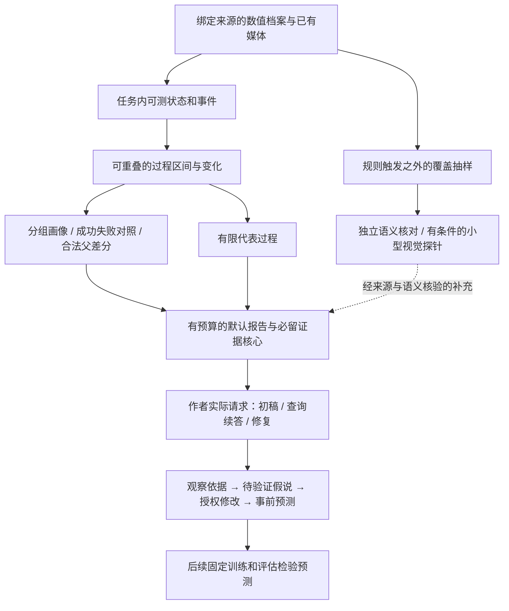

# Phase 3-R：过程描述、证据保真与价值再验证

版本：v1.1；日期：2026-09-29。状态：**IMPLEMENTING**。实际范围、资源与执行解释见[实施卡](IMPLEMENTATION_PLAN_ZH.md)。2026-09-29 用户明确授权本轮采用 `model_review`；原门槛保持，不能称人工评阅。

v1.1 修订（2026-09-29）：依据对 P3 作者账本、请求回执与评阅材料的复核（见 §1.1、§1.3），新增并前置 **P3-R.0 作者运行前提与天花板探针**；R.1–R.3 的扩展范围由 R.0 结果决定，无条件工程修正不变；R.3 的 24 个确认回合可分两批冻结；3-live 提前执行列为需用户明确批准的可选项。阈值、A/T 同预算、数据隔离与主计划 §4 硬边界不变。

位置：原 Phase 3 之后、Phase 4 之前。主计划的顺序和项目边界见[反馈系统升级计划](../FEEDBACK_SYSTEM_UPGRADE_PLAN_ZH.md)。本文是 P3-R 范围、验收和退出条件的唯一详细定义；实施时再冻结数据、阈值、预算和改动清单，不照本文机械指定类名或施工步骤。

**目标：让系统能够准确、有证据地说明“这一段行为怎样发展到当前结果”，把关键正反证可靠地交给作者，再验证作者是否因此提出更有根据的修改。** 不要求系统认识所有行为，也不把观察到的失败过程当作已证明的训练失败原因。

P3-R 完成且价值门通过，才允许评估 P4 的启动条件。没有查询需求时，P4 应保持 DEFERRED；不能为了顺序完整而建设接口。

## 1. 为什么需要这个阶段

### 1.1 已经成立的基础与尚未成立的结论

| 事实与证据 | 本阶段采用的判断 |
|---|---|
| [P3 工程审计](../P3/Audit_P3_2026-09-24_ZH.md)从原始数组独立重算 Stair 864 回合，以及 Push velocity / force 的过程量，与现有派生一致 | 保存与计算链有可用基础。它验证的是“按定义算对”，不能同时证明 slip 等名称对应真实物理机制 |
| 已完成 12 个焦点问题、每臂两次生成，共 48 个作者 episode；53 份材料包含 5 个重复项 | 不是 48 次训练，也不是 12 个独立策略。主要来自两份观察包、两个策略簇，结论只能限定在这版配置和这批资料 |
| [原评阅报告](../P3/human_review_20260924/REVIEW_REPORT_ZH.md)报告 A/T 事实支持率 92.7% / 84.1%，价值门未通过 | 原评分保留为历史结果。评阅由用户委托的模型专家完成，不改称独立人类评阅，也不能据此证明“过程反馈没有价值” |
| [六项随机复核](../P3/random_reaudit_20260924/REAUDIT_REPORT_ZH.md)确认部分错误，也发现假说被过强否定、奖励算术漏常数、未来目标被误读等问题 | 修订评阅口径并对受影响项一视同仁复议；不从六项抽样推算全套新分数，不靠复议自动宣布新方案通过 |
| Stair 默认视图删除全部 30 行成功/失败对照；时间线只剩少数尾部事件；6/24 个 T episode 的末次输入没有行为块 | 信息在选择、压缩和 repair 输入中丢失是真问题。不能把“档案已经有”写成“作者已经看到” |
| Push 使用窗口末帧方向和复位相对位移；51 个未恢复回合终点姿态近直立，但其中 9 个恢复窗口曾姿态失守 | 终点和全过程必须分开；本次扰动响应不能混入推前漂移或上次扰动 |
| 作者账本（92 个账本槽、89 次已知回执）：请求全部为 thinking enabled、reasoning_effort=max、输出上限 32,768；输出计量达到上限（≥32,000 token）的尝试 A 14/41、T 20/51（T 含 1 个按上限预留的中断槽），中位输出约 2.9 万 token；首次尝试失败 A 13/24、T 18/24；最终答案来自修复帧 A 14/24、T 20/24 | 运行状态把“反馈有没有价值”和“作者能不能写完”混在一起，T 更大的输入更常耗尽推理预算；新确认前必须固定并验证运行状态，两臂同一设置 |
| 验证器拒绝（多机制改动、可调用项失败、不透明轴索引）后的最小修复帧删掉全部 public_feedback_summary：最终输入无任何反馈的 episode A 2、T 6；按最终修复帧的失败原因计，T 的多机制拒绝至少 4 次，A 1 次 | 过程证据会诱使作者一次改多个机制，随后规则把反馈整段拿走；修复帧必须保留证据核心，单机制规则本身不改 |

这些数字用于定位开发问题，不是本阶段的新验收成绩。旧 P3 工程验收、原模型评分、复议结果、新 P3-R 结果分别保存。

### 1.2 根因与应修的层

| 缺口 | 源头修正 | 不采用的替代做法 |
|---|---|---|
| 代理测量容易被读成物理行为或原因 | 收窄词条含义，说明参考点、坐标、时间和可推断范围 | 为每个失败故事补一个专用标签 |
| “最后几个事件”不能保留持续、反复和重叠过程 | 以状态区间及关键变化组织过程，保留必要上下文 | 强制每个回合走同一串互斥阶段 |
| 代表回合与裁剪优先级不对应判断问题 | 先保护必要比较事实，再选择有覆盖依据的过程片段 | 单纯增大 prompt 或永远优先最后发生的事件 |
| 最后一次作者请求可能失去决策依据 | 在任务层产生精简证据核心，在通用 frame 层保留它 | 将旧 rationale 重新命名为真实观测 |
| 规则只能覆盖已定义的现象 | 保留组合描述、未知出口及独立于规则触发的抽样 | 声称检测器知道所有未知异常，或在线执行模型写的规则 |
| 评阅混淆事实、假说与干预效果 | 分开判分，按实际输入和原始证据分别核对 | 用已有失败视频证明一个未训练修改必然无效 |
| Stair 全量 CPU 派生占住 GPU | 调整计算与租约边界，复用同一套生产语义 | 建第二套后台真值或只把耗时移出报表 |
| 作者运行状态不稳定：推理预算耗尽、验证器拒绝后丢失反馈 | 事前固定推理模式与预算并在冻结首包上验证完成率；所有修复帧保留证据核心 | 只放宽输出上限而不验证完成率；删除单机制规则；让 T 单独换设置 |
| 先建机器再测价值，无法区分表达、作者与观测三种瓶颈 | 先用手工整理的理想证据做天花板探针，再按结果决定建什么 | 直接再跑一批 48 回合；把整理证据当生产方案 |

### 1.3 为什么先测天花板

P3 的 48 份答案里，只有 proposal-052（T、首稿、完整读了行为块）把改法与过程证据连起来，机制与录像一致；其余两臂都以结局率和先验猜测为主。这说明这条路可行，但现有实验分不开三种瓶颈：证据没有组织好、作者不会用、原始观测不够。三者对应的修法完全不同（改选择与表达、改作者协议或模型、补视觉或采集），先建 R.1–R.3 再测等于把数周工程押在一个未验证的假设上。R.0 用手工整理的理想证据直接测上限：如果理想证据能让同一作者写出有依据的提案，R.1/R.2 就有了明确的复现目标；如果不能，投入应转向作者或观测，而不是继续加词条。探针本身不是生产方案，其资料随后成为开发集。

## 2. 修正后的最小架构

这是现有任务派生和投影链的收敛，不是新增七个服务。P3-R 的常规报告优先用确定性结构及简短模板生成，不新增一次 LLM 叙事调用。视觉探针默认用于开发定位；它不自动进入生产作者路径。

### 2.1 单一事实来源，分开四种含义

| 类型 | 可以说明什么 | 不能自动升级为什么 |
|---|---|---|
| 原始测量 | 某步的姿态、参考点位置、接触合力、实际扰动等 | 碰撞对象、意图、学习原因 |
| 规则派生观察 | 指定身体在指定窗口满足某条件及其持续时间 | 未验证的“绊脚”“踝策略”“控制器冻结” |
| 视觉观察 | 在已绑定、可辨认画面中看到的动作或空间关系 | 未测接触力、精确摩擦、整段未录制过程 |
| 假说与预测 | 一种可能解释、拟改变的机制、预期可测变化 | 已证实根因或已经有效的改法 |

原始档案、任务规则和现有回执保持来源主线。短报告是同一证据的视图，模型笔记不回写测量。旧版本不回填新事件；重分析有自己的规则版本和首次可用时点。发现不同来源冲突时列出冲突及范围，不能静默用视觉覆盖数值，反之亦然。

### 2.2 过程是多条事实在时间上的组合

每个过程片段至少能定位：**谁、在哪里或相对什么、发生了什么可测变化、何时开始/确认/结束、持续多久、与哪些事实重叠、最后是什么任务结果、哪些部分没有证据。** 不是每条都要打印全部字段；作者可读版本须保留会改变判断的信息，完整字段可回读。

片段允许并发、反复、持续到终止、只见后半段。新组合无需先获得一个行为类别名。“开始越阈值”与“达到持续确认条件”不同；回合结束也不等于该状态自然结束。任务阶段锚点可以帮助对齐，但不构成必须从头走完的状态机。

以已经复核的 Stair r1.e64 为**开发例子**：末段低进展区间为 369–426 步，持续倾斜区间为 385–426、394 步确认，414–426 无瞬时脚部支撑，426 触发禁触。可以描述这些区间及重叠关系；更早存在倾斜，所以不能称“全程第一次倾斜”。既有回放画面另支持后翻/侧翻的视觉描述，但上述数字本身不证明“俯仰惩罚导致翻倒”。

过程表达要同时留下成功对照：失败中出现的动作，成功中是否也有、比例和持续时间怎样、比较是否同条件。个别典型片段负责解释过程，完整分组统计负责回答普遍程度，二者不能互相代替。

### 2.3 遇到没见过的语义

| 情况 | 系统应做什么 |
|---|---|
| 已知测量组成了未见组合 | 直接报告组合，例如“根部低进展，同时某足参考点长时间无载且几乎不动”；不必硬命名成某种步态 |
| 数值字段不足，已有画面可辨认 | 作为有时窗、身体与可见性限制的视觉观察；文字与数值依据分开 |
| 数值与画面都不能判断 | 明确缺哪种观测、当前能说到哪里；不得输出“没有异常” |
| 可能重要的过程没有触发任何规则 | 通过预先固定的全程分散抽样、规则阴性窗口和结果对照发现；把发现登记为待验证缺口 |

这不是完整的未知检测器。有限抽样仍会漏掉未知行为，报告须给覆盖范围。新规则只有在重复需求、可测定义、困难反例和独立验收齐备后，才由开发者纳入任务代码；模型不在线扩充正式词表。

## 3. 实施单元与严格验收

五个单元：R.0 先行并决定 R.1–R.3 的扩展范围，随后依次收敛；可以并行核对资料，但不能跳过语义门直接用大量作者调用试错。每个单元只交付对应能力，不把整个 P4–P7 搬到本阶段。R.0 之外的“无条件工程修正”（R.2 的租约边界、对照保留、修复帧证据核心，R.1 的词义收窄与噪声列处理）不依赖探针结果。

### P3-R.0：作者运行前提与天花板探针

**目标：**在任何新的作者调用之前固定一个两臂共用、能正常写完的运行状态；然后用最少的作者调用判断瓶颈在证据组织、作者还是观测，为 R.1–R.3 定范围。R.0 不是价值门，其全部资料随后转为开发集，不得用于 R.4 确认。

**R.0-a 运行前提：**

- 从 P3 冻结的 24 个首包中取至少 8 个（两任务、两臂各 2 个），在候选设置下重放，记录首次尝试完成率、输出 token 与费用。候选设置限于现有生产参数：reasoning_effort=high、放宽输出上限、或 empty_final_reasoning_retry 使耗尽后的重试关闭 thinking；不改提示内容。
- 选择费用最低且首次完成率 ≥90% 的设置，两臂同一设置写入启动卡；回执继续记录 requested_thinking_mode、reasoning_effort 与输出上限。达不到 90% 时记录实际值并由用户决定是否更换作者模型，不得让 T 单独换设置。
- 所有修复帧（推理耗尽、截断、验证器拒绝）保留任务提供的证据核心与当前焦点，这是 R.2 的同一项要求，在 R.0 先以最小接线验证：P3 中 8 个失去反馈的案例重建修复帧后，行为核心与聚合反馈均在。
- 费用上限：不超过 US$3，0 GPU。

**R.0-b 天花板探针：**

- 案例：4 个，Stair 2 个（c1_conditional_frontier、height_ood）、Push 2 个（medium、repeated），均取自已登记类别且失败形态已由录像与完整档案确认；这 4 个案例及其观察包不再进入 R.4。
- 输入变体，冻结后记录字节与 hash：A（现有反馈）；T0（现有行为块，仅修好投递）；Tc-num（开发者从完整档案手工整理的纯数值证据：带标签的短行、预先算好的成功/失败对照与分母、姿态方向与翻滚、停滞/冻结持续时间、Push 的首帧响应/峰值/净位移/未能安定；只含原始数值能支持的事实）；Tc-vis（Tc-num 加已由回放录像确认的形态，逐条标注时窗、身体与可见性，作为视觉观察而非测量）。Tc-num 可超过 8/12 KiB，但字节数必须报告；它是诊断参照，不是生产方案，也不与历史 A 拼对照。
- 生成：同一作者模型、R.0-a 的设置、同一源码权限与提示，每案例每变体 2 次，最多 32 个 episode。另可选**作者天花板**：Tc-num 交给一个更强的作者模型各 1 次，最多 4 个 episode，单独登记为诊断。
- 判分：脚本核对每个引用数字、episode/字段标识与代码事实是否出现在该输入中；按用户本轮明确授权，由模型专家隐藏变体名、打乱顺序后判两项（明确登记 model_review）：机制是否对应该案例已登记的失败形态（是/否/不可判），改动是否与所引过程证据相连（沿用 0–2 行动相关性定义）。不跑逐项多代理评阅流水线，不算总分。
- 事前判定：一个变体“有效”指至少 2 个案例各有至少 1 次生成达到行动相关性 2、机制判“是”且机器核对零错误；A 与 T0 为基线。结果只回答“往哪投入”，不宣布任何门通过。

| R.0-b 结果 | 决定 |
|---|---|
| Tc-num 有效 | R.1/R.2 以自动复现 Tc-num 的内容与组织为目标；R.3 按原设计 |
| 只有 Tc-vis 有效 | 登记视觉缺口；R.1 只补数值能支持的词条；R.3 的小型视觉探针提前，并在退出决策中评估 P6/P7 的有限 profile |
| Tc-num、Tc-vis 均无效，作者天花板有效 | 瓶颈在作者：在启动卡修订作者协议或模型（两臂同用），用同 4 案例重做一次 R.0-b 后再决定 R.1–R.3 的扩展 |
| 全部无效 | 只做无条件工程修正；R.1–R.3 的扩展与 R.4 暂停，把任务框定、单机制规则与微调前提的问题交用户决策 |

- 费用上限：作者调用不超过 40 个 episode。原分配为 US$12；2026-09-29 R.0-a第二轮8/8通过、选定65536输出后，将阶段内未启用的辅助API US$3转入，R.0-b上限调整为 **US$15**，阶段总额仍为US$30，见 `stage_budget_r2.json`。本次只放行默认32个episode，160次最坏请求为US$14.502912；40机会上限和更强作者选项不自动放行。作者调用0 GPU，媒体补缺单独按阶段GPU卡计量。

**严格验收：**

1. 运行设置、完成率、费用与 8 个重建修复帧的证据核心检查记录在案；两臂同一设置。
2. 4 个案例、4 种输入、判定规则与判分表在任何作者输出出现前冻结并记录 hash；输出出现后不增改变体或案例。
3. 机器核对结果与指定评阅者的判分逐项保存；每个变体的字节数与输出 token 一并报告；结论按上表落到唯一一行。

### P3-R.1：校正解释边界，补足必要过程

**目标：**让规则和描述都只说证据真正支持的内容，覆盖目前已经证明缺失、且能够从已有字段导出的关键过程。

**必要范围：**

- 对现有对外词条进行一次有限审查。`slip` 类代理优先写成“有接触力时参考点快速平移”；保留瞬变/持续、单足/全局 any 的区别。`low_progress` 不等于全身静止，低参考点净空不等于脚尖碰撞。
- 在所有画像行都接近 100% 的列（当前 `window_slip_any`；86% 的 slip 事件是触地/离地瞬变）不进入默认报告，或只以已确认 streak 计数出现；完整派生里保留。
- 新增词条的优先级按 R.0-b 中作者实际引用且判断正确的事实排定；探针没有用到的量不因“数据里有”而进入默认报告。
- Stair 补齐带方向的姿态变化、持续支撑/无载与低运动的组合，以及根部实际前进/回退和必要相对几何。只选择能回答已登记问题的量。抬头/倒置等名称先验证机器人坐标与姿态约定；大角度不能只靠一个 Euler 角草率分类。低姿也可能是成功策略，不能预设为缺陷。
- Push 用窗口初始响应、峰值及其时刻、窗口净位移、稳定条件的演变描述扰动过程；保留真正有用的末态。以正确注入或脉冲锚点对齐，区分未完成 dwell、曾完成后再失稳、未执行事件和删失。
- 当前 Push 缺逐脚观测时，不由根部速度推断迈步次数、落脚位置或踝/髋策略。P3-R 不强制新增接触传感器；只有开发探针证明缺项影响判断，才登记最小后续采集需求。
- 先修订评阅定义：可核事实、未证实假说、被证据直接反驳的陈述、代码是否兑现承诺、未来目标分别处理。一次回合已有迈步不反驳“步幅/时机可能不够”；终点直立不证明全程直立。

**严格验收：**

1. 新增/改名词条有可测定义、单位、身体/坐标、持续条件、适用域及不可推出的结论；已有合法任务判据、reward ABI、success/primary 和 acceptance 不变。
2. 从原始档案独立核算新增数值与区间；声明支持的现有 profile 均核对，缺字段版本明确降级。不用生产函数生成的答案再证明自身正确。
3. 困难反例至少覆盖：交替足触发、触地/离地尖峰、历史力非零但瞬时无支撑、接近阈值、持续时间刚不足、低进展但仍有身体运动、长期无载低运动、恢复窗短暂倾斜而终点正常、重复扰动和提前终止。真实案例配少量最小合成反例即可，不做全组合安全测试。
4. 输出保留阈值附近的实际量和持续时长；适量阈值扰动只检查描述是否脆弱，不用测试集调阈值或改变任务成功定义。阈值余量不是“物理解释正确概率”。
5. 旧评阅的更正另存；凡改变某类判据，检查两臂全部受影响项。若未全面复议，则旧汇总明确“含待复议标签”，不得发布一个部分改分的正式新总分。

### P3-R.2：将关键过程可靠送到作者，并收敛计算边界

**目标：**从完整档案到最后一次请求，保留足以作判断的最小过程和正反证，同时解决已知 GPU 空占及重复语义。

**必要范围：**

- 默认报告按“当前结果与分母 → 主要过程和差异 → 匹配成功反证 → 代表片段 → 合法父差分与未知项”组织。使用带标签、单位和明确分母的短行；重叠条件写清交集/并集或“可重叠”，必要比例预先计算，不迫使作者解多层索引再心算。
- 选择器按当前问题和分组覆盖确定代表，不再以字典序第一条失败代表全局，也不固定只留最后几个事件。优先覆盖主导失败及同 cell/run 成功；没有匹配成功则写 missing，不能拿不相容成功充数。完整分母不随选例变化。
- 持续状态应能进入时间线；相同状态可合并，不能因没有新边沿而消失。给核心对照和必要片段预留空间，再裁重复说明、冗余列和额外例子。所有成功/失败配对行不必全部常驻，但不能再次整段失去核心比较。
- 稳定定义在实际请求里保留一份。回执保持完整身份与 hash，作者用可定位短引用；移到其他 section 的内容仍计入整请求。正常首轮、source 续答、带失败源码的 static repair、其他已有修复路径，都保留当前焦点及任务提供的必需证据核心。
- repair 核心包括错误/源码、当前修改意图及其关键原始依据；既有 rationale 只能表示先前提案。通用层仅管理必留、预算与缺失，不知道台阶、脚或推力含义。A、T 的共有修复采用同一底座。
- 验证器拒绝（多机制、可调用项失败、不透明轴索引）触发的最小修复帧同样保留证据核心；以 P3 中 8 个失去反馈的案例重建验证。单机制规则不改，但初稿提示中把该规则与“过程证据不等于多处改动的许可”写清楚，A、T 同文。
- 记录每臂每次尝试的输出 token；若 T 的输入增长导致完成率或输出显著差于 A，在启动卡登记并作为 T 视图预算的约束之一，不靠放宽 T 的上限处理。
- Stair 全量 CPU 重算优先在评估进程退出且 GPU 释放后、phase 最终封存前完成；若当前 runner 生命周期不宜如此，则可选同一任务逻辑在线累积。只保留一条生产派生主线；独立离线验收不作为第二个生产真值。
- 随以上改动清理确有重复的 streak 定义、多个调用点剥离 `behavior` 和 missing 表达。判断所有消费者后再收口，不为统一风格扩建兼容框架，也不改写旧回执。

**严格验收：**

1. 固定来源、版本和预算能够重放同一选择结果。冻结关键问题清单，逐项记录“原始档案有／完整派生有／有界报告有／最后一次实际请求有”；关键事实损失定位到具体层，不用事件保留数代替信息保真。
2. 目标分组由启动卡按诊断问题预先确定，不要求全部cell/run逐行常驻，也不能看报告后缩小目标集合。每个有合法匹配资料的目标分组都有最小成功/失败比较，主导失败过程没有被稀有例子挤掉。无资料、不可比、未选取、预算省略分别可见。
3. 真正序列化的请求通过正常及上述已有分支验收；保留任务必需事实、当前焦点和授权合同，未超输入/输出及尝试预算。不能只验 prompt 构造前的字典。
4. 保持现有 Stair 8 KiB、Push 12 KiB 行为视图、56 KiB task sections 和 14 KiB 长期记忆为起始约束；包装、共享定义、差分及余量全部计量。若部署边界确需调整，须在新作者确认前冻结，A/T 同一总预算；不能靠扩大 T 上限过门。复用 P1 历史容量回归证明当前证据没有挤坏必要历史。
5. CPU 派生不再因全量重读单独占住 GPU；以真实生命周期或最小真实接线验证释放顺序，phase 只在必要派生封存后发布。数值、来源、重放与原有失败处理正确，完整 CPU/GPU/端到端耗时都保留。审计曾测到约 380 秒空占，但不预先承诺固定节省比例。
6. 生产模块不依赖 PLAN；任务定义仍在任务目录，公开投影不在组 prompt 时临时读取 NPZ；不增加第二套 journal、派生数据库或持久记忆系统。

### P3-R.3：独立验证描述，处理未知与视觉缺口

**目标：**证明系统在声明范围内既不乱说，也没有漏掉会改变判断的主要过程；识别必须靠视觉或新增观测解决的部分。

**语义验收的数据设计：**

- 旧 P3 全部作者材料、已讨论录像、随机六项及本次已分析的过程作为开发资料。首先登记哪些策略、回合、统计与标签已经用于调整，不能换一个问法就称新确认集。
- 另冻结至少 **24 个确认回合，Stair / Push 各至少 12 个**，覆盖支持 profile 下的主要成功、失败和易混淆过程。数量只保证工程覆盖，不宣称统计泛化。规则定义、选择/压缩逻辑和确认数据在看新系统确认输出前冻结。允许分两批冻结：第一批 12 个（各 6 个，必须覆盖已登记的失败形态、成功反例与规则阴性窗口）先揭示；若第一批触发任何系统修正，第一批即转开发集，第二批 12 个作为修正后的确认集；若第一批未触发修正，第二批仍须完成后才记 PASS。阈值不因分批改变。
- 优先选未用于调整的已有 public-dev 轨迹组；条件允许时按策略/采集组隔离。若只能同策略的新回合，明确属于同策略局部确认；checkpoint 副本和同一训练的中间版本不算新谱系。没有足够隔离资料时，先核对现有合格权重的有限新采集是否在预算内，否则记 INCONCLUSIVE。
- 标注者先看完整原始曲线和可用媒体，再看新报告；不以 reducer 事件或作者答案作为真值清单。标注关键事实、部位、时间范围、可回答与缺证据项，并冻结；只标与诊断问题有关的事实，不逐帧重标全部事件。主张切分固定，不能靠重复大量容易的数值稀释语义错误。
- 除规则阳性窗口，还要有规则阴性/无事件窗口、全程分散取点和成功反例。**区分两个验收对象：**完整回合派生以这24个回合各自的关键事实为分母；实际有界报告及最终请求，以事前登记的 cohort 诊断问题所需的过程、统计和正反证为分母。二者都从原始池建立答案，不能按选择器的输出窗口缩小分母，也不要求8/12 KiB默认报告复述24个回合全部细节。
- 对有界报告，原始池可支持、且事前认定为回答当前问题所必需的事实，被选择器或压缩遗漏仍算漏检。个体回合样本不能替代完整 cohort 的发生率；不能拿离线完整派生的成绩冒充最终作者输入的成绩。
- **在看确认输出前划定观测模态：**纯数值 profile 的定量召回只评原始数值能够支持的事实；仅视觉可见、真实不可见/未采样项分别作为能力缺口完整报告，不要求数值代码猜出它们。排除条件事前固定，不因系统答不出而改变；主动声称了缺依据的视觉/物理事实仍计不支持。规则内事实、新组合、仅视觉可见、真正缺观测分别报告，不把全部写 unknown 当作准确或宣称全行为覆盖。

**严格验收：**

1. 在冻结可评范围内，无身份/来源/权限硬错误。完整回合派生的逐回合宏平均事实支持率 **≥95%**，关键过程事实召回与主要时段/部位定位 **均≥90%**；有界报告及最终请求另按上述诊断问题单位检验，宏平均事实支持率 **≥95%**、必要事实覆盖 **≥90%**。两组成绩分别报告，再按 Stair、Push 与困难类别展开，不能用完整派生或一个任务的高分掩盖另一处失败。
2. 按身体、观察含义和时间区间匹配，边界误差/区间重叠容差由实际采样精度在解封前冻结。重叠与重复出现不能折成错误的单次顺序；“发生过”和“全过程如此”分别核对。
3. 空泛描述、可判断却拒答、代表选择漏掉主要过程均计关键事实遗漏。没发生的行为被当观察事实输出计不支持；机制假说独立评价，不能靠加“可能”就为错误观测免责。
4. 全量确定性数值通过不代替上述语义门；少数漂亮视频也不代替召回。若存在影响动作判断的系统性语义错误，即使总均值达标仍需修正，确认集随后转开发集，不在原集上重新刷 PASS。

**小型视觉探针：条件触发，非完整 P6/P7。**

只有已登记的问题确实不能由现有数值区分、且已有或可低成本取得可辨认媒体时，才做至多 **6 个回合的一轮开发探针**。冻结回合、问题、时间覆盖、相机/帧选择和预算；至少包含成功或规则阴性反例，不只选择最戏剧性的失败。先检查媒体可看清什么，再决定是否调用 VLM。

优先复用现有原生媒体或派生图；二者能回答的问题不同。回放始终是新 run：逐步对齐不足时只能作辅助类比，不能为旧回合精确接触时刻背书。需要新录制时仅补所需范围，缓冲有界，不在本阶段扩建全量媒体平台。

实际模型探针须验证图像确实发送、来源与时间匹配，计入全部帧/像素/token/费用。每条视觉观察带时窗、身体、可见性和不确定性；其引用正确不等于语义正确，仍接受独立核对。视觉可提出词表外描述，不猜测力、摩擦、扭矩或学习原因。

探针的出口只有“数值足够，应修选择/表达”“存在可重复的视觉增量，登记给 P6/P7”“媒体/观测仍不足”三类。它不授予 VISION PASS，不给纯文本 T 偷加评阅者观察或人工答案，也不以一次视觉成功替代 P3-R.4。缺媒体时可记 DEFERRED，纯数值 profile 必须相应收窄表述，不能装作覆盖全部物理行为。

### P3-R.4：定位作者瓶颈，进行一次新的价值确认

**目标：**确认更准确的过程证据会改善作者的事实判断与授权修改，而不是只让文字更长。修正一次、确认一次，失败后作出下一步决策。

**开发定位已前置为 R.0-b，本单元不再重复：**R.4 只在 R.0-b 落到“Tc-num 有效”或“作者天花板有效且已按其修订并复测有效”两行之后启动；其它两行按 §5 处理。以下关于整理事实输入的定义与分流规则保留，供 R.0-b 与结果解释共用。

- 整理事实输入是同 scope、同可用时点、同证据模态和同预算的人工整理视图，只含真实测量、过程与对照；不含奖励答案、建议改法、评阅结论或作者当时无权获取的画面信息。它是诊断参照，不能当正式生产方案，也不能与历史 A 拼成对照。
- 若 T 和整理事实输入都失误，优先核作者对指标、权限或代码的理解，以及“观察→假说→修改→预测”的衔接；若整理事实有效而 T 无效，继续修表达/选择；若原始信息也不够，登记观测缺口，不能指望 P4 查出不存在的证据。
- 围绕真实错误，对候选修改做最小数值核验：奖励符号、阈值附近变化、量级、声称不变的部分、必要正常反例，包含实际适用的常数、权重、裁剪及步长换算。合成输入探针与真实运行样本分开；缺实际贡献样本就不能声称已经测得训练影响。核验的是代码是否兑现描述，不证明重新训练后的效果。共同作者提示或核验修复同样进入 A/T，不在 T 独享补丁。

**正式确认设计：**

1. 采用原 P3 的**质量收益路线**；本次不改走事后省钱过门。默认冻结 12 个新案例，Stair / Push 各 6，每案例 A/T 各两次新生成，共 **48 个作者 episode**。开发探针（R.0）与这些确认分开计量：R.0 原定最多 48 个作者机会（运行前提 8、天花板探针 40）；2026-09-29 用户明确追加同模型扩输出的 8 包运行前提验证，R.0-a 总上限16，R.0-b上限40不变，R.4 最多 48 个；重试、源码查询和 repair 仍占原 episode 预算，不增加质量样本。
2. 新案例来自没有用于修改规则、提示或选择方案的资料。语义确认若用于修正系统，其资料随即成为开发集，不能继续用作作者确认；允许同一冻结资料先核语义再核作者，但须在揭示任何确认结果前一并冻结作者案例、问题、来源分组及选择规则，期间不据结果调系统或挑容易的题。确认标签、评语和答案不得进入作者输入。同一观察包的多个问题仍为相关样本，报告组与谱系数量，不伪称 12 个独立环境。
3. A 是完成共有 bug 修复的当前基线，T 是同底座加修正后的过程反馈；两臂重新生成。相同作者版本、模型配置、来源/as-of、源码权限、任务协议、输入/输出/attempt 总预算和公共提示。唯一处理差异明确列出，结果不能归因到只给 T 的代码修复。运行设置沿用 R.0-a 的结果，两臂相同。
4. 在调用前冻结过程类别、关键误判定义、事实切分规则、必要判断证据、重复生成的汇总方法、顺序及全部预算；若本轮同时收集P4需求证据，一并冻结需求分母、判定口径和比例门槛。不在输出出现后挑“有用”的类别或最好的一次生成。评阅校准样例来自开发集，不包含确认提案或其重复项。关键误判只计能用输入数字、代码或原始档案直接证明的矛盾（数值、编造观察、代码与描述矛盾、被档案直接否定的观察陈述）；未训练的干预效果与机制假说不计硬错，单独按“与现有证据一致/不一致/不可判”记录；两臂同一主张切分规则，同时报告每百条主张的错误率与过程证据的引用/使用/正确情况。
5. 先隐藏配置名、打乱顺序评语义，再检查实际输入是否提供依据；输入样式仍可能暴露条件，应承认盲化有限。机器先核数值/引用/代码，模型可辅助列待核主张；默认沿用主计划的**一名真实人类完成门槛相关语义裁决**，不默认再建逐项多代理投票流水线。尊重用户此前选择模型专家的方式：若新确认前明确继续采用纯模型评阅，则事前登记 `model_review` 验收 profile，保留相同质量阈值，只报告该 profile 的门状态与局限，不冒称人类验收，也不在看到分数后追认切换。未明确变更时，人类环节缺失仍记待补。

**严格价值门：**

- T 无身份/来源/权限全局硬错误，全部权限合规；T 输出事实支持率微平均和逐回答宏平均均 **≥95%**，并分别通过两任务的绝对质量检查。必要问题缺答不能通过少说事实提高成绩；同时报告关键证据使用/遗漏与无候选终态。
- 在至少两个事前登记的不同过程类别上，T 减少 A 的关键误判，或补足影响修改判断的必要证据；两任务的整体通过要求至少各有一个这样的类别。每类至少两个不同案例出现可追溯改善，按冻结的两次生成汇总，不能将同案重复输出充当两个案例。
- T 不以新增同等或更严重关键误判换取改善；授权合规、可检验性和机制—代码一致性不退化。关键错误率及类别净变化完整展示，保留支持改善与反对改善的案例。
- 未来训练效果只能记未测试，奖励数值检查、可证伪预测和当前事实正确分别记分。若假说本身不可判定，保持不确定，不由评阅者替未做的实验作结论。
- 失败、缺输出、服务中断及未知费用保留分母和回执；方法失败不伪装成 infra。确认只执行冻结的一轮，预算耗尽记未完成。改表达、阈值、作者提示或评阅主规则后须重新规划新确认，不能边看成绩边加样本。

如果只有一个任务通过，只记该 profile 的结果，整体 P3-R 不写 PASS；是否将后续目标收窄为该任务，需先修订范围，不能在失败后悄悄改总目标。该继续门不证明搜索收益，也不替代 P9 的最终选型。

## 4. 资源、交付与必要的连带修改

### 4.1 有限投入

本阶段默认 **不做候选训练，不进行模型排名，不重跑全部历史策略**。CPU 重算、既有材料与有针对性的验证优先。确需补采时使用已有合格 checkpoint，并记录新的协议/源码/运行身份；诊断重放不能补写历史决策证据。

启动卡必须从项目实际剩余额度分配独立的 P3-R 模型费与 GPU 容量小时上限，核实当前报价、已有支出及失联调用预留；没有完成分配就不启动付费实验。旧 P3 的 US$15 / 2 GPUh 不是自动续领配额，项目 US$120 / 500 GPUh 也不因新增阶段而扩大。可行性不足先取消未启动的可选视觉/整理事实探针；仍不足则记录未完成，不能缩掉主验收后算通过。

阶段卡同时固定：本文的作者机会数上限、每 episode 既有调用/修复限制、视觉探针的实际调用与媒体上限，以及必要采集次数/范围。作者、视觉、另行 API 评阅的失败和重试均计入费用。历史约 US$2.772 是旧作者实验的回执计量，不能代表全部模型评阅或 Codex 工作成本。

若需主计划的 `3-live`，默认仍在本阶段价值门通过后另按现有最多 4 个候选机会登记预算。**可选提前（需用户在启动卡明确批准）：**R.0-b 产出至少 2 份机器核对零错误、行动相关性 2 且机制判“是”的提案时，可把这 4 个候选机会提前到 R.4 之前执行，只回答主计划为 3-live 登记的三个问题；结果不进入 R.0/R.4 任何门，不算 CORE 通过，GPU 与费用单独登记。它不是本阶段默认训练，也不为 P3-R 事后翻案。

### 4.2 与后续模块的边界

| 模块 | P3-R 必须做的部分 | 留给后续的部分 |
|---|---|---|
| 数值与行为派生 | 必要状态/区间/响应量、语义收窄、独立重算、CPU 租约边界 | 大规模关节/足端采集、学习检测器 |
| 默认上下文 | 去重、自描述、正反证预留、repair 核心、整请求计量 | P4 按问题查询；P5 跨代全局分配与预测记忆 |
| 记忆 | 保持既有容量/身份/缺失回归，避免当前过程被挤掉 | 新长期语义记忆、向量库、跨 session 自动归纳 |
| 视觉 | 现有媒体核对、条件触发的小探针、登记真正观测缺口 | P6 可靠批量媒体；P7 生产视觉补充与未知行为核对 |
| 作者 | 最小事实—假说区分、针对真实错误的代码数值核验、公平 A/T | P8 自主补查闭环；P10/11 真正训练收益 |
| 验收 | 独立语义覆盖、实际输入保真和早期作者价值 | P9 全配置选择和后续研究效力 |

不建设全行为本体、通用时序 DSL、新诊断服务、自动扩词、因果证明器或完整可视化产品。现有语义已正确的路径不重写；没有消费者的旧开发分支可清理，历史实验与原评分不能删除来掩盖结果。

### 4.3 最小交付

实施时在本目录保留一份启动卡、一份验收记录及必要来源索引/测试产物即可；已有 journal 和回执继续承担调用与来源记录，不复制一个并行系统。生产规则、投影和相关测试进入正常源码目录，绝不导入 PLAN。

验收记录必须能回答：改了哪些定义；解决了哪些真实案例；哪些仍不可观测；默认及最终输入保住了什么；语义精度/召回与作者价值各是什么状态；实际花费多少；下一步该进入哪个模块。

## 5. 退出决策：不能把所有问题都交给 P4

| 验收结果 | 决策 |
|---|---|
| R.0-b 全部无效，或仅作者天花板有效且修订后复测仍无效 | 按 R.0-b 判定表处理：只做无条件工程修正，R.4 暂停，不进入 P4；任务框定、单机制规则与微调前提交用户决策 |
| 数值正确但语义/召回不足 | 留在过程定义、选择或采集问题，不启动完整作者确认与 P4 |
| 过程报告可靠，但 T 无法改善作者；若做了整理事实探针，它也无效 | 保留离线诊断能力；优先查作者机制，停止扩建查询/记忆平台。未做整理事实探针时，具体瓶颈仍记未区分，不为填表强行追加调用 |
| 已执行的整理事实探针有效，T 无效 | 证据组织仍是瓶颈；记录本轮失败，在新计划和新确认集上修正，不能回刷当前集 |
| 只有视觉探针显示潜力 | 登记有限视觉 profile 的后续验证；不把它当本轮 T 通过，不以此绕过 P4 启动门 |
| 工程、语义与作者价值均通过，但默认报告已经足够 | P3-R PASS，P4 DEFERRED；保留更简单的默认路径，可评估有界 3-live |
| 上述三门通过，仍有足量“合法证据已存在但预算省略、影响修改判断”的案例 | 按主计划进入 P4；启动卡预先固定需求比例门槛，不能在看到比例后选阈值 |

P4 的需求记录要区分：未采集、无法可靠解释、已生成但没有选中、受预算省略、作者看到了却误读/未用。只有**默认选择修正后，仍因固定工作集容量未提供，且能通过有界回查补齐的必要证据**才支持建查询接口；作者理解错误本身不算查询需求。不能拿已知选例 bug 为接口找理由。

当主要类别修正会改变案例计数时，先冻结需求判定，再收集对应证据；不足则 INCONCLUSIVE。工程 PASS、语义 PASS、作者价值 PASS、查询需求成立、真实 RL 收益分别报告，不能用一个“完成”覆盖五种结论。

## 6. 研究和工程借鉴及其限度

以下用于约束设计，不构成本项目效果证据；本次核对日期为 2026-09-25。

| 来源 | 借鉴的部分 | 不照搬的部分 |
|---|---|---|
| [REFLECT 项目](https://robot-reflect.github.io/)与[开源实现](https://github.com/real-stanford/reflect)，CoRL 2023 | 将多源经历分层组织，再逐步分析失败；支持“保留原始依据，给模型紧凑过程”的方向 | 其子目标/操作任务分解不能直接变成运动控制的固定阶段；LLM 解释不自动成为物理因果 |
| [RTAMT](https://github.com/nickovic/rtamt) | 明确时间窗口、持续条件、满足条件的余量，区分监测规范与解释 | 规范监测不能证明行为词的物理有效性；本阶段不引入完整 STL 语言或依赖，只采用必要思想 |
| [AHA](https://aha-vlm.github.io/)与[开源实现](https://github.com/NVlabs/AHA)，ICLR 2025 | 以自然语言表达视觉失败，提醒固定词表之外仍可能有有用信息 | 研究面向机器人操作，不证明对本项目 Stair/Push 有效；不训练专用 VLM，不把开放语言视为可信真值 |
| [LLM-as-a-Judge 研究](https://arxiv.org/abs/2306.05685) | 评阅存在位置、冗长和自我偏好等局限，需要固定标准、独立依据和可复核主张 | 不以同一模型多次投票替代人类语义裁决，也不把看似一致的评分视为真实物理验证 |

本阶段的核心选择由本地证据决定：保留已验证的记录与计算能力，修正从事实到过程、再到作者输入的损失；用少量独立确认决定后续投入。即使最终作者价值仍不过门，这一轮也必须给出可定位的瓶颈与停止边界，而不是留下更大的平台和更多无法核查的故事。
