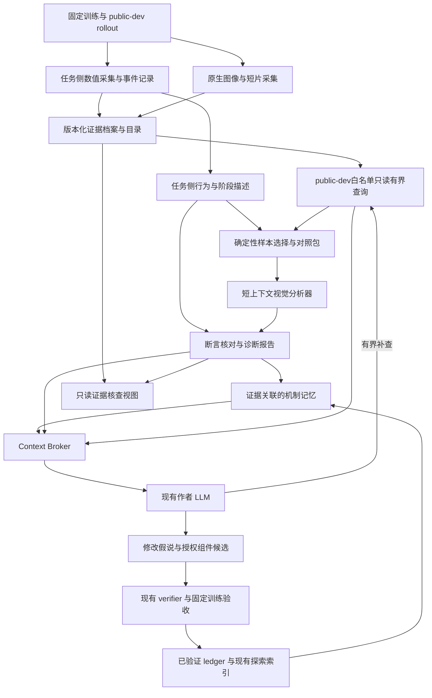

# 反馈系统升级计划：行为证据、视觉诊断、可检验记忆与有界上下文

版本：v1.1（扩展研究与源码复核后的计划稿）  
日期：2026-09-22  
状态：待实施；本文中的验收条件均为未来要求，不代表已经通过。  
适用项目：`D:\humanoid_agent\true_RL_Agent`。

## 1. 目标与决策

本次升级的目标是：**让作者 LLM 根据可追溯的行为证据，提出有明确预期、能够被下一轮实验检验的训练组件修改；同时使证据量、历史长度和视觉输入增长时，上下文与成本仍可控制。**

系统最终应能回答六个问题：

1. 任务完成到哪个阶段，哪些部位出现了什么动作或异常？
2. 异常在何时开始，如何发展，与终局失败是什么时间关系？
3. 相同条件下，成功样本及 parent 策略有什么不同？
4. 当前解释有哪些支持证据、反例和缺失观测？
5. 以前尝试过哪些相关机制，分别在什么条件下得到什么结果？
6. 下一次准备改变哪个授权机制，预期哪些行为指标变化，实验后是否支持该预期？

本版采用“**可信测量 → 行为描述 → 对照与假说 → 有界检索 → 授权修改 → 固定验收 → 记忆更新**”的架构。数值证据与视觉互补；任务判定、候选授权、训练预算和正式验收仍由既有可信链路负责。

工作划分为 Phase 0–11。Phase 0–8 建立能力，Phase 9 检验诊断质量，Phase 10 验证真实闭环，Phase 11 判断搜索收益。每个 Phase 有独立交付与验收，不以“模块已接线”替代效果证明。

本版补入网上研究与真实开源实现的核查结果，保留12个Phase，不增加独立平台。新增重点是：数值事件引导选帧、可核查的身体与时间描述、证据双时间、分类型记忆、评测隔离及恢复记账。完整依据与不采用项见 [研究与工程核查记录](D:/humanoid_agent/true_RL_Agent/PLAN/feedback_sys/RESEARCH_AND_ENGINEERING_REVIEW_ZH.md)。这些是待验证设计；本轮没有执行模型评测、统计仿真或训练。

## 2. 本计划的证据基础与现状判断

### 2.1 当前源码，而非旧问题清单

本次规划读取的是当前工作树。HEAD 为 `5cef484d`，但有大量既有未提交变更；该 SHA 不能单独代表实际实现。实施时必须冻结代码内容、任务配置和协议版本。

已经存在的基础应复用并验收：

- 共享 `PhasedEvaluationAdapter` 已声明 task-owned `project_public_phase_summary`，生成链调用任务实现。
- generation history 已能恢复各 trial 的训练回执，以及没有进入 selection 时的 measured parent public-dev；Push 比较已避免拿 acceptance score 代替 parent-dev。
- Push 的首次 reference 反馈、失败类别选择、same-trial 来源等已有新增实现与测试定义。本次没有重新运行这些测试。
- 已有 `ExplorationEvidenceCard`、ledger 派生完整索引、机制等价排除及非阻塞重复输入区域提示。
- 原生视频 recorder 已支持任务选择录制时点，并显式表示没有 pre-reset frame 的情况；不需要重新发明视频录制器。

仍需升级的能力：

- 逐步运动状态没有形成可持久检索的完整诊断证据；部分信息在 decoder/outcome 汇总时丢失。
- 训练 reward/diagnostic 常以最后一次 snapshot 或极值表示，缺少训练阶段与行为阶段条件下的变化。
- 作者输入仍以文本摘要为主；图片路径不构成视觉输入。
- history、experiment memory 和 prompt 的字节限额主要控制大小，尚不能完整表达哪些证据应优先保留、如何补查和如何核算视觉成本。
- 现有 authoring journal 有恢复与预算机制，新取证和视觉调用必须纳入同样的持久化边界。
- Push 同时涉及既有恢复协议与新增 force/recovery_v3 路径；本计划不把某一版冲量、恢复窗口或成功语义当作全部 Push 的通用规则。

### 2.2 实验告诉我们的边界

- 历史 Stair 同一候选出现过 `primary slip=0`、`slip_detected≈34.26%`。这是主终局标签与途中事件的区别，支持增加时间、部位和阶段证据，不能据此认定滑动就是根因。
- Go2 Push D 参考策略保存结果为 192/192 成功、240/240 扰动恢复。所选三段姿态审计没有支持“倒地被误判成功”。它适合采集与成功行为 QA，不适合直接作为本次成功率增益的主要任务。
- P5 中合成 fixture 全零/全截断与真实训练不激活不是同一证据；未选中、作者失败、运行异常、评测退步也不能合并为一个负面经验。
- 历史 prompt 容量探针曾达到约 3.7 万输入 token。后续 bytes 压缩没有相应的新质量对照，不能据此宣布上下文瓶颈已解决或已证明导致性能下降。

这些证据用于选择升级方向，不作为新版本验收结果。历史来源见文末本地证据索引。

### 2.3 新增参考材料的使用方式

已读取本目录的 [reference.md](D:/humanoid_agent/true_RL_Agent/PLAN/feedback_sys/reference/reference.md)、[comparison.html](D:/humanoid_agent/true_RL_Agent/PLAN/feedback_sys/reference/comparison.html) 和 [样本元数据](D:/humanoid_agent/true_RL_Agent/PLAN/feedback_sys/reference/val_clips/metadata.json)。其中包含动作、作用部位、交互对象、位置、起止时间、关键帧的结构化思路，以及长上下文下识别退化的经验记录。

本计划吸收三点：视觉观察使用独立短上下文；对象/部位识别与动作描述分开核对；全局帧与局部 ROI 互补。机器人版本应支持多肢体同时发生的动作，不能强行按单一串行状态机描述。

这些资料来自手部操作场景，GT 粒度也有局限。页面动作数、调用次数、运行时间和 token 是运行统计，不是识别准确率；模型名称与优劣是参考材料中的记录，不构成本项目的模型选型结论。本轮未重新逐帧标注其中视频。不得把这 10 个外部案例混入本项目 Stair/Push 正式诊断验收集。

## 3. 明确的目标架构



图中的 public-dev 是允许用于作者改进的证据域。public-accept/sealed 原始轨迹、媒体、隐藏 seed 和私有路径不会因新服务而开放。

### 3.1 组件职责与所有权

以下是逻辑职责，首版可在现有模块中实现，不要求全部成为独立服务或进程。

| 组件 | 唯一职责 | 所有权与边界 |
|---|---|---|
| Evidence Recorder | 记录带 identity、control step、单位和缺失状态的数值与媒体 | runner 提供基础设施；任务决定采集时点与字段 |
| Evidence Store / Catalog | 保存不可变原始证据、hash、覆盖范围和可检索目录 | 共享存储；内部元数据与 prompt-visible 投影分离 |
| Task Diagnostic Projector | 定义阶段、身体角色、规则事件、对照统计和描述 | task/robot adapter；不改变 success/termination |
| Evidence Selector | 在固定预算内选代表失败、其他失败、成功及 parent 对照 | 任务定义距离/阶段；共享层实施预算和去重 |
| Evidence Service | 白名单查询、分页、权限、返回预算与 receipt | 独立 typed `evidence_request`；不扩张源码读取为任意文件读取 |
| Visual Analyst | 对给定证据包产生带引用的可见观察与候选解释 | 短上下文、可替换模型、无训练或验收权限 |
| Claim Validator | 核对具体断言的来源、时间、可观测性、冲突与缺失 | 通用契约加任务校验；不能自动证明物理因果 |
| Mechanism Memory | 将假说、授权干预、预测、结果及反证关联到现有机制卡 | ledger 派生索引；不建立第二份实验真值 |
| Context Broker | 按实际模型预算组装本轮工作集与遗漏清单 | 保留现有 builder 入口；task semantics 不进入共享排序器 |
| Authoring Journal | 记录调用、证据读取、输入包、预算预留、失败和恢复 | 扩展现有持久化链；崩溃后不重置预算 |
| Evidence Inspector | 同步查看曲线、原生帧、事件与断言，支持人工标注和回查 | 一个只读导出视图；不成为第二个评测器或数据真值 |

### 3.2 证据对象及其关系

| 对象 | 最小内容 | 不允许的混淆 |
|---|---|---|
| EvidenceManifest | session/task/robot/protocol/schema/source/checkpoint/split/episode、事件时间、首次可用ledger位置、覆盖、hash | 内部路径/seed 不能直接成为公开 ID；描述旧事件的迟到证据不能提前可见 |
| MotionSegment | actor/body roles、action、target/relation、位置参考系、起止 step、可重叠动作、evidence refs | 单脚动作不代表全身阶段；未知目标不能补造 |
| DiagnosticClaim | measured_observation / rule_event / visual_observation / hypothesis、来源与版本、数值或帧引用、可见性、冲突与缺失 | 模型观察不是传感测量；阈值事件不能自动升级为根因 |
| ContrastSet | 候选和 parent/成功对照、配对条件、组内分母、选择理由、缺少的对照 | 展示样本比例不是总体发生率 |
| HypothesisRecord | 适用域、问题、机制差异、预测方向、支持/反证、tested 状态 | 单次 accepted 不等于机制普遍有效 |
| ContextReceipt | 精确输入包 hash、采用/遗漏证据、token/图像预算、查询与缓存使用 | 看过更多证据不等于诊断更正确 |

原始数值、媒体、规则产物和模型解释各自保留版本。纠正采用追加记录和 `supersedes/invalidated_by`，不重写旧 ledger。索引可以删除后重建；被引用的证据不得静默删除，缺失或保留期到期必须可见。

### 3.3 本版的四项核心设计

**一是用对照包组织反馈。** 每轮先提供当前问题、同条件成功样本及可比 parent；缺失就明确缺失。按行为差异选证据，而不是将所有失败视频都塞入上下文。

**二是把取证限制为有问题的补查。** 第一版最多一次补查往返，请求说明希望区分的假说与需要的观察。只读已有 public-dev 档案，不允许模型追加 rollout、重训、换 seed 或重开评测。补查后说明解释是否改变；无收益时停止。

**三是把经验记成可检验预测。** 保存“某条件下某干预预计减少什么现象、实际是否发生”，而非“某奖励好/坏”。支持、反驳与不充分证据并存；跨 robot/protocol/parent 默认重新评估适用性。

**四是分离视觉工作集与代码工作集。** 视觉分析器只接收任务、身体映射、当前窗口、必要数值和少量对照；作者保留约束、源码、诊断与相关记忆。原图可按需重读，避免一次文字摘要永久丢失视觉信息。

这些设计属于本项目拟验证的工程方案，不宣称提出了已被验证的新算法。

### 3.4 这轮研究融入的具体机制

**沿着时间轴逐层取证。** 默认报告提供“回合结果→事件目录→局部窗口”三级入口。任务侧用接触变化、脚的运动方向、身体姿态和恢复状态生成候选时刻；窗口内提供变化前、变化时、变化后的证据。保留少量均匀覆盖帧，降低只看已知规则而遗漏新现象的风险。首次规则触发、事后可定位的偏离起点、最终失败时间分别保存，不互相替代，也不声称实现了在线预警。借鉴 REFLECT、ProTracer 和 Q-Frame 的组织方法，不移植其操作任务阈值或额外模型调用链。

**按身体与时间解释，不强行找一个根因。** 身体角色由任务绑定，数值、接触、图像和并行动作共用时间轴。可描述“右脚已离地、左脚仍支撑、躯干继续向前倾”，但是否由某奖励造成，需要后续干预检验。若以后引入 RAPT 类学习检测器，其模型归因单列 `detector_attribution`，不得写成策略敏感度或物理原因。

**原始记录、确定性事件和模型笔记分层。** 前两层只能由采集及明确规则产生；模型可以追加假说和引用，不能覆盖原件。每条记忆同时记录“事情何时发生”和“系统何时获知”；适用范围变化、反证和失效均追加保存。只检索决策时点已知且协议相容的证据，再从中选短工作集。借鉴 Letta、Graphiti、ACE 的局部机制，首版仍使用现有 ledger 和派生索引。

**人工能回查，运行能恢复。** 一个只读视图让人点击断言就看到同一段曲线和画面，供验收和疑难诊断使用；可以是现有工具导出或薄 Rerun adapter，无需新建完整网站。一次逻辑任务可能包含多次实际API调用；每次都入账，checkpoint不承诺外部调用只发生一次。借鉴 LeRobot、Isaac Lab、Rerun、MCAP、Inspect、LangGraph 的具体边界，而非引入整套框架。

## 4. 全局验收契约

### 4.1 四种结论必须分开

| 结论 | 必要证据 | 不足以替代它的证据 |
|---|---|---|
| 接线正确 | 真实最终 payload、正反例、恢复与预算测试 | 类定义存在、单个 adapter 输出正确 |
| 采集可信 | 真实模拟器同源数值/图像、reset 边界、覆盖与重算 | 合成 fixture、单段好看的视频 |
| 诊断有用 | 冻结案例、独立标注、错误率和成本对照 | VLM 自评分、描述更长、动作条数更多 |
| 搜索收益成立 | 独立 paired search sessions、固定预算/协议、预注册主要终点 | 单个高分候选、同候选多次重训、小规模试运行 |

Phase 状态使用 `NOT_STARTED / PASS / FAIL / INCONCLUSIVE / DEFERRED`。`INCONCLUSIVE` 和 `DEFERRED` 均不是通过；可以交付已经通过的前序能力，但不能宣布整体收益验收完成。

### 4.2 所有 Phase 共用的硬门

1. 新增公开证据必须绑定到正确 task、robot、protocol、candidate/source、checkpoint、episode 与时间窗口；错配一项就拒绝或明确不可用，不能换别的 trial 补齐。
2. 明确区分 `not_collected / missing / censored / truncated / omitted_by_budget / unsupported / observed_zero`，不以零值填充缺失。
3. 禁止将未训练、infra failure、未完成评估或未选中直接写成负向机制效果。
4. 只查询允许的 public-dev 证据。现有验收状态仍按既有 public contract 投影；accept/sealed 详细分数、媒体和轨迹不向作者开放。
5. 原有奖励授权、PPO/初始化/训练预算、成功与终止规则、验收 gates 不因诊断升级而改变。新的诊断阶段和“动作质量”不自动成为新奖励或新 gate。
6. 必测分支不得 skip；中间层测试与最终 provider payload/媒体内容边界测试都要通过。历史测试记录只用于回归定位。
7. 每个阶段提供机器可读结果、失败项、源码/config/schema hashes、产物索引及成本回执。只存在截图、控制台 PASS 或说明文档，不算验收闭合。

下面的数量和阈值是**本计划提出的工程目标**，并非文献给出的通用最优值。Phase 0 可依据基线测量修订并冻结 v1 manifest；之后变更必须升版本，受影响验收重做，不能看到保留集或处理组结果后降低门槛。

## 5. Phase 总览与依赖

| Phase | 目标 | 工作量边界 | 依赖 |
|---|---|---|---|
| 0 | 冻结范围、现状与验收基线 | 小：manifest、数据与成本可行性 | 无 |
| 1 | 证据契约与当前消费链一致 | 中：共享重放边界与两任务投影 | 0 |
| 2 | 可追溯数值轨迹与事件窗口 | 中：记录/存储/真实采集 QA | 1 |
| 3 | 阶段、姿态与训练过程诊断 | 中：两个 task projector，有限词表 | 2 |
| 4 | 有界证据目录与查询 | 中：一个只读 service | 1、2；语义 view 依赖 3 |
| 5 | 机制记忆与上下文预算 | 中：扩展现有索引和 builder | 3、4 |
| 6 | 同源媒体证据与多模态传输 | 中：复用 recorder，采样/传输/缓存 | 基础设施依赖1、2、4；事件选帧验收另依赖3；可与5并行 |
| 7 | 短上下文视觉诊断与断言核对 | 中：一个分析器、一个校验层 | 3、5、6 |
| 8 | 有界补查与作者闭环接入 | 中：扩展现有 authoring 状态机 | 数值路径4、5；视觉路径另需6、7 |
| 9 | 冻结案例上的诊断与成本验收 | 有界评测：不训练 RL | CORE需3–5、8；视觉比较另需6、7 |
| 10 | 小规模真实搜索试运行 | 有界计算：16 个候选机会，含重试最多18次训练启动 | 9 |
| 11 | 固定预算正式收益检验与发布 | 有界计算：主任务96个候选机会，含重试最多104次训练启动 | 10 |

阶段之间可以提前做接口设计和 fixtures；未通过前置硬门的路径不能被用来宣称下游真实通过。不在某个 Phase 顺手改整个 PPO、任务协议、provider 框架或搜索算法。

发布分为两个能力档：`CORE` 包含数值时序、行为诊断、证据服务、有界上下文与既有记忆兼容；`VISION` 在CORE上增加原生媒体与视觉分析。新机制检索R、视觉V和主动补查分别有启用标志。Phase 6–7是VISION分支，通过工程门后须参加Phase 9视觉对照；未完成或失败则如实标记，不阻止CORE经文本路径独立验证。共享身份/权限硬门失败会阻塞全部路径，可选模块未获增益只关闭该模块。CORE通过不能代替完整视觉交付，视觉未测仍是计划中的未完成项。

## 6. 各 Phase 目标与严格验收

### Phase 0：冻结真实基线与验收范围

**目标：**明确本次究竟升级哪个代码/协议组合，数据、预算和最终结论适用于哪里。

**交付范围：**源码内容快照、受支持的 task×robot×protocol 清单、原始证据可用性清单、baseline payload 与成本记录、诊断数据划分、全部硬预算和验收 manifest。只使用已经确定存在的协议，不为凑矩阵启用未完成配置。

**严格验收：**

- Stair 与 Push 均登记当前实际协议版本、robot binding、奖励输入 ABI、主失败规则、恢复/到顶终点、数据字段及单位。新增 force Push 必须单独登记；不同扰动模型不能共用未经验证的阈值。
- 固定主要收益任务，优先选择有余量且已有合格基线的 Go2×Stair；通过它既有 reference qualification。若无合格任务，后续收益阶段记 `DEFERRED_NO_ELIGIBLE_TASK`，不得临时放宽成功定义。
- Go2 Push 192/192 仅用于采集/兼容/成功姿态检查，不作为主收益任务。
- 至少准备24个开发案例和48个预注册诊断选择案例的来源计划；选择集两个任务各24个，每任务来自至少3个独立训练谱系，每谱系最多8个。开发与选择按训练谱系拆分，不能用同一策略不同视频帧冒充独立划分。选择集只运行一次冻结矩阵并按事前规则选择模块，不能据结果改prompt/模型/阈值；其质量数字不是被选方案在独立确认集上的无偏估计。缺数据就登记缺口，不虚构历史轨迹、不为凑数自动启动无目的训练。
- 人工规则、模型/版本、输出长度、文本与视觉预算、比较组、主要指标、统计方法、停止条件及最大 GPUh/调用数均写入 manifest。GPUh 用真实历史时长估计；没有有限数值预算不得进入 Phase 10。
- 记录实际安装的模拟器/recorder版本及生命周期；外部仓库最新实现不是本地版本的证据。对拟引入的依赖分别登记代码、权重、数据许可和维护状态，锁定版本；借设计不自动引入依赖。
- 预先登记主终点的效应量与精度目标、n=8的分布假设及统计设计检查方案。Phase 10后、首个正式模型调用/候选生成/训练启动之前，完成有限CPU敏感性仿真并锁定确认性或探索性定位：覆盖零点质量、偏斜、少数大幅退化和合理方差范围，报告区间覆盖率、假阳性、功效及Monte Carlo不确定性。各情景、可接受界限、仿真次数和随机种子事前冻结；两对pilot不足以可靠估计分布。无法支持预算内确认性设计时，Phase 11预先记为探索性或延期，不能凭事后显著结果改称确认性通过。此时若按预定程序修改影响方案的内容，必须先重做受影响的工程验收。
- 保存至少初代、长历史、source followup、static repair、minimum-core 五类实际 prompt 基线；记录 bytes 与可取得的真实 usage，未知项明确标记。

**不通过：**只记录 Git HEAD；任务仍饱和；候选/parent 不可比较；案例来源与数据划分不清；训练开销只有“以后再看”。

### Phase 1：收敛证据契约与端到端投影一致性

**目标：**任何新增信息进入记忆或作者前，都有唯一来源、明确可用性和可重放结果。

**交付范围：**版本化 EvidenceManifest/DiagnosticClaim 基础契约；现有 phase-summary、parent-dev、same-trial runtime 消费链回归矩阵；必要的最小修复。

**严格验收：**

- 当前已经完成的共享 projector、parent-dev 与 Push feedback 修复，在 live、ledger replay、memory 和最终 provider payload 中得到同一结果；对投影重复执行两次仍幂等。
- 构造只篡改 `public_summary` 的 score、失败数、分母、stratum 或诊断字段，而不改绑定 receipt/hash 的反例。最终作者只能收到由绑定 receipt 重建/验证的值，或请求被拒绝。若当前实现已经拒绝，不再重复修改；若未拒绝，修复 shared replay 边界并调用 task-owned projector。
- 验证训练回执缺少 `runtime_activation_summary` 时的处理。上游若要求必填，应拒绝；合法历史缺失则输出未采集。未采集、无 diagnostic term、零次执行、有效执行且值为零、预算遗漏五种状态不得混淆。
- 覆盖 accepted、formal_rejected、qualified_not_selected、trained-but-dev-failed、未训练、没有 selection、首次 reference，以及 sibling 混合结果。
- 注入另一 trial runtime、accept/sealed 明细和路径 canary，正常与 minimum-core payload 都不得泄漏；与 source/candidate/checkpoint 的绑定一致。
- 加一个最小 fake task adapter 能走通同一共享链，证明共享层没有写死 Stair/Push 统计公式；旧 ledger 不改写并按声明版本重放。

**不通过：**只验证 adapter 而不验证最终请求；缺数据被改成零；accept 分数成为 parent-dev；来源一致性只依赖 LLM 提示词。

### Phase 2：数值事件窗口与可靠证据存储

**目标：**保留解释失败所需的时序事实，并能核对 reset 前后的正确状态。

**交付范围：**有限内存recorder、双层数值存储、任务事件锚点、训练统计采样及读取/重算工具。第一层保存整个评估episode的低维必要时序或可验证充分统计，第二层保存有界高维姿态窗口；不能只留几个窗口却声称能重算全回合。首版可用NPZ/Parquet加JSON manifest，不强制新增数据库或ROS依赖。

**严格验收：**

- Stair 记录带符号身体姿态、身体/关节与逐脚必要状态、接触和局部地形关系；Push 记录本协议真实扰动起止、实际执行、恢复各条件、dwell 与截止。每字段有单位、参考系、采样率与 body mapping。
- 为每个需重算的旧统计登记输入与覆盖要求，完整支持ever-latch、max、事件次数和连续dwell；高维窗口未覆盖的部分不生成细粒度姿态结论。磁盘或采样丢失破坏这些覆盖时，该episode标incomplete，不能通过重算门。
- 训练侧以有界采样保存iteration、累计environment steps、term registry/version、样本窗口、有效样本数、贡献分布/裁剪计数与覆盖率；绑定本次训练回执。无需保存全量训练轨迹或在训练热路径运行完整阶段分析器。
- 对已登记的 4 个任务/形态组合，真实 simulator QA 每格至少 3 seeds×4 episodes，共 48 episodes；尚未支持的组合明确不在发布范围，不能用另一协议顶替。常态、终止和短回合/reset 边界均有真实覆盖或明确的补充定向采集。
- 所有记录能追到同一 checkpoint、episode、control step；边界事件不跨 episode；采样间隔、丢包与截断可见。协议需要连续 dwell 的窗口按 control-step 精度保存，不用低频采样推断“连续满足”。
- 为episode边界和异步媒体保存显式索引：control step/simulation time是事件时间，wall clock仅作运行审计。测试终止计算、pre-reset采集、reset和post-reset的调用顺序；旧episode的terminal state不能被新episode覆盖。重采样若使用边界填充必须携带mask，填充点不参与dwell、动作持续时间或真实覆盖计算。诊断采集不能误用success-only导出配置。
- 从保存证据重算已有统计，在冻结数值容差内一致，整数计数完全一致。capture on/off 匹配检查不能改变成功、终止、主失败分类；若环境不能实现逐值确定性，Phase 0 先登记允许误差和对照方法，不能事后归咎随机性。
- 数值采集在固定配置下至少 5 次配对性能测量，wall-time 中位数开销不超过 10%；CPU/GPU 缓冲区容量有上限，长度翻倍不导致内存随完整 rollout 线性增长。磁盘上限耗尽时保留覆盖/缺失回执，不静默丢关键窗口。
- 中断写入、损坏 hash、部分完成与重复提交都被检测；不完整 artifact 不能标成 complete。
- 数值、媒体分别记录completeness，episode manifest列出各子产物状态。数值文件关闭校验后可独立complete，未启用媒体不阻塞CORE；媒体只有异步帧写入与编码完成后才complete，编码失败保留incomplete。catalog提交使用原子或可恢复的发布步骤；中断不能读到“子产物complete＋半个文件”。按episode/时间窗口检索无需顺序读完整历史，索引可由原件重建。

**不通过：**只有极值与均值；完整轨迹仅存在内存；无法确认 terminal state；为了记录而改变物理参数、控制动作或协议终点。

### Phase 3：确定性行为描述与训练阶段诊断

**目标：**不用 VLM 也能生成“阶段—部位—动作—方向—时长—频率”的可信报告。

**交付范围：**task-owned phase/role projector、有限行为词表、MotionSegment、对照统计、奖励训练过程摘要，以及只读证据核查视图的数值版本。阶段允许重叠和 unknown；视图只承担验证，不扩成新实验平台。

**严格验收：**

- Stair 能区分与现有观测对应的抬脚/落脚/支撑转移/上移/首次到顶；Push 能区分扰动前、偏差增长、支撑调整、进入恢复带、连续保持或再次失稳。每个判据都能从保存字段重算。
- `insufficient_clearance` 仅描述相对局部面的低 clearance 规则事件；未测到脚尖撞立面时不得自动写“碰撞”。slip 事件不自动写成“摩擦不足”；base 倾角不自动推出特定关节根因。
- 每条描述包含时间范围、身体角色、方向/参考系、支持引用及缺失信息；同时动作不被强制串行化。角色索引重排保持语义，左右镜像正确交换方向与部位，未知 mapping 返回 unsupported。
- 诊断 fixtures 上数值、分母和规则事件 100% 与独立计算 oracle 一致；阶段边界容差不超过一个实际采样间隔，control-step 连续事件不超过一个控制步。
- reward/diagnostic至少提供训练早、中、晚阶段的采样覆盖、激活、贡献分布与饱和摘要；首版行为阶段条件统计限定在评估轨迹，与训练阶段统计分别标注。未采样状态不能推断成未激活。
- 训练统计通过已有训练回执的task public projection进入作者反馈；v1 `evidence_request`只读public-dev，不开放训练原始轨迹或任意日志。今后若要按需读训练摘要，须另登记有限的公开训练诊断域及receipt白名单，不能伪装成public-dev。
- 同时输出失败和成功对照的发生率；primary outcome、过程中症状、环境 termination 与 hypothesis 四者明确分离。所有原有任务成功与验收统计保持一致。
- 输出带选择理由的候选事件时刻及“时间×身体部位”证据表；首版使用可重算的状态/阈值变化，不训练异常检测网络。局部净位移、累计运动量与姿态方向分开计算，避免往返运动被净位移抵消；没有足够采样则标unsupported。罕见成功动作纳入反例，异常分数或变化点不能等同失败。
- 核查视图能从每条描述跳到对应数值区间，Phase 6后再叠加同源图像；parent/candidate使用相同量纲和布局但各自保持episode身份。盲评导出隐藏配置、模型答案和实验结果暗示；人工注释与原始记录分开保存。

**不通过：**仅将旧标签改写成中文；总 reward 增大被解释为行为改善；姿态美观成为未声明的新 gate。

### Phase 4：可审计的 Evidence Service

**目标：**LLM 不必一次接收全部信息，也能在预算内查询正确证据。

**交付范围：**独立 typed `evidence_request`、目录、有限 view、分页、查询回执与缓存。原有 `source_request` 保持源码职责。

**严格验收：**

- 支持事件列表、固定窗口摘要、按 outcome/stratum 聚合、同条件 parent/成功对照、证据可用性；媒体 view 在 Phase 6 接入。只能使用 opaque ID 和允许的过滤条件，不能读取任意路径。
- 跨未授权task/protocol、checkpoint身份错绑、错误hash、越窗、未知ID、accept/sealed、分页重复与请求超额等反例全部拒绝或返回明确状态；response经过task public projection和契约校验。合法ContrastSet允许不同parent/candidate checkpoints，但两端身份、协议、条件与可比性必须明确验证。查询绑定`as_of_ledger_head/generation`，不能读取该决策时点之后的结果、未来后代或同代尚不允许共享的sibling证据。
- 相同目录、查询、selector 版本和预算返回相同排序与内容 hash。分页后总分母不改变；截断有 continuation/omission 信息。
- 查询scope绑定session、任务协议、split及允许的candidate/checkpoint集合。同时核对事件时间与证据首次进入ledger的可用时间；G3才补入的G1记录不能出现在G1回放。缓存键包含scope、as-of位置、证据hash、schema/projector/selector版本、查询与分页预算。测试同名episode、跨session同机制、迟到证据、旧缓存及合法parent对照，错源和提前泄漏均为0。
- 三层view（回合结果、事件目录、局部窗口）引用同一底层事实；跨层级重算的时间、数值、顺序和分母完全一致。服务返回不能暴露用于评测的gold、题型或可从文件名猜出的标签。
- catalog 包含覆盖范围和未采集项；没有同条件对照时返回 missing，不能偷偷换另一 parent 或评估条件。
- 请求数、返回 tokens/bytes、媒体数和累计费用均可追溯；故障重试不重置额度，重复读取能够命中同一证据缓存。
- 针对保留任务的查询 fixtures，正确身份引用率为 100%；不以检索到语义相近的错误协议证据抵消漏检。

**不通过：**直接给 LLM 全盘文件读取；全局放宽 sanitizer；只检查输入权限而不检查输出内容。

### Phase 5：可检验机制记忆与有界 Context Broker

**目标：**历史增加时仍能找到相关正反证，并准确控制本轮文本、工具与视觉预算。

**交付范围：**扩展现有机制卡/索引、假说与反证状态、metadata-first 检索、builder 内信息选择、ContextReceipt。先采用确定性索引，不以向量数据库为先决条件。

**严格验收：**

- 机制记忆保留适用 task/robot/protocol/parent、授权 delta、预测、证据、结果和反例；supported 仅表示本次限定比较支持预期，不改写为通用因果规律。
- 给定包含成功、反例、未训练、未测量、零激活与协议变更的固定历史，状态更新符合事前规则。后来的反证追加保留，旧结论收窄/失效可追溯；机制等价仍由已有确定性 key 判断。
- 原始测量、确定性事件、模型笔记使用不同类型与写入权限；`visual_observation`和模型建议只能进入模型笔记层。机制卡用稳定ID和局部追加操作更新，操作幂等、保留来源及失效关系。连续三轮摘要重建不能把假说提升为事实，模型标注helpful/harmful不能成为实验效果量；“有来源”也不等于来源内容正确。
- 使用 100、500、1000 条完整模拟历史与真实小历史混合测试：强制保留当前 parent、最近待解释 trial、身份与授权边界；关键反例可回读。完整排除集合不能被 prompt 截断悄悄缩小。历史回放按当时 ledger 前缀构建索引，不能使用事后完整历史帮助当时的作者。
- 在至少30个固定检索问题上，覆盖精确事实、跨代对照、更新/反证、时间先后、缺证据、身份/权限六类，每类至少5问。每类分别公布结果；可回答项相关证据recall@5≥90%，错身份率为0；有支持和反证时必须同时暴露。缺证据项正确返回不足，不用相近证据填空。此处检验检索层；Phase 9另用oracle-evidence探针区分“没找回”与“找回后读错”，不能只报最终答对率。
- 按模型的实际 tokenizer/计费能力核算总输入，并预留输出与工具余量；图片计入单独预算。无可靠计量能力的 provider 不能声称严格 token 验收通过。
- 当前事实、源码和历史去重；预算不足时保留最小行为证据及目录，每个遗漏有原因。连续三轮压缩/重建后，关键数字、分母、来源和未知状态 100% 不变，不从上一份自然语言摘要复制事实。
- 覆盖初代、长历史、source followup、repair、minimum-core，所有实际请求均不超过 manifest 的输入/输出/媒体上限；静态修复复用诊断引用，不反复触发视觉分析。

**不通过：**仅把 8 条改成 80 条；用字符数冒充 token；经验总结覆盖原记录；借检索绕开 task projection。

### Phase 6：同源媒体证据与真正的多模态输入

**目标：**让模型看到的帧与被讨论的状态完全对应，并以有限成本覆盖关键运动。

**交付范围：**复用 NativeVideoRecorder，增加有界缓冲/编码、帧索引、可复现片段选择、必要 ROI、provider 多模态消息与缓存。

**严格验收：**

- 每个 frame/clip 有 episode、control-step 映射、相机、分辨率、可见性、覆盖区间和 hash；真实媒体全部可解码。采样帧误差不超过一个 control step；reset 后画面不能充当前一 episode 的失败前画面。
- 区分capture selector和presentation selector：评估前冻结可录制episode/相机池与采集预算；事件触发方式必须确实保留事件前窗口。评估后只从实际录到的池中选主失败、另一失败、成功及可比parent，并报告录制池占总体的覆盖。缺类返回missing，不能事后补造原episode视频；必测“主失败恰好发生在未录制episode”的情况。不能让VLM先看结果后挑证据。
- 初始预算：整轮基础分析＋补查最多涉及4个episode，每例最多6张基础关键帧；单请求最多24个图像输入，整轮累计实际图像发送次数也最多24，ROI、重复发送和重试均计入。启用补查时基础请求默认最多18张，为后续预留至少6次发送额度；预算不足就停止补查/重试，不能因允许3次调用就突破图像总量。短视频按等价帧/token和实际费用登记；unique帧数、实际发送量和计费量分别记录。Phase 0可按模型能力修订并冻结这些上限，运行中不能自动放大。
- 在冻结开发案例上，以同一已录媒体池比较均匀帧、数值事件锚点帧、锚点加覆盖帧三种确定性策略。先用既有事件标注比较关键事件覆盖与边界误差，不额外调用VLM；确定策略后才进入Phase 9。至少保留变化前后信息，记录未覆盖事件；短暂事件比帧间隔更短时不声称保证可见。ROI的像素、分辨率及provider实际图像成本同样受限，24张不是唯一成本上限。
- ROI 只有在投影可靠时启用，并保留全身/环境参照与像素映射；裁掉另一支撑脚或地形导致的歧义必须能回到完整帧。图片文件名、叠字、metadata 中的隐藏身份信息不得进入公开内容。
- 文本 provider 明确 unsupported；支持视觉的 provider 实际发送 image/video content block，集成测试验证实际请求和接收回执，不能只传路径字符串。
- 损坏视频、未知FPS、缺目标、相机遮挡、抽帧失败和选择器fallback均显式返回状态，不能以黑图、默认30 FPS或“稳定接触”充当观测。同一输入/版本/预算产生相同帧清单和hash；若算法含随机步骤，种子与选择回执必须固定。视觉缓存另绑定模型版本、完整输入、prompt、请求参数和媒体hash。
- recorder 不无限堆积 `_frames`；媒体容量、录制 GPUh、编码和传输成本均有上限。诊断回放与原评测分开标记，必须核对条件和结果；不可回放一致时不标为同一原 episode 的精确媒体。

**不通过：**仅验证 mp4 文件存在；用合成示意图冒充原生观测；把额外回放算成独立成功样本。

### Phase 7：短上下文视觉分析与逐断言核对

**目标：**视觉提供可定位的行为补充，同时把误识别、不可见和物理解释区分开。

**交付范围：**一个可替换的 Visual Analyst、结构化 MotionSegment/DiagnosticClaim 输出、Claim Validator。每个基础包最多一次分析调用；必要补查调用由 Phase 8 管理。

**严格验收：**

- 分析输入只含必要任务/身体映射、窗口、对照和数值；不输入全部源码、所有历史或未验证经验。文本前缀初始上限 8k token，媒体另计，最终值在 Phase 0 冻结。
- 输出逐项包含actor/body roles、action、target/relation、start/end、frame/field refs与不可见项；模型只能生成`visual_observation/hypothesis`，引用的测量与规则保持原类型。支持并行动作；不存在目标对象时允许空值。
- 错帧、错 episode、错身体角色、单位错配、引用不存在、已测传感事实冲突等 fixtures 全部被检测或降为不可判断。数字与图像不一致按具体 claim 核对，不能对整份报告简单投票。
- 未观测的接触力、摩擦、扭矩、CoM、遮挡关节不得由外观补成测量事实。低帧率看不清不自动认定与数值矛盾。
- 空间示意或非度量俯视图若使用，必须与原生图像分开标记，不能证明距离或接触；优先使用已有仿真几何作参照。检查一次瞬时图像不足以证明连续运动，跨帧关系仍要有时间依据。首版不新增caption→diagnosis多轮链，不照搬外部工程的默认解析重试。
- VLM 输出不得改成功、primary outcome、reward 输入授权或 acceptance；任何输出 schema 失败都留下回执，最多进行 manifest 允许的修复，不能无限重试。
- 同一案例至少完成短上下文与生产最大工作集干扰条件的受控探针；模型最终选择依据 Phase 9 的质量/成本，参考材料中的品牌排序不作为验收。

**不通过：**只生成一段流畅总结；用模型自信分代替证据；把数值代理指标一概当作物理根因。

### Phase 8：有界补查、修改假说与作者状态机

**目标：**作者能够使用新证据，但不会因此获得额外实验权限或无限推理预算。

**交付范围：**扩展现有 authoring response/continuation/journal；冻结版本的 evidence_request 分支；与候选关联的修改假说 sidecar；旧文本模式可回退。

**严格验收：**

- 首版最多一次证据补查往返，每次最多 2 个 view；请求带待区分解释与所需观测，返回后记录解释有无改变。已有 source 请求和 evidence 请求分别限额，并受总调用/费用上限共同约束。
- 数值view经任务投影直接回作者；媒体view只进入短上下文Visual Analyst，再经Claim Validator形成带引用claims回作者，首版不把额外媒体直接塞进作者长上下文。一轮基础分析加补查最多2次逻辑视觉分析，合计最多3次实际视觉provider调用，包含schema修复和传输重试；缓存命中不重复收费，无法确认是否计费的失败调用仍占预算。作者原有尝试上限继续生效，不能为补查重置。
- 补查只读既有 public-dev；请求重训、重放、换 seed、修改 eval 或访问任意路径全部不可执行。
- hypothesis sidecar 记录关注问题、支持与反证、授权机制、预测指标方向、可能代价。探索性候选允许“证据尚不能区分”，不要求伪造一个确定根因才能进入既有 verifier。
- 作者仍遵守当前单机制/组件授权。sidecar 不成为执行代码，不改变固定 selector；修复过程中 parent/source anchor 不漂移。
- 在调用前预留预算，并对成功、失败、timeout、重复响应和崩溃恢复记账。模拟“已调用但未收到结果”时不能假设免费重试；无法确认的调用按保守预算处理。
- 沿用journal登记`operation_id/input_hash → reserved → sent → received → published`，另有`outcome_unknown`；逻辑提交最多一次，实际尝试全部记账。检查发送前、远端成功但本地未持久化、已收响应未晋升、已晋升未返回四个切点；不得重复晋升或重置预算。provider无幂等保障时不声称外部调用exactly-once，历史只读回放也不得隐式发新调用。
- 记忆追加检查预期ledger head，冲突时重新校验scope与parent后再提交；不能静默绑定新parent。失败日志追加保留，恢复仅复用输入与模型身份完全匹配的已完成回执；框架默认重试次数或清理失败日志设置不得覆盖本计划。
- 对至少三个generation的scripted integration覆盖接收、拒绝、缺证据、补查拒绝、静态修复、预算耗尽与恢复；明确验证G2读取G1经验、G3读取G1/G2并处理新反证，失效结论不再被无条件使用。最终ledger、候选、诊断、prompt和媒体引用闭合，无跨trial混用。
- 关闭新增能力可以重放旧模式；降级明确记录，不能把文本 fallback 标成完整视觉结果。

**不通过：**另起开放 agent 绕开 authoring journal；模型不能解释就不断追加 GPU/API 资源；候选只有更长 rationale 而无可检验预测。

### Phase 9：冻结案例上的诊断质量与成本验收

**目标：**在昂贵训练前证明新增反馈能减少可核查错误，并选择唯一进入 RL 试验的配置。

**交付范围：**开发集调试记录、48个预注册诊断选择案例、盲评标注、对照表、成本账、固定配置选择结果。案例不足或独立性不足时记`DEFERRED`，不把frames当cases。本阶段完成一次工程资格筛选；若要另作诊断泛化声明，需新增独立训练谱系的确认集并单列预算。

**严格验收：**

- 48个选择案例为两个任务各24个，与开发集按训练谱系隔离；涵盖失败、相同主标签不同过程、近成功与成功对照。罕见事件可单独做challenge set，但不能伪装总体分布。
- 至少两名不知配置的审阅者标注主要阶段/部位/可见事实，分歧保留并裁决；原始数值由独立规则核验。无法达成确定标签的项单列不确定性，不能只删除不利案例。
- 每个arm/case从同一不可变基底独立运行；ledger、派生笔记、可写索引、查询状态及输出缓存按arm/case隔离。问答、反思和标注不得被后续案例或同case其他arm读取；仅允许显式登记的冻结原始证据缓存共享，不能共享自适应查询结果。查询接口只给题目、允许证据和随机调用ID，不给gold、题型、数据集原始题号或标签路径；评分器与作者/检索器隔离。若未来研究答题后学习，另建顺序在线协议，不能与此冻结矩阵混算。
- VISION通过工程门时，对同一批案例运行5个配置：现有反馈锚点A；时序底座T；T＋新检索R；T＋视觉V；T＋R＋V。后四个构成真正的视觉×检索2×2。无新检索组仍使用冻结的现有记忆；模型版本、作者输出限额和底层证据池一致。若视觉分支尚未通过，只做A/T/T+R的CORE比较，并明确没有视觉增益结论，不能用空图片配置冒充完整矩阵。
- 完整矩阵为48×5＝240次预注册输出。事前固定12个开发案例，完成三类成对探针：短/长上下文（24次）、固定selector/一次主动补查（24次）、实际检索/oracle evidence（24次），共312个计划报告；探针在选择集解封前完成，oracle仅作为诊断检索瓶颈的分析条件，绝不能进入真实作者链。CORE-only为144+72＝216个报告。检索探针的12问覆盖六类各2问；Phase 5的检索单测、Phase 6的离线选帧比较不额外产生模型报告。视觉预处理、补查和修复等子调用另计：默认完整阶段provider调用上限600次、CORE-only上限300次，Phase 0可在看选择集结果前修订并冻结；报告数不等于API调用数。
- oracle与实际检索使用相同scope、as-of、合法证据池、reader/prompt及总输入预算；oracle只选择合法原始证据ID，不给答案、人工解释或标注文本。缺证据/权限拒绝题的oracle仍为空；不可用oracle把权限外信息引入对照。oracle产物与结果不进入生产目录。
- 主动补查单列工程启用规则：在预注册适用开发探针上，错误案例率相对固定selector下降≥20%，或同等质量总模型费用下降≥20%，且没有新增硬错误并满足总预算；基线零错误只判断成本，不算虚假相对增益。未达标默认关闭。在开发探针结束、选择集解封前冻结开关及策略并写入配置hash；A保留现状，所有T系配置使用同一冻结补查策略，不根据选择集结果反复开关。12例只提供工程选择证据，不支持独立模块效力声明。
- 运行manifest固定case/config/evidence/model/prompt hashes及重复序号，按稳定key核对planned与终态集合。正常并发完成顺序不影响结果；缺项、身份/序号错配、旧缓存和重复逻辑结果不得得到完整性PASS。重复物理响应幂等处理，实际调用仍全部计费。质量单位固定为case×config×重复序号：最终无有效报告只计该单位一次失败/漏检，修复尝试不新增质量样本；全部尝试进入调用、费用、修复率和运行失败统计。运行完整只证明每个计划单位有终态回执，不等于质量达标。
- 身份错配、accept/sealed 泄漏、编造未采集测量、不可解析 evidence ID 为 0 容忍；可评事实支持率点估计≥95%，主要失败阶段/部位定位准确率≥90%，可观测关键事实召回率≥90%，支持/反证引用解析率100%。空报告、泛泛描述及本可判断却拒答的必需项计为漏检，不能靠少说话通过。事实支持率先按案例计算再做宏平均，避免一例生成大量简单事实抬高分数；同时公布原始分子/分母和按训练谱系聚类的不确定性。点阈值只是工程准入，不证明真实错误率低于5%。
- 必需MotionSegment集合由冻结原始证据池和独立标注事前确定，不按selector最后选出的帧缩减；遗漏关键帧造成的漏检计入系统结果，另报“证据已经提供条件下”的诊断质量。按身体角色＋动作＋时间区间一对一匹配，默认tIoU≥0.5，宏平均precision和recall均≥90%。瞬时点事件按来源预注册容差：数值事件不超过一个control step，视觉点事件以原始记录的帧间隔和标注不确定性定义，非均匀输入帧不能事后放宽容差；模糊边界保存区间。另报边界误差和可定位覆盖率。重复描述不重复得分，遗漏并行肢体计漏检，整回合标签不能靠覆盖过关。事后偏离起点只在可标注案例计算误差，同时公布全部失败的漏检/不可定位分母，不能只报条件MAE。
- 受控长上下文探针中，相比同源短上下文，关键事实支持率与主要定位准确率下降均不超过5个百分点；超出则进一步隔离工作集，不能直接换更大窗口宣布解决。
- V 或 R 是否启用分别判断：在事前定义的对应适用案例上，相对匹配底座的预注册诊断错误率下降≥20%，或同等质量下总模型费用下降≥20%；无新增硬错误。主错误率按“存在关键事实误报、必需事实漏报或主要阶段/部位错判的案例数/可评案例数”计算。基线错误为0时不得计算虚假的相对下降，应按成本/覆盖报告无增量证据。
- 本阶段“同等质量”统一指预注册主错误率不升高、全部绝对质量门通过且无新增硬错误；费用包含视觉预处理、查询、修复和失败尝试。不能通过少返回必需事实、减少应评案例或把错误变成无答案来换成本通过。
- 配置选择只在通过绝对质量硬门的T、T+R、T+V、T+R+V中进行：优先错误率更低，平局取总费用更低，再平局取模块更少。R单独与T比较、V单独与T比较；组合如仅依靠交互达到门槛，可以整体入选，但须相对最好的合格简化方案仍满足上述增量门，不宣称R/V各自独立有效。最终入选方案还须相对A满足事前质量或成本增量门；T单独未增益不自动否定组合。若没有方案达到，Phase 9可记录工具可用，但不得进入高成本正式收益阶段。
- 上述20%和绝对点阈值用于工程选择，不是独立效力证明；适用子集、质量/费用分支及平局规则必须事前固定。48案例仅有至少6个训练谱系，不能算48次独立泛化实验。若另宣称R或V各自有效，应预注册比较族并独立确认或作适当多重比较控制；调整p值不能消除同集选优偏差。唯一冻结方案进入独立Phase 11的一个主要比较，无需仅因Phase 9有5组再机械乘5惩罚。
- 公布原始帧预算、累计 token、调用次数、费用及延迟的中位数/P95。准确率更高但超过总硬预算的配置不进入下一阶段；质量持平且更贵的模块默认关闭。

**不通过：**把新增动作条数当召回；比较组看了不同 rollout；只比较文字 token 而忽略图像/预处理；同一个 VLM 自评通过；选最漂亮指标代替事前主要指标。

### Phase 10：小规模真实搜索试运行

**目标：**确认最终候选方案在真实训练、评测、记忆更新和恢复中完整运行，量化正式研究费用。

**交付范围：**一个有余量主任务；baseline 与 Phase 9 选定方案；2 对独立搜索 session，每 session 2 代×2 lanes。训练槽上限为 `2 arms×2 pairs×2 generations×2 lanes＝16`。

**严格验收：**

- 两组从相同冻结 parent、相同初始化契约与配对 train/eval seed schedule 开始，模型版本、最大候选槽、训练预算和选择规则一致；改进组的视觉/查询子调用计入总作者费用。支持 provider seed 时登记并配对；不支持时记录其随机性，独立 session 仍独立运行，不能宣称 LLM 输出完全可复现。
- 所有arm/session从共同的只读初始历史快照开始，之后各自拥有独立ledger、机制索引、模型会话和推导缓存。只允许共享已冻结的原始证据缓存；不能读取其他session新生成的候选、诊断、摘要或结果。pair内train schedule相同、pair间独立；eval遵守冻结协议，允许多cohort时事前独立配对，要求固定pool时不擅改seed。采用事前交错/随机顺序降低运行时段影响。
- 全部 session 均按意向处理保留结果。作者失败、不产生候选、候选 runtime failure、未接受等仍占相应机会，不能补一个更顺利的 seed。
- 每个训练槽从证据 → prompt → candidate → train → eval → decision → memory 都能追溯。中断恢复不重复晋升、不重置调用预算、不将旧诊断配给新候选。
- 报告“有可用先代证据、实际检索、作者引用、后续测量验证”的次数与比例。自然运行未触发的记忆路径标记未获真实覆盖；两代运行不能单凭代数证明记忆有效。
- 无任何全局硬门违规；总 GPUh、作者费用、存储和延迟不超过 Phase 0 冻结上限。启用 VISION 时独立确认 native media、实际 multimodal 请求与文本报告一致；CORE 路径不生成伪视觉通过记录。
- 输出全部配对结果、失败与费用，不以两对结果做显著收益宣称。该 Phase 只允许结论“真实闭环与成本可行/不可行”。
- pilot最多16个候选机会，作者未生成/候选失败仍占机会；infra重试池最多2次、每arm最多1次、每槽最多1次，故最多18次实际训练启动。pilot及其重试不并入Phase 11效应样本或96个候选机会。

**不通过：**只有 CPU fixture 或 provider 请求成功；没有真实训练；因未提升而换任务/seed；pilot 结果被并入后续正式检验。

### Phase 11：正式搜索收益检验与发布

**目标：**回答“在明确任务与固定资源下，反馈升级是否提高搜索收益”，并发布经证实的能力范围。

**交付范围：**仅比较现有 baseline 与一个事前选定的完整升级配置。主任务最多 8 对独立 search sessions；每个 session 3 代×2 lanes，总候选训练槽上限 `2×8×3×2＝96`。不把同一个候选重训 8 次当作 8 次系统搜索。

**严格验收：**

- Phase 10结束后、首个正式模型调用/候选生成/训练启动之前，完成统计设计检查并锁定最终manifest：主任务、作者版本、选定模块、8对session seed schedules、训练/eval契约、分析方法、研究性质和最大成本。沿用Phase 10的arm/session隔离；正式结果不可回流给提示词开发或重新选择方案。每个session内部仍正常使用它自己的已允许历史进行跨代改进。
- pair之间使用独立train schedules，pair内部两arm相同。eval只在冻结协议允许的范围内使用独立配对cohorts；协议要求固定pool时所有pair共享该pool，统计结论条件于这个pool，不为制造独立性擅改seed。同一pair的起始parent在对应评分cohort上评估一次并共享；完全相同且identity有效的既有parent回执可复用，不能用旧cohort分数减新cohort分数。运行顺序事前随机或交错，不能根据中途收益改顺序。
- 主要终点为固定候选预算结束时、满足既有必要gates的session current-best的同协议public-dev主目标相对该pair起始parent的差值。没有替换parent时为0；发生替换时保留真实差值，包括负值，不做`max(0, delta)`，也不事后改挑历史dev最高的候选。两arm的配对差值按session计算，不能按episode/frame/候选数量扩大样本量。
- 研究门槛δ针对“两种系统的平均收益差”，不同于单候选晋升门槛。已归一到[0,1]的主目标默认δ=0.01；只有协议最小提升量与该终点量纲及定义一致时才取两者较大值。其他量纲在Phase 0定义等价门槛，不套1个百分点；不得更换主要终点为接受数、最好视频或另一条更好看的曲线。
- 主分析使用8个配对session差值的均值95% t置信区间，并报告预注册固定随机种子的配对bootstrap敏感性分析与逐对差值。先构造`difference[session_pair_id]`再重采样完整pair，不能分别bootstrap两arm；相同两arm应恒得零差值/零区间，乱序不改变结果，缺pair明确不完整。两种分析结论不一致记`INCONCLUSIVE`；一致也不是校准保证，须同时满足事前统计设计检查并声明分布假设。增加bootstrap次数不增加独立样本，n=8的正态性检验不显著也不能证明正态。
- 搜索收益PASS要求主区间下界严格超过δ，且最终比较的合格current-best及其所需评测满足既有必要guards、总预算不超限；正常被拒候选不要求全部通过guard。CI未超过δ则不能宣布收益成立；不得追加seed直到显著。8对只是预算上限与计划样本量，不保证统计功效。三代实验最多支持声明预算下的短程跨代效果，不证明长期记忆泛化。
- 正式评估仍执行既有 public-accept/sealed 规则，相关私有证据只供最终审计；不向作者或检索开放，不用它挑下一版反馈系统。需要额外独立最终 cohort 时必须事前登记并单列费用。
- 正式候选机会固定96；另设总计8次infra重试池、每arm最多4次、每槽最多1次，实际训练启动总数最多104。只允许事前白名单中的宿主/服务故障按同一源码与seed重试；候选数值错误、方法侧超时、作者失败不补槽。更改这些上限只能在正式开始前重新冻结预算，不能临时追加。
- 故障回执包含代码、归类规则版本、归类时点、原始证据、可否重试、初始状态身份及已扣资源；在查看对照效果前按冻结规则归类。不得事后把方法失败改称infra，重试保持源码/seed/初始状态一致，两arm不能互借额度。Phase 10同样遵守该规则。
- 方法侧耗尽预算或失败的session仍以当时current-best进入意向处理分析；身份/泄漏等全局硬错误立即停机并判FAIL。纯infra导致无法形成计划8对完整结果时，全部失败记录保留，收益记INCONCLUSIVE，不排除失败pair、不补幸运seed，不按中途效果提前停止。
- 发布包含兼容矩阵、精确代码与schema、离线/真实结果、全部费用、已知盲点、迁移与回退方式。没有验证的另一任务/robot/protocol不得宣称同样收益。
- 主终点若使用搜索期间已反复反馈的public-dev池，结论明确限于该公开开发池。独立泛化须由事前登记、未参与任何调参的最终评估另行支持，不能从dev增益自动推出。

**不通过或结论不足：**只有单个高分候选；统计单位错误；失败session被排除；总预算不等；正式结果用于调参；CI不支持实际收益。可以保留已通过工程验收的工具，但 Phase 11 不能标 PASS。

## 7. 资源、采样与验证数据的统一约束

### 7.1 预算必须包含整个系统

每个 session 同时限制：候选训练槽、实际训练启动数、eval/诊断回放次数、GPUh、作者调用、视觉调用、补查、总文本/图像计费、墙钟和磁盘。某一维额度耗尽就执行冻结的停止/降级规则，不能靠另一层重试绕过。16/96仅指候选训练槽；reference资格验证、已有parent复核、eval、视频回放、失败重试和最终独立评估均另列且计入总资源预算，不能藏在槽数之外。

总预算从journal机械重建：分别对账计划机会、实际启动/调用、已知与未知费用。复用reference/parent回执也登记来源和身份，既不当作新独立样本，也不让原始成本消失。外部SDK的自动重试、视觉预处理和收费回放纳入同一账；禁止另起不受预算约束的默认执行链。

总上下文满足：

```text
固定约束 + 必要源码 + 当前行为事实 + 相关记忆 + 新查询结果 + 媒体成本
+ 输出预留 + 安全余量 <= 模型实际上下文上限
```

工程对照固定输入上限与实际费用口径；正式研究主要比较相同训练槽与相同作者费用上限下的结果，同时公开真实消耗。低成本组无需人为填满额度，超额组不能接受事后补贴。

### 7.2 代表性、缺失与跨协议

完整评估池的数值统计负责总体分母；有限视觉包负责局部解释。若仅采集到部分 episode 视频，报告覆盖范围，不能以选中视频推断总体异常率。

MotionSegment 的阶段允许并行、重叠和 unknown。四足前后/左右脚与人形双足/手部角色来自 robot binding；共享的是字段和语义关系，不是身体索引、支撑数量或阈值。归一量同时保留原量纲和尺度来源。

历史 protocol 版本、碰撞代理和新 force Push 不混成一个比较域。需要新目标时另开评估协议版本并重新资格验证，不在本计划内暗改旧任务。

### 7.3 第一版明确不做

- 不训练专用失败 VLM，不构建统一机器人运动本体或自动 retargeting。
- 不引入开放多 agent 自主实验，不允许模型请求新训练来填证据缺口。
- 不用 VLM 打分替代固定成功与晋升 gates，不按“看起来更自然”自动拒绝策略。
- 不建立自动因果图、不把相关性写成因果；不把合成 fixture 活动性当真实行为效果。
- 不先建设大向量数据库或全量高清轨迹平台；先证明有限证据与索引有用。

## 8. 首轮实施的源码落点

| 范围 | 主要入口 | 本次变更原则 |
|---|---|---|
| phase/history一致性 | [phased_adapter.py](D:/humanoid_agent/true_RL_Agent/src/true_rl_agent/evaluation/phased_adapter.py)、[generation_record.py](D:/humanoid_agent/true_RL_Agent/src/true_rl_agent/agent_core/generation_record.py) | 重放绑定与共享调用，统计语义仍task-owned |
| Stair采集和描述 | [transition_decoder.py](D:/humanoid_agent/true_RL_Agent/src/true_rl_agent/tasks/stair_climbing/transition_decoder.py)、[episode_evidence.py](D:/humanoid_agent/true_RL_Agent/src/true_rl_agent/tasks/stair_climbing/episode_evidence.py)、[training_diagnostics.py](D:/humanoid_agent/true_RL_Agent/src/true_rl_agent/tasks/stair_climbing/training_diagnostics.py) | 保留过程与方向，不修改终局定义 |
| Push采集和描述 | [runtime.py](D:/humanoid_agent/true_RL_Agent/src/true_rl_agent/tasks/push_recovery/runtime.py)、[force_runtime.py](D:/humanoid_agent/true_RL_Agent/src/true_rl_agent/tasks/push_recovery/force_runtime.py)、[runtime_adapter.py](D:/humanoid_agent/true_RL_Agent/src/true_rl_agent/tasks/push_recovery/runtime_adapter.py) | 协议版本分别投影，真实零与缺失分开 |
| 记忆与上下文 | [exploration.py](D:/humanoid_agent/true_RL_Agent/src/true_rl_agent/agent_core/exploration.py)、[experiment_memory.py](D:/humanoid_agent/true_RL_Agent/src/true_rl_agent/agent_core/experiment_memory.py)、[context_builder.py](D:/humanoid_agent/true_RL_Agent/src/true_rl_agent/memory/context_builder.py) | 扩展现有索引，避免第二份真值 |
| 查询与作者 | [source_request_service.py](D:/humanoid_agent/true_RL_Agent/src/true_rl_agent/agent_core/source_request_service.py)、[authoring_loop.py](D:/humanoid_agent/true_RL_Agent/src/true_rl_agent/agent_core/authoring_loop.py) | 增加独立evidence契约，预算与恢复共用已有链 |
| 媒体与传输 | [native_video.py](D:/humanoid_agent/true_RL_Agent/src/true_rl_agent/runner/native_video.py)、[openai_compatible_provider.py](D:/humanoid_agent/true_RL_Agent/src/true_rl_agent/agent_core/openai_compatible_provider.py) | 有界原生录制、显式多模态、完整用量回执 |
| 任务公开投影 | [Stair prompt adapter](D:/humanoid_agent/true_RL_Agent/src/true_rl_agent/tasks/stair_climbing/prompt_adapter.py)、[Push prompt adapter](D:/humanoid_agent/true_RL_Agent/src/true_rl_agent/tasks/push_recovery/prompt_adapter.py) | 最小事实核心、目录与遗漏均可见 |

上述是所有权地图，不是要求按文件机械改写。Phase 1 的两处一致性风险尚需反例确认；已由现有链路拒绝的情况只增加验收证据，不重复修复。

## 9. 研究、工程与本地证据索引

### 一手研究和工程依据

| 来源 | 本计划采用的内容 | 适用边界 |
|---|---|---|
| [Eureka，ICLR 2024](https://eureka-research.github.io/assets/eureka_paper.pdf) | 中间训练checkpoints的reward分项反射 | 没有证明自动恢复物理因果 |
| [PoseScript](https://arxiv.org/abs/2210.11795) | 几何关系到结构化姿态描述 | 人体阈值和模型不直接迁移四足 |
| [Video2Reward](https://arxiv.org/html/2412.05515v1) | 部位级运动轨迹反馈 | 周期/参考动作假设；2026-09-22核查作者仓库仅两份文件，无可直接接入的实现源码 |
| [SDS](https://arxiv.org/abs/2410.11571) | 视觉与训练反馈参与四足技能奖励迭代 | 主要周期步态与较好视角，不能直接保证登阶收益 |
| [E-SDS](https://arxiv.org/abs/2512.16446) | 地形上下文与人形奖励生成 | 预印本、主要仿真与地形专用策略 |
| [AHA](https://arxiv.org/abs/2410.00371) | 视觉失败描述作为独立能力 | 操作任务为主；代码有研究/评估非商业限制；诊断解释不等于真实根因 |
| [RDA](https://arxiv.org/html/2606.01672v1) | 多rollout视频、子任务日志与重复失败汇总 | 2026预印本；其模型选优和子任务修改不照搬 |
| [MemGPT](https://arxiv.org/abs/2310.08560) | 外存与有限工作集、按需检索 | 不保证LLM经验正确或机器人搜索增益 |
| [Lost in the Middle](https://aclanthology.org/2024.tacl-1.9/) | 长度/位置影响需实测 | 较早模型与文本任务，不外推当前具体下降幅度 |
| [Anthropic context engineering](https://www.anthropic.com/engineering/effective-context-engineering-for-ai-agents) | 按需读取、压缩、结构化外存与工程取舍 | 产品实践，不是本项目随机对照证据 |
| [MCAP specification](https://mcap.dev/spec)、[Rerun](https://rerun.io/docs/concepts/logging-and-ingestion/mcap/message-formats) | 时间轴、schema、索引与多模态查看的成熟设计 | 日志工具，不提供失败因果推断；首版不强制引入 |

新增REFLECT、ProTracer、KITE、RAPT、ActionFormer、Q-Frame、LeRobot、Isaac Lab、Letta、Mem0、Graphiti、ACE、LongMemEval及V2、rliable、Inspect、LangGraph，以及统计研究的原始链接、源码核查、许可边界与Phase落点，集中记录在 [扩展研究与工程记录](D:/humanoid_agent/true_RL_Agent/PLAN/feedback_sys/RESEARCH_AND_ENGINEERING_REVIEW_ZH.md)，避免把计划变成文献堆叠。

### 已有本地依据

- [2026-09-21 升级评估](D:/humanoid_agent/exa-results/feedback-upgrade-2026-09-21/review.md)：前一轮完整链路与论文核读；当前变动以本计划Phase 0冻结为准。
- [Stair G13历史提示词重建](D:/humanoid_agent/true_RL_Agent/PLAN/2new_world/P5/replay_context_final_c6/generation_13.json)：主失败与途中症状的差别。
- [P5候选历史审计](D:/humanoid_agent/true_RL_Agent/PLAN/2new_world/P5/audit_candidate_history.json)：活动性、结构、选择与收益的区分。
- [P5容量探针](D:/humanoid_agent/true_RL_Agent/PLAN/2new_world/P5/audit_capacity/result.json)：真实token口径与测量边界。
- [Go2姿态审计](D:/humanoid_agent/true_RL_Agent/PLAN/2new_world/P6/GO2_POSTURE_RESULT_ZH.md)：饱和结果与有限视频结论。
- [当前Push投影测试定义](D:/humanoid_agent/true_RL_Agent/tests/unit/test_push_feedback_projection.py)：已有修复的回归入口；不是本轮新通过记录。

## 10. 最终交付边界

工程交付完成需要 Phase 0–10 中所有声明启用的能力通过；可选视觉/主动补查若没有收益，应保持关闭并标记未获准启用。Phase 11 单独决定是否可以宣称“反馈升级提高了搜索收益”。

最终应交付一个可核查的系统：输入受限，证据可回读，事实与解释分离，记忆可反驳，预算可恢复，候选改动可检验。论文借鉴、代码完成、诊断通过和搜索收益四件事分别报告。
