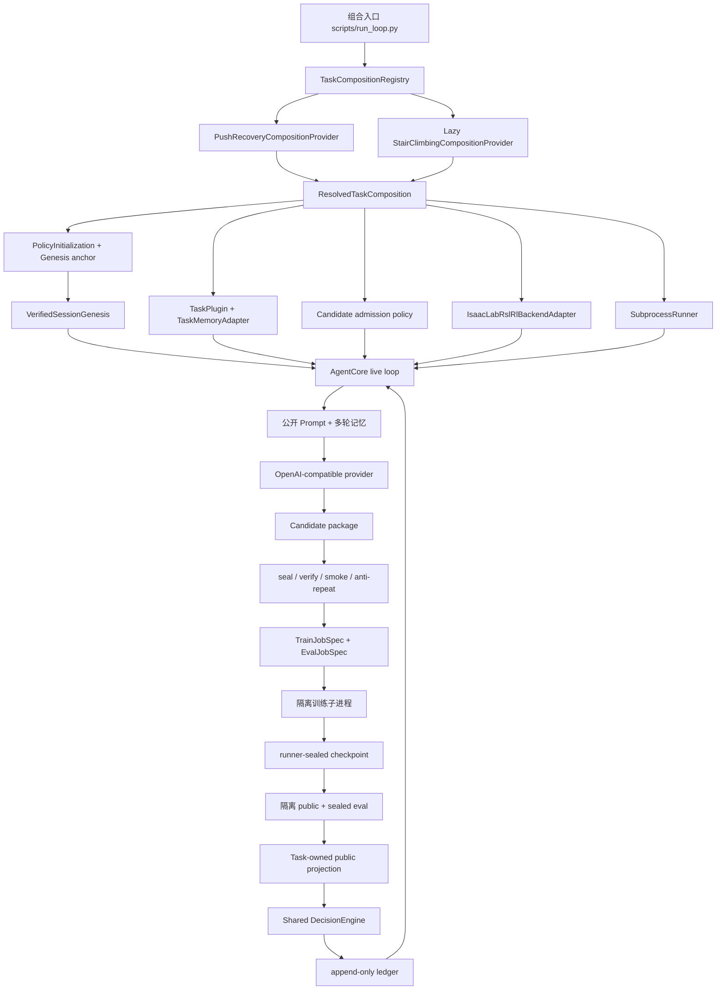

# true_RL_Agent 系统结构、任务插件与代表性实验

> 事实基线：2026-08-05，仓库提交 `a5586d8`。
>
> 本文描述当前 `D:\humanoid_agent\true_RL_Agent` 的生产结构。文中的“真实实验”仅指实际调用 Isaac Lab/RSL-RL 完成训练和评估的记录；dry-run、单元测试和协议探针会单独标明，不当作策略能力结果。

## 1. 系统要解决什么问题

`true_RL_Agent` 是一个独立的人形机器人强化学习策略改进系统。它让 LLM 提出受控的训练代码候选，然后由系统完成静态验证、固定预算训练、隔离评估、接受或拒绝决策，以及跨轮源码继承。

系统希望形成下面的闭环：

```text
冻结任务目标、训练协议和评估协议
              ↓
从 Genesis 恢复 current-best 与当前奖励源码
              ↓
构建只包含公开信息的提示词
              ↓
LLM 生成候选 training_code/components.py
              ↓
封存源码 → 静态验证 → task-owned smoke → 历史机制检查
              ↓
固定训练预算、初始化、PPO 和环境协议进行训练
              ↓
只用 sealed checkpoint 进行 public/sealed 隔离评估
              ↓
共享 DecisionEngine 根据冻结门槛接受或拒绝
              ↓
写入不可变 ledger；只有 accepted 源码成为下一轮父代
```

核心原则不是“让 LLM 直接控制强化学习系统”，而是：

- LLM 只负责提出允许范围内的训练代码假设；
- TaskPlugin 负责定义任务特殊语义；
- Backend 只负责把合同物化为训练/评估作业；
- Runner 负责进程、预算、checkpoint 和可信证据；
- DecisionEngine 负责统一接受规则；
- ledger 和 Genesis 负责可恢复、可重放的事实链。

## 2. 总体架构



### 2.1 生产组合入口

生产 registry 定义在 [`composition/defaults.py`](../src/true_rl_agent/composition/defaults.py)：

- 默认任务是 `unitree_push_recovery`；
- `unitree_stair_climbing` 通过 `LazyTaskCompositionProvider` 延迟加载；
- 仅选择 Stair 时才解析 Stair Final V2 和官方 reference program；
- 选择 Push 不会顺带构造 Stair 环境、reference artifact 或 Isaac Gym 注册。

每个 provider 最终返回同一种 [`ResolvedTaskComposition`](../src/true_rl_agent/composition/base.py)，其中绑定：

- `TaskPlugin`；
- `TaskMemoryAdapter`；
- `BackendAdapter`；
- `Runner`；
- candidate admission policy；
- policy initialization；
- Genesis anchor 类型；
- 经过严格类型校验的 task defaults；
- 可选 baseline 或 verified reference artifact。

组合对象会在子进程启动前检查 task ID、backend 兼容性、候选权限、smoke 能力、初始化方式和 Genesis anchor 是否一致。

### 2.2 共享 AgentCore

共享闭环主要位于 [`agent_core/`](../src/true_rl_agent/agent_core/)：

| 模块 | 职责 |
|---|---|
| `live_loop.py` | 恢复 session、复放 ledger、逐轮 authoring/训练/评估、汇总闭环结果 |
| `live_invocation.py` | 为每次 live 调用建立独立、write-once、非 ledger 权威的生命周期证据：启动时封存 start，退出时尽力封存 exit；仅在正常完成或汇总检查失败时保存并绑定 summary 快照，exit 区分正常完成、中断和失败 |
| `authoring_loop.py` | 限定 provider 尝试次数，处理 JSON/schema/verifier/smoke/历史机制 repair |
| `authoring_checks.py` | 保持稳定的 authoring 检查入口并组装公开 repair 证据，不承载重型执行或 AST 实现 |
| `component_smoke_runtime.py` | 在 spawn 子进程中执行 task-owned fixture、超时与输出形状检查 |
| `component_source_semantics.py` | 归一化并比较候选组件 AST，形成 canonical mechanism delta 与历史重复证据 |
| `round.py` | 执行一个候选从验证到 decision record 的完整生命周期 |
| `decision.py` | 统一消费 candidate surface、评估统计和 required gates |
| `session_genesis.py` | 创建或验证不可变 Genesis 和初始 current-best |
| `ledger.py` | 追加不可变轮次事实，禁止静默覆盖 |
| `context.py` / `experiment_memory.py` | 从公开 ledger 构建有界跨轮记忆 |
| `eval_run_audit.py` | 核对训练、评估、seal、decision 和 ledger 的闭合性 |

AgentCore 不知道“推恢复”或“楼梯高度”的具体含义。它只理解通用合同，例如 `TaskSpec`、`TrainJobSpec`、`PublicEvalResult`、required gates 和 `DecisionRecord`。

### 2.3 候选源码与执行授权

候选包的权威入口是：

```text
candidate_manifest.yaml
training_code/components.py
rationale.md
```

候选必须经过 [`candidates/`](../src/true_rl_agent/candidates/) 下的统一链路：

1. provider 输出 JSON 被严格解析；
2. candidate package 被物化；
3. runner-owned artifact manifest 封存源码字节和 hash；
4. verifier 检查 import、文件、AST、入口和能力边界；
5. task-owned component smoke 用真实 ABI 形状检查输出；
6. anti-degenerate 只从 `build_training_components()` 实际返回的 active component 建立 canonical inventory，并按共享 `authoring_policy.py` 验证最多一个机制 delta；相同、纯参数/文字、已评估等价机制和不可可靠归因的结构会在同轮进入 repair，结构不同的同输入 variant 不再依赖 rationale 中的字面 candidate ID 决定真伪；
7. 只有 verified artifact ref 可以进入 Backend 和 `TrainJobSpec`。

当前 ledger v6 只接受 verifier-owned assessment 投影出的 sealed canonical delta；runtime
activation 只能给该身份补调用与贡献证据，不能重新猜测机制身份。后续 replay 和
experiment memory 都消费这一绑定投影，不保存第二份可分叉的 `kind/name` 结论。

候选不能修改：

- Runner 和 Backend 代码；
- PPO/optimizer；
- 训练预算和 seed policy；
- checkpoint 选择；
- 评估协议、成功定义和 acceptance；
- action/observation space；
- sealed validation 或 ledger。

### 2.4 Backend 与 Runner

当前两个任务共用 [`IsaacLabRslRlBackendAdapter`](../src/true_rl_agent/backends/isaac_lab_rsl_rl.py)，但使用各自的 task-owned profile、entrypoint 和 runtime config。

Backend 的职责是生成强类型作业：

- `TrainJobSpec`：训练 subject、源码身份、TrainingBinding、预算、初始化和 CLI；
- `EvalJobSpec`：sealed checkpoint、EvaluationBinding、split 数量和隔离要求；
- `BaselineEvalJobSpec`：仅在兼容 baseline 路径使用。

[`SubprocessRunner`](../src/true_rl_agent/runner/subprocess_runner.py) 负责：

- 启动白名单可执行文件；
- 在启动前绑定 spec 与 argv；
- 校验 checkpoint 实际字节 SHA-256；
- 运行训练和评估子进程；
- 检查 summary identity；
- 把私有 artifact 与公开结果分离。

候选奖励代码只在训练进程加载。评估进程只加载 sealed checkpoint，不加载 candidate path 或 candidate package，因此评估分数不能由候选奖励函数直接伪造。

### 2.5 训练、评估和接受绑定

系统使用两类核心 binding：

- `TrainingBinding`：绑定任务、训练预算、初始化、策略网络、PPO/optimizer、runtime profile 和源码身份；
- `EvaluationBindingV1`：绑定 task protocol、eval protocol、acceptance protocol 和 seed cohort。

candidate 与 current-best 只有在 EvaluationBinding 完全一致时才允许比较。

acceptance 规则由版本化 `AcceptanceProtocol.decision_rule` 决定。Push 和旧 ledger
继续使用 V2 noise-aware 规则：

```text
先通过全部 task-declared required gates
再满足 absolute_accept_floor
再满足 candidate_score - current_best_score > max(min_delta, pooled_standard_error)
```

生产 Stair 使用 V3 paired-headroom 规则。candidate 与 current-best 必须来自完全
相同的 EvaluationBinding 和固定有序 seed cohort，门槛为：

```text
max(
    min_delta,
    headroom_reduction_fraction * (score_ceiling - current_best_score),
    paired_standard_error_multiplier * paired_delta_standard_error,
)
```

当前 Stair 冻结参数是 `score_ceiling=1.0`、`headroom_reduction_fraction=0.2`、
`paired_standard_error_multiplier=1.5`、`min_delta=0.0`。它消除了接近满分时固定
绝对增量大于剩余提升空间的死区，但仍要求提升同时超过剩余空间比例和同 cohort
配对噪声裕量。决策和 ledger replay 调用同一个门槛计算器；配对样本不进入 LLM
历史摘要。

非策略候选不会冒充策略提升：

- parameter-only：拒绝作为 policy improvement；
- diagnostic-only：只记录 diagnostic improvement；
- engineering-only：只记录 engineering improvement；
- code-level 且 runtime/eval/gates 完整：才可能 accepted。

### 2.6 Genesis、ledger 与源码继承

`VerifiedSessionGenesis` 是每个 session 的不可变起点，绑定：

- task/backend 身份；
- task、training、evaluation、acceptance hash；
- policy initialization；
- 初始 current-best；
- bootstrap、policy baseline 或 reference program anchor；
- 需要时绑定初始策略状态 hash。

每次继续运行前，系统会从 Genesis 和 ledger 复放 current-best。复放失败、身份不一致或 ledger 序列断裂时拒绝继续。

accepted 的含义是“双推进”：

- policy current-best 推进到 accepted checkpoint 的评估统计；
- source current-head 推进到 accepted `components.py`。

下一轮仍按任务冻结的初始化协议重新训练，不会自动从上一轮 accepted checkpoint warm-start。这样奖励机制变化与起始策略变化不会混在一起。

### 2.7 Prompt 与多轮记忆

[`prompting/`](../src/true_rl_agent/prompting/) 负责通用提示词装配，TaskPromptAdapter 负责任务特殊内容。

模型可见内容包括：

- 任务目标和候选权限；
- RewardInputs/输出 ABI；
- 当前 accepted 源码或 reference 源码；
- 最近失败源码；
- public-dev/public-accept 的公开摘要；
- runtime component 激活证据；
- 相对 accepted 头部新增、但可能被高幅值基线项挤出排序的候选运行组件；
- 最近轮次和 best nonaccepted；
- verifier/smoke/provider repair feedback。

模型不可见内容包括：

- raw private/sealed seed；
- checkpoint 本地路径；
- sealed rollout 细节；
- Runner 私有配置和 secret；
- acceptance 的可修改入口。

完整 ledger 和 prompt artifacts 永久保留；模型可见记忆则经过 [`TaskMemoryAdapter`](../src/true_rl_agent/memory/task_adapter.py) 和固定字节/轮次上限压缩。

## 3. 目录结构

| 路径 | 内容 |
|---|---|
| `src/true_rl_agent/agent_core/` | 多轮闭环、decision、Genesis、ledger、replay |
| `src/true_rl_agent/composition/` | 生产 registry、任务选择和一次性组合解析 |
| `src/true_rl_agent/tasks/` | TaskPlugin 公共接口及任务私有实现 |
| `src/true_rl_agent/candidates/` | 候选 schema、artifact、verifier、smoke 前合同 |
| `src/true_rl_agent/backends/` | Isaac Lab/RSL-RL 作业物化 |
| `src/true_rl_agent/runner/` | 作业执行、checkpoint、argv、证据和隔离 |
| `src/true_rl_agent/evaluation/` | binding、统计、sealed evidence、acceptance/replay |
| `src/true_rl_agent/prompting/` | provider-facing prompt 组装与安全检查 |
| `src/true_rl_agent/memory/` | 通用公开记忆接口 |
| `src/true_rl_agent/safety/` | trusted eval seal 和安全不变量 |
| `configs/` | task/backend/agent 冻结配置和协议 |
| `scripts/` | 生产入口、Isaac train/eval 和阶段探针 |
| `tests/` | 单元、集成、边界和故障注入测试 |
| `PLAN/` | 阶段计划、实施记录和真实实验审计 |
| `runs/` | 本地 audit/dry-run 产物；不能自动视为真实 RL 实验 |

## 4. 已接入任务一：Unitree Push Recovery

### 4.1 任务目标

Task ID：`unitree_push_recovery`。

目标是在 Unitree G1 站立状态受到 runner-owned 平面 x/y push 后：

- 不跌倒；
- 恢复姿态；
- 恢复目标速度状态；
- 限制持续漂移和不稳定动作。

当前权威实现位于 [`tasks/push_recovery/`](../src/true_rl_agent/tasks/push_recovery/)。

### 4.2 初始化和训练协议

默认生产组合：

- `PolicyInitialization.random()`；
- Genesis anchor：`bootstrap`；
- 4096 个训练环境；
- 每个 iteration 每环境 24 步；
- 500 iterations；
- 总预算 `49,152,000 env-steps`；
- RSL-RL PPO MLP：`512, 256, 128`；
- train/eval profile：`strong_push`；
- 默认 checkpoint selector：runner-sealed best public-dev。

Push TaskSpec 声明支持 random 和 warm_start，但当前默认 composition 使用 random bootstrap。warm_start 只有在显式提供并验证 `BaselineManifest` 时才允许进入。

### 4.3 LLM 可修改什么

Push 当前是“在基础环境奖励上增加受控组件”的模型：

- `RewardTerm`：训练侧附加奖励；
- `DiagnosticTerm`：公开诊断，不直接决定接受；
- `reward_weight_scale_schedule`：参数/调度能力，但不能单独作为策略提升接受。

训练 wrapper 最终执行：

```text
environment reward + candidate reward terms
```

候选可使用 task-owned `PushRecoveryRewardInputs`，包括姿态、速度、位置、关节、动作变化，以及当前步公开 push signal。它拿不到 env、runner、optimizer、checkpoint selector 或 eval internals。

### 4.4 评估和反馈

当前配置为：

- public-dev：3 seeds；
- public-accept：3 seeds；
- sealed validation：7 seeds；
- 每个 split 64 个并行 eval env；
- success predicate：`no_fall_and_recovers_velocity_after_push`；
- absolute floor：0.05；
- min policy delta：0.05。

公开反馈包含 success、fall、push drift、timeout、motion quality 和 runtime reward/diagnostic 激活摘要。push 的特殊失败语义只存在于 Push 插件和适配器中。

### 4.5 代表性实验：15 轮真实 live 闭环

仓库记录：[`PLAN/prompt/Step13/step13_multiround_live_validation.md`](../PLAN/prompt/Step13/step13_multiround_live_validation.md)。

服务器历史 run：

```text
/data/yuyangliu/AGENT/true_RL_Agent/
runs/live_15round_prompt_step13_20260702T192853Z
```

实验设置：

- 15 个训练轮次；
- 每轮固定 `4096 × 24 × 500 = 49,152,000 env-steps`；
- 21 次 provider attempt，15 个候选实际进入训练/ledger；
- 3 个 accepted，12 个 rejected；
- provider failure 为 0；
- 最终 best public score 为 `0.84375`。

代表性轮次：

| Round | Candidate | Public score | Decision | 说明 |
|---|---|---:|---|---|
| R1 | `push_recovery_v2` | 0.000000 | reject | required gate 失败，fall-dominated 反馈进入下一轮 |
| R2 | `push_recovery_v3` | 0.484375 | accept | 首次越过 absolute floor，建立 policy current-best |
| R3 | `push_recovery_v5` | 0.671875 | accept | 满足 noise-aware delta |
| R5 | `push_recovery_v7_balanced` | 0.515625 | reject | 有能力但没有超过 current-best 阈值 |
| R15 | `push_recovery_v21_fall_risk_penalty` | 0.843750 | accept | 最终 accepted head |

该实验代表性在于它同时验证了：

- provider repair 不会把未通过 verifier 的稿件送入训练；
- code-level 候选真实执行并产生 runtime activation；
- public failure 和 `noise_aware_delta_not_met` 会进入后续 prompt；
- parameter-only 候选没有被当作策略提升；
- 15 轮 prompt、ledger 和 accepted lineage 能持续闭合。

限制：这是 Push 自己的 500-iteration 协议结果，不能与 Stair 的 2000-iteration、七桶宏平均分数直接比较。

## 5. 已接入任务二：Unitree G1 Stair Climbing

### 5.1 任务目标

Task ID：`unitree_stair_climbing`。

目标是让 G1 从底部平台沿 +x 方向爬上单向楼梯，到达顶部平台并保持稳定。

当前生产实现位于 [`tasks/stair_climbing/`](../src/true_rl_agent/tasks/stair_climbing/)，其设计和运行边界见 [`task_extension_guides/stair_climbing.md`](task_extension_guides/stair_climbing.md)。

### 5.2 初始化和 reference program

Stair 不使用 Phase 0 官方 rough-locomotion checkpoint warm-start。正式循环是：

1. 把 Isaac Lab 官方 G1 rough locomotion 的完整奖励转录为 R0 `training_code/components.py`；
2. 从固定随机初始化训练 R0；
3. 用 R0 的正式 public/sealed 结果创建 reference-program Genesis；
4. 每个 R1/R2/... 候选仍从相同固定随机初始化协议重新训练；
5. 只有 accepted 奖励源码成为下一轮父代，accepted checkpoint 不作为下一轮训练起点。

Stair 生产入口要求已有 reference Genesis：

- [`create_stair_reference_genesis.py`](../scripts/create_stair_reference_genesis.py)：preflight/create/load-only；
- [`run_stair_live.py`](../scripts/run_stair_live.py)：强制选择 Stair、live mode 和 existing Genesis；
- [`materialize_stair_job.py`](../scripts/materialize_stair_job.py)：Stair 专用作业物化包装。

### 5.3 固定训练和评估协议

Final V2 绑定：

- 4096 个训练环境；
- 每环境 24 步/iteration；
- 2000 iterations；
- 总预算 `196,608,000 env-steps`；
- policy initialization：random；
- checkpoint selector：final iteration；
- 训练楼梯高度范围由 Final V2 的 runner-owned 单一权威合同固定为 `0.05-0.35 m`，task-owned terrain curriculum 在 10 个难度行间推进；reference 与所有 candidate 使用完全相同的分布，历史 Phase D pilot 仍保留其原有 `0.05-0.20 m` 证据但不再被表述为当前正式训练分布；
- PPO、网络和 optimizer hash 进入 TrainingBinding。

固定评估网格：

```text
高度：0.10, 0.15, 0.20, 0.25, 0.30, 0.35, 0.40 m
踏深：0.30, 0.35, 0.40, 0.45, 0.50 m
```

高度 `0.40 m` 是唯一保留的 OOD frontier；训练踏深固定为 `0.40 m`。评估同时保留
`0.40 m` 踏深的七高度等权分数作为 in-distribution 非退化锚点，并以 35 个高度/踏深
cell 的等权宏平均作为候选接受目标。高度或踏深方向上的非单调倒置只作诊断，不直接形成
接受门槛。

评估设计：

- public-dev：3 seeds；
- public-accept：5 seeds；
- sealed validation：7 seeds；
- 每个 seed、每个高度/踏深 cell 8 个 first episode；
- 每个 seed 使用 280 个并行 eval env，一次覆盖全部 35 个 cell；
- 每个 seed 先对 35 个 cell 等权宏平均，再跨 seed 计算 mean/std/SE；标准误的样本单位是
  seed macro，不把同一 seed 内的 280 个 episode 伪装成独立 seed；
- sealed split 的 runner summary 额外保存 canonical per-seed × 35-cell × primary-reason 整数计数
  私有摘要，并将其哈希绑定到 checkpoint、evaluation/training binding 与 subject；sealed
  aggregate 从同一摘要派生，公开 prompt 只接收 gate 投影，不接收该私有摘要；
- `0.40 m` anchor 的 episode 长度保持 12 秒；其他踏深按各自目标进度相对 anchor
  等比缩放并取最近 control step，`0.30/0.35/0.40/0.45/0.50 m` 分别为
  `9.8/10.9/12.0/13.1/14.2 s`。Isaac 共享 batch 运行到最长时限，task-owned tracker
  在每个 cell 自己的截止步闭合 timeout；
- 固定前进指令 0.8 m/s；
- acceptance 要求 35-cell generalization 目标满足 paired-headroom 提升，同时 `0.40 m`
  踏深锚点相对 current-best 的回退不得超过 `0.02`；该固定小带宽与既有五种子 anchor
  噪声同量级，用于避免饱和 guard 因有限样本波动锁死循环。二者来自同一批 task-owned
  first-episode evidence；
- active success 与失败分类由 [`stair_evaluation_semantics_v6.json`](../configs/tasks/stair_evaluation_semantics_v6.json) 单源定义：首次到达对应踏深的顶部目标时，root 必须位于自己的顶部平台范围、具备足够净空且姿态稳定，并至少有一只位于顶层表面附近的脚提供不少于 10 N 的向上支撑；该事件只锁存 `first_valid_top_arrival_achieved` 诊断。随后在固定前向指令下连续 20 个 control steps 保持有效顶层支撑、且支撑脚平面速度不超过 0.5 m/s，才形成 primary success，并由现有 objective、guard 与 sealed 统一计分。到顶后、稳定成功前发生 torso contact、fall 或 off-course 会按既有优先级判失败，并记录 `post_arrival_safety_failure_detected`；一直未稳定到 cell deadline 则判 timeout。fall 的支撑面仍受接触脚 x 投影与脚踝垂直位置约束，投影台阶表面不得高于脚踝超过冻结的 `0.03 m` 容差。timeout 只引用 evaluation profile 的 cell deadline，不保存第二份固定秒数。

该升级生成新的 evaluation-semantics hash 与 effective task-protocol hash，并通过新的
`task_protocol_hash` 形成新的 EvaluationBinding 和 Genesis；冻结的 EvaluationProtocol 与
AcceptanceProtocol 配置及各自 hash 不变。旧语义结果（包括 eval-v5 35-cell 结果）只能用于历史
诊断，不能与新语义结果混入同一个 current-best 或 ledger epoch；每轮新实验必须从 R0 在新语义下
重新建立 Genesis。扩大并行 batch 会改变有限样本的 reset 轨迹，因此锚点保证的是冻结任务分布和
新 epoch 内部的严格可比性，不声称逐 episode 复现旧协议分数。

eval-v5 的冻结语义快照不再与 active task 配置并列保存；已完成的正式运行产物绑定其 hash，仓库
历史仍保留精确字节。active loader 始终只接受 v6，因此当前 checkout 不再包含一个无法加载、
却看起来像现行配置的 v5 JSON，也没有引入多版本运行入口。

primary outcome 必须闭合为：

- success；
- torso contact；
- fall；
- off-course；
- base orientation instability；
- slip；
- insufficient clearance；
- timeout。

在 active v6 中，torso contact、fall 和 off-course 在 stable success 形成前都会永久阻断本
episode 的成功；若它们发生在首次有效到顶之后、稳定成功之前，还会记录 post-arrival safety
failure，并按既有优先级形成 primary failure。stable success 一旦锁存，tracker 会在该
transition 立即闭合 episode，因此不存在“成功后继续观察、再以失败诊断但不撤销成功”的 active
v6 路径；那是冻结 eval-v5 的历史语义。orientation、slip 和 clearance 的历史持续触发保留为
diagnostic，只有信号在未成功 episode 终止时仍满足各自冻结的连续步数阈值，才可成为 primary
failure，否则终局原因保持 timeout。

### 5.4 LLM 可修改什么

Stair 与 Push 的关键区别是“完整奖励替换”。普通候选只能提交一个新的完整：

```text
training_code/components.py
```

它接收 detached-clone 的 `StairRewardInputsV2`，输出唯一权威 complete reward。PPO、episode accumulator、训练日志和 runtime evidence 消费同一个 pre-reset reward 结果。

Stair prompt 的 task-owned 输入语义额外明确：`base_height` 与 `base_pos_relative_to_terrain_origin[:, 2]` 是同一 canonical 值，参考系原点位于底部起始平台，因此它包含已爬台阶的累计高度，不是机器人相对当前支撑台阶的离地间隙。候选应使用 `roll`/`pitch` 或 `projected_gravity` 判断姿态，使用 `goal_progress_fraction` 判断接近楼顶，并使用接触字段判断支撑。

候选源码、verifier 和 runtime evidence 是机制事实的权威来源；rationale 仅用于解释。rationale 若声称奖励上下界，必须把条件因子、函数内部 clamp、`RewardTerm` clip 和 weight 全部计入，否则不应给出数值上界。

候选不能修改 terrain、height bins、curriculum、评估、PPO、初始化、成功/失败定义或 acceptance。当前 Stair 也没有开放 LLM curriculum capability。

### 5.5 代表性实验一：Phase 0 checkpoint 兼容性探针

证据：[`PLAN/stair/phase0_report.json`](../PLAN/stair/phase0_report.json)。

这是兼容性/可行性探针，不是正式训练：

- 使用 Isaac Lab 2.3.0 官方 `Isaac-Velocity-Rough-G1-v0` checkpoint；
- 验证 G1 body/joint、310 维 observation、37 维 action、terrain origin、termination term 和 checkpoint 安全；
- 56 个环境各记录一个完整 12 秒 first episode；
- 56/56 到达第一阶附近；
- 随后都因 base contact 终止并触发 fall diagnostic；
- stair success 为 `0/56`。

结论是 checkpoint 与 runtime schema 兼容，但不具备目标楼梯能力。因此它没有成为 warm-start、current-best、Genesis 或 acceptance evidence。

### 5.6 代表性实验二：正式 R0 reference Genesis

证据：[`PLAN/stair/phase_e_completion_manifest.json`](../PLAN/stair/phase_e_completion_manifest.json)。

R0 使用官方完整奖励源码，从随机策略按正式 2000-iteration 预算训练：

| 指标 | 结果 |
|---|---:|
| Public-accept mean | 0.5464285714 |
| Public-accept SE | 0.0174963553 |
| Sealed mean | 0.5586734694 |
| Sealed SE | 0.0121452864 |
| Reference low-step macro success | 0.95 |
| 训练 checkpoint iteration | 1999 |

R0 通过 reference capability gate 后成为 Stair session 的初始 current-best 和源码父代。这里锚定的是“奖励源码 + 从零训练后的正式能力”，不是 Phase 0 checkpoint。

### 5.7 代表性实验三：Phase G 15 轮完整奖励源码进化

完整审计：[`PLAN/stair/phase_g_15round_experiment_audit.md`](../PLAN/stair/phase_g_15round_experiment_audit.md)。

服务器历史 run：

```text
/data/yuyangliu/true_rl_agent_phase_g/
formal_15round_eb4ede9_20260804T063045Z
```

实验设置：

- 15/15 候选完成训练；
- 15/15 完成 public 七桶评估；
- 15/15 完成 sealed validation；
- 每个候选固定 `196,608,000 env-steps`；
- 相同 TrainingBinding 和 initial policy state；
- 2 个 accepted，13 个 rejected；
- eval incomplete 为 0；
- 24 份不可变 provider-attempt prompt。

代表性轮次：

| Round | Candidate | Public | Sealed | Decision | 主要现象 |
|---|---|---:|---:|---|---|
| R1 | `stair_repair_v1` | 0.253571 | 0.275510 | reject | base contact 占主导 |
| R2 | `stair_base_force_v1` | 0.546429 | 0.528061 | reject | 与 R0 持平，未达到 min delta |
| R6 | `stair_contact_stability_v1` | 0.000000 | 0.000000 | gate reject | fall 约 80.7% |
| R9 | `stair_stable_progress_v2` | 0.589286 | 0.576531 | **accept** | 在稳定姿态条件下增加目标进度机制 |
| R13| `stair_stable_clearance_v2` | 0.000000 | 0.000000 | gate reject | 无界接触贡献导致 100% base contact |
| R14| `stair_stable_progress_contact_v3` | 0.621429 | 0.602041 | **accept** | 把接触惩罚限制到最大约 0.4 |
| R15| `stair_balanced_footing_v1` | 0.396429 | 0.387755 | reject | 新增脚部平衡项贡献过小 |

源码继承链：

```text
R0 official reference
  └─ R1 ... R9
       └─ R9 accepted source
            └─ R10 ... R14
                 └─ R14 accepted source
                      └─ R15 rejected，最终 head 保持 R14
```

最终 R14 的 public 七桶成功率：

| 高度 | 0.10 | 0.15 | 0.20 | 0.25 | 0.30 | 0.35 | 0.40 |
|---|---:|---:|---:|---:|---:|---:|---:|
| Success | 0.775 | 0.900 | 1.000 | 0.975 | 0.675 | 0.025 | 0.000 |

相对 R0：

- public 宏平均绝对提升 `0.075`；
- 0.30 m 从 `0.175` 提升到 `0.675`；
- base-contact failure 从 `0.378571` 降到 `0.25`；
- 0.10/0.15 m 有回退；
- 0.35 m 只有极低成功率；
- 0.40 m 仍为 0。

因此系统已经证明“完整奖励源码能够在受控闭环中真实进化并被接受”，但没有证明楼梯任务已经完全解决。

### 5.8 Checkpoint 行为可视化

[`isaaclab_stair_checkpoint_video.py`](../scripts/isaaclab_stair_checkpoint_video.py) 可以对一个 byte-verified Stair checkpoint 在当前 35-cell、280-env public-dev profile 中捕获指定高度/踏深 cell 的三个环境真实轨迹，然后离线渲染 MP4，并保存：

- checkpoint 和视频 hash；
- trajectory NPZ；
- protocol/profile/cell/env identity；
- episode outcome；
- 同一次 canonical rollout 的全部 280 个环境、35-cell 成功率及高度/踏深边缘值；
- camera/render manifest。

直接用 Isaac Python 执行该脚本即可。第一次运行会按照项目内的
[`stair_checkpoint_video_renderer.txt`](../requirements/stair_checkpoint_video_renderer.txt)
精确版本锁，在
`outputs/runtime_dependencies/stair_checkpoint_video_renderer/<environment-id>/`
自动建立内容寻址的隔离 venv；离线渲染 worker 使用该 venv 的 `python -I`，只从该环境加载
`pybullet/imageio/opencv/numpy` 等包。这个过程不会安装或修改服务器全局、Isaac 或用户
site-packages，也不需要手工设置外部 `PYTHONPATH`。依赖锁 hash、实际包版本、Python/平台
身份和隔离状态均写入视频 manifest。首次建立环境需要访问 Python 包源，后续复用通过完整
import/version probe 的同一内容寻址目录。

```bash
<ISAAC_PYTHON> scripts/isaaclab_stair_checkpoint_video.py \
  --checkpoint <CHECKPOINT_PT> \
  --checkpoint-sha256 sha256:<CHECKPOINT_SHA256> \
  --robot-urdf <G1_URDF> \
  --output-dir outputs/stair_checkpoint_videos/<FRESH_OUTPUT> \
  --label <LOWERCASE_LABEL> \
  --cell-id stair_040__tread_500 \
  --device cuda:0
```

命令不应附加任何项目外 renderer `PYTHONPATH`；`output-dir` 必须是尚不存在的新目录，且
`cell-id` 必须来自当前冻结 profile。高级诊断也可改用 `--env-indices <ENV_A> <ENV_B> <ENV_C>`，但三个环境必须属于同一个 cell。

视频中的三个机器人用于行为审计；manifest 中的 280 环境统计来自同一次 task-owned episode
状态机，只做聚合、不重新判定。轨迹捕获使用正式 profile 的 terrain、cell deadline、seed
binding 和 pre-reset 终态；离线 renderer 只重放状态，不重新计算物理。单个 public-dev run
仍不等价于完整 public/sealed 多 run 数值评估，也不进入 acceptance。

## 6. 两个任务插件的关键差异

| 维度 | Push Recovery | Stair Climbing |
|---|---|---|
| Task ID | `unitree_push_recovery` | `unitree_stair_climbing` |
| Registry | 默认 eager provider | lazy provider |
| 默认初始化 | random | random |
| Genesis anchor | bootstrap | reference program |
| 候选模型 | 基础奖励 + additive RewardTerm | 完整奖励源码替换 |
| 训练预算 | 4096 × 24 × 500 | 4096 × 24 × 2000 |
| Checkpoint | best public-dev | final iteration |
| Public-accept seeds | 3 | 5 |
| Sealed seeds | 7 | 7 |
| Eval 结构 | 64 env push recovery | 280 env、35 个高度/踏深 cell |
| 任务反馈 | fall、drift、recovery、motion quality | 高度/踏深 success、progress、primary failure、diagnostics |
| Curriculum 权限 | metadata 存在但当前 LLM 不生效 | 当前为空，不开放 |
| 代表性最终记录 | 15 轮 final best 0.84375 | 新协议须由新 R0 epoch 重新建立；旧分数不可沿用 |

这些数字属于不同任务、不同预算和不同 score definition，只能在各自任务内比较，不能用于判断哪一个任务“更强”。

## 7. 共享边界与任务私有边界

### 7.1 必须保持共享的能力

- candidate artifact/seal/verification；
- `TrainJobSpec` / `EvalJobSpec`；
- subprocess 安全和 checkpoint 预检；
- TrainingBinding / EvaluationBinding；
- public/sealed evidence 基础合同；
- DecisionEngine；
- Genesis、ledger、replay；
- prompt 公共安全和 source lineage；
- 进程 lease、artifact layout 和 resume。

### 7.2 必须留在任务包内的语义

- success/failure 定义；
- terrain、push 或目标分布；
- task RewardInputs；
- runtime recorder/decoder；
- failure taxonomy；
- public metric projection；
- task prompt 和 memory；
- task-specific smoke；
- seed/bin resolver；
- reference qualification。

新任务不能通过在 AgentCore、Runner 或 DecisionEngine 中增加 task ID 分支来接入。

## 8. 如何接入第三个任务

合理路径是：

1. 在 `tasks/<new_task>/` 创建独立包；
2. 定义 task-owned config 和 protocol hash；
3. 实现 `TaskPlugin`、prompt adapter、memory adapter、component smoke；
4. 定义严格 candidate capability profile；
5. 实现 train/eval runtime profile 和公开投影；
6. 复用共享 Backend/Runner，或新增不含任务语义的 BackendAdapter；
7. 实现 composition provider；
8. 先 staging 注册，再进入 production registry；
9. 建立 baseline/reference Genesis；
10. 通过单轮真实训练、隔离评估、ledger replay 和默认 Push 不退化验收。

如果未来开放 curriculum、terrain progression、domain randomization 或新的 observation feature，应新增经过验证的 capability，而不是让候选直接访问 env 或修改任务协议。

## 9. 当前成熟度和已知边界

### 已经完成

- 两个任务在同一生产 composition registry 中接入；
- Push 默认路径与 Stair lazy 路径隔离；
- candidate 源码封存、验证、smoke、训练、隔离 eval、decision、ledger 全链闭合；
- baseline/reference Genesis 和 replay 可用；
- public/sealed split 与 candidate eval isolation 已实现；
- task-owned prompt、memory、failure 和 public projection 已实现；
- Push 与 Stair 都有真实多轮训练实验；
- Stair 已产生两次 accepted 完整奖励源码推进。

### 仍需谨慎解释

- 当前 acceptance 更适合搜索排序，不等于多训练 seed 的科研级因果证明；Stair
  的配对门槛减少固定 eval cohort 的随机波动，但不能消除多轮搜索对该 cohort 的过拟合；
- Push 代表性实验采用 500 iterations，Stair 采用 2000 iterations；
- Stair R14 主要提升中等高度，0.40 m 尚未突破；
- Stair accepted 机制尚未通过多训练 seed 和消融证明因果归因；
- checkpoint 视频只能辅助识别行为问题，不能取代冻结评估；
- 当前 LLM 仍不能修改课程、PPO、训练预算和评估协议。

## 10. 关键追溯入口

- 生产 registry：[`composition/defaults.py`](../src/true_rl_agent/composition/defaults.py)
- 共享组合合同：[`composition/base.py`](../src/true_rl_agent/composition/base.py)
- 共享 live loop：[`agent_core/live_loop.py`](../src/true_rl_agent/agent_core/live_loop.py)
- live 调用生命周期：[`agent_core/live_invocation.py`](../src/true_rl_agent/agent_core/live_invocation.py)
- 单轮执行：[`agent_core/round.py`](../src/true_rl_agent/agent_core/round.py)
- DecisionEngine：[`agent_core/decision.py`](../src/true_rl_agent/agent_core/decision.py)
- Runner：[`runner/subprocess_runner.py`](../src/true_rl_agent/runner/subprocess_runner.py)
- Backend：[`backends/isaac_lab_rsl_rl.py`](../src/true_rl_agent/backends/isaac_lab_rsl_rl.py)
- Push plugin：[`tasks/push_recovery/plugin.py`](../src/true_rl_agent/tasks/push_recovery/plugin.py)
- Push 15 轮记录：[`Step13 多轮 Live/Audit 验收记录`](../PLAN/prompt/Step13/step13_multiround_live_validation.md)
- Stair plugin：[`tasks/stair_climbing/plugin.py`](../src/true_rl_agent/tasks/stair_climbing/plugin.py)
- Stair Final V2：[`configs/tasks/stair_protocol_v2.json`](../configs/tasks/stair_protocol_v2.json)
- Stair R0 manifest：[`phase_e_completion_manifest.json`](../PLAN/stair/phase_e_completion_manifest.json)
- Stair 15 轮审计：[`phase_g_15round_experiment_audit.md`](../PLAN/stair/phase_g_15round_experiment_audit.md)
- 扩展边界：[`extension_and_boundary_guide.md`](extension_and_boundary_guide.md)
